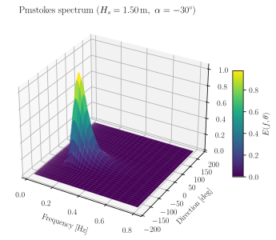
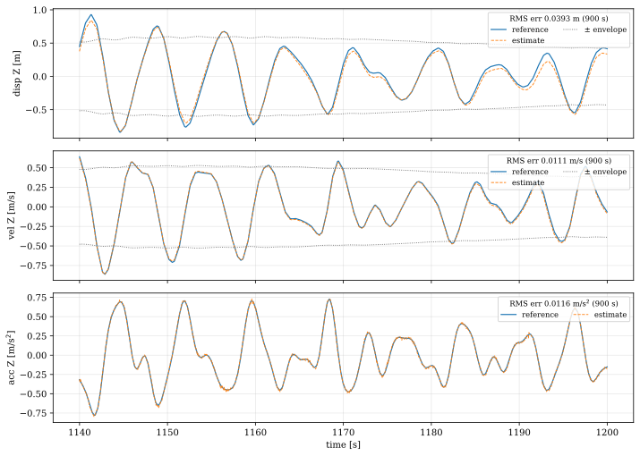
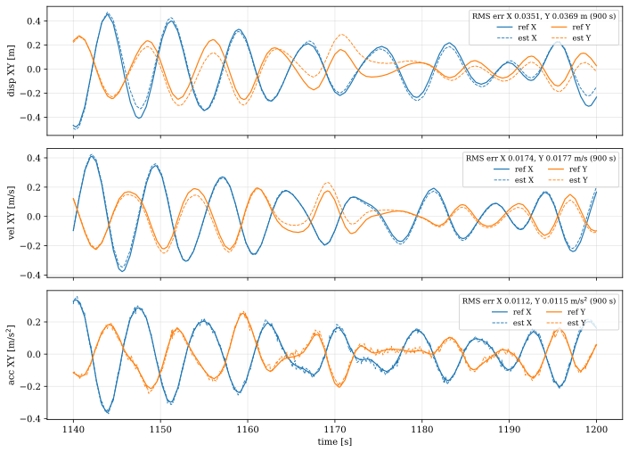
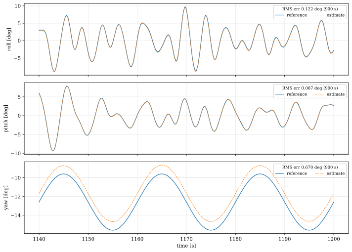
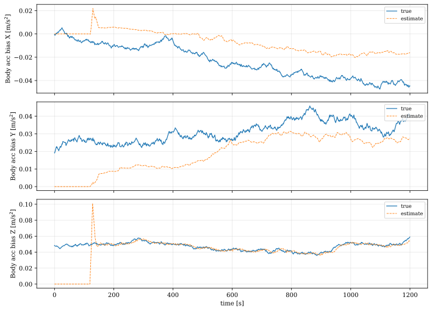
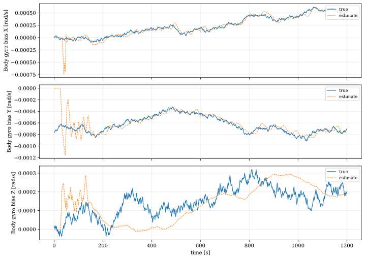
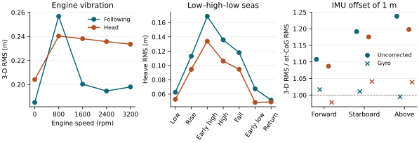
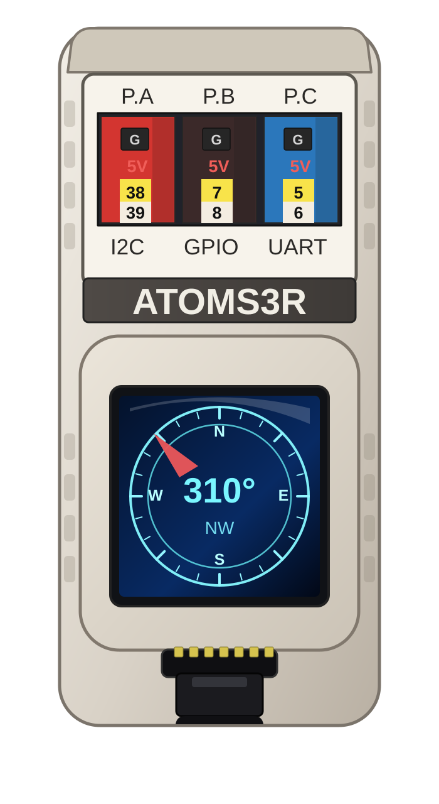

# ocean-imu

Marine IMU and wave-processing algorithms in modern C++ for sensor fusion, sea-state estimation, and simulation-driven validation.
Designed for ship MRU (Motion Reference Unit), Marine INS (Inertial Navigation System), AHRS (Attitude and Heading Reference System).

The primary marine INS method is the **27-state shared-mode TFG–CARMA(4,1) filter**. It estimates attitude, heading, sensor biases and wave-relative surge, sway and heave. Its two-frame Lie group carries attitude and motion together during corrections. Its CARMA prior uses measured cross-axis coupling when the wave record supports it.

[Method article](doc/kalman_tfg_shared_modes/kalman_tfg_shared_modes-method.tex) · [Main-build PDF](https://github.com/bareboat-necessities/ocean-imu/releases/download/vTest/kalman_tfg_shared_modes-method.pdf) · [AtomS3R sketch](sensors/full_marine_ins/atomS3R_ins_tfg_carma_shared_modes/) · [Simulation results](#results)

## Motivation

A marine AHRS cannot just reuse typical popular drone and aerospace IMU filters unchanged. In aerospace, motion is usually modeled as rotation about the center of mass (satellite), and drones often initialize while sitting still before takeoff, so the accelerometer gives a clean gravity direction. On a ship, the system may be turned on while already moving in waves and wind, with heave, roll, pitch, and translational accelerations all mixed into the IMU signals. That means the filter has to learn tilt during motion, avoid trusting wave-distorted acceleration as pure gravity, and keep working across very different sea conditions. In practice, a ship AHRS/INS needs wave-aware initialization, motion compensation, and tuning that can adapt to different sea states dynamically.

The algorithms presented here not only implement tilt-compensated compass and basic roll/pitch/rate-of-turn sensors, they provide corrections for wave induced motion,
and additionally reconstruct 3D displacement of a vessel (heave - strongly observable, surge/sway - weakly) in real-time and estimate apparent (to the vessel being observer) waves direction.

The code of filters is written in C++ and can run on a microcontroller such as esp32 or on a regular computer. The compass calibration implemented as a part of this library can be run directly on your microcontroller unit. The testing framework uses Stokes/Airy waves with Pierson-Moskowitz or JONSWAP spectrums and a choice of a directional spread model (cosine by default).

## Methods

The articles describing the math behind the methods:

INS Filters:

- [Shared-mode TFG–CARMA(4,1) method and implementation](https://github.com/bareboat-necessities/ocean-imu/releases/download/v2.8.4/kalman_tfg_shared_modes-method.pdf)

- [Adaptive Shared-Mode CARMA(4,1) QMEKF](https://github.com/bareboat-necessities/ocean-imu/releases/download/v2.8.4/kalman_carma_shared_modes.pdf)

- [CARMA(4,1) QMEKF](https://github.com/bareboat-necessities/ocean-imu/releases/download/v2.8.4/kalman_carma.pdf)

- [CARMA(4,1) Two-Frame Lie-Group Filter (TFG)](https://github.com/bareboat-necessities/ocean-imu/releases/download/v2.8.4/kalman_tfg_carma.pdf)

- [Two-Frame Lie-Group Filter (TFG)](https://github.com/bareboat-necessities/ocean-imu/releases/download/v2.8.4/kalman_tfg.pdf)

- [3D Wave Kalman with OU](https://github.com/bareboat-necessities/ocean-imu/releases/download/v2.8.4/kalman_ou-w3d.pdf)

- [OU-III stability study](https://github.com/bareboat-necessities/ocean-imu/releases/download/v2.8.4/kalman_ou-w3d-stability-study.pdf)

- [PII Observer](https://github.com/bareboat-necessities/ocean-imu/releases/download/v2.8.4/pii_observer-model.pdf)

- [Non-Linear Observer NLO](https://torarnj.folk.ntnu.no/TimeVarGain.pdf)

Heave-only filters (comparison baselines, see [docs/heave-only.md](docs/heave-only.md)):

- [Godhavn Standard Heave Filter and Richter Zero-Displacement Filter](https://skoge.folk.ntnu.no/prost/proceedings/ifac2014/media/files/0111.pdf)

- [Küchler Harmonic-Mode EKF](https://skoge.folk.ntnu.no/prost/proceedings/ifac11-proceedings/data/html/papers/1935.pdf)

Research Studies:

- [Wave Direction](https://github.com/bareboat-necessities/ocean-imu/releases/download/v2.8.4/kalman-wave-dir.pdf)

- [INS Filters Startup](https://github.com/bareboat-necessities/ocean-imu/releases/download/v2.8.4/ins-startup.pdf)

- [GNSS Fusion](https://github.com/bareboat-necessities/ocean-imu/releases/download/v2.8.4/kalman-gnss-fusion.pdf)

- [Stochastic Marine Motion](https://github.com/bareboat-necessities/ocean-imu/releases/download/v2.8.4/stochastic-marine-motion.pdf)

IMU Calibration:

- [IMU Calibration Method](https://github.com/bareboat-necessities/ocean-imu/releases/download/v2.8.4/imu_calibrate-method.pdf)

Frequency tracking:

- [KalmANF Frequency Tracker](https://github.com/bareboat-necessities/ocean-imu/releases/download/v2.8.4/freq-tracking_adaptive_notch_kalman.pdf)

- [Aranovskiy Frequency Tracker](https://github.com/bareboat-necessities/ocean-imu/releases/download/v2.8.4/freq-tracking_aranovskiy.pdf)

- [PLL Frequency Tracker](https://github.com/bareboat-necessities/ocean-imu/releases/download/v2.8.4/freq-tracking_pll.pdf)

- [Zero Crossing Frequency Tracker](https://github.com/bareboat-necessities/ocean-imu/releases/download/v2.8.4/freq-tracking_zero_crossing.pdf)

Wave Models:

- [Wave Models](https://github.com/bareboat-necessities/ocean-imu/releases/download/v2.8.4/wave_sim-waves.pdf)

- [Fenton Waves](https://github.com/bareboat-necessities/ocean-imu/releases/download/v2.8.4/wave_sim-fenton.pdf)

- [Spectral Models](https://github.com/bareboat-necessities/ocean-imu/releases/download/v2.8.4/wave_sim-spectral.pdf)

- [Sea Metrics](https://github.com/bareboat-necessities/ocean-imu/releases/download/v2.8.4/spectrum-sea_metrics.pdf)

- [Vessel RAO](https://github.com/bareboat-necessities/ocean-imu/releases/download/v2.8.4/wave_sim-vessel-RAO.pdf)

Autopilot Use Cases:

- [Algorithmic Methods in Open Source Marine Autopilots](https://github.com/bareboat-necessities/ocean-imu/releases/download/v2.8.4/autopilots-methods.pdf)

There are several versions of Kalman INS filters and two filters (PII observer and NLO) based on control theory:

- Shared-mode TFG–CARMA(4,1) combines 18 wave-motion coordinates, three attitude errors and six sensor-bias errors. The shared-mode QMEKF uses the same wave prior with quaternion error coordinates. Independent-axis CARMA variants provide comparisons for both geometries.
- OU-III uses higher-order integral drift correction in a 21-state Kalman filter.
- TFG is a right-invariant two-frame Lie-group error-state EKF. Same 21 dimensional state and the same OU wave model as OU_III, but attitude, the world-frame kinematic states and the body-frame biases live on one group, so an attitude correction rotates velocity, position, integral displacement and wave acceleration coherently instead of leaving them behind.
- OU_II uses more direct integral drift correction and is more responsive to sea-state changes. It is an 18-dimensional-state Kalman filter.
- PII observer is based on control theory. It is very computationally light-weight with no matrix operations. It's less accurate than Kalman filters.
- NLO is a time-varying-gain nonlinear observer. It uses explicit attitude and translational injection terms with the gains published by Bryne/Fossen/Johansen instead of a propagated covariance, and its translational loop is scheduled on the tracked wave frequency.
- All above filters are adaptive.
- The repository includes ESP32-S3 firmware builds. Device timing and sea-trial evidence vary by estimator.
- All filters tested to run on Windows and Linux as well.

Arduino .ino sketches for esp32s3 (on atomS3R):

- [Shared-mode TFG–CARMA(4,1), 27 states](sensors/full_marine_ins/atomS3R_ins_tfg_carma_shared_modes/)
- Kalman OU_II: https://github.com/bareboat-necessities/ocean-imu/tree/main/sensors/full_marine_ins/atomS3R_ins_kalman_ou2
- Kalman OU_III: https://github.com/bareboat-necessities/ocean-imu/tree/main/sensors/full_marine_ins/atomS3R_ins_kalman_ou3
- Kalman CARMA3 (experimental): https://github.com/bareboat-necessities/ocean-imu/tree/main/sensors/full_marine_ins/atomS3R_ins_carma3
- Kalman TFG-CARMA3 (experimental): https://github.com/bareboat-necessities/ocean-imu/tree/main/sensors/full_marine_ins/atomS3R_ins_tfg_carma3
- Shared-modes CARMA QMEKF, 27 states (experimental): https://github.com/bareboat-necessities/ocean-imu/tree/main/sensors/full_marine_ins/atomS3R_ins_carma_shared_modes
- Reduced tangent-bias shared-mode CARMA research, 27 states: [implementation and reproducible comparison](tests/kalman_tangent_shared_modes/README.md), [standalone article](doc/kalman_tangent_shared_modes/kalman_tangent_shared_modes.tex). The geometry and conditional bias-gain veto remain opt-in; the study does not establish an adoption advantage or implement the full 30-state TG-INS.
- Two-Frame Lie-Group (TFG): https://github.com/bareboat-necessities/ocean-imu/tree/main/sensors/full_marine_ins/atomS3R_ins_tfg
- PII observer: https://github.com/bareboat-necessities/ocean-imu/tree/main/sensors/full_marine_ins/atomS3R_ins_pii_observer
- Non-Linear Observer NLO: https://github.com/bareboat-necessities/ocean-imu/tree/main/sensors/full_marine_ins/atomS3R_ins_nlo

## Overview

`ocean-imu` collects reusable components for marine motion estimation and wave analytics. The codebase is organized so individual modules can be built and exercised from `tests/*` without requiring a monolithic build system.

## UI

GUI client (Windows and Linux):

https://github.com/bareboat-necessities/ins-dashboard-gtk

### Main capabilities

- Attitude and heading workflows (yaw/roll/pitch, AHRS-oriented utilities)
- Wave and frequency-domain analysis
- Wave direction detection
- Adaptive wave-motion models, including shared-mode CARMA(4,1) and the OU family
- Tuning and filtering helpers for marine sensor pipelines

## Results

The following-sea example uses a simulated 28 ft vessel at 5 kn in a PM–Stokes sea with 1.5 m significant wave height. The tracking figures show the fixed interval-rate regression replay against simulator truth. The score files identify the gyro sampling profile for each row. Both directions have eight scored records and a 900 s evaluation window. [Following-sea scores](reports/results/sim_v1.4.0/following/metrics.csv) · [Head-sea scores](reports/results/sim_v1.4.0/head/metrics.csv)

### Directional wave spectrum

The spectrum shows how incident wave energy is distributed over frequency and direction for this sea.

<p align="center">
  
</p>

### 3-D motion tracking on the same sea

The final 60 s show vertical and horizontal displacement, velocity and acceleration. The RMS annotations cover the full scoring window. Heave is more strongly observable than surge and sway.

<table>
<tr>
<td width="50%"></td>
<td width="50%"></td>
</tr>
<tr>
<td align="center"><b>Z kinematics</b></td>
<td align="center"><b>X/Y kinematics</b></td>
</tr>
</table>

The corresponding attitude trace from that same generated case is also retained with the gallery:

<p align="center">
  
</p>

### Bias tracking

The accelerometer and gyroscope plots follow all three bias components from startup through the end of the 20-minute replay.

<table>
<tr>
<td width="50%"></td>
<td width="50%"></td>
</tr>
<tr>
<td align="center"><b>Accelerometer bias</b></td>
<td align="center"><b>Gyroscope bias</b></td>
</tr>
</table>

### Degradation in following and head seas

The same shared-mode TFG filter was replayed with engine vibration, a changing sea state, and a displaced IMU. Each engine speed and mounting offset has a matched engine-off, at-CoG reference on the same record. The transition uses one continuous filter run through both crossfades.

<p align="center">
  
</p>

[Study results and reproduction](reports/results/tfg_shared_modes/degradation/) · [24-seed synthetic comparison](reports/results/tfg_shared_modes/) · [OU-II and OU-III validation](docs/ou-validation.md)

### Embedded target: M5Stack AtomS3R

<p align="center">
  
</p>

The [AtomS3R marine INS sketch](sensors/full_marine_ins/atomS3R_ins_tfg_carma_shared_modes/) runs the shared-mode TFG wrapper with IMU calibration, magnetic startup and NMEA output. The sketch guide gives the static memory estimates and identifies the timing and stack measurements still needed on the device.

## Repository layout

```text
src/                 core algorithms and reusable components
  ahrs/              attitude and heading routines
  avg/               averaging and smoothing helpers
  detrend/           detrending helpers
  discrete/          discrete-time utilities
  freq/              frequency-domain utilities
  imu_calibrate/     IMU calibration logic
  kalman_carma_shared_modes/  shared-mode TFG and QMEKF estimators
  kalman_ou_ii/      OU-II Kalman model components
  kalman_ou_iii/     OU-III Kalman model components
  kalman_tfg/        two-frame Lie-group filter components
  lie/               Lie group operations the TFG filter is built on
  nmea/              NMEA parsing/helpers
  pii_observer/      observer/filter components
  tuner/             auto-tuning helpers
  util/              shared support code
  wave_dir/          wave direction estimation

tests/               module-level build and validation targets
  ahrs/              AHRS-focused tests and examples
  detrend/           detrending tests
  freq/              builds freq-track
  heave_only/        heave-only filters (Godhavn, Richter, Kuchler) and heave_only-sim
  imu_calibrate/     IMU calibration tests
  kalman_tfg_shared_modes/  shared-mode TFG replay and degradation studies
  kalman_ou_ii/      builds kalman_ou_ii-sim
  kalman_ou_iii/     builds kalman_ou_iii-sim
  pii_observer/      builds pii_observer-adaptive
  wave_sim/          wave simulation programs

sensors/             sensor integration and application examples
  */                 standalone sensor-oriented demos/utilities

doc/                 module documentation and notes
plots/               generated plotting scripts/assets
img/                 images and sample result figures
```

## Prerequisites

- `g++` with C++20 support
- `make`
- Eigen headers (typically from `libeigen3-dev`)

Typical Eigen include location on Linux:

- `/usr/include/eigen3`

## Simulation data dependency

Some validation and simulation workflows depend on data released in:

- https://github.com/bareboat-necessities/oceanography-waves-lib

All current external-data simulations use release `v1.4.0` with **both** `sim-data-files-vessel-rao-28ft-5kn.zip` (northbound, following seas) and `sim-data-files-vessel-rao-28ft-5kn-south.zip` (southbound, head/bow-quartering seas): an estimated 28 ft fin-keel sailboat RAO at the CG, travelling at 5 kn with heading oscillating ±3° every 20 s. Each direction has separate metrics, charts, quality gates and study artifacts. Run `make sim-regression` for the complete two-case matrix; see [moving-vessel replays](docs/moving-vessel-replays.md). The records include encounter effects, steering acceleration, changing attitude and full body rates. This is an analytical quasi-steady response, without hull-specific forward-speed hydrodynamics or propulsion/steering dynamics. Spectrum CSVs and filename heights describe the incident sea.

`make ensure-sim-data` verifies the archive and every cached member before replacing stale inputs. Wave-displacement/velocity scores subtract only the declared cruise track from reference truth; all physical accelerations and delivered sensors remain intact. See [the underway replay convention](docs/moving-vessel-replays.md).

You can fetch and unpack this data for local runs with:

```bash
make fetch-sim-data
```

## Build

Run builds from the specific test folder you want to validate:

```bash
make -C tests/kalman_tfg_shared_modes all
make -C tests/freq all
make -C tests/kalman_ou_ii all
make -C tests/kalman_ou_iii all
make -C tests/pii_observer all
```

If Eigen is not on the default include path for your environment, pass an include override:

```bash
make all CPPFLAGS+='-I/usr/include/eigen3'
```

## Validation

Primary project validation command (when available in your environment):

```bash
make all
```

For module-level validation, run `make all` inside the relevant folder under `tests/`.

### Shared-mode TFG validation

Run the [deterministic replay](tests/kalman_tfg_shared_modes/) for its case-specific accuracy gates. The [degradation study](reports/results/tfg_shared_modes/degradation/) uses the same filter and exports full-rate RMS scores for engine noise, sea transitions and installation offsets.

### Paired OU validation

The OU-II/OU-III statistical validation runner scores continuous metrics over
the final 15 minutes of each 20-minute run. Deterministic simulator regression
gates remain executable diagnostics, but they are not Monte Carlo inclusion
criteria and are not exported as pass/fail evidence. Wave realization, IMU
noise, and initialization are paired across both filters and matched ablations.

```bash
python3 tools/ou_validation.py --mode smoke
python3 tools/ou_validation.py --mode full
```

Full mode produces raw and summary CSV, JSON, LaTeX, paired-effect, manifest,
and SVG plot artifacts under `reports/results/ou_validation/`. See [`docs/ou-validation.md`](docs/ou-validation.md) for the
protocol, provenance contract, seed controls, and interpretation.
