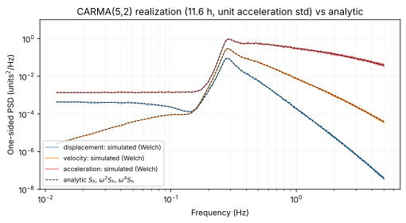
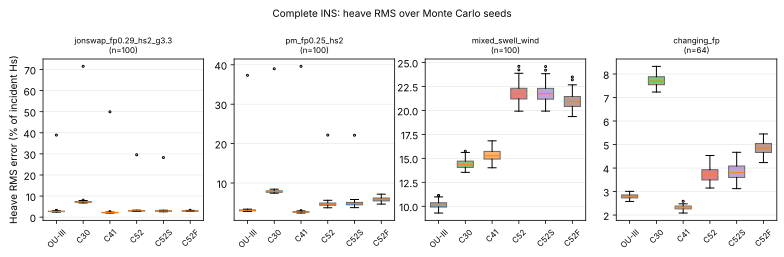
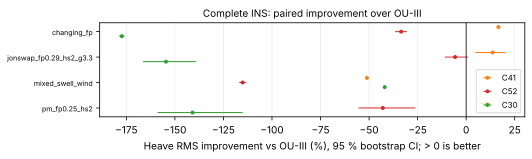
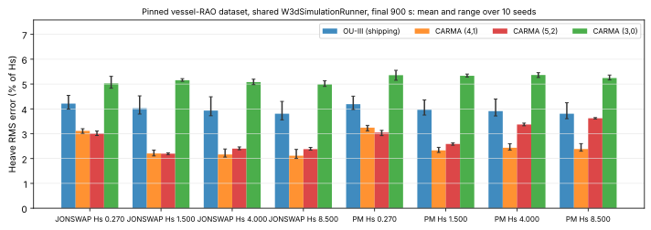
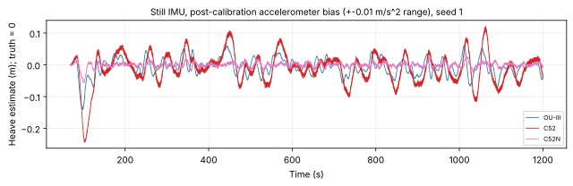
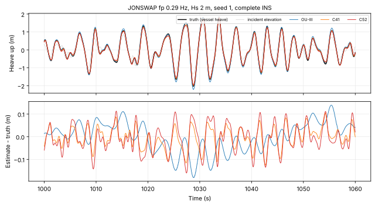
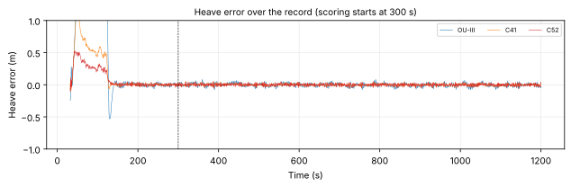
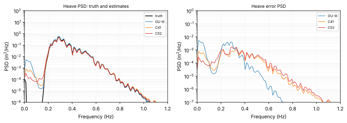
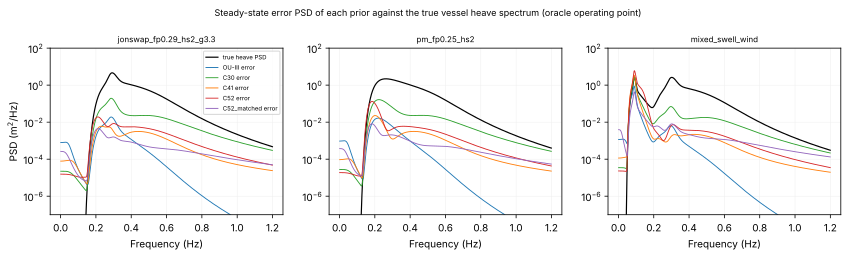
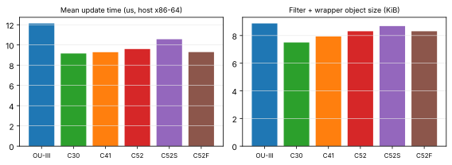

# Experimental CARMA heave filter versus OU-III

**Status: experimental research comparison.**  Nothing here changes the
shipping OU-III estimator, its tuning, gates, magnetic handling or the OU-III
stability study.  `Kalman3D_Wave_OU_III` and `SeaStateFusionFilter_OU_III`
remain the deployed, authoritative implementation; the CARMA code lives in
`src/kalman_carma/` and is used only by tests and the benchmark.  The
CARMA prior is a statistical model, not a law imposed on the vessel's
physical history, and no result below is a stability or admissibility
statement (see the last section of
`doc/kalman_ou_iii/stochastic-marine-motion.tex`).

**Result in one paragraph.**  On realistic single-peaked seas the CARMA
filters estimate heave substantially better than OU-III without any vertical
pseudo-measurement: over 100 paired seeds in the complete INS, CARMA(4,1)
lowers the heave RMS error by 41 % (JONSWAP 0.29 Hz), 36 % (Pierson-Moskowitz)
and 39 % (slowly changing sea), CARMA(5,2) by 35 %, 18 % and 28 %, every
95 % interval excluding zero.  On the pinned vessel-RAO dataset that OU-III's
own results table uses, replayed through the same runner, CARMA(4,1) is 41 %
and CARMA(5,2) 25 % better on all 80 (record, seed) pairs.  CARMA also has
half to a third of OU-III's low-frequency (drift) error.  It is not uniformly
better: on a mixed swell + wind sea CARMA(4,1) is 13 % and CARMA(5,2) 166 %
worse, CARMA(5,2) is 34 % worse on a bimodal sea, both are worse in still
water (46-53 mm against 27 mm), and with a wrong shape their covariance is
overconfident.  CARMA(4,1) is better than CARMA(5,2) almost everywhere, at
lower cost.  **Recommendation: keep OU-III as the shipping filter; retain
CARMA as an experimental alternative, with CARMA(4,1), not CARMA(5,2), as the
candidate for further work** (section 11).

## 1. Model

The vertical displacement `h` (NED `p_z`, about the local equilibrium) is a
Gaussian CARMA process with transfer function `H(s) = g B(s)/P(s)` (monic
`B`, `P`) and two-sided PSD

    S_h(w) = g^2 |B(iw)|^2 / |P(iw)|^2,      Var h = (1/2pi) int S_h(w) dw.

| Model | B(s) | P(s) | states |
|---|---|---|---|
| CARMA(3,0) | 1 | (s+lambda) L1(s) | 3 |
| CARMA(4,1) | s + w_z0 | L1(s) L2(s) | 4 |
| CARMA(5,2) | s^2 + 2 zeta_z w_z s + w_z^2 | (s+lambda) L1(s) L2(s) | 5 |

with `L_j(s) = s^2 + 2 zeta_j w_j s + w_j^2` and `w = 2 pi f`.

**Relative degree and acceleration.**  `deg P - deg B = 3` for all three,
so `S_h = O(w^-6)`, `int w^4 S_h dw < inf`, and `h`, `v = h'` and `a = h''`
exist in mean square with finite variance; `a` is continuous but not
differentiable (its derivative carries the white driving noise).  JONSWAP has
an `f^-5` displacement tail, so none of these models is asymptotically
equivalent to it.

**Parameters.**  `tools/carma_fit.py` minimizes the RMS log-spectral error
`sqrt(mean_f [d(f) - mean_f d]^2)`, `d = 10 log10(S_C/S_J)`, against JONSWAP
(`f_p` = 0.29 Hz, `gamma` = 3.3) on a 1 mHz grid over 0.17-1.30 Hz, i.e. shape
only (the driving intensity is set at run time).  Constraints: every pole
damping in [0.05, 1]; CARMA(5,2) `zeta_z >= 0.20`; CARMA(4,1) `f_z0 >= 0`.
Results are in `reports/results/carma_benchmark/carma_fit.json`.

| Model | parameters (Hz, damping) | RMS dB, 0.17-1.30 Hz | max dB | DC level re peak | `T_z f_p` |
|---|---|---|---|---|---|
| CARMA(5,2), preliminary (used) | f1 0.27812/0.09715, f2 0.44274/0.52299, f_lambda 1.86402, f_z 0.15105/0.20 | 0.84 | 9.7 | -23.2 dB | 0.783 |
| CARMA(5,2), refit, same constraints | f1 0.27678/0.09708, f2 0.44283/0.49116, f_lambda 2.24923, f_z 0.15229/0.20 | 0.83 | 9.4 | -23.2 dB | 0.777 |
| CARMA(5,2), unconstrained (`zeta_z >= 0.01`) | f1 0.28168/0.1479, f2 0.66801/0.86989, f_lambda 0.06859, f_z 0.16952/0.02709 | 0.34 | 1.1 | -2.2 dB | 0.895 |
| CARMA(4,1) | f1 0.306945/0.104191, f2 0.815318/0.478188, f_z0 0 | 1.86 | 17.5 | zero at DC | 0.782 |
| CARMA(3,0) | f1 0.386457/0.266692, f_lambda 5.0 (on bound) | 2.93 | 24.0 | -5.8 dB | 0.766 |
| JONSWAP | | | | | 0.779 |

The preliminary constrained CARMA(5,2) parameters are used unchanged: the
refit under the same constraints gains 0.006 dB.  The unconstrained fit
reproduces the warned-about behaviour: a narrow notch (`zeta_z` = 0.027) at
0.17 Hz on the band edge and a 0.069 Hz real pole that puts 23 % of the
displacement variance below 0.1 Hz.  It is reported, not used.  The
CARMA(4,1) optimum places its zero at DC; the CARMA(3,0) optimum sits on the
5 Hz real-pole bound (an oscillator-like `f^-4` slope across the band).

All curves use the same frequency axis and are each normalized to their own
peak, i.e. shapes only.  The fractional oscillator mentioned in the study
request is not in the repository and is not plotted.

## 2. State-space realization

`src/kalman_carma/CarmaVerticalModel.h` writes every model in the
coordinates

    x = [h, v, a, l_1 .. l_{N-3}],    dx = A x dt + g e_a dW,

so that `h = C x = x_0`, `v = C A x = x_1`, `a = C A^2 x = x_2` exactly (the
first two rows of `A` are `h' = v`, `v' = a`).  This is the observability
change of basis applied to the factored (cascade) realization; the
remaining coordinates are latent states of that cascade, not additional
physical variables.  For CARMA(5,2) the cascade is

    u' = -lambda u + g xi,     r'' + 2 zeta2 w2 r' + w2^2 r = u,
    h'' + 2 zeta1 w1 h' + w1^2 h = u + beta1 r' + beta0 r,
    beta1 = 2 zeta_z w_z - 2 zeta2 w2,  beta0 = w_z^2 - w2^2,

(`B/L2 = 1 + (beta1 s + beta0)/L2`), and eliminating `u` through
`a = u + beta1 r' + beta0 r - w1^2 h - 2 zeta1 w1 v` gives, with
`gamma = beta1 - lambda` and latent `(l1, l2) = (r, r')`,

    a'  = gamma w1^2 h + (2 gamma zeta1 w1 - w1^2) v + (gamma - 2 zeta1 w1) a
          + (-beta1 w2^2 - gamma beta0) l1 + (beta0 - 2 beta1 zeta2 w2 - gamma beta1) l2 + g xi
    l1' = l2
    l2' = w1^2 h + 2 zeta1 w1 v + a - w_z^2 l1 - 2 zeta_z w_z l2.

The latent pair therefore obeys the numerator ("zero") dynamics driven by the
input of the first oscillator; it is stable because `zeta_z > 0`.  At
`kappa` = 1 the CARMA(5,2) matrix is

    [  0        1        0        0        0     ]
    [  0        0        1        0        0     ]
    [-43.491   -7.889  -14.582  -77.805  -35.510 ]
    [  0        0        0        0        1     ]
    [  3.054    0.340    1       -0.901   -0.380 ]

with eigenvalues -11.712, -0.170 +- 1.739i, -1.455 +- 2.371i (the poles of
`P`).  CARMA(4,1) has one latent state `r` (the input of `L2`):
`r' = w1^2 h + 2 zeta1 w1 v + a - w_z0 r` and
`a' = d w1^2 h + (2 d zeta1 w1 - w1^2) v + (d - 2 zeta1 w1) a + (-w2^2 - d w_z0) r + g xi`,
`d = w_z0 - 2 zeta2 w2`.  CARMA(3,0) is the companion form in `[h, v, a]`:
`a' = -lambda w1^2 h - (2 lambda zeta1 w1 + w1^2) v - (lambda + 2 zeta1 w1) a + g xi`.

In these coordinates OU-III's vertical chain is the special case
`a' = -a/tau + noise` with no `h`, `v` feedback (and an extra integral `S`);
CARMA feeds displacement and velocity back into the jerk equation, which is
what makes its displacement stationary.

**Scaling.**  A fixed shape is moved by one frequency scale `kappa`
(every pole and zero times `kappa`).  With unit gain this gives exactly
`Var_kappa(a) = Var_1(a)/kappa` and `Var_kappa(h) = Var_1(h)/kappa^5`, so a
requested stationary acceleration standard deviation `sigma_a` is met with
`g^2 = sigma_a^2 kappa / Var_1(a)` without a run-time Lyapunov solve; the
displacement zero-crossing frequency is `kappa` times its base value
(0.3787, 0.3708 and 0.3704 Hz for CARMA(3,0), (4,1), (5,2)).

## 3. Exact discretization

For any step `h`,

    F = exp(A h),   Q = int_0^h exp(A t) W exp(A^T t) dt,   W = g^2 e_a e_a^T,

is computed by `discretize_lti()`: Taylor series of both integrands at
`h_s = h/2^s` with `||A h_s||_inf <= 1/4`, evaluated in the diagonally
scaled coordinates `x = D z`, `D = diag(h_s^{d_i})`, `d_i` the coupling
distance of state `i` from the noise input, followed by `s` exact doublings
`Q(2h) = Q(h) + F Q F^T`, `F(2h) = F^2`.  The scaling keeps the small entries
(`Q_hh ~ h^5`) at full relative precision and avoids subnormal intermediates;
every series term is a product, never the difference `P - F P F^T` of
stationary covariances, which cancels catastrophically in float at 5 ms.  `Q`
is a sum of positive semidefinite terms up to rounding.  The stationary
covariance is the same doubling carried until `F` has decayed.  Non-uniform
steps are supported directly (the filter caches `F`, `Q` for an unchanged
step and model; with a varying `dt` they are recomputed every sample).

`tests/kalman_carma/carma_model-test.cpp` (801 checks) verifies, for all three
orders and several `kappa`:

* the realization reproduces `g^2|B|^2/|P|^2` from the polynomial factors
  (relative error < 1e-9, 5 mHz-20 Hz), `C G = C A G = 0`, `C A^2 G = g`, and
  the eigenvalues equal the factor poles, all strictly stable;
* `F`, `Q` against a double-precision Van Loan matrix exponential (scaled
  coordinates) for steps 0.1 ms-50 ms, and against `P - F P F^T` for
  0.4-40 s: < 1e-9 relative to each entry's natural scale; the float
  implementation within 1e-5 (F, whitened) and 1e-4 (Q) at IMU-rate steps;
* `Q` positive semidefinite; the semigroup law for non-uniform steps
  `Q(h1+h2) = F(h2) Q(h1) F(h2)^T + Q(h2)`;
* the doubling stationary covariance against a Kronecker Lyapunov solve
  (< 1e-9) and against quadrature of `S_h`, `w^2 S_h`, `w^4 S_h` (< 1e-5);
* the discrete recursion `P <- F P F^T + Q` converging to the continuous
  stationary covariance (double < 1e-9, float < 2e-3);
* the `kappa` scaling law; a 10 000 s simulation staying bounded.

## 4. Integration into the INS

`Kalman3D_Wave_CARMA<float, N, with_vertical_integral>`:

| block | states | from |
|---|---|---|
| attitude error, gyro bias | 6 | OU-III, same transition and structured Qd |
| horizontal `[v_x, v_y, p_x, p_y, S_x, S_y, a_x, a_y]` | 8 | OU-III integrated OU chain and `S = 0` update, unchanged |
| vertical `[h, v_z, a_z, latent]` (+ `S_z`) | N (+1) | CARMA |
| accelerometer bias | 3 | OU-III residual-bias OU, gate and freeze |

CARMA(5,2) without `S_z` has 22 states (OU-III: 21).  The vertical
acceleration enters the attitude-aware accelerometer model exactly where
OU-III's `a_w,z` does,

    f_b = R_wb ([a_x, a_y, a_z]^T - g e_z) + b_a(T),

so the Jacobian with respect to the vertical block is `R_wb e_z e_a^T`, next
to `-[f_b]x` for attitude and `I` for the bias; every cross-covariance is
retained (the gain uses the full `P C^T`).  When bias learning is gated off
the bias uncertainty is still marginalized into the innovation covariance and
the bias rows are frozen, as in OU-III.  The position and velocity
pseudo-measurement APIs act on `h` and `v_z`.  Not carried over: wind heel,
IMU lever arm and the commanded-parameter random-walk filter (none enabled
by the deployed wrapper).  The block-diagonal linear transition is applied
structurally rather than formed densely; besides being cheaper, the dense
11 x 11 loop of the CARMA(3,0) build faulted under GCC 13 -O3 on x86-64 (an
aligned vector load on a misaligned column; clean under clang, ASan and
UBSan).

**`S_z`.**  The CARMA(5,2) prior has `S_h(0) = c0 > 0`, so `S_z = int h dt`
is not stationary under it: near DC `h` is white with level `c0` and `S_z`
is a random walk.  No zero pseudo-measurement is carried over.  The optional
variant propagates `S_z' = h` exactly with the CARMA states and applies
`S_z = 0` every `T_S` as an explicit regularizer of that random walk: with
information-rate-equivalent noise `r^2 T_S` it closes a first-order loop at
`w_R = sqrt(c0/(r^2 T_S))`; placing `w_R tau = kappa_R` (OU-III's pole
constant 0.3627) gives `r_Sz = sqrt(c0) tau / (kappa_R sqrt(T_S))`.  It is
tested separately (C52S).  CARMA(4,1)'s zero at DC makes `S_z` stationary
and needs no such update.

**Wrapper.**  `SeaStateFusionFilter_CARMA` reuses the shared front end,
adaptation mechanics, proxy startup and magnetic acquisition, and OU-III's
per-sample schedule, magnetometer-service bias gate, tilt watchdog and Racc
inflation; the horizontal chain keeps OU-III's SpectralMSE `r_S` law.  The
same measured operating point that tunes OU-III scales the CARMA shape:
`kappa = f_tune / f_z,model`, `f_tune = c_tau/(2 tau)` (the model's
zero-crossing frequency is placed on the measured one), and
`sigma_a = max(0.05 m/s^2, noise floor, sigma_aw / c_sigma)` (the measured
band acceleration RMS, with OU-III's floor).  These mappings were fixed
before any Monte Carlo run.  `setFixedVerticalCarma(1, 0)` holds the shape at
its 0.29 Hz design (C52F); `setCarmaSigmaFloor()` exists only for the
mechanism ablation C52N.

## 5. Stochastic-process validation

`carma_process-sim` generates 11.6 h (20 ms) and 400 s (1 ms) realizations
with the library's float model; `tools/carma_process_validation.py` checks
them against quantities derived independently in Python (companion
realization, scipy Lyapunov, polynomial PSDs).

| check (11.6 h at 20 ms, 400 s at 1 ms) | CARMA(3,0) | CARMA(4,1) | CARMA(5,2) | pass if |
|---|---|---|---|---|
| largest pole real part (rad/s) | -0.648 | -0.201 | -0.170 | < 0 |
| sample / Lyapunov variance, `h`, `v`, `a` | 0.992, 0.993, 0.999 | 1.006, 1.003, 0.999 | 1.009, 1.006, 1.002 | within 8 % |
| Welch vs analytic PSD, mean abs dB, `h`, `v`, `a` | 0.10, 0.10, 0.12 | 0.10, 0.11, 0.09 | 0.13, 0.13, 0.07 | < 0.35 dB |
| `S_v/S_h` vs `w^2`, `S_a/S_h` vs `w^4`, mean abs dB | 0.005, 0.031 | 0.017, 0.005 | 0.015, 0.017 | < 0.3 dB |
| `(dv/dt - a)` residual / Brownian prediction `g sqrt(dt/12)` | 0.998 | 1.001 | 1.000 | within 5 % |
| `E[da^2] / (g^2 dt)` | 0.984 | 1.000 | 0.994 | within 5 % |
| increment scaling exponent, `a` (1 = Brownian), `v` (2 = differentiable) | 0.98, 1.99 | 1.00, 2.00 | 0.99, 2.00 | within 0.1 |
| max `|h| / sigma_h` over 11.6 h | 4.58 | 4.33 | 4.49 | finite |

So `h` and `v` are differentiable, `a` is continuous with Brownian
increments (not differentiable), the spectra and variances are the designed
ones, and long runs stay bounded.  `reports/results/carma_benchmark/process_validation.json`
holds the full output.

## 6. Benchmark protocol

**Truth.**  `tests/kalman_carma/CarmaBenchTruth.h`: random-phase synthesis
(160 jittered frequencies over 0.55-4.5 `f_p` x 5 directions, cos^2s
spreading) of the incident sea.  Vessel motion is the response of a small
rigid hull: each RAO is a second-order mass-spring-damper response
`wn^2 / (wn^2 - w^2 + 2 zeta wn i w)` to the wave excitation times the
hull-averaging factor `exp(-k l)` (wavenumber `k`, effective averaging
length `l`) with which a hull of finite draft and size filters short waves.
Heave: 0.55 Hz, `zeta` 0.35, `l` 0.5 m.  Roll and pitch are driven by the
beam and bow slopes: 0.40 Hz / 0.15 / 1.0 m and 0.60 Hz / 0.30 / 1.5 m, gains
0.8 and 1.0, plus heel/trim and a slow yaw wander; surge and sway follow the
orbital motion.  All channels are analytic harmonic sums, so position,
velocity, acceleration, attitude and rate come from one history.  No CARMA
model is used.  Incident elevation and vessel heave are reported
separately; errors are against vessel heave, normalized by the incident
`H_s` (the repository's convention).

The motion levels were calibrated against the pinned 28 ft vessel-RAO
dataset from truth statistics alone (`carma_bench --level truth`), before any
estimator was run on this truth: vertical acceleration
0.3-1.5 m/s^2 RMS with peaks below 6.5 m/s^2, roll 3-5 deg and pitch 2-5 deg
RMS with peaks up to about 20 deg (30 deg in the large-rotation case), body
rates below 0.8 rad/s (1.3 rad/s), against 0.24-1.72 m/s^2, peaks up to
6.6 m/s^2, roll 1-8 deg RMS and rates up to 0.9 rad/s in the dataset.  Every
sea respects a realistic steepness, `H_s/L_p` <= 0.06 (deep-water peak
wavelength `L_p`).  The generated table "Realized motion levels" lists every
scenario (`carma_bench --level truth`).

**Sensors.**  The shared harness models (`make_imu_noise_model`,
`make_mag_noise_model`, the parameters of `process_wave_file_for_tracker`):
accelerometer 1.51 mg white, +-8 mg turn-on bias, 5e-4 m/s^2/sqrt(s) bias
walk; gyro 0.00157 rad/s, +-0.05 deg/s, 1e-5; magnetometer 0.8 uT at 25 Hz
with residual bias, scale, cross-axis and misalignment; 200 Hz IMU.  One
corrupted stream per (scenario, seed) is fed to every filter.

**Levels.**  Level 1 isolates the motion model: the true attitude levels the
measured specific force exactly, `y = a_z + b_z + n`, and reduced vertical
filters run on it -- OU-III's chain `[v, p, S, a_w] + b` (shared
`IntegratedOUChain`, SpectralMSE `r_S`, tau-scaled `S` cadence, shipping
constants) and the CARMA models `+ b`.  One measurement-only operating point
(the shipping `WavePeriodEstimator`, sigma band and `SeaStateAutoTuner` on
`y`) drives all of them; `--params oracle` instead takes `T_z` and `sigma_a`
from the realized truth.  Level 2 runs the complete shipping
`SeaStateFusion_OU_III` (unchanged, simulator configuration of
`kalman_ou_iii-sim` minus its dataset-specific direction/low-wave RAO
settings, which the firmware does not set) against `SeaStateFusion_CARMA`
with identical configuration.  The pinned vessel-RAO dataset
(oceanography-waves-lib v1.2.3) is replayed through the shared
`W3dSimulationRunner` with the unchanged `kalman_ou_iii-sim` and `carma-sim`
(same adapter configuration).

**Filters.**  OU3 (shipping OU-III), C30, C41, C52 (adaptive scale and
amplitude), C52S (with `S_z`), C52F (frequency scale fixed at the 0.29 Hz
design, amplitude adaptive), C52N (amplitude floor = noise floor, quiet
scenarios only, post-hoc mechanism ablation), C52Mv (Level 1 oracle-shape
diagnostic, see section 8).

**Scenarios.**  JONSWAP `f_p` 0.20 Hz (`H_s` 1, 2 m), 0.29 Hz (0.4, 0.8,
1.1 m; `gamma` 1.5/3.3/7 at 0.8 m), 0.45 Hz (0.2, 0.4 m) and a long 0.10 Hz,
4 m sea; Pierson-Moskowitz 0.15 Hz/2.5 m, 0.25 Hz/1 m, 0.40 Hz/0.4 m; tapered
broadband 0.10-0.70 Hz, 1 m; mixed swell (0.09 Hz, 1 m) and wind sea
(0.30 Hz, 0.8 m); bimodal (0.13 Hz/1.2 m + 0.42 Hz/0.4 m, 70 deg apart);
`f_p` rising 0.22 -> 0.36 Hz over 300-900 s (0.7 m); a 10 s change from
0.35 Hz/0.5 m to 0.18 Hz/2 m at 600 s; 5 cm `H_s`; still IMU (shared bias
model and post-calibration +-0.01 m/s^2); extra accelerometer drift (5 mg
ramp plus 2 mg oscillation); 15 deg heel and 5 deg trim; large rotation
(roll and pitch gains 2.0, +-15 deg yaw oscillation); +-25 % sample-interval
jitter; a no-RAO control (heave = incident elevation); 3600 s records.  100
seeds for the four primary cases (JONSWAP 0.29 Hz/0.8 m, PM 0.25 Hz/1 m,
mixed, changing `f_p`) at both levels, 30 for the rest, 20 for the 3600 s
records.

**Metrics.**  Scored on `t >= 300 s` of 1200 s records (and the last 60 s):
heave RMS, RMS/`H_s`, mean, peak; velocity and acceleration RMS; low-frequency
error (RMS of the 60 s moving average); linear drift trend; convergence time
(after Live, the 30 s rolling RMS stays below 1.5x the scored RMS; see 7.5
on the committed values); mean NIS
of the accelerometer innovation and the fraction inside its 95 % chi-square
interval; NEES of `[p_z, v_z]` (expected 2); failures (non-finite,
negative variance, `|e| > 10 H_s`); host update time and object size.
Paired statistics over seeds as described in the generated tables.

## 7. Results

All tables below are extracted from the generated
`reports/results/carma_benchmark/summary.md`, which has the full set
(95 % bootstrap intervals, win rates, Wilcoxon p, every metric, the oracle
operating point and the final-60-s columns).  2250 paired runs; **no
estimator failed** (non-finite state, negative variance or `|e| > 10 H_s`)
in any of them.

### 7.1 Headline: complete INS, primary sea states (100 seeds)

| Sea state | OU-III RMS | CARMA(5,2) RMS | Improvement [95 % CI] | Win | Drift: LF RMS OU-III / C52 | Median abs trend OU-III / C52 | Final 60 s RMS OU-III / C52 |
|---|---|---|---|---|---|---|---|
| JONSWAP 0.29 Hz, 0.8 m | 0.025 m (3.11 % Hs) | 0.016 m (2.04 % Hs) | +34.5 % [33.9, 35.0] | 100 % | 7.1 / 2.2 mm | 15.5 / 5.5 mm/h | 0.025 / 0.017 m |
| PM 0.25 Hz, 1 m | 0.033 m (3.26 % Hs) | 0.027 m (2.68 % Hs) | +17.7 % [16.3, 19.0] | 98 % | 9.0 / 2.9 mm | 20.2 / 6.5 mm/h | 0.033 / 0.026 m |
| mixed swell + wind | 0.131 m (10.27 % Hs) | 0.349 m (27.29 % Hs) | -165.8 % [-167.5, -164.1] | 0 % | 18.7 / 17.0 mm | 47.3 / 24.0 mm/h | 0.130 / 0.339 m |
| changing `f_p` | 0.023 m (3.26 % Hs) | 0.017 m (2.36 % Hs) | +27.6 % [26.8, 28.3] | 100 % | 6.4 / 2.0 mm | 16.7 / 5.3 mm/h | 0.019 / 0.017 m |

Same seeds, CARMA(4,1): +41.3 % [41.0, 41.7], +35.5 % [35.0, 36.0],
-13.4 % [-14.0, -12.9] and +38.7 % [38.3, 39.1].  Peak heave error, JONSWAP:
OU-III 0.087 m, C41 0.056 m, C52 0.063 m; velocity RMS 8.5, 6.1, 7.5 mm/s.
Acceleration RMS is slightly higher for CARMA (0.0146-0.0151 against
0.0138 m/s^2): its prior attributes a little more of the measured
acceleration to noise.

### 7.2 All synthetic sea states

Heave RMS error in % of incident `H_s` (mean over seeds) and change against
OU-III (positive = better).  Level 1 is the vertical subproblem under the
prescribed true attitude, Level 2 the complete INS.

| Scenario | n | Level 1: OU-III | C41 | C52 | Level 2: OU-III | C41 | C52 | C52S |
|---|---|---|---|---|---|---|---|---|
| JONSWAP 0.29 Hs 0.8 | 100 | 3.12 | 1.81 (+42 %) | 2.03 (+35 %) | 3.11 | 1.83 (+41 %) | 2.04 (+35 %) | 1.92 (+38 %) |
| PM 0.25 Hs 1 | 100 | 3.26 | 2.09 (+36 %) | 2.68 (+18 %) | 3.26 | 2.10 (+36 %) | 2.68 (+18 %) | 2.74 (+16 %) |
| mixed_swell_wind | 100 | 10.16 | 11.53 (-14 %) | 27.14 (-167 %) | 10.27 | 11.65 (-13 %) | 27.29 (-166 %) | 27.28 (-166 %) |
| changing f_p | 100 | 3.26 | 1.97 (+40 %) | 2.34 (+28 %) | 3.26 | 2.00 (+39 %) | 2.36 (+28 %) | 2.30 (+29 %) |
| JONSWAP 0.29 Hs 0.8 no RAO | 30 | 3.11 | 1.95 (+37 %) | 2.57 (+17 %) | 3.11 | 1.95 (+37 %) | 2.57 (+17 %) | 2.60 (+16 %) |
| JONSWAP 0.20 Hs 1 | 30 | 4.16 | 2.28 (+45 %) | 2.47 (+41 %) | 4.15 | 2.35 (+43 %) | 2.51 (+39 %) | 2.50 (+40 %) |
| JONSWAP 0.20 Hs 2 | 30 | 3.04 | 1.77 (+42 %) | 2.13 (+30 %) | 3.03 | 1.78 (+41 %) | 2.13 (+30 %) | 2.11 (+30 %) |
| JONSWAP 0.45 Hs 0.2 | 30 | 4.14 | 2.34 (+43 %) | 2.39 (+42 %) | 4.13 | 2.61 (+37 %) | 2.54 (+38 %) | 2.30 (+44 %) |
| JONSWAP 0.45 Hs 0.4 | 30 | 2.68 | 1.67 (+38 %) | 1.93 (+28 %) | 2.66 | 1.69 (+37 %) | 1.93 (+28 %) | 1.68 (+37 %) |
| JONSWAP 0.29 Hs 0.4 | 30 | 4.35 | 2.38 (+45 %) | 2.43 (+44 %) | 4.32 | 2.60 (+40 %) | 2.53 (+41 %) | 2.41 (+44 %) |
| JONSWAP 0.29 Hs 1.1 | 30 | 2.73 | 1.65 (+40 %) | 1.95 (+29 %) | 2.73 | 1.65 (+39 %) | 1.95 (+29 %) | 1.81 (+34 %) |
| JONSWAP 0.29 Hs 0.8, gamma 1.5 | 30 | 3.12 | 1.91 (+39 %) | 2.23 (+28 %) | 3.12 | 1.92 (+38 %) | 2.24 (+28 %) | 2.19 (+30 %) |
| JONSWAP 0.29 Hs 0.8, gamma 7 | 30 | 3.17 | 1.78 (+44 %) | 1.96 (+38 %) | 3.16 | 1.79 (+43 %) | 1.97 (+38 %) | 1.75 (+45 %) |
| JONSWAP 0.10 Hs 4 | 30 | 4.70 | 2.56 (+46 %) | 2.78 (+41 %) | 4.69 | 2.60 (+45 %) | 2.83 (+40 %) | 2.88 (+39 %) |
| PM 0.15 Hs 2.5 | 30 | 3.69 | 2.38 (+35 %) | 3.56 (+4 %) | 3.69 | 2.39 (+35 %) | 3.57 (+3 %) | 3.68 (+0 %) |
| PM 0.40 Hs 0.4 | 30 | 3.02 | 1.84 (+39 %) | 2.03 (+33 %) | 3.00 | 1.88 (+38 %) | 2.03 (+32 %) | 1.89 (+37 %) |
| broadband | 30 | 8.09 | 4.47 (+45 %) | 5.05 (+38 %) | 8.32 | 5.39 (+35 %) | 5.78 (+30 %) | 6.03 (+28 %) |
| bimodal | 30 | 5.88 | 4.12 (+30 %) | 7.81 (-33 %) | 5.91 | 4.18 (+29 %) | 7.90 (-34 %) | 8.09 (-37 %) |
| abrupt_change | 30 | 2.83 | 1.78 (+37 %) | 2.40 (+15 %) | 2.82 | 1.79 (+37 %) | 2.42 (+14 %) | 2.44 (+14 %) |
| bias_drift | 30 | 3.94 | 2.11 (+46 %) | 2.19 (+44 %) | 3.91 | 2.11 (+46 %) | 2.18 (+44 %) | 2.06 (+47 %) |
| tilted | 30 |  |  |  | 3.15 | 1.84 (+42 %) | 2.05 (+35 %) | 1.91 (+39 %) |
| large_rotation | 30 |  |  |  | 3.15 | 1.83 (+42 %) | 2.05 (+35 %) | 1.91 (+39 %) |
| JONSWAP 0.29 Hs 0.8 jitter | 30 |  |  |  | 3.14 | 1.84 (+41 %) | 2.07 (+34 %) | 1.93 (+38 %) |
| JONSWAP 0.29 Hs 0.8 3600 s | 20 |  |  |  | 3.10 | 1.83 (+41 %) | 2.03 (+34 %) | 1.91 (+38 %) |
| mixed_swell_wind 3600 s | 20 |  |  |  | 10.24 | 11.61 (-13 %) | 27.10 (-165 %) | 27.09 (-165 %) |

* **Motion model, not attitude coupling.**  For the primary seas Level 1
  and Level 2 agree within 0.03 % of `H_s` for every filter; the largest
  differences (up to 0.9 points, broadband and the smallest seas) raise every
  filter's error in the complete INS.  The heeled (15 deg / 5 deg),
  large-rotation (30 deg roll peaks) and jittered-timing cases reproduce the
  level-sea margins.  The gains come from the vertical prior; the shared
  attitude path neither adds to nor removes them.
* **Where CARMA wins.**  Every single-peaked JONSWAP and PM sea from 0.10 to
  0.45 Hz and 0.2 to 4 m, the broadband sea, abrupt and gradual changes, the
  no-RAO control and the extra bias drift.  CARMA(4,1) also wins the bimodal
  sea.
* **Where it loses.**  The mixed swell + wind sea (both orders) and the
  bimodal sea (CARMA(5,2)): section 8.  PM 0.15 Hz is a tie for CARMA(5,2).
* **Frequency adaptation.**  C52F (shape fixed at 0.29 Hz, amplitude
  adaptive) is 13-33 % better than OU-III near 0.29-0.45 Hz but fails badly
  away from its design frequency (e.g. 39 % `H_s` at 0.10 Hz): the measured
  frequency scale `kappa` is necessary on waves.  In still water it is what
  produces CARMA's phantom heave (section 7.4).

### 7.3 Pinned vessel-RAO dataset (the OU-III results-table data)

The eight scored records of oceanography-waves-lib v1.2.3 through the shared
`W3dSimulationRunner`; OU-III is the unchanged `kalman_ou_iii-sim`, CARMA is
`carma-sim` with the identical adapter configuration.  With the protocol of
`tools/ou_sim_table.py` (default seeds, final 900 s) the OU-III column
reproduces `doc/kalman_ou_iii/w3d-sim-results-generated.tex-part` exactly.

| Record | OU-III | CARMA(5,2) | CARMA(4,1) | CARMA(5,2) + `S_z` | CARMA(3,0) |
|---|---|---|---|---|---|
| JONSWAP 0.27 m | 0.0115 (4.25) | 0.0080 (2.96) | 0.0082 (3.06) | 0.0075 (2.77) | 0.0141 (5.21) |
| JONSWAP 1.5 m | 0.0615 (4.10) | 0.0332 (2.21) | 0.0336 (2.24) | 0.0319 (2.12) | 0.0775 (5.17) |
| JONSWAP 4 m | 0.1607 (4.02) | 0.0963 (2.41) | 0.0899 (2.25) | 0.0970 (2.42) | 0.2032 (5.08) |
| JONSWAP 8.5 m | 0.3153 (3.71) | 0.1998 (2.35) | 0.1775 (2.09) | 0.2024 (2.38) | 0.4222 (4.97) |
| PM-Stokes 0.27 m | 0.0114 (4.21) | 0.0080 (2.97) | 0.0087 (3.21) | 0.0077 (2.84) | 0.0149 (5.52) |
| PM-Stokes 1.5 m | 0.0604 (4.02) | 0.0389 (2.60) | 0.0352 (2.35) | 0.0394 (2.63) | 0.0805 (5.37) |
| PM-Stokes 4 m | 0.1582 (3.96) | 0.1354 (3.38) | 0.0979 (2.45) | 0.1395 (3.49) | 0.2151 (5.38) |
| PM-Stokes 8.5 m | 0.3147 (3.70) | 0.3050 (3.59) | 0.2013 (2.37) | 0.3129 (3.68) | 0.4454 (5.24) |

Heave RMS error in m (% of `H_s`), deterministic protocol.  Roll, pitch and
yaw errors and horizontal displacement errors are essentially unchanged
(generated table).  Over ten `W3D_SEED` values (80 paired record/seed runs):
CARMA(4,1) +40.9 % [39.8, 42.0], CARMA(5,2) +24.8 % [20.2, 29.5], both
better on every pair (Wilcoxon p = 7.8e-15); CARMA(3,0) -33.5 %.  The
dataset holds only single-peaked JONSWAP and PM-Stokes seas, the family the
CARMA shape was fitted to (on an analytic spectrum, not on these records);
CARMA(5,2)'s margin shrinks on the long PM-Stokes records, CARMA(4,1)'s does
not.

### 7.4 Drift, long records, bias and quiet water

* **Drift.**  The low-frequency error (RMS of the 60 s moving average) is
  2-3 times smaller for CARMA on every single-peaked sea (JONSWAP 7.1 mm for
  OU-III, 3.1 mm C41, 2.2 mm C52), and the median absolute linear trend is
  15.5, 6.9 and 5.5 mm/h.  In 3600 s records the error does not grow for any
  filter (JONSWAP: 3.10 / 1.83 / 2.03 % `H_s`, final 60 s 0.026 / 0.015 /
  0.017 m), so CARMA's stationary prior holds the displacement without a
  vertical pseudo-measurement.
* **Accelerometer bias.**  With an extra 5 mg ramp and 2 mg oscillation on
  top of the shared bias model, the mean error over the final minute is
  -29 mm for OU-III, -13 mm for C41 and -9 mm for C52 (overall +46 % and
  +44 %): CARMA is less sensitive to an unmodelled bias drift.
* **Still IMU.**  Both CARMA orders are worse than OU-III: 46-53 mm RMS of
  phantom heave against 27 mm (CARMA(3,0) 30 mm).  The mechanism is the
  shared operating point, not the CARMA dynamics: in still water the tuner
  sits at its longest-period clamp (`tau` = 10 s), which scales the CARMA
  shape to a 0.05 Hz sea, and with the 0.05 m/s^2 amplitude floor that prior
  admits a large low-frequency displacement variance.  Holding the frequency
  scale (C52F) gives 0.6 mm; flooring the amplitude at the band noise floor
  instead (C52N) gives 7.5 mm but makes the 5 cm sea worse (15.2 % against
  9.7 % `H_s`, NEES 35).  No fix is applied here.
* **Very small motion.**  5 cm `H_s`: OU-III 17.1 %, C41 9.6 %, C52 9.7 %
  of `H_s` (8.6, 4.8, 4.9 mm).

### 7.5 Consistency and convergence

NEES of `[p_z, v_z]` (expected 2): single-peaked seas 1.0-1.3 for OU-III,
1.0-1.3 for C41, 1.4-2.2 for C52; mixed sea 7.2, 28 and 149.  With a wrong
shape the CARMA covariance is far too small and nothing in the filter
detects it.  The accelerometer NIS is below its expected value for every
filter (mean 0.2-0.3 against 3) because the shipping measurement variance is
deliberately conservative; CARMA's is lower than OU-III's.  The `conv_s`
column of `raw_runs.csv` is not a measurement: the rolling window of
`convergence_time()` started before Live, a NaN error entered its running sum
and `std::max(0.0, NaN)` turned every later window into 0, so every
tuner-driven run reported 0 s.  The routine is fixed in `carma_bench.cpp`
(the window restarts at Live); corrected convergence and startup errors are
reported in `docs/carma-three-axis.md`.  Every other column is unaffected
(re-runs are bit identical).

### 7.6 Example trajectories and spectra

OU-III's error is concentrated below 0.15 Hz (integration drift held by the
`S = 0` update); CARMA's is spread over the wave band and the tail, an
order of magnitude lower below 0.15 Hz and higher above 0.5 Hz.

## 8. Mechanism: spectral shape, not observability

`tools/carma_mismatch_analysis.py` computes, for the true vessel-heave
spectrum of a case (the band-limited incident spectrum times the truth's
heave RAO) and the oracle operating point, the exact steady-state transfer
`T(f)` from the accelerometer to `h_hat` of each filter (scipy DARE on the
200 Hz discrete model; OU-III's `S = 0` update included at its
information-rate-equivalent variance) and splits the error variance into
signal distortion `int |1 + w^2 T|^2 S_h df` (what the prior does with the
true spectrum) and noise propagation `int |T|^2 N df` (measurement
observability):

| case | OU-III | CARMA(3,0) | CARMA(4,1) | CARMA(5,2), JONSWAP shape | CARMA(5,2), shape refitted to the truth |
|---|---|---|---|---|---|
| JONSWAP 0.29 Hz, 0.8 m | 13.4 (11.2 / 7.4) | 36.1 | 10.2 (9.7 / 3.2) | 13.7 (13.5 / 1.8) | 8.6 (7.4 / 4.4) |
| PM 0.25 Hz, 1 m | 17.3 (15.1 / 8.4) | 49.6 | 14.8 (14.3 / 3.7) | 21.3 (21.2 / 2.0) | 11.0 (9.9 / 5.0) |
| JONSWAP 0.20 Hz, 1 m | 19.6 (15.8 / 11.6) | 44.6 | 13.3 (12.1 / 5.6) | 16.6 (16.3 / 3.3) | 12.5 (11.1 / 5.6) |
| JONSWAP 0.45 Hz, 0.4 m | 6.6 (5.4 / 3.8) | 15.9 | 5.2 (4.9 / 1.6) | 7.0 (6.9 / 0.9) | 3.0 (2.5 / 1.7) |
| mixed swell + wind sea | 60.7 (59.0 / 14.4) | 128.0 | 93.7 (93.4 / 6.8) | 302.1 (302.0 / 3.8) | 129.8 (129.8 / 2.1) |
| bimodal | 31.6 (26.6 / 17.1) | 74.3 | 26.9 (25.6 / 8.4) | 51.3 (51.1 / 4.8) | 18.9 (17.3 / 7.6) |

Steady-state heave RMS error in mm (signal distortion / noise propagation).
In this steady-state analysis two effects compete.  OU-III's prior is nearly shape-free above its corner
`1/tau`, so its signal distortion is moderate everywhere, but it lets
accelerometer noise through at low frequency (7-17 mm, mostly below
0.1 Hz).  A stationary CARMA prior propagates two to four times less noise,
and wins whenever its shape is close enough to the vessel's heave spectrum;
when it is not, the filter attenuates or mis-phases the true motion wherever
the prior is wrong, and signal distortion dominates.  CARMA(4,1) (one zero
at DC, two resonances) sits on the right side of that balance for every
single-peaked sea and the bimodal case; the fixed JONSWAP-fitted CARMA(5,2)
is level with OU-III on JONSWAP and worse on PM, whose broader peak its
narrow first resonance (`zeta_1` = 0.097) does not cover.  For the mixed sea
the 0.09 Hz swell falls near CARMA(5,2)'s numerator zero once `kappa` scales
the shape to the wind sea: 289 mm RMS of its 302 mm error is below 0.1 Hz.
The constrained refit (last column) cannot represent two well-separated
peaks either and is still worse than OU-III there.

The steady-state analysis omits the accelerometer bias and its random
walk.  In the Monte Carlo, OU-III's low-frequency error is larger than its
steady-state value (the error PSD below 0.15 Hz is about ten times CARMA's),
so the measured margins of CARMA exceed the analytic ones (JONSWAP 0.29 Hz:
analytic C52 = OU-III, Monte Carlo C52 35 % better).

The Monte Carlo with the refitted shape (C52M, Level 1, oracle operating
point, 30 seeds; generated table "oracle-shape diagnostic"):

| case | OU-III | C41 | C52 (JONSWAP shape) | C52M (refitted, uses the truth) | NEES OU-III / C41 / C52 / C52M |
|---|---|---|---|---|---|
| JONSWAP 0.29 Hz | 3.19 % | 1.79 % (+43.9 %) | 1.96 % (+38.6 %) | 1.66 % (+48.1 %) | 0.99 / 0.75 / 0.79 / 0.59 |
| PM 0.25 Hz | 3.28 % | 2.00 % (+39.0 %) | 2.37 % (+27.7 %) | 1.76 % (+46.3 %) | 1.08 / 0.87 / 1.10 / 0.64 |
| mixed swell + wind | 9.18 % | 10.02 % (-9.2 %) | 26.96 % (-193.6 %) | 10.52 % (-14.6 %) | 3.41 / 10.83 / 90.30 / 7.64 |
| bimodal | 5.82 % | 3.53 % (+39.4 %) | 5.05 % (+13.3 %) | 2.57 % (+55.8 %) | 1.26 / 1.29 / 2.78 / 0.93 |

C52M is not an independent result: its shape comes from the true spectrum.
It shows that the remaining CARMA(5,2) deficit is spectral mismatch, not
measurement observability, bias coupling, initialization or numerical
conditioning: with the right shape it gains a further 10-40 points on the
single- and two-peak seas; for the mixed sea even the best constrained
CARMA(5,2) shape stays worse than OU-III.  Identifying that shape online (seven parameters
from the accelerometer, with its own stability and consistency questions)
is not part of this work.

## 9. Does CARMA replace `S_z`?

Yes.  The default CARMA filters carry no `S_z` and no vertical
pseudo-measurement; the stationary prior bounds the displacement variance by
itself.  Evidence: no error growth over 3600 s, 2-3 times less
low-frequency error than OU-III with its `S = 0` update (section 7.4), and
the pinned dataset (section 7.3).  The explicit `S_z` variant (C52S, section
4) changes the heave error by a few percent either way (better at 0.45 Hz
and on the primary JONSWAP, slightly worse on PM, broadband and bimodal,
identical low-frequency error), costs one state and, with a jittered sample
interval, 50 % more host time.  It is not needed.  CARMA(4,1)'s zero at DC
makes `S_z` stationary without any update.  OU-III's `S = 0`
pseudo-measurement is not carried over to the vertical channel; the
horizontal channels keep OU-III's chain and its `S = 0` updates unchanged.

## 10. Cost and ESP32-S3 build

Host (x86-64, `-O3`, serial on an idle machine, three JONSWAP seeds; time per
`update()` after Live, all filters interleaved on one stream):

| filter | states | mean update (us), fixed dt | with +-25 % dt jitter | object bytes (host) |
|---|---|---|---|---|
| OU-III | 21 | 5.02 | 5.02 | 9 088 |
| CARMA(3,0) | 20 | 3.77 | 4.13 | 7 680 |
| CARMA(4,1) | 21 | 3.87 | 4.22 | 8 128 |
| CARMA(5,2) | 22 | 4.09 | 4.78 | 8 512 |
| CARMA(5,2) + `S_z` | 23 | 4.46 | 7.33 | 8 896 |

CARMA is cheaper than OU-III per update, mainly because the block-diagonal
transition is applied structurally.  With a constant sample interval the
exact `F`, `Q` are cached; with a varying interval they are recomputed every
sample (scaled series plus doublings), which costs CARMA(5,2) about 0.7 us
and the 6-state `S_z` block about 2.9 us on the host.

ESP32-S3 (`esp32:esp32:m5stack_atoms3`, arduino-esp32 3.3.11, xtensa GCC
14.2.0, `-Os`): every variant compiles and links, with no relocation or
literal-pool errors (the ESP32-S3 failure mode mentioned in the request).

| variant | program flash (bytes) | wrapper object | filter object | static RAM (globals) |
|---|---|---|---|---|
| OU-III (shipping baseline) | 683 246 | 3 032 | 5 692 | 22 400 |
| CARMA(5,2), 22 states | 671 226 | 3 000 | 5 224 | 22 400 |
| CARMA(4,1), 21 states | 670 118 | 3 000 | 4 760 | 22 400 |
| CARMA(5,2) + `S_z`, 23 states | 675 854 | 3 000 | 5 656 | 22 400 |

(object sizes from `sizeof` in the Xtensa build; the sketch allocates the
fusion object on the heap, so the static RAM reported by the linker is the
same for all four.)  Caveats: built against Eigen 3.4.0
through a local `ArduinoEigenDense.h` shim rather than the published
ArduinoEigen package, which the build host could not download; the M5Unified
library was staged without its AtomS3R sources; prototypes generated with
exuberant-ctags.  **No AtomS3R hardware was available: on-target update
time, stack use and numerical behaviour in float on the Xtensa FPU are not
verified.**  The sketch prints mean and maximum `micros()` per update when
run on hardware.

## 11. Engineering assessment

1. **Does CARMA(5,2) estimate heave more accurately than OU-III?**  On
   single-peaked seas, yes; on mixed swell + wind and bimodal seas and in
   still water, no.  On the pinned dataset OU-III is evaluated on, yes.
2. **By how much, where, with what confidence?**  Complete INS, 100 paired
   seeds: JONSWAP 0.29 Hz +34.5 % [33.9, 35.0], PM 0.25 Hz +17.7 %
   [16.3, 19.0], changing sea +27.6 % [26.8, 28.3]; 30-seed secondary seas
   +14 to +44 % (PM 0.15 Hz +3 %, not significant); mixed sea -166 %,
   bimodal -34 %, still IMU 46 against 27 mm.  Pinned dataset +24.8 %
   [20.2, 29.5] on all 80 pairs.  Intervals are 95 % paired bootstrap over
   seeds; win rates and Wilcoxon p are in the generated tables.
3. **Long-term drift?**  Reduced: low-frequency error 2-3 times smaller,
   median trend 5.5 against 15.5 mm/h, no growth over 3600 s.
4. **Can the stationary dynamics replace `S_z`?**  Yes (section 9).
5. **Sensitivity to accelerometer bias or attitude errors?**  Less sensitive
   to an unmodelled bias drift (final-minute mean error -9 against -29 mm);
   equal sensitivity to attitude (Level 1 = Level 2, heel and 30 deg roll
   change nothing).  More sensitive to the still-water operating point
   (section 7.4).
6. **Does CARMA(4,1) give nearly the same benefit at lower complexity?**  It
   gives more: CARMA(4,1) beats CARMA(5,2) on nearly every case (complete
   INS: +41 % against +35 % on JONSWAP, +36 % against +18 % on PM, +29 %
   against -34 % on the bimodal sea, -13 % against -166 % on the mixed sea,
   +41 % against +25 % on the dataset), with one state fewer and a cheaper
   update.  CARMA(5,2) + `S_z` is ahead only on some short or small seas
   (0.45 Hz, 0.4 m and less), by at most 0.3 % of `H_s`.  CARMA(3,0) is worse than OU-III
   everywhere except tiny motion.
7. **Cost on AtomS3R?**  Not measured on hardware.  The ESP32-S3 build
   links with 12 kB less flash than OU-III and a 5.2 kB filter object
   (OU-III 5.7 kB); on the host CARMA(5,2) needs 0.81x OU-III's update time.
8. **Stable when the sea-state assumptions are wrong?**  No divergence or
   failure in 2250 runs, including wrong shapes (mixed, bimodal) and a fixed
   design frequency far from the sea (C52F at 0.10 Hz: 39 % `H_s`, bounded);
   errors stay bounded over 3600 s.  But the covariance is then
   inconsistent (NEES up to about 150), and there is no formal stability
   result for CARMA.
9. **Remaining limitations?**  Section 12.
10. **Recommendation.**  **Do not replace OU-III.**  Retain CARMA as an
    experimental alternative, and take **CARMA(4,1)** forward rather than
    CARMA(5,2), whose extra flexibility does not translate into better
    estimation with a fixed shape.  Before any deployment: a fix for the
    still-water operating point, a strategy for multi-peaked seas (where the
    fixed shape is wrong and the covariance overconfident), on-target
    timing and float behaviour on the AtomS3R, and a stability analysis of
    the CARMA INS under the repository's protocol.  Reject CARMA(3,0).

## 12. Limitations and open items

* **Multi-peaked seas.**  A single frequency scale applied to one fixed
  shape cannot follow a swell well below the wind sea: CARMA(5,2)'s
  numerator zero lands on the swell.  CARMA(4,1) degrades less (-13 %) but
  also loses.  An online identifier for the shape parameters, its excitation
  requirements and its effect on stability and covariance consistency are
  not studied.
* **Overconfidence under mismatch.**  With a wrong shape the CARMA
  covariance does not cover the error (NEES 28 and 149 against 2 on the mixed
  sea).  Nothing inflates it; this is reported, not fixed.
* **Quiet water.**  46-53 mm of phantom heave on a still IMU, against 27 mm
  for OU-III, from the shared operating point (section 7.4).  The two
  obvious fixes trade against small seas; none is applied.
* **Not carried over**: wind-heel feed-forward, IMU lever arm and the
  parameter random-walk option of OU-III (all off in the deployed wrapper).
* **Truth model.**  One synthetic hull (rigid-body RAOs with hull
  averaging, calibrated to the 28 ft dataset's motion levels) and one pinned
  dataset of that hull.  How far the vessel's heave spectrum is from the
  JONSWAP shape decides the ranking of the priors, so it can differ for
  other hulls and sea mixtures.
* **No stability claim.**  None of this is part of, or evidence for, the
  OU-III stability study; the CARMA prior is a statistical model and no
  admissibility or practical-stability statement is made for it.
* **Hardware.**  ESP32-S3 compile and link only (section 10).

## Reproduction

    make -C tests/kalman_carma build test            # unit, process and smoke checks
    python3 tools/carma_fit.py                       # spectral fits
    (cd tests/kalman_carma && ./carma_process-sim process)
    python3 tools/carma_process_validation.py --input tests/kalman_carma/process \
        --check --out reports/results/carma_benchmark
    python3 tools/carma_mismatch_analysis.py
    python3 tools/carma_benchmark.py run             # synthetic grid (resumable)
    python3 tools/carma_benchmark.py matched         # oracle-shape diagnostic
    make ensure-sim-data && make -C tests/kalman_ou_iii build
    python3 tools/carma_benchmark.py dataset         # pinned dataset, 10 seeds
    python3 tools/carma_benchmark.py deterministic   # OU-III table protocol
    python3 tools/carma_benchmark.py timing          # on an idle host
    python3 tools/carma_benchmark.py traces
    python3 tools/carma_benchmark.py truth
    python3 tools/carma_benchmark.py report

ESP32-S3 build: `tests/kalman_carma/arduino/carma_compile_check/` with
`-DCARMA_CHECK_VARIANT=0..3` (OU-III, CARMA(5,2), CARMA(4,1), CARMA(5,2)+`S_z`)
for `esp32:esp32:m5stack_atoms3:CDCOnBoot=cdc,USBMode=hwcdc`.  It is under
`tests/`, so the shipped-sketch CI jobs do not compile it.
