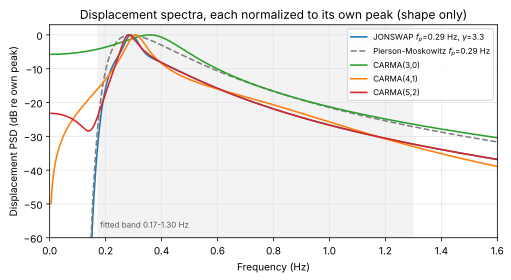
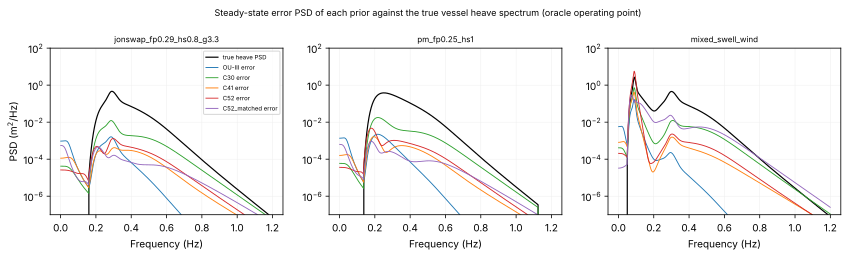
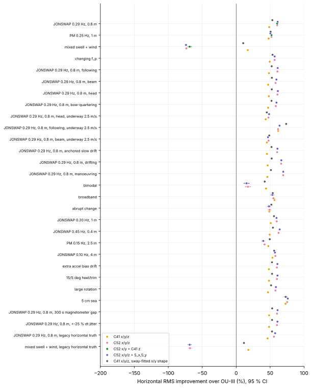
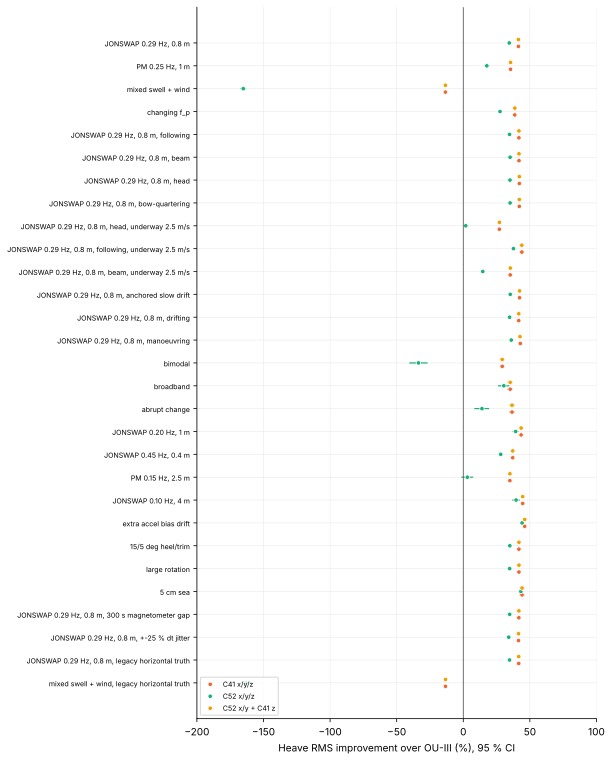
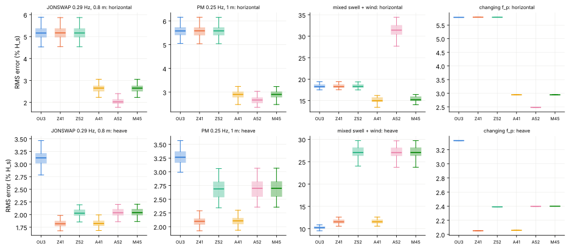
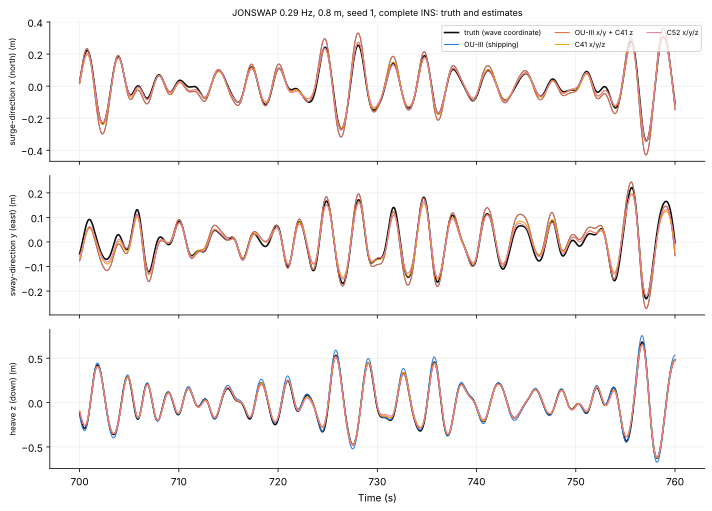
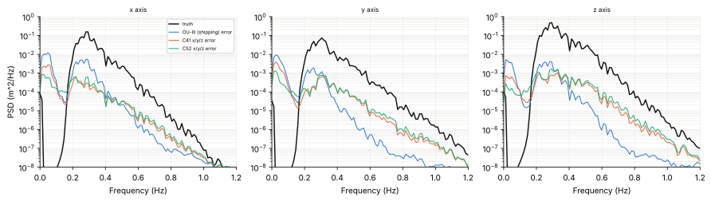
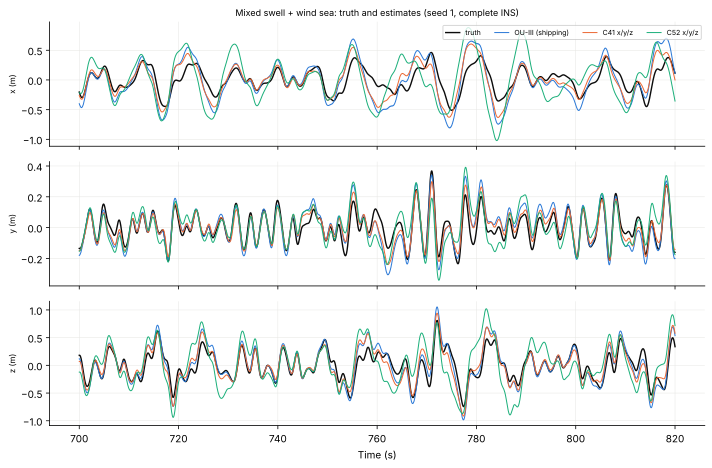
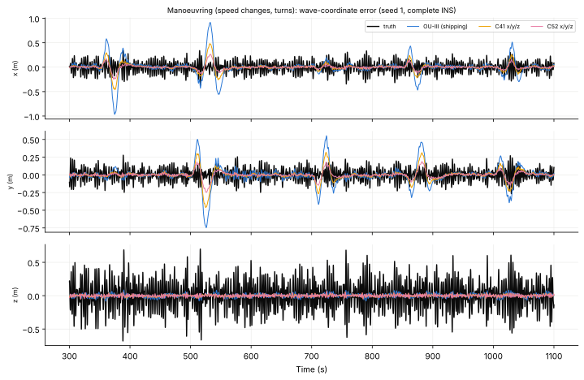
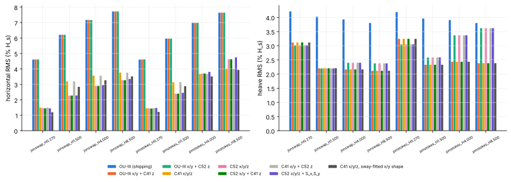

# Three-axis CARMA motion priors versus OU-III (experimental)

**Status: experimental research.**  Nothing here changes the shipping OU-III
estimator, its tuning, gates, magnetic handling or the OU-III stability study.
`Kalman3D_Wave_OU_III` / `SeaStateFusionFilter_OU_III` remain the deployed,
authoritative implementation.  The three-axis prototype filter, its wrapper
and the CARMA model library live in `src/kalman_carma/`
(`Kalman3D_Wave_CARMA3.h`, `SeaStateFusionFilter_CARMA3.h`,
`CarmaVerticalModel.h`); nothing in the deployed OU-III configuration includes
them.  The experimental AtomS3R sketch `atomS3R_ins_carma3` runs
recommendation B for research (section 8).
A CARMA prior is a statistical model, not a law imposed on the vessel's
physical history; no result below is a stability, admissibility or hardware
statement.  The paper `doc/kalman_carma/kalman_carma.tex` and its chart
gallery `doc/kalman_carma/kalman_carma-charts.tex` summarize this report;
CI builds both from a fresh replay of the dataset.

**Result (simulation only; no hardware).**  CARMA(4,1) on all three axes
(21 states, the same as OU-III, a third of its multiply-adds per sample) is the
only configuration that beats OU-III horizontally on every simulated sea.
In the paired complete-INS benchmark (100 seeds on the four principal seas,
30 or 20 on 27 further sea conditions) its horizontal RMS error is 43-73 %
lower on single-peaked, bimodal, broadband, underway, anchored, drifting and
manoeuvring cases and 17 % lower on the mixed swell + wind sea; on an
independent replay hull it is 52 % lower.  Its CARMA(4,1) heave is 27-46 %
better than OU-III's and 13 % worse on the mixed sea.  CARMA(5,2)
horizontally is better still on most single-peaked seas but 73 % worse than
OU-III on the mixed sea, because its spectral notch lands on the swell;
mixed orders inherit that failure.  A DC-zero CARMA needs no horizontal `S`
state, and OU-III's `S = 0` cannot be carried over to one (no stabilizing
Riccati solution); on CARMA(5,2), the derived `S` law changes little.
Correlated x-y driving noise is free and gained 5 % with the oracle
correlation, untested with an estimated one.  Against this, every CARMA
variant is worse than OU-III on a still IMU (horizontal phantom 84 against
53 mm RMS, heave 53 against 27 mm, a heave startup transient 2-3 times
larger) and more overconfident on the mixed sea.  **Recommendation:
B, CARMA(4,1) on X/Y and Z, as the research candidate; not shippable**
(section 12).

## 1. Baseline

* **OU-III.**  OU-III carries per axis the integrated OU chain
  `[v, p, S, a_w]`, `a_w` an OU process with time constant `tau` and
  stationary std `sigma_aw` (isotropic: `sigma_aw,H = S_factor sigma_aw,Z`,
  `S_factor = 1`), `S' = p`, and the pseudo-measurement `S = 0` every `T_S`
  with the SpectralMSE `r_S` (horizontal factors 0.72, 0.50).  The CARMA
  filter replaces the three chains by CARMA(p, p-3) priors in
  `[p, v, a, latent]` coordinates and keeps OU-III's attitude, bias,
  magnetometer, startup and adaptation.
* **Frequency-range consistency.**  The CARMA amplitude mapping sets the
  model's *total* (0 to infinity) acceleration variance equal to an RMS
  measured in the adaptive band [0.5 f, 4 f] of the shipping sigma channel;
  the model's relative-degree-3 tail (`S_a ~ w^-2`) puts part of its variance
  outside that band, so the in-band prior is lower than measured.  The
  process-validation PSD checks of `tools/carma_process_validation.py`
  compare the acceleration PSD only on the *displacement* band (within 40 dB
  of the displacement peak, below 2 Hz), not on the band where acceleration
  carries its energy.  Both are reported, not changed: the mapping is the one
  every benchmarked CARMA filter uses (changing it would be re-tuning), and
  the steady-state analysis below shows that a *larger* horizontal amplitude
  than the true one is favourable under shape mismatch (section 6), so the
  inconsistency is not what limits CARMA.

## 2. Physics of three-axis wave-induced motion

Earth-fixed NED axes; `p_wave` is the oscillatory displacement about the local
equilibrium (the repository's wave coordinate).

**Heave.**  Hydrostatic restoring gives a resonant RAO (`f_n` = 0.55 Hz,
`zeta` 0.35 for the benchmark hull) times hull averaging `e^{-k d}`; the heave
spectrum is the incident JONSWAP/PM spectrum reshaped by it, single-peaked in
single seas, two-peaked in swell plus wind sea.

**Surge and sway.**  There is no hydrostatic restoring in the horizontal
plane.  A small free-floating hull in long waves follows the water-particle
orbit: in deep water the horizontal orbital displacement along the
propagation direction has the elevation amplitude and lags it by a quarter
period (`xi = H[eta]`, `xi ~ w int eta` for a narrow band).  Hull averaging
over draft, length and beam attenuates short waves; the benchmark uses
effective averaging lengths (the `e^{-k l}` form the truth already uses for
heave, roll and pitch, `l` = 0.09-0.14 L matches `sinc(kL/2)` at
`kL/2` = 1..pi/2):

    surge = e^{-k (d + l_L |cos b|)} cos b,   sway = e^{-k (d + l_B |sin b|)} sin b,
    d = 0.5 m, l_L = 0.75 m, l_B = 0.28 m,  b = propagation direction re bow.

So the horizontal spectra are the incident spectrum times `cos^2 b` /
`sin^2 b`, low-passed by the hull, with **no resonance** (the `hlegacy`
control instead uses 0.8 x the heave RAO, whose 0.55 Hz resonance is not
physical for surge and sway).  Horizontal displacement is
about half the heave in these seas (JONSWAP 0.29 Hz, 0.8 m: std x/y/z
0.103/0.080/0.202 m) and its zero-crossing frequency is lower than heave's
(0.31 against 0.33 Hz), because heave's resonance lifts its shoulder.

**Directional coupling.**  For one direction component the three axes are
perfectly coherent: `x, y` in phase with each other (co-spectrum
`cos th sin th`), and in quadrature with the elevation.  The x-z phase at the
heave peak is -63 deg, not -90 deg: quadrature holds against the *incident*
elevation and the heave RAO adds its own lag (27 deg at 0.29 Hz).  Directional
spreading lowers coherence: JONSWAP with cos^8 spreading has energy-weighted
squared coherence x-z 0.97, y-z 0.76, x-y 0.64 (figure `coherence.svg`);
two systems 70 deg apart (bimodal) make x-y and y-z incoherent where the
other system dominates.  The cross-spectral matrix
`S_xyz(f) = sum_j S_eta(f) w_j t_j t_j^H` is Hermitian positive semidefinite
by construction; numerically the Hermitian defect is <= 4e-16 and the
smallest eigenvalue is >= 0 (relative to the trace) at every frequency of
every case.

**Roll and pitch coupling.**  Roll and pitch follow the beam and bow slopes;
the benchmark's IMU is at the centre of gravity, so roll/pitch reach the
translational estimate only through the attitude estimate: a tilt error
`dtheta` puts `g dtheta` into the horizontal specific force (0.1 deg is
0.017 m/s^2), which is why the horizontal channel is the attitude-coupled
one.  A lever arm (IMU above the roll centre) would add `r x alpha` to the
horizontal acceleration; it is studied elsewhere (`docs/ou-iii-imu-lever-arm.md`)
and not here.

**Low-frequency translation is not wave motion.**  Second-order
(difference-frequency) forces and wind drive horizontal motion far below the
wave band: an anchored hull sails on its rode with 30-300 s periods and metres
of amplitude (benchmark: 2.5 m at 1/90 Hz, 1.1 mg, with 16 deg yaw sheer); a
drifting hull moves with the mean drift and slowly varying velocity
(0.3 m/s mean, 0.08 m/s fluctuations, 0.7 mg); an underway hull makes way at
constant velocity, which no accelerometer sees, and changes speed and heading
(benchmark manoeuvre: up to 0.2 m/s^2 for 25-35 s).  These are motions of the
local equilibrium, not of the wave coordinate: the benchmark adds them to what
the IMU senses and scores the estimators against `p_wave` only.  Their
accelerations (1-30 mg) are of the order of accelerometer bias and of
`g dtheta`, so an IMU-only estimator cannot reconstruct them; what matters is
how much of them each prior turns into phantom wave displacement.

**Forward speed.**  Underway, every component is met at the encounter
frequency `w_e = w - k U cos b`: head seas move energy up (0.29 Hz to about
0.43 Hz at 2.5 m/s, with heave acceleration doubling), following seas move it
down towards and through zero (frequency folding), where the double
integration from acceleration has no information at all.

**Consequences for the prior.**  (i) The wave-induced horizontal spectrum of
a free-floating hull is, like heave, the incident spectrum reshaped by a
smooth RAO, with no extra resonance: forcing a JONSWAP-*fitted* shape onto
surge and sway is justified for the oscillatory part to the same extent as for
heave (a fixed shape scaled to the measured wave frequency), not more.
(ii) Both the elevation spectrum (`exp(-1.25 (f_p/f)^4)`) and every RAO vanish
at DC, and the displacement primitive of wave motion is bounded (a premise of
the repository's physical model), so a physically consistent prior has a
**zero at DC**.  (iii) Low-frequency translation is outside the model class;
a stationary prior should attribute it to bias/tilt or ignore it, not track
it.  (iv) Cross-axis coherence is high but its phase and magnitude depend on
direction, spreading and the hull's RAOs.

## 3. Candidate state-space models

A CARMA(p, q) displacement `p` with `H(s) = g B(s)/P(s)` (monic), driven by
unit-intensity white noise `xi`, is realized in the library coordinates of
`src/kalman_carma/CarmaVerticalModel.h`:

    x = [p, v, a, l_1 .. l_{N-3}],   dx = A x dt + G dW,   G = g e_a,
    p = e_0' x,  v = e_1' x = C A x,  a = e_2' x = C A^2 x,   W = G G' = g^2 e_a e_a'.

Relative degree `p - q = 3` gives `C G = C A G = 0`, `C A^2 G = g`:
displacement and velocity are differentiable, acceleration is continuous with
finite variance (`S_a = w^4 S_p ~ w^-2`), its derivative carries the white
noise.  Exact discretization `F = e^{A h}`, `Q = int_0^h e^{At} W e^{A't} dt`
uses the library's scaled Taylor series plus doublings (no stationary
difference `P - F P F'`, which cancels in float).  One shape at `kappa = 1`
is moved by the measured frequency (`kappa = f_tune / f_z,model`) and the
amplitude `g^2 = sigma_a^2 kappa / Var_1(a)` (closed form, no run-time
Lyapunov solve).

| Model | B(s) | P(s) | states | DC |
|---|---|---|---|---|
| CARMA(3,0) | 1 | (s + lambda) L1 | 3 | level |
| CARMA(4,1) | s + w_z0 | L1 L2 | 4 | zero (fitted `w_z0` = 0) |
| CARMA(5,2) | s^2 + 2 zeta_z w_z s + w_z^2 | (s + lambda) L1 L2 | 5 | level (-23 dB re peak) |
| CARMA(5,2), DC | s^2 | (s + lambda) L1 L2 | 5 | double zero |

`L_j = s^2 + 2 zeta_j w_j s + w_j^2`.  The library writes the latent
coordinates of the cascade realization (CARMA(4,1): the input `r` of `L2`;
CARMA(5,2): `(r, r')`); `w_z = 0` in the CARMA(5,2) branch gives `B = s^2`
exactly, so the double-DC-zero model needs no new code.

**Shape fits.**  `tools/carma_fit.py` minimizes the RMS log-spectral error
`sqrt(mean_f [d(f) - mean_f d]^2)`, `d = 10 log10(S_C/S_J)`, against JONSWAP
(`f_p` = 0.29 Hz, `gamma` = 3.3) on a 1 mHz grid over 0.17-1.30 Hz, i.e. shape
only (the driving intensity is set at run time).  Constraints: every pole
damping in [0.05, 1]; CARMA(5,2) `zeta_z >= 0.20`; CARMA(4,1) `f_z0 >= 0`.
Results are in `reports/results/carma_model/carma_fit.json`; the library
shapes (`CARMA*_JONSWAP_SHAPE` in `CarmaVerticalModel.h`) are:

| Model | parameters (Hz, damping) | RMS dB, 0.17-1.30 Hz | max dB | DC level re peak | `T_z f_p` |
|---|---|---|---|---|---|
| CARMA(5,2) (C52J) | f1 0.27812/0.09715, f2 0.44274/0.52299, f_lambda 1.86402, f_z 0.15105/0.20 | 0.84 | 9.7 | -23.2 dB | 0.783 |
| CARMA(4,1) (C41J) | f1 0.306945/0.104191, f2 0.815318/0.478188, f_z0 0 | 1.86 | 17.5 | zero at DC | 0.782 |
| CARMA(3,0) (C30J) | f1 0.386457/0.266692, f_lambda 5.0 (on bound) | 2.93 | 24.0 | -5.8 dB | 0.766 |
| JONSWAP | | | | | 0.779 |

The CARMA(5,2) shape is a preliminary constrained fit; a refit under the same
constraints gains 0.006 dB and is not used.  Without the `zeta_z` bound the
optimizer places a narrow notch (`zeta_z` = 0.027) at 0.17 Hz on the band
edge and a 0.069 Hz real pole that puts 23 % of the displacement variance
below 0.1 Hz; that fit is reported in the JSON, not used.  The CARMA(4,1)
optimum places its zero at DC; the CARMA(3,0) optimum sits on the 5 Hz
real-pole bound (an oscillator-like `f^-4` slope across the band).

**Realization.**  The first two rows of `A` are `p' = v`, `v' = a`; the
latent coordinates are those of the factored (cascade) realization after the
observability change of basis.  For CARMA(5,2) the cascade is

    u' = -lambda u + g xi,     r'' + 2 zeta2 w2 r' + w2^2 r = u,
    p'' + 2 zeta1 w1 p' + w1^2 p = u + beta1 r' + beta0 r,
    beta1 = 2 zeta_z w_z - 2 zeta2 w2,  beta0 = w_z^2 - w2^2,

and eliminating `u` gives, with `gamma = beta1 - lambda` and latent
`(l1, l2) = (r, r')`,

    a'  = gamma w1^2 p + (2 gamma zeta1 w1 - w1^2) v + (gamma - 2 zeta1 w1) a
          + (-beta1 w2^2 - gamma beta0) l1 + (beta0 - 2 beta1 zeta2 w2 - gamma beta1) l2 + g xi
    l1' = l2
    l2' = w1^2 p + 2 zeta1 w1 v + a - w_z^2 l1 - 2 zeta_z w_z l2.

The latent pair obeys the numerator ("zero") dynamics driven by the input of
the first oscillator.  CARMA(4,1) has one latent state `r` (the input of
`L2`): `r' = w1^2 p + 2 zeta1 w1 v + a - w_z0 r` and
`a' = d w1^2 p + (2 d zeta1 w1 - w1^2) v + (d - 2 zeta1 w1) a + (-w2^2 - d w_z0) r + g xi`,
`d = w_z0 - 2 zeta2 w2`.  CARMA(3,0) is the companion form in `[p, v, a]`.
In these coordinates OU-III's chain is the special case `a' = -a/tau + noise`
with no `p`, `v` feedback; CARMA feeds displacement and velocity back into
the jerk equation, which is what makes its displacement stationary.

**Scaling.**  A fixed shape is moved by one frequency scale `kappa` (every
pole and zero times `kappa`).  With unit gain, `Var_kappa(a) = Var_1(a)/kappa`
and `Var_kappa(p) = Var_1(p)/kappa^5`, so a requested stationary acceleration
standard deviation `sigma_a` is met with `g^2 = sigma_a^2 kappa / Var_1(a)`;
the displacement zero-crossing frequency is `kappa` times its base value
(0.3787, 0.3708 and 0.3704 Hz for CARMA(3,0), (4,1), (5,2)).

**Exact discretization.**  `discretize_lti()` evaluates the Taylor series of
`F = exp(A h)` and `Q = int_0^h exp(A t) W exp(A' t) dt` at `h_s = h/2^s` with
`||A h_s||_inf <= 1/4`, in the diagonally scaled coordinates `x = D z`,
`D = diag(h_s^{d_i})` (`d_i` the coupling distance of state `i` from the
noise input), followed by `s` exact doublings `Q(2h) = Q(h) + F Q F'`,
`F(2h) = F^2`.  The scaling keeps the small entries (`Q_pp ~ h^5`) at full
relative precision; every series term is a product, never the difference
`P - F P F'` of stationary covariances, which cancels catastrophically in
float at 5 ms.  The stationary covariance is the same doubling carried until
`F` has decayed.  `tests/kalman_carma/carma_model-test.cpp` (801 checks)
verifies, for all three orders and several `kappa`: the realization against
`g^2 |B|^2/|P|^2` from the polynomial factors (< 1e-9 relative, 5 mHz-20 Hz),
`C G = C A G = 0`, `C A^2 G = g`, poles equal to the factor poles; `F`, `Q`
against a double-precision Van Loan exponential for steps of 0.1 ms-50 ms and
against `P - F P F'` for 0.4-40 s (< 1e-9), float within 1e-5 (F) and 1e-4
(Q) at IMU-rate steps; `Q` positive semidefinite and the semigroup law
`Q(h1 + h2) = F(h2) Q(h1) F(h2)' + Q(h2)` for non-uniform steps; the stationary
covariance against a Kronecker Lyapunov solve and against quadrature of
`S_p`, `w^2 S_p`, `w^4 S_p`; the `kappa` scaling law; a bounded 10 000 s
simulation.

**Stochastic-process validation.**  `carma_process-sim` generates 11.6 h
(20 ms) and 400 s (1 ms) realizations with the library's float model;
`tools/carma_process_validation.py` checks them against quantities derived
independently in Python (companion realization, scipy Lyapunov, polynomial
PSDs; `reports/results/carma_model/process_validation.json`):

| check (11.6 h at 20 ms, 400 s at 1 ms) | CARMA(3,0) | CARMA(4,1) | CARMA(5,2) | pass if |
|---|---|---|---|---|
| largest pole real part (rad/s) | -0.648 | -0.201 | -0.170 | < 0 |
| sample / Lyapunov variance, `p`, `v`, `a` | 0.992, 0.993, 0.999 | 1.006, 1.003, 0.999 | 1.009, 1.006, 1.002 | within 8 % |
| Welch vs analytic PSD, mean abs dB, `p`, `v`, `a` | 0.10, 0.10, 0.12 | 0.10, 0.11, 0.09 | 0.13, 0.13, 0.07 | < 0.35 dB |
| `S_v/S_p` vs `w^2`, `S_a/S_p` vs `w^4`, mean abs dB | 0.005, 0.031 | 0.017, 0.005 | 0.015, 0.017 | < 0.3 dB |
| `(dv/dt - a)` residual / Brownian prediction `g sqrt(dt/12)` | 0.998 | 1.001 | 1.000 | within 5 % |
| `E[da^2] / (g^2 dt)` | 0.984 | 1.000 | 0.994 | within 5 % |
| increment scaling exponent, `a` (1 = Brownian), `v` (2 = differentiable) | 0.98, 1.99 | 1.00, 2.00 | 0.99, 2.00 | within 0.1 |
| max `|p| / sigma_p` over 11.6 h | 4.58 | 4.33 | 4.49 | finite |

So `p` and `v` are differentiable, `a` is continuous with Brownian
increments, the spectra and variances are the designed ones, and long runs
stay bounded.

Values at the JONSWAP operating point (`f_z` = 0.37 Hz, `sigma_a`
= 0.5 m/s^2; `tools/carma3_analysis.py`, `carma3_analysis.json` holds A, G,
the output rows, W, F, Q at 200 Hz and P_inf of every model):

| | C30J | C41J | C52J | C52D | C41H |
|---|---|---|---|---|---|
| poles (rad/s) | -30.7, -0.63 +- 2.29i | -2.45 +- 4.49i, -0.20 +- 1.91i | -11.7, -0.17 +- 1.74i, -1.45 +- 2.37i | -30.9, -0.14 +- 1.76i, -1.33 +- 2.85i | -0.85 +- 3.23i, -0.15 +- 2.09i |
| controllable / observable from a / from p | 3/3/3 | 4/4/4 | 5/5/5 | 5/5/5 | 4/4/4 |
| `C A^2 G` (= g) | 3.75 | 1.27 | 2.27 | 3.65 | 0.48 |
| transfer-function error vs `g B/P` | 2e-12 | 5e-14 | 5e-13 | 4e-12 | 4e-14 |
| std p / v (m, m/s) | 0.032 / 0.075 | 0.058 / 0.134 | 0.047 / 0.109 | 0.036 / 0.084 | 0.081 / 0.189 |
| cond(P_inf), correlation-scaled / raw | 2.1 / 274 | 5.5 / 144 | 12 / 534 | 8.3 / 1426 | 17 / 181 |
| `Q_pp / Q_aa` at 200 Hz | 3.3e-11 | 3.2e-11 | 3.2e-11 | 3.4e-11 | 3.1e-11 |

C41J/C52J/C30J are the JONSWAP fits above; C52D is CARMA(5,2) with `B = s^2`
refitted to JONSWAP (1.12 dB, real pole on its 5 Hz bound); C41H is CARMA(4,1)
fitted to the benchmark's beam-sea sway spectrum (JONSWAP times its own
horizontal RAO, energetic band; **hull-dependent**).  Every model is strictly
stable, minimal, observable from acceleration alone and from displacement.
The correlation-scaled condition number is independent of `kappa` (scaling
is a similarity); the raw one grows with frequency spread (`Var p ~ kappa^-5`
against `Var a`), which the library's scaled discretization handles: float
`F`, `Q` agree with double to <= 1.5e-6 (relative to each entry's scale) over
f_z = 0.05-1 Hz for C41, C52 and both with S (`carma3-test`).

**Fits to horizontal targets.**  Log-spectral shape fits (objective and bounds
of `tools/carma_fit.py`) to the vessel-filtered targets need the energetic
band (within 30 dB of the peak): the hull filter makes the targets fall
30-75 dB across 0.17-1.30 Hz, faster than any relative-degree-3 rational
spectrum, and a full-band fit would be decided by the deep tail.  The
CARMA(4,1) fits to vessel heave, head-sea surge and beam-sea sway are close to
each other (f1 0.28-0.29 Hz, zeta1 0.073-0.075, f2 0.41-0.48 Hz,
zeta2 0.18-0.26) and all differ from the JONSWAP fit (f2 0.815 Hz,
zeta2 0.48): the hull filter, not the axis, changes the shape.

## 4. The auxiliary state S

OU-III's horizontal chain needs `S = int p dt` and `S = 0`: its `p` is a
double integral of an OU acceleration, so without `S` the pair `(v, p)` is not
detectable from acceleration.  A CARMA prior is Hurwitz, so it is detectable
(indeed observable from acceleration) without any pseudo-measurement.  The
question is whether the integral of CARMA displacement is controlled.

**Theory.**  `S(t) = int_0^t p` has transfer function `g B(s) / (s P(s))`.

* If `B(0) != 0` (CARMA(5,2) as fitted, CARMA(3,0)), the pole at 0 does not
  cancel: in the augmented system `[x; S]` the zero mode is **controllable
  from the noise and unobservable from acceleration** (PBH, both checked
  numerically).  `S` is a random walk with `Var S(t) ~ S_p(0) t`, `S_p(0)`
  the two-sided DC level; at f_z 0.37 Hz, 0.5 m/s^2: slope 5.497e-5
  m^2 s^2/s analytic, 5.497e-5 from the covariance recursion, 1.232e-4 both in
  the float filter at its test operating point (`carma3-test`).  The prior
  therefore *contradicts* the physical premise that the displacement
  primitive is bounded.
* If `B(0) = 0` (CARMA(4,1) as fitted, CARMA(5,2) with `B = s^2`), the zero
  mode is **uncontrollable**: `S(t) = S_inf(t) - S_inf(0)` with the stationary
  `S_inf = g B~(s)/P(s)`, `B = s B~`, which is a linear functional of the
  existing state (`c' x`, `c = A^{-T} e_p`).  `Var S(t) -> 2 Var S_inf`
  (C41J: 0.00182 = 2 x 0.000908 m^2 s^2; C52D: 0.000688 = 2 x 0.000344), with
  no growth over 3600 s.  The prior already encodes a bounded primitive.

**Option A -- CARMA without S.**  With a DC zero the stationary prior bounds
the displacement *and* its primitive; without one (C52J) it bounds the
displacement but lets its primitive wander as a random walk.  Drift control
of the displacement itself comes from the prior in both cases: the error at
DC is set by the prior's DC level and the bias/tilt confounding, not by S.

**Option B -- CARMA with S.**  `S' = p` appended adds an eigenvalue at 0.
* `B(0) != 0`: the mode is a controllable random walk; `S = 0` every `T_S`
  with variance `r^2` is an information-rate-`1/(r^2 T_S)` regularizer that
  closes a first-order loop at `w_R = sqrt(S_p(0)/(r^2 T_S))`; placing
  `w_R tau = kappa_R` (OU-III's pole constant 0.3627) gives
  `r_S = sqrt(S_p(0)) tau / (kappa_R sqrt(T_S))` per axis (used for A52S;
  the wrapper applies the same law to an optional vertical `S_z`).  It is a regularizer, not a measurement: under the
  prior `S` is unbounded, so `S = 0` asserts the physical premise the prior
  lacks.  The augmented pair is detectable (`[C_a; e_S]` observes the zero
  mode) and the steady-state filter exists.
* `B(0) = 0`: the mode is uncontrollable *and* on the unit circle, so the pair
  is **not stabilizable**: the discrete algebraic Riccati equation has no
  stabilizing solution (scipy refuses it).  The filter estimates the offset
  `S(0)` like a constant (gain -> 0), and the pseudo-measurement then keeps
  re-measuring `S_inf = c' x` -- prior information already in the model,
  counted again every `T_S` with temporally correlated "noise".  It is not a
  valid measurement model.  Carried over with OU-III's r_S (A41S, the negative
  control) it is still worse in steady state on PM, mixed and bimodal seas
  (table in section 6).
* Numerically, the zero mode integrates every rounding error of `Q`: a Van
  Loan step of 1 s with the 31 rad/s real pole of C52D leaks 3e-7 m^2 s^2 per
  step into the uncontrollable mode (the analysis therefore uses 0.1 s steps),
  and in float the `S` variance seeded at 50^2 m^2 s^2 has an ulp (2.4e-4)
  far above the per-sample random-walk increment (~1e-7), so the S-mode
  covariance of a float filter is only as good as its last pseudo-update.

**Option C -- the DC zero as the low-frequency constraint.**  A numerator
zero at DC makes the integral of displacement stationary with finite variance
(single zero: `S` stationary, `int S` a random walk; double zero: both
stationary).  It is the principled replacement of the S mechanism, and it is
what OU-III's S mechanism *is* in the frequency domain:

> **OU-III's S = 0 is a DC zero.**  Condition the integrated-OU prior
> (`S_p,OU = 2 sigma^2 tau / (w^4 (1 + w^2 tau^2))`) on `S = 0` observed at
> information rate `1/N`, `N = r_S^2 T_S`.  The conditional displacement
> spectrum is `S_eff = S_OU N w^2 / (S_OU + N w^2)
> = 2 sigma^2 tau N w^2 / (2 sigma^2 tau + N w^6 + N tau^2 w^8)`, a rational
> spectrum `(2 sigma^2/tau) |iw|^2 / |P(iw)|^2` with `P` the monic Hurwitz
> factor of `N tau^2 s^8 - N s^6 + 2 sigma^2 tau`: a **CARMA(4,1) with
> B(s) = s**.  (Spectral factorization error 4e-15..1e-14.)

At the JONSWAP 0.29 Hz operating point its poles are 0.293 Hz / zeta 0.39 and
0.299 Hz / 0.93 for the vertical r_S, 0.318 / 0.39 and 0.324 / 0.93 for the
horizontal (x factor 0.72): a broad, low-Q DC-zero prior, against the
C41J fit's sharp 0.307 Hz / 0.10 resonance.  The equivalence is exact for the
two-sided (smoothing) posterior.  The causal filters differ (the causal OU-III
filter conditions only on past S updates): their steady-state transfers differ
by up to 50 % in 0.1-1 Hz, and the causal OU-III error is 13.4 mm against
16.3 mm for its equivalent CARMA(4,1) on heave, 9.9 against 8.6 mm on x
(`ou3_s_equivalence.svg`).  So OU-III already *is* a broadband DC-zero
prior; CARMA(4,1) as fitted is a *narrow* DC-zero prior, and the CARMA(5,2) fit
gives up the DC zero for a notch at 0.15 Hz (x kappa).

**Recommendation on S.**  Do not carry OU-III's `S = 0` into a CARMA model.
Use a DC-zero CARMA (Option C; CARMA(4,1) has it as fitted).  If a model
without a DC zero is kept, its `S` needs the derived pole-placement law
(Option B, A52S), and it remains a regularizer of a mis-specified DC level.
The benchmark tests A (A41, A52), B (A52S; A41S as the negative control) and
C (A41's DC zero).

**Vertical.**  The same analysis holds for `S_z = int h dt`.  No benchmarked
variant carries `S_z` or any vertical pseudo-measurement: the stationary
prior bounds the heave by itself, and CARMA(4,1)'s DC zero bounds `S_z` too.
The filter supports `S_z` (template flag `SZ`, pole-placement `r_Sz`) for a
vertical model with a DC level; it is covered by `carma3-test`, not
benchmarked.

## 5. Multivariate (coupled) CARMA

**Independent axes.**  `A = diag(A_x, A_y, A_z)`, `W = diag(...)`.  The
prototype shares one `A_h` for x and y (the same waves, one measured
frequency) and gives z its own model and order.

**Correlated process noise.**  With `A_x = A_y = A_h`, a joint driving
intensity `Sigma_h (x) W_1` (`Sigma_h` a 2 x 2 directional covariance) is a
legitimate coupled vector CARMA: `F = I_2 (x) F_1`, `Q = Sigma_h (x) Q_1`
exactly (checked against the joint discretization to 6e-16 and a fine-step
reference to 1e-14 in `carma3-test`), at no extra state or cost.  Its
cross-spectrum is `S_xy(w) = Sigma_xy |H(iw)|^2`, **real at every frequency**:
correlated noise through identical dynamics can only represent the in-phase
x-y co-spectrum of directional seas.  The x-z and y-z relations of linear
waves are quadrature (phase-shifted), which correlated noise cannot produce;
they need different dynamics on the two axes.

**Shared-latent quadrature coupling.**  The minimal dynamic coupling uses the
narrow-band identity `xi ~ w int eta`: with a DC-zero heave prior,
`int z = S_inf = c' x_z` is a state functional, so

    p_N = alpha_N w_z c' x_z + r_N,   a_N = alpha_N w_z v_z + a(r_N),

with independent CARMA residuals `r_N, r_E`, is a linear Gaussian vector
CARMA (relative degree 4 for the coherent part).  Its cross-spectral matrix
is Hermitian PSD (smallest eigenvalue / trace >= 1e-5 on 0.02-2 Hz) and the
benchmark-truth cross-spectrum fixes `alpha` (oracle direction and coherence).

**How much can cross-axis information give?**  Noncausal Wiener bound with
the *true* `S_xyz` and white accelerometer noise (`tools/carma3_analysis.py`):

| sea | x gain, h-noise x1 / x3 / x10 | x-y only, x1 / x3 / x10 |
|---|---|---|
| JONSWAP 0.29 Hz (heading 0) | 6.3 / 13.5 / 20.8 % | 0.7 / 1.2 / 1.6 % |
| PM 0.25 Hz | 5.3 / 12.2 / 18.7 % | 0.5 / 1.1 / 1.4 % |
| mixed swell + wind | 16.5 / 39.8 / 64.9 % | 0.5 / 0.6 / 0.9 % |
| bimodal | 10.7 / 24.0 / 38.7 % | 0.0 / 0.0 / 0.0 % |

("h-noise x3" inflates the horizontal measurement noise threefold, a crude
stand-in for tilt-coupled error.)  The bound is relative to an *oracle prior*
whose own error is tiny (0.3 mm): it says what cross-axis information adds
once the spectrum is known exactly, not what a mismatched prior can recover.
The causal steady-state errors with real priors are 10-30 times larger and
**mismatch-dominated**.  The shared-latent coupled model, even with oracle
`alpha`, is worse than independent C41 axes on single-peaked seas
(x: 10.2 against 5.5 mm, JONSWAP; 14.1 against 8.8 mm, PM; inflating its
residual to the isotropic amplitude: 8.8 and 12.9 mm), because the narrow-band
quadrature `w_z / w` is off by 25 % at 0.8 `w_z` and the error budget is
dominated by exactly such mismatch.  It is better only on the mixed sea
(67 / 61 mm against 88 mm), where the independent C41 prior is itself badly
mismatched.  The x-y correlation alone is worth at most 0.5-1.6 % in the
bound; in the complete INS, with a mismatched prior, the oracle correlation
gained 5 % (section 9.7).

**Conclusion on coupling.**  A physically meaningful cross-spectral model
needs direction (with its 180 deg ambiguity), spreading and the hull's RAO
phase, all sea-state dependent; even with all three given exactly, the
achievable causal coupling structure loses to independent axes where CARMA
works, and the gain bound is small there.  A coupled model is not practical
for the real-time filter at this stage; correlated noise across identical x/y
dynamics is practical (zero cost) but can represent only the co-spectrum, has
a small bound, and needs an estimate of the correlation.

## 6. Steady-state error budgets (white noise only, oracle operating point)

Exact steady-state Kalman transfers (DARE at 200 Hz) applied to the true
displacement spectra; error = signal distortion / noise propagation, mm RMS.
Horizontal priors use the wrapper's mapping (frequency from the vertical
channel, amplitude = vertical band acceleration RMS, i.e. OU-III's isotropic
choice).

| x axis, mm RMS (signal / noise) | JONSWAP 0.29 Hz | PM 0.25 Hz | mixed | bimodal |
|---|---|---|---|---|
| OU-III | 10.0 (7.8 / 6.2) | 13.7 (11.7 / 7.1) | 70.2 (69.1 / 12.2) | 33.2 (29.9 / 14.4) |
| C30J | 18.4 (18.3 / 1.8) | 28.0 (27.9 / 2.0) | 113.7 (113.7 / 4.2) | 58.7 (58.4 / 5.6) |
| C41J | 5.6 (4.5 / 3.2) | 8.8 (8.0 / 3.7) | 87.6 (87.3 / 6.8) | 23.3 (21.8 / 8.4) |
| C52J | 6.8 (6.6 / 1.8) | 12.7 (12.5 / 2.0) | 283.7 (283.7 / 3.8) | 46.1 (45.8 / 4.8) |
| C52J+S | 6.5 (6.3 / 1.8) | 13.6 (13.5 / 2.0) | 283.1 (283.1 / 3.8) | 49.3 (49.0 / 4.8) |
| C41J+S (OU-III r_S) | 5.6 (4.7 / 3.1) | 10.6 (10.0 / 3.5) | 105.1 (104.9 / 6.4) | 30.1 (29.0 / 7.9) |
| C52D | 10.7 (10.6 / 1.3) | 19.0 (18.9 / 1.5) | 289.4 (289.4 / 2.8) | 56.2 (56.1 / 3.7) |
| C41H | 4.8 (2.9 / 3.8) | 7.5 (6.1 / 4.4) | 80.4 (80.0 / 7.6) | 23.2 (21.5 / 8.8) |
| C41J, true amplitude | 6.4 (5.9 / 2.5) | 10.4 (10.0 / 3.0) | 132.7 (132.6 / 4.6) | 33.3 (32.8 / 5.8) |
| *heave (z), same filters: OU-III / C41J / C52J* | 13.4 / 10.2 / 13.7 | 17.2 / 14.8 / 21.3 | 60.7 / 93.7 / 302.1 | 31.5 / 26.9 / 51.3 |

* Horizontal C41J halves OU-III's x error on single-peaked seas (signal
  distortion and noise propagation both lower), and is worse on the mixed
  sea.  C52J is worse than C41J on every sea, catastrophically on the mixed
  sea; C52D (double DC zero) and C30J are worse than OU-III.  The horizontal
  fit C41H is better than C41J on single-peaked seas.
* The *true* per-axis amplitude (`C41J_oracle_amp`) is worse than the larger
  isotropic one: under shape mismatch an inflated prior distorts less.
* This analysis has no bias, no tilt coupling and no adaptation; the Monte
  Carlo below has all three, and its ranking of C41 and C52 differs.

**Heave.**  `tools/carma_mismatch_analysis.py` applies the same construction
to the vertical channel with the true vessel-heave spectrum (incident
spectrum times the truth's heave RAO; OU-III's `S = 0` update included at its
information-rate-equivalent variance; `reports/results/carma_model/mismatch_analysis.json`):

| heave, mm RMS (signal / noise) | OU-III | C30J | C41J | C52J | C52, shape refitted to the truth |
|---|---|---|---|---|---|
| JONSWAP 0.29 Hz, 0.8 m | 13.4 (11.2 / 7.4) | 36.1 | 10.2 (9.7 / 3.2) | 13.7 (13.5 / 1.8) | 8.6 (7.4 / 4.4) |
| PM 0.25 Hz, 1 m | 17.3 (15.1 / 8.4) | 49.6 | 14.8 (14.3 / 3.7) | 21.3 (21.2 / 2.0) | 11.0 (9.9 / 5.0) |
| JONSWAP 0.20 Hz, 1 m | 19.6 (15.8 / 11.6) | 44.6 | 13.3 (12.1 / 5.6) | 16.6 (16.3 / 3.3) | 12.5 (11.1 / 5.6) |
| JONSWAP 0.45 Hz, 0.4 m | 6.6 (5.4 / 3.8) | 15.9 | 5.2 (4.9 / 1.6) | 7.0 (6.9 / 0.9) | 3.0 (2.5 / 1.7) |
| mixed swell + wind | 60.7 (59.0 / 14.4) | 128.0 | 93.7 (93.4 / 6.8) | 302.1 (302.0 / 3.8) | 129.8 (129.8 / 2.1) |
| bimodal | 31.6 (26.6 / 17.1) | 74.3 | 26.9 (25.6 / 8.4) | 51.3 (51.1 / 4.8) | 18.9 (17.3 / 7.6) |

OU-III's prior is nearly shape-free above its corner `1/tau`, so its signal
distortion is moderate everywhere, but it lets accelerometer noise through at
low frequency.  A stationary CARMA prior propagates two to four times less
noise and wins whenever its shape is close enough to the vessel's spectrum;
when it is not, signal distortion dominates.  CARMA(4,1) is on the right side
of that balance for every single-peaked sea and the bimodal case; the fixed
CARMA(5,2) is level with OU-III on JONSWAP and worse on PM, whose broader peak
its narrow first resonance (`zeta_1` = 0.097) does not cover.  On the mixed
sea the 0.09 Hz swell falls near CARMA(5,2)'s numerator zero once `kappa`
scales the shape to the wind sea (289 of its 302 mm are below 0.1 Hz); even
the refitted shape (which uses the truth) cannot represent two well-separated
peaks.

## 7. State dimension and cost

Every configuration shares nine states: attitude error (3), gyro bias (3) and
accelerometer bias (3).  Motion states per axis: OU-III `[v, p, S, a_w]` (4),
CARMA(4,1) `[p, v, a, r]` (4), CARMA(5,2) `[p, v, a, r, r']` (5), plus one
for an `S`.  `P` is a dense symmetric `NX x NX` float matrix.

| Configuration | id | states x / y / z | NX | P floats / bytes | multiply-adds per sample | added on a jittered step | ESP32-S3 `sizeof` filter (B) | ESP32-S3 code, object (B) | largest stack frame (B) | host update, fixed dt / +-1 % on a 1 us clock / +-25 % jitter (us) |
|---|---|---|---|---|---|---|---|---|---|---|
| OU-III (shipping) | OU3 | 4 / 4 / 4 | 21 | 441 / 1764 | 12 483 | 0 | 5692 | 156 309 | 1024 | 7.07 / 7.04 / 7.12 |
| C41 x/y/z | A41 | 4 / 4 / 4 | 21 | 441 / 1764 | 4170 | 216 | 6040 | 135 694 | 1344 | 2.53 / 2.60 / 3.18 |
| C52 x/y/z | A52 | 5 / 5 / 5 | 24 | 576 / 2304 | 5697 | 440 | 8560 | 140 060 | 2000 | 2.85 / 2.99 / 4.17 |
| C41 x/y + C52 z | M45 | 4 / 4 / 5 | 22 | 484 / 1936 | 4655 | 328 | 7176 | 147 452 | 2000 | 2.62 / 2.74 / 3.62 |
| C52 x/y + C41 z | M54 | 5 / 5 / 4 | 23 | 529 / 2116 | 5164 | 328 | 7408 | 148 448 | 2000 | 2.73 / 2.83 / 3.70 |
| C52 x/y/z + S_x, S_y | A52S | 6 / 6 / 5 | 26 | 676 / 2704 | 6971 | 610 | 10 288 | 145 892 | 2000 | 3.34 / 3.54 / 6.58 |
| C41 x/y/z + S_x, S_y | A41S | 5 / 5 / 4 | 23 | 529 / 2116 | 5164 | 328 | 7336 | 143 607 | 1344 | -- |
| C41 x/y/z, correlated x-y noise | A41C | 4 / 4 / 4 | 21 | 441 / 1764 | 4170 | 216 | as A41 | as A41 | as A41 | -- |
| shared-latent coupled C41 (section 5) | -- | 4 / 4 / 4 | 21 | 441 / 1764 | about 4170 | | not implemented in C++ | | | |

* **Operation counts** are the analytic multiply-adds of one prediction plus
  one accelerometer update of each implementation (`cost_model` in
  `tools/carma3_analysis.py`).  OU-III propagates its 12-state linear block
  as one dense matrix on both sides of `P`, forms its gain with one LDLT
  solve per state and evaluates the Joseph update with 24 products per
  entry.  The CARMA filter applies the block-diagonal `F_LL` to the upper
  block triangle of `P` only (each block written to both triangles), copies
  the unit rows of `F_AA = [[R, B], [0, I]]`, forms its gain through `S^-1`
  (three solves) and writes the Joseph update
  `P - K C P - (K C P)' + K S K'` as `K G' - (P C') K'` with
  `G = K S - P C'`, the same expression for any gain, frozen bias rows
  included, at 6 products per entry.  CARMA(4,1) everywhere needs a third of
  OU-III's multiply-adds, CARMA(5,2) everywhere less than half, and the S
  states make CARMA the most expensive.  Correlated x-y noise and the
  shared-latent coupling add no state: `Q_H = Sigma_h (x) Q_1` and the
  coupling enters `C` and `A`, not `NX`.
* **Discretization.**  `F`, `Q` of each CARMA block (one horizontal model
  serves x and y through the Kronecker structure) are exact at a reference
  step `h0`, recomputed by `discretize_lti` when the committed operating
  point changes or the step `h = h0 + d` leaves the neighbourhood
  `|d| ||D^-1 A D||_inf <= 1/16`, `D = diag(h0^d_i)` the scaling of
  `discretize_lti` (its shift couplings give `|d|/h0`, so the neighbourhood
  is `h0/16`, 312 us at 200 Hz, over the tuner's frequency range).  Inside
  it `StepDiscretization` (`CarmaVerticalModel.h`) evaluates their Taylor
  series in `d` (`dF/dh = A F`, `dQ/dh = F W F'`; `max(3, M - 1)` and twice
  as many terms for an `M`-state block) from coefficients formed once per
  reference: the "added on a jittered step" column.  On a 5 ms reference
  with +-300 us of jitter and f_z 0.05-1.2 Hz it agrees with the double
  discretization of the actual step at least as closely as the float
  `discretize_lti` does (`carma3-test`).  A +-1 % clock stays inside the
  neighbourhood; the benchmark's +-25 % jitter mostly leaves it, so those
  steps re-run `discretize_lti`.  The class keeps `KF + KQ + 6` matrices per
  block model (reference coefficients, `A`, `W`, current `F`, `Q`): 980 B
  for a 4-state, 1820 B for a 5-state and 3044 B for a 6-state block on the
  ESP32-S3, two blocks per filter.  OU-III's closed-form transition has no
  such cost.
* **Host time** (x86-64, `-O3`, one process on an idle host, mean update
  after Live over three JONSWAP seeds) ranks the variants; it is not an
  ESP32-S3 time.  An absolute target estimate would need a measured
  host/target ratio for this code, which does not exist.  The defensible
  statement is relative: on this host every CARMA variant costs less per
  sample than the OU-III filter that the AtomS3R runs today, at a fixed and
  at a jittered sample interval; that the ordering holds on the target is
  plausible (the multiply-add counts are the layout-independent comparison)
  but not measured.  The size of the gap is not robust: the unchanged
  OU-III filter's host time depends on how GCC compiles the benchmark
  adapter's translation unit.
* **ESP32-S3 numbers** are from the target compiler (Espressif Xtensa GCC
  14.2.0, `-Os`, arduino-esp32 flags) on one translation unit per variant
  holding the complete fusion wrapper's sample path
  (`tests/kalman_carma/arduino/carma3_size_probe`, `esp32s3_size.csv`); code
  bytes are object-level, not a linked image.  All variants are smaller in
  code than OU-III (one CARMA model class serves every axis).  The filter
  object grows with `NX^2` and with the `StepDiscretization` coefficients of
  its two block models (C41 x/y/z 6040 B against OU-III's 5692 B, up to
  10 288 B for C52 + S).  The largest stack frame is the library's
  `discretize_lti` (1344 B for a 4 x 4 model, 2000 B for 5 x 5), against
  1024 B for OU-III; the deepest sample-path chain is `time_update` (560 B
  for C41 x/y/z) calling it.  **No hardware was used: no on-target time,
  float behaviour or AtomS3R validation is claimed.**
* **Conditioning** is section 3: correlation-scaled `cond(P_inf)` 5.5 (C41)
  to 12 (C52), raw up to 1426; float `F`, `Q` within 1.5e-6 of double over
  f_z 0.05-1 Hz; 100 s of float prediction keeps the stationary covariance
  to 1.5e-4.

## 8. Implementation

* `src/kalman_carma/Kalman3D_Wave_CARMA3.h`:
  `Kalman3D_Wave_CARMA3<T, NHC, SH, NZC, SZ>`, `NHC, NZC` in 3..5: a CARMA
  block per horizontal axis `[p, v, a, latent (, S)]` sharing `A_h`, with the
  Kronecker `Q`, and a vertical CARMA block `[h, v, a, latent (, S_z)]`.
  Attitude, gyro bias, accelerometer and magnetometer models, the residual
  accelerometer-bias OU and its freeze, Joseph updates and resets are
  OU-III's mathematics.  Not carried over: wind heel, lever arm, the
  commanded-parameter random walk (none enabled by the deployed wrapper).
* `src/kalman_carma/SeaStateFusionFilter_CARMA3.h`: OU-III's per-sample
  schedule (shared front end, proxy startup, staged commit, watchdog,
  magnetometer-service bias gate, Racc inflation) with the operating-point
  mappings `kappa = f_tune / f_z,model`, `f_tune = c_tau / (2 tau)`, for
  every axis (the model's displacement zero-crossing frequency is placed on
  the measured one), `sigma_z = max(0.05 m/s^2, noise floor, sigma_aw /
  c_sigma)` (the measured band acceleration RMS, with OU-III's floor),
  `sigma_h = S_factor sigma_z` (no horizontal statistic is measured), and the
  `S` laws of section 4.  Mappings fixed before any Monte Carlo run.  Not
  included by `ArduinoOceanImu.h`.  The inner filter is a defaulted template
  parameter (`MekfT`, default `Kalman3D_Wave_CARMA3`) so the experimental
  two-frame Lie-group core of `docs/tfg-carma3-research.md` runs behind the
  same schedule; the default instantiation is unchanged.
* Shared code: the filters take the attitude, covariance-projection and
  pseudo-update schedule helpers they share with OU-III from
  `src/kalman_common/` (`MekfAttitudeMath.h`, `CovarianceProjection.h`,
  `PeriodicSchedule.h`), and
  the wrapper takes OU-III's tuning envelope, `r_S` law constants and
  `TuneState` from `src/kalman_common/SeaStateTuning.h`.  No CARMA header
  includes an OU header.
* `sensors/full_marine_ins/atomS3R_ins_carma3/`: an experimental AtomS3R
  research sketch running recommendation B (CARMA(4,1) x/y/z, no `S`) with
  the OU-III sketch's I/O, calibration and wrapper settings, minus the lever
  arm and the pseudo-update cadence, which have no CARMA counterpart.  It is
  not hardware evidence (obstacle 5 stands).
* `src/kalman_carma/CarmaVerticalModel.h`: the CARMA model library of
  section 3 (shapes, realization, scaling, exact discretization), one
  instance per axis model, and `StepDiscretization`, the reference-step
  discretization of a jittered sample clock (section 7).
* `tests/kalman_carma/carma3/`: benchmark adapters only (`Bench3.h`,
  `FullAdapters.h`), shared by `carma3_bench` and `carma3-sim`.
* The OU-III native-secant diagnostic hashes the whole `src/` tree, so a
  change under `src/kalman_carma/` rebinds its
  `shipping_source_tree_sha256`: regenerated with clang 18.1.3, every other
  field of `reports/results/ou3_stability/planar-native-secants-diagnostic.json`
  is reproduced exactly.
* `tests/kalman_carma/carma3-test.cpp` (74 checks): layouts; the CARMA
  accelerations in the attitude-aware accelerometer model (vertical
  acceleration / bias and attitude / horizontal acceleration
  cross-covariances) and the position and velocity pseudo-measurements on
  every axis; non-uniform steps with and without `S_x, S_y, S_z` (finite,
  symmetric, PSD covariance; bounded `S`); Kronecker discretization;
  stationary covariance invariant over 100 s of float prediction
  (<= 1.5e-4); S growth = `S_p(0)` per second with a DC level, bounded with a
  DC zero; float vs double discretization over f_z 0.05-1 Hz;
  `StepDiscretization` on a +-300 us jittered 5 ms clock against double
  (every step from the series, f_z 0.05-1.2 Hz) and its refresh conditions;
  noiseless
  three-axis sinusoid recovered within 10 % on every axis with PSD
  covariance; correlated prior; wrapper on a still IMU.  Wired into
  `make all` through `run_tests.sh` with `carma_model-test`, the process
  validation, paired smoke runs of `carma3_bench` at both levels and the
  default-seed `carma3-sim` replay of the eight scored dataset records, which
  fails on a regression bar (each at the measured worst value plus 0.5 %).

## 9. Benchmark

**Design.**  `tests/kalman_carma/carma3_bench` runs one scenario and seed per
process: a random-phase directional sea (cos^2s spreading; waves 30 deg off
the bow unless stated) through the vessel RAOs of section 2, plus the
scenario's low-frequency translation.  One IMU/magnetometer stream (200 Hz;
accelerometer white noise 1.5 mg, turn-on bias up to 8 mg with a random walk;
gyro white noise 0.0016 rad/s, bias up to 0.05 deg/s; magnetometer 0.8 uT at
25 Hz with hard/soft-iron terms) is generated once per seed and fed
identically to every filter: every comparison is paired.  Errors are taken
against the wave coordinate in the geographic frame (the INS is magnetic;
estimates are rotated by the declination before scoring) over t >= 300 s of
a 1200 s run; startup metrics use the first 120 s after Live.  No ground
truth enters any estimator or tuner.  The truth's motion levels were
calibrated against the pinned 28 ft vessel-RAO dataset from truth statistics
alone, before any estimator was run on it: vertical acceleration
0.3-1.5 m/s^2 RMS with peaks below 6.5 m/s^2, roll 3-5 deg and pitch 2-5 deg
RMS, body rates below 0.8 rad/s (1.3 rad/s in the large-rotation case),
against 0.24-1.72 m/s^2, peaks up to 6.6 m/s^2, roll 1-8 deg RMS and rates up
to 0.9 rad/s in the dataset; every sea has `H_s/L_p <= 0.06`.  Two levels:

* **complete INS** (`full`): OU3 is `SeaStateFusion_OU_III` unchanged, the
  CARMA variants `SeaStateFusion_CARMA3` (same schedule, startup, magnetic
  acquisition, tuner, bias handling);
* **level 1** (`l1`): prescribed attitude: per-axis reduced filters on
  `y = R_nb f + g e_z` with the true `R_nb` and the same tuner, which removes
  attitude and gyro coupling and isolates the motion prior.

100 paired seeds on the four principal seas at both levels; 30 on 27
secondary complete-INS conditions and 5 level-1 ones; 20 seeds of 3600 s on
JONSWAP and the mixed sea; 14930 filter runs in `raw_runs.csv`.  All
tables, per-axis metrics, confidence intervals and Wilcoxon tests are in the
generated `reports/results/carma3_benchmark/summary.md` and
`paired_stats.json`; the tables below are excerpts.

### 9.1 Principal seas (complete INS, 100 paired seeds)

| Sea | | OU-III | C41 x/y/z | C52 x/y/z | C52 x/y + C41 z |
|---|---|---|---|---|---|
| JONSWAP 0.29 Hz, 0.8 m (n=100) | horizontal | 5.18 | 2.66 (+48.7 % [+48.4, +48.9]) | 2.05 (+60.5 % [+60.1, +60.8]) | 2.05 (+60.4 % [+60.1, +60.8]) |
|  | heave | 3.12 | 1.83 (+41.4 % [+41.0, +41.7]) | 2.04 (+34.5 % [+34.0, +35.1]) | 1.83 (+41.4 % [+41.1, +41.7]) |
| PM 0.25 Hz, 1 m (n=100) | horizontal | 5.58 | 2.91 (+47.8 % [+47.6, +48.1]) | 2.68 (+52.0 % [+51.4, +52.7]) | 2.67 (+52.0 % [+51.4, +52.7]) |
|  | heave | 3.26 | 2.10 (+35.5 % [+35.0, +36.0]) | 2.68 (+17.7 % [+16.3, +19.0], win 98 %) | 2.10 (+35.5 % [+35.1, +36.0]) |
| mixed swell + wind (n=100) | horizontal | 18.26 | 15.14 (+17.1 % [+16.8, +17.5]) | 31.67 (-73.4 % [-74.5, -72.2], win 0 %) | 31.08 (-70.2 % [-71.2, -69.1], win 0 %) |
|  | heave | 10.27 | 11.65 (-13.4 % [-13.9, -12.9], win 0 %) | 27.23 (-165.2 % [-166.8, -163.5], win 0 %) | 11.65 (-13.4 % [-13.9, -12.9], win 0 %) |
| changing f_p (n=100) | horizontal | 5.70 | 2.88 (+49.4 % [+49.0, +49.7]) | 2.47 (+56.7 % [+56.2, +57.1]) | 2.47 (+56.7 % [+56.2, +57.1]) |
|  | heave | 3.26 | 2.00 (+38.7 % [+38.2, +39.1]) | 2.36 (+27.6 % [+26.8, +28.3]) | 2.00 (+38.7 % [+38.2, +39.1]) |

RMS error in % of incident H_s; in brackets the paired change against OU-III with its 95 % bootstrap interval; every candidate is better (or worse) than OU-III on every seed unless a win rate is given.

### 9.2 All conditions

| Condition | n | horizontal: OU-III / C41 / C52 / C52 x/y + C41 z | heave: OU-III / C41 / C52 |
|---|---|---|---|
| JONSWAP 0.29 Hz, 0.8 m, following | 30 | 5.15 / 2.67 / 2.02 / 2.02 | 3.15 / 1.83 / 2.05 |
| JONSWAP 0.29 Hz, 0.8 m, beam | 30 | 5.31 / 2.81 / 2.23 / 2.23 | 3.16 / 1.84 / 2.05 |
| JONSWAP 0.29 Hz, 0.8 m, head | 30 | 5.11 / 2.65 / 2.00 / 2.00 | 3.15 / 1.83 / 2.05 |
| JONSWAP 0.29 Hz, 0.8 m, bow-quartering | 30 | 5.24 / 2.77 / 2.18 / 2.18 | 3.16 / 1.83 / 2.05 |
| JONSWAP 0.29 Hz, 0.8 m, head, underway 2.5 m/s | 30 | 3.65 / 2.06 / 1.91 / 1.91 | 2.46 / 1.79 / 2.41 |
| JONSWAP 0.29 Hz, 0.8 m, following, underway 2.5 m/s | 30 | 10.54 / 4.03 / 4.04 / 4.04 | 8.43 / 4.72 / 5.25 |
| JONSWAP 0.29 Hz, 0.8 m, beam, underway 2.5 m/s | 30 | 5.47 / 3.00 / 2.86 / 2.86 | 3.31 / 2.15 / 2.83 |
| JONSWAP 0.29 Hz, 0.8 m, anchored slow drift | 30 | 6.67 / 3.64 / 2.64 / 2.64 | 3.16 / 1.82 / 2.04 |
| JONSWAP 0.29 Hz, 0.8 m, drifting | 30 | 10.04 / 5.39 / 3.39 / 3.40 | 3.14 / 1.83 / 2.05 |
| JONSWAP 0.29 Hz, 0.8 m, manoeuvring | 30 | 26.04 / 14.11 / 8.01 / 8.01 | 3.20 / 1.83 / 2.04 |
| bimodal | 30 | 11.10 / 6.22 / 9.18 / 9.17 | 5.90 / 4.18 / 7.89 |
| broadband | 30 | 16.85 / 7.34 / 7.60 / 7.60 | 8.32 / 5.39 / 5.79 |
| abrupt change | 30 | 5.58 / 2.86 / 2.83 / 2.83 | 2.83 / 1.79 / 2.43 |
| JONSWAP 0.20 Hz, 1 m | 30 | 7.65 / 3.75 / 3.08 / 3.08 | 4.15 / 2.35 / 2.52 |
| JONSWAP 0.45 Hz, 0.4 m | 30 | 4.03 / 2.04 / 1.51 / 1.51 | 2.67 / 1.68 / 1.92 |
| PM 0.15 Hz, 2.5 m | 30 | 7.42 / 3.90 / 4.32 / 4.32 | 3.68 / 2.40 / 3.57 |
| JONSWAP 0.10 Hz, 4 m | 30 | 10.26 / 4.77 / 4.34 / 4.34 | 4.69 / 2.60 / 2.83 |
| extra accel bias drift | 30 | 5.22 / 2.70 / 2.09 / 2.09 | 3.91 / 2.11 / 2.18 |
| 15/5 deg heel/trim | 30 | 5.25 / 2.72 / 2.10 / 2.10 | 3.15 / 1.84 / 2.05 |
| large rotation | 30 | 5.37 / 2.85 / 2.26 / 2.26 | 3.14 / 1.83 / 2.05 |
| 5 cm sea | 30 | 32.66 / 8.92 / 8.13 / 8.13 | 17.14 / 9.58 / 9.73 |
| JONSWAP 0.29 Hz, 0.8 m, 300 s magnetometer gap | 30 | 5.27 / 2.71 / 2.10 / 2.10 | 3.14 / 1.83 / 2.05 |
| JONSWAP 0.29 Hz, 0.8 m, +-25 % dt jitter | 30 | 5.26 / 2.71 / 2.10 / 2.10 | 3.15 / 1.84 / 2.07 |
| JONSWAP 0.29 Hz, 0.8 m, legacy horizontal truth | 30 | 5.52 / 2.97 / 2.45 / 2.45 | 3.14 / 1.83 / 2.05 |
| mixed swell + wind, legacy horizontal truth | 30 | 15.62 / 12.82 / 26.25 / 25.87 | 10.27 / 11.65 / 27.03 |
| JONSWAP 0.29 Hz, 0.8 m, 3600 s | 20 | 5.18 / 2.64 / 2.03 / 2.03 | 3.12 / 1.82 / 2.03 |
| mixed swell + wind, 3600 s | 20 | 18.30 / 15.09 / 31.72 / 30.89 | 10.25 / 11.61 / 27.06 |

RMS error, % of incident H_s (complete INS).  Heave of C52 x/y + C41 z equals C41's.

* **CARMA(4,1) horizontally is better than OU-III on every condition**: 43-73 %
  on every single-peaked, bimodal, broadband, directional, underway, anchored,
  drifting, manoeuvring, low-amplitude, sensor-fault and long case, 17-18 % on
  the mixed sea (also with the legacy horizontal truth and over 3600 s).
  Heading changes it by a few per cent.  The following sea at 2.5 m/s, whose
  encounter frequencies fold towards zero, doubles OU-III's error (10.5 %
  H_s) and C41 holds 4.0 %; the 5 cm sea, where noise dominates, is where
  C41 gains most (32.7 -> 8.9 %).
* **CARMA(5,2) horizontally** is better than C41 on single-peaked seas
  (JONSWAP 2.05 against 2.66 % H_s) and much better under low-frequency
  translation (manoeuvring 8.0 against 14.1, drifting 3.4 against 5.4), level
  with it on broadband and abrupt-change seas, worse on bimodal (9.2 against
  6.2) and PM 0.15 Hz, and **73 % worse than OU-III on the mixed sea**.
* **Heave** depends only on the vertical model: variants with the same
  vertical model (A41, M54, H41; A52, M45) differ in heave by at most
  0.04 % H_s on any condition.  C41 z is better than C52 z on every wave
  condition (30-100 seeds per condition); both lose to OU-III on the mixed sea (-13 %, -165 %) and C52 z
  also on the bimodal sea (-34 %).
* **Mixed orders.**  C52 x/y + C41 z (M54) combines the best single-peaked
  horizontal and heave results and inherits C52's horizontal failure on the
  mixed sea (horizontal 31.08 % H_s, -70.2 % [-71.2, -69.1] against OU-III);
  C41 x/y + C52 z (M45) is dominated by C41 x/y/z.

### 9.3 Horizontal S and shape variants

| Sea | n | OU-III | C41 | C41 + S (OU-III r_S) | C41, sway-fitted | C52 | C52 + S (derived law) |
|---|---|---|---|---|---|---|---|
| JONSWAP 0.29 Hz, 0.8 m | 100 | 5.18 | 2.66 | 2.56 | 2.42 | 2.05 | 2.02 |
| PM 0.25 Hz, 1 m | 100 | 5.58 | 2.91 | 3.10 | 2.75 | 2.68 | 2.77 |
| mixed swell + wind | 100 | 18.26 | 15.14 | 17.46 | 16.37 | 31.67 | 31.76 |
| changing f_p | 100 | 5.70 | 2.88 | 2.91 | 2.64 | 2.47 | 2.47 |
| JONSWAP 0.29 Hz, 0.8 m, following, underway 2.5 m/s | 30 | 10.54 | 4.03 | 3.59 | 2.78 | 4.04 | 3.81 |
| JONSWAP 0.29 Hz, 0.8 m, anchored slow drift | 30 | 6.67 | 3.64 | 3.41 | 3.19 | 2.64 | 2.62 |
| JONSWAP 0.29 Hz, 0.8 m, drifting | 30 | 10.04 | 5.39 | 4.92 | 4.79 | 3.39 | 3.36 |
| JONSWAP 0.29 Hz, 0.8 m, manoeuvring | 30 | 26.04 | 14.11 | 12.72 | 12.72 | 8.01 | 7.98 |
| bimodal | 30 | 11.10 | 6.22 | 6.91 | 6.43 | 9.18 | 9.40 |
| broadband | 30 | 16.85 | 7.34 | 8.27 | 7.77 | 7.60 | 7.87 |
| PM 0.15 Hz, 2.5 m | 30 | 7.42 | 3.90 | 4.41 | 3.75 | 4.32 | 4.46 |
| JONSWAP 0.10 Hz, 4 m | 30 | 10.26 | 4.77 | 5.18 | 4.52 | 4.34 | 4.40 |

Horizontal RMS, % of incident H_s, complete INS.

* **CARMA(5,2) + S (derived law, A52S)** is within a few per cent of
  CARMA(5,2) everywhere (JONSWAP 2.02 against 2.05, PM 2.77 against 2.68,
  mixed 31.8 against 31.7 % H_s; still IMU 80 against 87 mm): the drift
  control comes from the prior, and S does not repair the mixed-sea failure.
* **CARMA(4,1) + S with OU-III's r_S (A41S)**, the mathematically invalid
  carry-over of section 4, is better than C41 where the error is low-frequency
  (still IMU 42 against 84 mm, below OU-III's 53; manoeuvring 12.7 against
  14.1; drifting 4.9 against 5.4; following underway 3.6 against 4.0) and worse
  where the sea itself has broad or low-frequency energy (mixed 17.5 against
  15.1; PM 3.10 against 2.91; bimodal 6.9 against 6.2; broadband 8.3 against
  7.3; JONSWAP 0.10 Hz 5.2 against 4.8), and degrades heading in the
  magnetometer gap (yaw 3.36 against 2.09 deg).  It acts as extra low-frequency
  shrinkage that counts prior information twice.  The effect it captures is
  real; a valid way to obtain it would have to be part of the prior, and is
  not tested here.
* **Sway-fitted shape (H41; hull-dependent).**  The C41 shape fitted to this
  benchmark's own sway RAO is better than the JONSWAP shape on single-peaked
  seas (JONSWAP 2.42 against 2.66; following underway 2.78 against 4.03) and
  worse on the mixed and bimodal seas (16.4 against 15.1; 6.4 against 6.2).
  It shows that the horizontal shape is worth about 10 %, with a sign that
  depends on the hull and the sea; it is not adopted.

### 9.4 Still IMU

| Filter | horizontal RMS (mm) | of which 60 s mean (mm) | heave RMS (mm) | horizontal, calibrated bias (mm) |
|---|---|---|---|---|
| OU-III (shipping) | 52.6 | 16.5 | 27.0 | 52.6 |
| C41 x/y/z | 84.3 | 28.7 | 52.6 | 84.3 |
| C52 x/y/z | 86.7 | 26.2 | 46.3 | 86.7 |
| C52 x/y + C41 z | 86.7 | 26.2 | 52.6 | 86.7 |
| C52 x/y/z + S_x,S_y | 80.5 | 24.7 | 46.3 | 80.5 |
| C41 x/y/z + S_x,S_y (OU-III r_S) | 42.4 | 13.0 | 52.6 | 42.4 |
| C41 x/y/z, sway-fitted x/y shape | 76.2 | 22.7 | 52.6 | 76.2 |

30 seeds, 1200 s, scored from 300 s.

Every CARMA variant is worse than OU-III on a still IMU, horizontally
(76-87 mm against 53 mm) and vertically (46-53 mm against 27 mm).  Calibrating the turn-on bias changes nothing (`still IMU,
calibrated bias` column).  The phantom lies below the wave band, nearly all
of it at 0-0.05 Hz (periods of 20 s and longer; band table below), and only
29 of C41's 84 mm is in the 60 s running mean.  That is where the prior is: with no
waves the tuner pins its operating frequency at its bound, f_z = 0.050 Hz,
and the amplitude at its floor, 0.05 m/s^2, so the CARMA prior expects
decimetres of displacement at 20 s periods and lets sensor noise and slow
tilt/bias leakage through there.  OU-III sits at the same operating point
with the same floor; its `S = 0` updates hold the integral, which at 0.05 Hz
is a strong constraint.  The only variant below OU-III is the invalid A41S.

### 9.5 Level 1 (prescribed attitude) and where the error lives

| Sea | n | horizontal: OU-III / C41 / C52 / C52 x/y + C41 z / C30 | heave: OU-III / C41 / C52 / C30 |
|---|---|---|---|
| JONSWAP 0.29 Hz, 0.8 m | 100 | 3.70 / 1.99 / 1.64 / 1.64 / 3.54 | 3.12 / 1.81 / 2.03 / 4.88 |
| PM 0.25 Hz, 1 m | 100 | 3.94 / 2.19 / 2.21 / 2.21 / 4.12 | 3.26 / 2.09 / 2.68 / 5.43 |
| mixed swell + wind | 100 | 12.17 / 11.54 / 25.79 / 25.79 / 10.99 | 10.16 / 11.53 / 27.14 / 11.71 |
| changing f_p | 100 | 4.07 / 2.16 / 1.99 / 1.99 / 4.36 | 3.26 / 1.97 / 2.34 / 5.52 |
| bimodal | 30 | 7.40 / 4.60 / 7.34 / 7.34 / 6.69 | 5.88 / 4.12 / 7.81 / 7.50 |
| JONSWAP 0.29 Hz, 0.8 m, beam | 30 | 3.72 / 2.02 / 1.72 / 1.72 / 3.79 | 3.15 / 1.83 / 2.05 / 4.92 |
| JONSWAP 0.29 Hz, 0.8 m, head | 30 | 3.55 / 1.92 / 1.56 / 1.56 / 3.36 | 3.16 / 1.82 / 2.05 / 4.93 |
| JONSWAP 0.29 Hz, 0.8 m, anchored slow drift | 30 | 15.77 / 9.10 / 5.78 / 5.78 / 9.17 | 3.16 / 1.82 / 2.05 / 4.93 |
| JONSWAP 0.29 Hz, 0.8 m, manoeuvring | 30 | 38.07 / 21.44 / 11.91 / 11.91 / 17.20 | 3.15 / 1.82 / 2.04 / 4.92 |

RMS error, % of incident H_s, prescribed attitude.

With the attitude prescribed, every filter's horizontal error drops on seas
without translation (OU-III 5.18 -> 3.70 % H_s on JONSWAP; with translation
it rises: the complete INS can absorb part of that low-frequency acceleration
as tilt or body-frame bias, the level-1 filters only as a per-axis bias; not
analysed further) and the ranking stays: the CARMA advantage is
not an artifact of the attitude coupling.  CARMA(3,0) is within 7 % of
OU-III horizontally on single-peaked seas (better on the mixed and bimodal
seas and under translation) and 15-69 % worse in heave; it is not
considered further.
The error by frequency band (seed 1, Welch over t >= 300 s) shows the
mechanism:

**Error by frequency band, JONSWAP 0.29 Hz, 0.8 m, seed 1, complete INS (mm RMS)**

| Axis | Filter | total | 0.0-0.017 Hz | 0.017-0.05 Hz | 0.05-0.1 Hz | 0.1-0.2 Hz | 0.2-0.4 Hz | 0.4-0.8 Hz | 0.8-5.0 Hz |
|---|---|---|---|---|---|---|---|---|---|
| x | OU-III (shipping) | 34.7 | 11.1 | 18.3 | 12.0 | 3.7 | 21.7 | 2.3 | 0.2 |
| x | C41 x/y/z | 15.4 | 5.6 | 8.4 | 6.9 | 2.5 | 6.8 | 2.3 | 0.2 |
| x | C52 x/y/z | 11.6 | 3.8 | 4.6 | 3.4 | 4.1 | 7.6 | 2.4 | 0.2 |
| z | OU-III (shipping) | 25.6 | 8.6 | 11.2 | 6.4 | 2.9 | 19.1 | 2.5 | 0.2 |
| z | C41 x/y/z | 15.4 | 3.5 | 4.1 | 3.8 | 2.8 | 11.3 | 7.1 | 0.4 |
| z | C52 x/y/z | 16.9 | 2.2 | 2.0 | 2.1 | 4.8 | 13.4 | 7.8 | 0.6 |

**Error by frequency band, JONSWAP 0.29 Hz, 0.8 m, seed 1, level 1 (prescribed attitude) (mm RMS)**

| Axis | Filter | total | 0.0-0.017 Hz | 0.017-0.05 Hz | 0.05-0.1 Hz | 0.1-0.2 Hz | 0.2-0.4 Hz | 0.4-0.8 Hz | 0.8-5.0 Hz |
|---|---|---|---|---|---|---|---|---|---|
| x | OU-III (shipping) | 28.1 | 19.7 | 14.7 | 5.7 | 2.4 | 14.1 | 1.1 | 0.1 |
| x | C41 x/y/z | 14.2 | 10.8 | 6.8 | 3.8 | 1.8 | 5.7 | 2.2 | 0.1 |
| x | C52 x/y/z | 11.0 | 7.1 | 3.5 | 2.0 | 3.3 | 6.9 | 2.4 | 0.1 |
| z | OU-III (shipping) | 25.6 | 8.8 | 11.5 | 6.4 | 2.8 | 18.9 | 2.4 | 0.2 |
| z | C41 x/y/z | 15.4 | 3.6 | 4.2 | 3.8 | 2.6 | 11.3 | 7.1 | 0.4 |
| z | C52 x/y/z | 16.9 | 2.3 | 2.0 | 1.9 | 4.8 | 13.4 | 8.0 | 0.5 |

**Error by frequency band, mixed swell + wind, seed 1, complete INS (mm RMS)**

| Axis | Filter | total | 0.0-0.017 Hz | 0.017-0.05 Hz | 0.05-0.1 Hz | 0.1-0.2 Hz | 0.2-0.4 Hz | 0.4-0.8 Hz | 0.8-5.0 Hz |
|---|---|---|---|---|---|---|---|---|---|
| x | OU-III (shipping) | 214.3 | 31.5 | 53.1 | 184.5 | 78.0 | 11.4 | 2.1 | 0.3 |
| x | C41 x/y/z | 166.1 | 14.6 | 28.7 | 155.5 | 51.6 | 7.7 | 3.7 | 0.6 |
| x | C52 x/y/z | 351.7 | 11.0 | 35.7 | 322.8 | 104.9 | 10.4 | 3.9 | 0.5 |
| z | OU-III (shipping) | 122.4 | 20.6 | 26.8 | 106.7 | 44.9 | 8.8 | 1.3 | 0.2 |
| z | C41 x/y/z | 129.4 | 9.5 | 21.2 | 121.9 | 40.4 | 15.9 | 10.0 | 1.2 |
| z | C52 x/y/z | 304.1 | 10.0 | 25.5 | 279.1 | 91.6 | 18.1 | 11.4 | 1.1 |

**Error by frequency band, still IMU, seed 1, complete INS (mm RMS)**

| Axis | Filter | total | 0.0-0.017 Hz | 0.017-0.05 Hz | 0.05-0.1 Hz | 0.1-0.2 Hz | 0.2-0.4 Hz | 0.4-0.8 Hz | 0.8-5.0 Hz |
|---|---|---|---|---|---|---|---|---|---|
| x | OU-III (shipping) | 41.5 | 17.5 | 32.3 | 12.6 | 1.6 | 0.3 | 0.1 | 0.1 |
| x | C41 x/y/z | 61.5 | 28.5 | 45.7 | 5.3 | 1.9 | 1.6 | 1.9 | 4.5 |
| x | C52 x/y/z | 64.5 | 24.5 | 52.2 | 5.0 | 1.8 | 1.1 | 1.0 | 2.5 |
| z | OU-III (shipping) | 24.9 | 14.7 | 17.9 | 6.7 | 0.9 | 0.2 | 0.1 | 0.1 |
| z | C41 x/y/z | 47.7 | 35.7 | 26.4 | 3.1 | 1.1 | 0.9 | 1.3 | 3.3 |
| z | C52 x/y/z | 41.1 | 27.3 | 26.9 | 2.9 | 1.0 | 0.6 | 0.7 | 1.8 |

**CARMA operating frequency f_z = kappa * f_z,base, seed 1, complete INS (t >= 300 s)**

| Scenario | filter | median (Hz) | 5-95 % (Hz) | C52 notch 0.151 kappa at the median (Hz) |
|---|---|---|---|---|
| JONSWAP 0.29 Hz, 0.8 m | C41 x/y/z | 0.327 | 0.307-0.352 |  |
| JONSWAP 0.29 Hz, 0.8 m | C52 x/y/z | 0.327 | 0.307-0.352 | 0.133 |
| mixed swell + wind | C41 x/y/z | 0.218 | 0.176-0.278 |  |
| mixed swell + wind | C52 x/y/z | 0.218 | 0.176-0.278 | 0.089 |
| JONSWAP 0.29 Hz, 0.8 m, manoeuvring | C41 x/y/z | 0.326 | 0.307-0.352 |  |
| JONSWAP 0.29 Hz, 0.8 m, manoeuvring | C52 x/y/z | 0.326 | 0.307-0.352 | 0.133 |
| still IMU | C41 x/y/z | 0.050 | 0.050-0.050 |  |
| still IMU | C52 x/y/z | 0.050 | 0.050-0.050 | 0.020 |
| JONSWAP 0.29 Hz, 0.8 m, beam | C41 x/y/z | 0.327 | 0.307-0.352 |  |
| JONSWAP 0.29 Hz, 0.8 m, beam | C52 x/y/z | 0.327 | 0.307-0.352 | 0.133 |

Horizontally, OU-III's error is spread from 0 to 0.4 Hz; C41 cuts it in the
wave band (0.2-0.4 Hz) and below it, C52 cuts it most below the wave band
(0-0.05 Hz: bias, tilt and rotation leakage, which `g dtheta` makes larger
horizontally than vertically) at a slightly higher in-band error.  On the
mixed sea, every filter's error sits mostly at the swell, C52's most (on x, 322.8 of 351.7 mm in 0.05-0.1 Hz, seed 1; the INS tuner's operating frequency has a median of 0.218 Hz there, which puts the C52 notch at 0.089 Hz); on the still IMU the
CARMA error sits in the prior's band (C41 x: 45.7 of 61.5 mm in 0.017-0.05 Hz; the tuner is pinned at its bound, f_z = 0.050 Hz, with the 0.05 m/s^2 amplitude floor).

### 9.6 Consistency, startup, convergence, attitude

| Sea | Filter | NEES x / z / 6-dof | pred. std / RMS, x / z | startup RMS x / z (mm) | startup peak x / z (mm) | conv. x / z (s, median) | roll / pitch / yaw RMS (deg) |
|---|---|---|---|---|---|---|---|
| JONSWAP 0.29 Hz, 0.8 m | OU-III (shipping) | 3.19 / 1.11 / 7.7 | 1.01 / 1.27 | 51 / 696 | 266 / 1121 | 692 / 126 | 0.23 / 0.21 / 1.72 |
|  | C41 x/y/z | 2.19 / 1.07 / 5.4 | 1.38 / 1.26 | 20 / 263 | 95 / 469 | 740 / 96 | 0.20 / 0.22 / 1.67 |
|  | C52 x/y/z | 1.53 / 1.36 / 4.4 | 1.47 / 1.02 | 18 / 138 | 100 / 297 | 85 / 92 | 0.21 / 0.23 / 1.67 |
|  | C52 x/y + C41 z | 1.52 / 1.09 / 4.1 | 1.47 / 1.26 | 18 / 263 | 100 / 469 | 90 / 96 | 0.21 / 0.23 / 1.67 |
| mixed swell + wind | OU-III (shipping) | 18.34 / 7.13 / 30.9 | 0.33 / 0.50 | 301 / 1482 | 985 / 2411 | 912 / 853 | 0.29 / 0.22 / 1.89 |
|  | C41 x/y/z | 32.01 / 28.20 / 63.7 | 0.24 / 0.25 | 208 / 621 | 599 / 1133 | 953 / 921 | 0.20 / 0.24 / 1.55 |
|  | C52 x/y/z | 161.32 / 149.53 / 324.2 | 0.09 / 0.09 | 357 / 452 | 878 / 1022 | 969 / 905 | 0.48 / 1.60 / 2.64 |
|  | C52 x/y + C41 z | 153.40 / 28.26 / 190.2 | 0.09 / 0.25 | 357 / 621 | 877 / 1133 | 959 / 922 | 0.21 / 0.32 / 2.02 |

Means over 100 paired seeds (convergence: median).

* **NEES** (6-dof position-velocity, 6 if consistent): on single-peaked seas
  CARMA is closer to consistent than OU-III, whose horizontal axes are
  overconfident (NEES 3.2-4.6 per horizontal axis); on the mixed sea every filter is
  overconfident and CARMA much more (C41 64, C52 324, OU-III 31).  The
  accelerometer NIS (3-dof, 3 if consistent) is 0.06-0.57 for every filter:
  the wrapper's accelerometer noise (with its inflation) far exceeds the
  realized innovations, more so with CARMA's better acceleration prediction,
  so NIS does not test the motion prior here.
* **Startup** (first 120 s after Live).  In waves CARMA's transient is
  smaller: JONSWAP heave RMS OU-III 696 mm, C41 263 mm, C52 138 mm;
  horizontal x 51 / 20 / 18 mm (peaks 266 / 95 / 100 mm), against 15-25 mm
  in steady state; CARMA starts from a stationary covariance that matches the
  sea, OU-III from a large non-stationary one.  On a still IMU it is the
  other way round: heave RMS 0.97 m (OU-III) against 2.96 m (C41) and 2.12 m
  (C52), peaks up to 2.5 / 8.4 / 6.0 m over 30 seeds; 0.14 / 0.42 / 0.30 m
  with the turn-on bias calibrated.  The uncalibrated turn-on accelerometer
  bias meets a prior parked at 0.05 Hz with the amplitude floor (section
  9.4).  It is set by the heave model: variants with the same vertical model
  have the same vertical transient.
* **Convergence** (corrected metric: time after Live from which the 30 s
  rolling RMS stays within 1.5x the steady value; median): heave 126 / 96 /
  92 s; x 692 / 740 / 85 s.  The long x values are late low-frequency
  excursions crossing the threshold, which C52 suppresses; on the mixed sea
  the medians are 850-970 s for every filter.
* **Attitude.**  Roll and pitch errors are similar for every filter
  (0.14-0.39 deg RMS over the conditions, CARMA slightly lower in roll),
  except C52 on all axes on the mixed sea (pitch 1.60 deg, roll 0.48 deg: the
  unexplained swell acceleration is absorbed as tilt) and, less, the mixed
  orders there.  The horizontal CARMA prior
  improves heading where the magnetometer is absent or the vessel turns: yaw
  RMS in the 300 s magnetometer gap 2.90 deg (OU-III) against 2.09 (C41, C52),
  manoeuvring 4.36 against 2.75 (C41) and 2.14 (C52).

### 9.7 Coupled x-y prior with the oracle correlation

C41 x/y/z with the x-y driving-noise correlation r = 0.795 of the true directional spectrum (JONSWAP 0.29 Hz, 0.8 m, 30 paired seeds): horizontal RMS 20.53 mm against 21.68 mm for independent axes, +5.3 % [+4.5, +6.2], better on 100 % of seeds.  This exceeds the 0.7-1.6 % noncausal bound of
section 5, which assumed the true spectrum; with a mismatched prior the
correlation is an additional constraint.  The correlation came from the true
directional spectrum; no estimator of it was implemented or tested, so this
is an upper-bound diagnostic, not a candidate.

### 9.8 Pinned vessel-RAO dataset

The eight scored records of oceanography-waves-lib v1.2.3 (28 ft hull RAO, JONSWAP and PM-Stokes, 0.27-8.5 m) through the shared `W3dSimulationRunner`: OU-III is the unchanged `kalman_ou_iii-sim`, the CARMA variants `carma3-sim` with the identical adapter configuration; ten `W3D_SEED` values, final 900 s of each record.  The hull differs from the synthetic benchmark's.

| Filter | horizontal % H_s (change) | heave % H_s (change) | roll / pitch / yaw RMS (deg) |
|---|---|---|---|
| OU-III (shipping) | 6.36 | 3.98 | 0.30 / 0.26 / 2.43 |
| C41 x/y/z | 3.04 (+52.2 % [+50.8, +53.8], better on 100 %) | 2.50 (+37.2 % [+35.3, +39.1], better on 100 %) | 0.30 / 0.24 / 2.29 |
| C52 x/y/z | 2.76 (+56.7 % [+54.5, +58.8], better on 100 %) | 2.83 (+28.9 % [+26.0, +31.7], better on 100 %) | 0.30 / 0.24 / 2.33 |
| C52 x/y + C41 z | 2.76 (+56.7 % [+54.5, +58.8], better on 100 %) | 2.50 (+37.2 % [+35.3, +39.1], better on 100 %) | 0.29 / 0.24 / 2.33 |
| C41 x/y + C52 z | 3.04 (+52.2 % [+50.8, +53.8], better on 100 %) | 2.83 (+28.9 % [+26.0, +31.7], better on 100 %) | 0.30 / 0.24 / 2.29 |
| C52 x/y/z + S_x,S_y | 2.81 (+55.8 % [+53.5, +58.0], better on 100 %) | 2.83 (+28.9 % [+26.0, +31.7], better on 100 %) | 0.30 / 0.25 / 2.36 |
| C41 x/y/z, sway-fitted x/y shape | 2.80 (+56.0 % [+54.4, +57.8], better on 100 %) | 2.50 (+37.2 % [+35.3, +39.1], better on 100 %) | 0.29 / 0.24 / 2.29 |

10 seeds x 8 records, paired per (record, seed); final 900 s of each record.

Improvement pools the per-record RMS in % H_s, which weights every record equally.  On this hull and these single-peaked seas the synthetic results carry over: C41 x/y/z is 52 % better than OU-III horizontally and 37 % in heave on every one of the 80 pairs; C52 x/y/z is better horizontally (57 %) and worse in heave than C41 (29 % better than OU-III); the sway-fitted C41 shape, fitted to the *synthetic* hull, is also better here (56 %).  The dataset has no mixed sea, no still water and no low-frequency translation, so it cannot test the obstacles of section 12.

## 10. The known CARMA problems

Causes are numbered as in the study brief: (1) spectral fitting, (2)
transfer-function zeros, (3) noise-model mismatch, (4) acceleration
observation sensitivity, (5) adaptation of the characteristic frequency,
(6) pseudo-measurement design, (7) covariance modelling, (8) observability,
(9) numerical implementation, (10) an overly restrictive model of the vessel
dynamics.

| Problem | Reproduced? | Evidence | Causes |
|---|---|---|---|
| C41 better than C52 in the complete INS | Heave: yes, on every wave condition.  Horizontal: **reversed** on single-peaked seas | Heave JONSWAP 1.83 / 2.04, PM 2.10 / 2.68 % H_s; identical at level 1 and in the white-noise steady state (10.2 / 13.7 mm): not attitude, bias or adaptation.  Horizontally C52 rejects sub-band error better (section 9.5) | 1, 2, 10 (heave); 2, 4 (horizontal reversal) |
| C52 collapse on the mixed sea | Yes, worse, and on all axes | Heave -165 %, horizontal -73 % against OU-III; 3600 s and legacy truth the same.  White-noise steady state at the oracle operating point (x): 284 mm signal distortion against 3.8 mm noise, so it is the prior's shape.  C52's numerator zeros sit at 0.151 Hz x kappa (zeta 0.2); the INS tuner's operating frequency on this sea has a median of 0.218 Hz (5-95 %: 0.176-0.278 Hz, seed 1), kappa = 0.59, so the notch falls at 0.089 Hz (0.072-0.113 Hz), on the swell peak (0.09 Hz) that carries about 60 % of the elevation variance; 323 of C52's 352 mm x error (seed 1) is in 0.05-0.1 Hz.  The filter cannot represent the swell; the unexplained swell acceleration leaks into tilt (pitch 1.6 deg) | 1, 2, 5, 10; consequence 7 |
| Still-water phantom | Yes, vertical (C41 53, C52 46 mm against 27) and **also horizontal** (76-87 against 53 mm) | Unchanged by turn-on bias calibration; nearly all below 0.05 Hz.  In still water the tuner pins the operating frequency at its bound (f_z = 0.050 Hz) and the amplitude at its floor (0.05 m/s^2), as for OU-III, so the CARMA prior expects decimetres of displacement at 20 s periods and turns noise and slow tilt/bias leakage into motion there; OU-III's S = 0 is a broad, low-Q DC-zero prior (section 4) and a double-counted S (A41S) halves the CARMA phantom | 5, 6, 3, 10 |
| Overconfidence under mismatch | Yes on multi-peaked seas; **not** on single-peaked ones | NEES 6-dof mixed: OU-III 31, C41 64, C52 324; JONSWAP 7.7 / 5.4 / 4.4 (6 = consistent).  The Kalman covariance is conditional on the prior; with a prior outside the true family it is not an error bound, and the narrower the prior the larger the miss | 7 (as a consequence of 10); no model-error term is carried |
| Large startup transients | In waves **no** (CARMA's is smaller than OU-III's); **yes on a still IMU** (2-3 times OU-III's) | First 120 s after Live, heave RMS OU-III / C41 / C52: JONSWAP 0.70 / 0.26 / 0.14 m; still IMU 0.97 / 2.96 / 2.12 m (peaks up to 2.5 / 8.4 / 6.0 m); still IMU with the turn-on bias calibrated 0.14 / 0.42 / 0.30 m.  In waves CARMA starts at a stationary covariance that matches the sea; on a still IMU the not-yet-estimated turn-on accelerometer bias (up to 8 mg) meets a prior parked at f_z = 0.05 Hz with the amplitude floor, which expects metres of displacement at 20 s periods | 5, 3, 10 |
| Inconsistent frequency ranges | Yes, documented | Amplitude mapping matches total model variance to an in-band RMS; process-validation PSD compares acceleration on the displacement band (section 1) | 1 (mapping), not limiting |

Observability (8) is not a cause of any of them: every CARMA prior is
observable from acceleration alone, and the one non-stabilizable construction
(S on a DC-zero model) is not a candidate.  Numerical implementation (9) of
the filters is not a cause: exact discretization, float against double,
stationary-covariance invariance and non-uniform steps are tested.

## 11. The fundamental tradeoff

1. **Is a stationary CARMA displacement model a better representation of
   horizontal marine motion than the integrated OU-III model?**  For the
   oscillatory, wave-induced part, yes in the sense that matters to the
   filter.  Wave-induced horizontal displacement is stationary with a
   spectrum that vanishes at DC (section 2).  A DC-zero CARMA(4,1)
   represents that directly; OU-III represents it only after conditioning on
   `S = 0`, which makes it an equivalent broad, low-Q DC-zero CARMA(4,1)
   (section 4).  With a fitted shape the horizontal error halves on every
   single-peaked sea.  The shape is the limit: with the white-noise steady
   state on the mixed sea, the fitted C41 is worse than OU-III's broad prior
   (88 against 70 mm, section 6).  In the complete INS, C41 is still better
   (+17 %), because CARMA rejects the low-frequency leakage that dominates
   the INS error.
2. **Can CARMA naturally suppress horizontal displacement drift?**  Yes.  A
   Hurwitz prior bounds the displacement, and with a DC zero (C41) also its
   primitive, without any pseudo-measurement.  Low-frequency error (60 s
   mean), x, JONSWAP: OU-III 7.6 mm, C41 3.9, C52 2.7; drifting 12.5 / 6.4 /
   4.0; manoeuvring 28.8 / 15.0 / 9.4.  The price is that the prior shrinks
   all low-frequency content, real swell included (the mixed sea).
3. **How does it distinguish oscillatory wave motion from low-frequency
   translation?**  It does not detect anything; it shrinks by frequency.
   Translation accelerations (1-30 mg, below 0.02 Hz) are indistinguishable
   in an IMU from accelerometer bias and `g dtheta`, so the prior attributes
   them to the bias/tilt states or to nothing.  The wave coordinate stays
   bounded, but its error under translation is 1.3-5 times that of the same
   sea without translation (section 9.2).  C52's real pole and zeros reject more of it than C41.
   No model here estimates the vessel's translation; that needs another
   sensor (GNSS).
4. **Would independent CARMA axes lose useful directional information?**  A
   bounded amount.  The noncausal bound with the true cross-spectrum is 5-17 %
   on x (single-peaked to mixed, white noise).  Most of it is x-z/y-z
   quadrature coherence, which needs wave direction (with its 180 deg
   ambiguity), spreading and the hull's RAO phase.  The x-y part is <= 1.6 %
   in the bound and 5 % in the complete INS with the oracle correlation.  A
   physically coupled x-z model with oracle coupling lost to independent
   axes on single-peaked seas (section 5).
5. **Could correlated process noise improve the three-axis model?**  For
   x-y, yes, a little, at zero state or compute cost (`Q_H = Sigma_h (x)
   Q_1`).  The x-y co-spectrum `cos th sin th` is invariant under the
   180 deg direction ambiguity, so its correlation could in principle be
   estimated in band from horizontal accelerations; that estimator is
   untested.  For x-z and y-z, no: correlated noise through identical
   dynamics has a real cross-spectrum, and the physical relation is
   quadrature.
6. **Is CARMA(4,1) preferable to CARMA(5,2) for horizontal axes?**  As a
   fixed choice, yes.  C52 is 8-26 % better than C41 on most single-peaked
   seas (worse on PM 0.15 Hz) and 27-43 % better under translation.  C41 is far better on the mixed sea
   (+17 % against -73 % relative to OU-III) and on the bimodal sea.  The sea
   state is not known in advance, C52's failure is catastrophic and C41's
   shortfall moderate.  Mathematically, C41 has the DC zero that the physics
   and the bounded-primitive premise ask for; C52's integral is a random
   walk.
7. **Is a mixed-order model mathematically preferable?**  No.  The
   wave-induced horizontal and vertical spectra of a free-floating hull are
   both the incident spectrum times a smooth RAO, so there is no physical
   reason for different orders.  The empirically best single-peaked
   combination (C52 x/y + C41 z) inherits C52's horizontal failure on the
   mixed sea; C41 x/y + C52 z is dominated.
8. **What additional observability or stability assumptions are required?**
   For the motion model, none: every CARMA prior is Hurwitz and observable
   from acceleration (section 3).  An `S` state requires `B(0) != 0` for the
   augmented pair to be stabilizable, so it must not be added to a DC-zero
   model.  For the INS, yaw observability (magnetic service) and
   bias/tilt/motion separability remain as for OU-III, but the CARMA prior
   changes how low-frequency acceleration is split among them.  The
   operating-point commits make the filter a switched linear system.  The
   premises and proofs of the OU-III stability study (MARINE MOTION, IMU
   BIAS, MAGNETIC SERVICE) are about the shipping OU-III filter; none of them
   transfers, and **nothing here is a stability statement**.
9. **What happens when the vessel's motion is not in the assumed CARMA
   family?**  Everything in this study is that case: the truth contains no
   CARMA model.  The error is then dominated by signal distortion rather than
   noise (section 6), the covariance stops being an error bound (NEES), and
   failures are sea-specific.  The more specific the prior's shape (C52's
   notch), the larger the failure on seas it does not fit.  OU-III's broad
   prior is the most robust on the mixed sea in heave.
10. **Does any measured improvement justify the increase in state dimension
    and computational cost?**  For C41 x/y/z there is no increase: 21 states
    like OU-III, a third of its multiply-adds per sample and a faster host
    update at a fixed and at a jittered sample interval (section 7).  For C52
    x/y/z (+3 states, less than half of OU-III's multiply-adds), the
    single-peaked gain over C41 does not justify the mixed-sea risk.  S states (+2) bring no consistent gain.
    Coupling adds no states but needs information the filter does not have.

## 12. Recommendation

**B: CARMA(4,1) on X/Y and CARMA(4,1) on Z**, as the research candidate.
**Not shippable.**

* Against **A** (OU-III horizontal, CARMA z): horizontal CARMA(4,1) is better
  than OU-III's horizontal chain on every one of the 31 complete-INS sea
  conditions (43-73 %; mixed sea 17 %), at level 1 and under translation,
  with no extra states or cost; heave does not depend on the horizontal
  prior (section 9.2), so A's heave is B's.
* Against **C** (CARMA(5,2) everywhere): the mixed-sea collapse (horizontal
  -73 %, heave -165 %) and the bimodal heave loss.  Its mechanism (a notch
  that the frequency mapping can place on a swell) is structural, not a
  tuning issue.
* Against **D** (different orders or parameters per axis): the per-axis
  choice that wins on single-peaked seas (C52 x/y + C41 z) fails on the
  mixed sea; the sway-fitted C41 shape is hull-dependent and mixed in sign.
* Against **E** (coupled): the oracle gain is 5 % (x-y), a physically
  coupled x-z prior with oracle coupling lost to independent axes, and no
  estimator of the coupling exists.
* Against **F** (OU-III everywhere): the paired gains are large, consistent
  over 31 sea conditions, two levels and an independent replay hull, with
  tight intervals, at lower cost.  F remains the right choice for still
  water (obstacle 1).

**Remaining obstacles before B could be considered for deployment**

1. Still water and very quiet seas: horizontal phantom 84 against 53 mm,
   heave 53 against 27 mm, and a heave startup transient 2-3 times OU-III's
   (metres before the turn-on bias is learned).  The cause is the resonant
   prior at a floored operating point (0.05 Hz, 0.05 m/s^2); a valid
   low-frequency or "no waves" mechanism in the prior is needed (A41S shows
   the size of the effect on the steady phantom, not a valid fix).
2. Mixed swell and wind sea: heave 13 % worse than OU-III and
   NEES twice OU-III's; a single fixed shape scaled by one frequency cannot
   represent two peaks.
3. Covariance under mismatch: no model-error term; the covariance is not an
   error bound on multi-peaked seas.
4. Hull and sea dependence: one synthetic hull and one replay hull; the
   horizontal shape is the JONSWAP fit; no lever arm, wind heel or
   nonlinear waves.
5. No hardware evidence: no AtomS3R timing, float behaviour or sea data.
6. No stability analysis: the OU-III stability study does not cover a CARMA
   motion model.

## Limitations

Synthetic truth (linear random-phase directional seas through explicit
RAOs, one hull) and one pinned replay dataset (one 28 ft hull, single-peaked
seas); the low-frequency translation models are simple; the IMU is at the
centre of gravity.  All results are simulation results; the analytic results
(sections 3-6) are exact for their stated models; the oracle diagnostics
(coupling, true-amplitude prior) use information the filter does not have and
are labelled.  H41 and every horizontal-RAO-dependent number hold for this
benchmark's hull only.

## Reproduction

    make -C tests/kalman_carma build test
    python3 tools/carma_fit.py                        # spectral fits (section 3)
    (cd tests/kalman_carma && ./carma_process-sim process)
    python3 tools/carma_process_validation.py --input tests/kalman_carma/process \
        --check --out reports/results/carma_model
    python3 tools/carma_mismatch_analysis.py          # heave steady state (section 6)
    python3 tools/carma3_analysis.py                  # sections 2-7, figures
    python3 tools/carma3_benchmark.py run --jobs 4    # synthetic grid (resumable)
    make ensure-sim-data && make -C tests/kalman_ou_iii kalman_ou_iii-sim
    python3 tools/carma3_benchmark.py dataset          # pinned dataset, 10 seeds
    python3 tools/carma3_benchmark.py traces
    python3 tools/carma3_benchmark.py truth
    python3 tools/carma3_benchmark.py timing           # on an idle host
    python3 tools/carma3_benchmark.py report           # summary.md, figures
    python3 tools/carma_sim_table.py                   # doc/kalman_carma results table
    (cd plots/kalman_carma && bash draw_plots.sh)      # doc/kalman_carma charts

ESP32-S3 sizes: `tests/kalman_carma/arduino/carma3_size_probe/build.sh
<xtensa toolchain bin dir>` (Espressif `esp-14.2.0_20241119`), written to
`esp32s3_size.csv`.

The rows of `raw_runs.csv` and `dataset_runs.csv` reproduce bit for bit
(apart from `runtime_ns`) with this tree's `carma3_bench` and `carma3-sim` on
the host that produced them (x86-64, GCC `-O3 -march=native`).  The benches
build without `-ffp-contract=off`, so a different compiler, CPU or
translation-unit layout can move results in the fifth significant digit
through FMA contraction; no table or conclusion depends on that digit.
