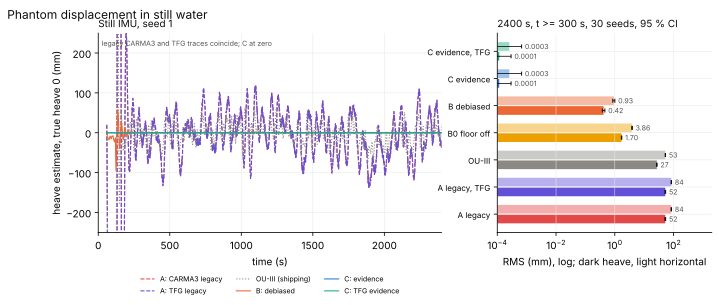
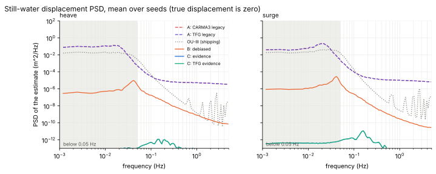
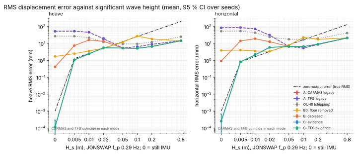
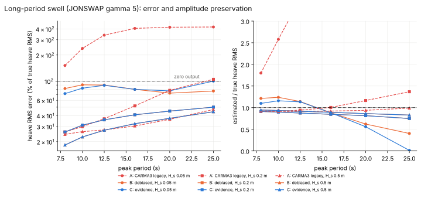
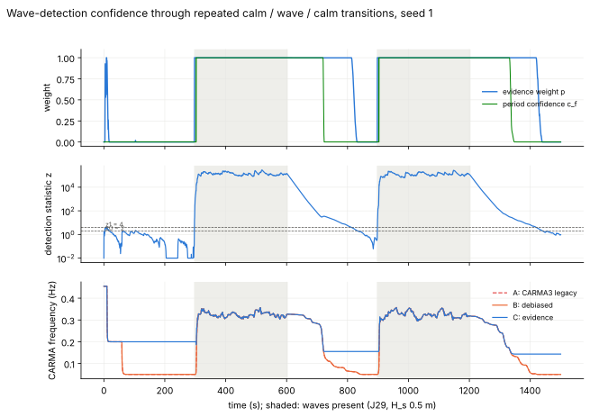
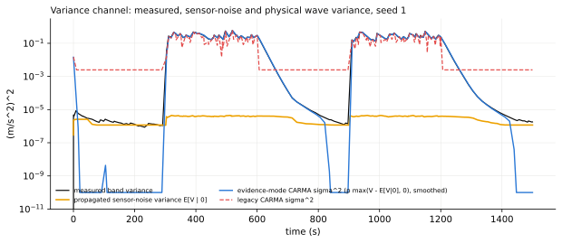
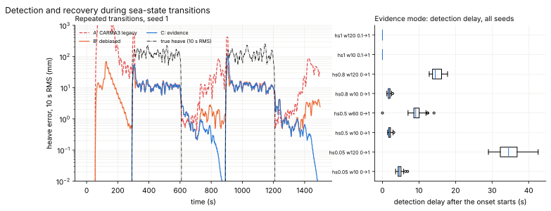
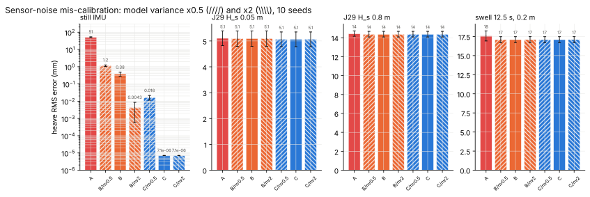

# Wave excitation of the CARMA research filters: evidence instead of floors (experimental)

**Status: experimental research on the two CARMA research filters**
(`SeaStateFusionFilter_CARMA3`, quaternion MEKF, and
`SeaStateFusionFilter_TFG_CARMA3`, two-frame Lie-group EKF; one wrapper, two
inner filters).  The shipping OU-III filter, its wrapper, tuning and the
OU-III stability study are not touched: `SeaStateFusionFilter_OU_III` does not
include the new code and its outputs are bit-identical.  A CARMA prior is a
statistical model, not a law imposed on the vessel's physical history; no
result here is a stability, admissibility or hardware statement.

**Summary.**  In the legacy chain, the wave excitation of both CARMA filters
is set by positive floors, not by measured waves (section 1.1).  In still
water, and on every sea whose vertical acceleration RMS is below 0.28 m/s^2,
the CARMA driving noise is the 0.05 m/s^2 floor.  The prior frequency is the
0.05 Hz clamp, reached because sensor noise pulls the period estimate there.
Sensor noise and slow attitude and bias error are then reconstructed as
displacement.

Evidence mode (`CarmaExcitationMode::Evidence`) replaces those floors with
three pieces:

* the noise-debiased variance of the band;
* a smooth detection probability built on an effective sample size, which
  weights that variance;
* a frequency hold: the prior keeps its frequency unless the band's own
  spectral moments confirm the measured period.

It must be enabled explicitly.  The default mode, `Legacy`, gives
bit-identical outputs to the previous tree.

Paired simulation: 30 seeds per principal condition, separate tuning seeds,
both inner filters, C (evidence) against A (legacy):

| case | result |
|---|---|
| still water | heave RMS 52.2 → 0.0001 mm and horizontal RMS 83.7 → 0.0003 mm; startup transient 2958 → 0.07 mm.  Better on every seed (target: −50 %). |
| small waves, heave | 69-98 % better up to H_s 0.02 m and 1-30 % better at 0.05-0.2 m.  Worst small-sea regression 3.3 %, worst swell regression 6.3 % (target: ≤ 10 %). |
| small waves, horizontal | **Target missed** on short-period 0.05-0.1 m seas: 20-30 % worse.  The cause is the fixed isotropic horizontal mapping (`S_factor` = 1), not the evidence logic (section 6.9). |
| wave onset | 80-96 % less error in the first minute; detection takes 1.9-4.6 s. |
| abrupt stop | 31-32 % worse in the first minute (4.2 against 3.2 mm). |
| calm-water manoeuvring | tilt 12.5 % worse, accelerometer-bias error 60 % worse. |
| realistic and mixed seas | no regression. |
| pinned vessel-RAO records (independent hull) | heave 8 % better, horizontal 1-5 % worse. |

Seas below the detection boundary of section 2.6 are reported as calm.  That
boundary runs from H_s 3 mm at 3 s to 12 cm at 25 s.

Cost: at most 0.25 us per sample on the host, +2.7-3.3 kB of code and +128 B of
wrapper state.  One exception: in still water, TFG Evidence mode is 50 %
slower on the host, because the arithmetic underflows into subnormal floats
(section 6.11).  The ESP32-S3 target build was not measured.

## 1. The failure mechanism

### 1.1 What drives the CARMA prior

The CARMA wrapper maps the measurement-only sea-state front end onto every
CARMA axis: frequency scale `kappa = f_tune / f_z,model`, `f_tune = c_tau/(2
tau)`, and the driving amplitude.  The Legacy amplitude is

    sigma_CARMA = c_carma max(0.05 m/s^2, sigma_band,floor, 1e-4, sigma_aw / c_sigma),
    sigma_aw    = c_sigma sqrt(max(V - V_floor, 1e-6) a_still),

`V` the tuner's EW variance of the period-scaled band `[0.5, 4] f_tune`,
`V_floor = (0.12 m/s^2)^2 g_band` the configured pre-band floor referred
through the band's exact white-noise gain `g_band`, and `a_still =
exp(-t_still / 1 s)` the stillness attenuation (`MarineWaveFrontEnd`'s
stillness detector: an EMA of `(a/g)^2` against `8e-4`, i.e. vertical RMS
below `0.28 m/s^2`).  The horizontal amplitude is `S_factor` times the
vertical one.

Four positive floors sit in this chain, and none is wave evidence:

| Floor | Value | What it is |
|---|---|---|
| CARMA amplitude floor | 0.05 m/s^2 | a constant |
| configured pre-band noise floor | 0.12 m/s^2 per sample | 8.1x the simulated BMI270-class accelerometer (1.51 mg = 0.0148 m/s^2); referred through the band it is 35x the band variance measured in still water |
| stillness attenuation | vertical RMS < 0.28 m/s^2 | an absolute acceleration threshold, independent of the sensor |
| variance floor | 1e-6 (m/s^2)^2 | numerical |

Measured on the benchmark (seed 1): in still water the band variance is
`1.1e-6 (m/s^2)^2` against `6.1e-7` predicted for the white noise alone (the
rest is the 5e-4 m/s^2/sqrt(s) bias random walk), and `4.0e-5` for the
configured floor.  `V - V_floor < 0`, so `sigma_aw` sits on its `1e-6`
floor, `0.9e-3 m/s^2`.  The stillness attenuation does the same on every sea
whose vertical acceleration RMS is under `0.28 m/s^2`: on JONSWAP 0.29 Hz
seas of H_s 0.005 to 0.1 m, on 12.5-25 s swell of 0.2-0.5 m, and
intermittently even at H_s 0.5 m (legacy `sigma` 0.38 against a measured
0.49 m/s^2).  **On all of them the CARMA driving noise is the 0.05 m/s^2
floor itself, whatever the sea.**  The floor is therefore not only an
artificial still-water excitation; it is also what keeps the legacy filter
working on small seas, compensating a measurement chain that discards their
measured amplitude.

### 1.2 Frequency

`WavePeriodEstimator` measures `T_z = 2 pi sqrt(m0/m2)` from doubly
integrated, doubly high-passed (0.02 Hz) vertical acceleration.  That proxy
weights the spectrum by `1/omega^4`; in still water it holds the sensor's own
low-frequency content (white noise and bias random walk give a 16 mm proxy,
section 2.4) and, over the first minutes, the slow levelling transient of the
front end's Mahony observer.  Its frequency is 0.015-0.035 Hz, the tuner
clamps it to 0.05 Hz, `tau = 10 s`.  In still water the legacy CARMA(4,1)
prior is therefore placed at `f_z = 0.05 Hz` with `0.05 m/s^2` and expects a
displacement standard deviation of

    sigma_h = sigma_a sqrt(Var_1(h) / (Var_1(a) kappa^4)) = 0.32 m

at 20 s periods (`Var_1` the unit-gain stationary variances of the fitted
shape, `f_z,base = 0.371 Hz`).  Sensor noise, slow tilt error and slow bias
leakage are accepted as displacement in exactly that band: the documented
phantom (docs/carma-three-axis.md section 9.4: heave 53 mm, horizontal 84 mm
RMS, 0-0.05 Hz; startup heave transient of metres).

### 1.3 The five quantities

| Quantity | Where it belongs | Legacy | Evidence mode |
|---|---|---|---|
| accelerometer measurement noise | measurement covariance `Racc`; the evidence statistic's null model | also enters the CARMA amplitude through the 0.12 floor and as the 0.05 floor | only in the null model of the evidence statistic |
| gyro noise, attitude error | attitude block of the filter; non-wave content of the front end's levelled channel | pulls the period estimate (levelling transient) | a pulled period is held (section 2.4) |
| genuine wave excitation | CARMA driving noise `W = G G^T` | floored at 0.05 m/s^2 | `p max(E, 0)` |
| sea-state parameter uncertainty | the evidence weight `p`, the period confidence `c_f` | none | moment-matched in `W`; frequency held |
| numerical regularization | numerical floor | 1e-4 m/s^2 inside the 0.05 max | 1e-5 m/s^2, independent of sensor and sea |

## 2. Mathematics

### 2.1 Noise-debiased band variance

The band output is `y = a_wave + n`, `n` the sensor error referred through
the band `H(s) = s b / ((s + a)(s + b))`, `a = 2 pi f_lo`, `b = 2 pi f_hi`.
With white per-sample noise `s^2` at interval `dt` (two-sided density
`c = s^2 dt`) and a bias random walk of intensity `q`, the EW variance with
horizon `tau` has, under "no waves",

    E[V | 0] = s^2 g_band + q b / (2 a (a + b)) - q / (2 tau a^2),

`g_band` the band's exact time-varying white-noise gain (`AdaptiveWaveBandPass`
propagates it), the second term the random-walk variance
`(q/pi) int_0^inf b^2 / ((w^2 + a^2)(w^2 + b^2)) dw` and the third the part the
tuner's EW mean removes (`S_y(0)/(2 tau)`, `S_y(0) = q / a^2`).  `E = V -
E[V | 0]` is unbiased for the wave's band variance when the noise model is
right, `max(E, 0)` the noise-debiased variance.  Checked against the
measurement chain on simulated noise (6000 s, `carma_excitation-test`):
within 1.2 % at f_tune 0.05, 0.3 and 1.0 Hz, with and without the random
walk.

### 2.2 Detection: effective sample size

Successive band samples are strongly correlated, so a chi-square test on the
raw sample count (`tau / dt`, 2.4e5 samples in a 60 s horizon) is wrong by
three orders of magnitude.  For a Gaussian band output with spectrum `S` the
EW estimate has (Isserlis)

    Var V / V^2 = pi / (tau B),   B = (int_0 S dw)^2 / int_0 S^2 dw,

so its effective sample size is `N = 2 tau B / pi`.  For white noise through
`H`, `B = pi (a + b)` and `N = 2 tau (a + b)`; with the random walk

    N = 2 tau (a + b) (c + q')^2 / (c^2 + 2 c q' + q'^2 (a^2 + 3ab + b^2)/(ab)),  q' = q/(ab),

from `int_0 w^4 / D^2 = pi / (4 (a+b)^3)`, `int_0 w^2 / D^2 = pi / (4 ab (a+b)^3)`,
`int_0 1 / D^2 = pi (a^2 + 3ab + b^2) / (4 a^3 b^3 (a+b)^3)`,
`D = (w^2 + a^2)(w^2 + b^2)`.  Measured on noise: N = 120 / 223 / 228 against
99 / 226 / 226 (white, f_tune 0.05 / 0.3 / 1 Hz) and 33 against 25 with the
random walk at 0.05 Hz.  The statistic is

    z = E / (E[V | 0] sqrt(2/N + u^2)),

`u` the relative 1-sigma uncertainty of the noise variance itself (default
0.5: the noise model of a device is known to a factor of about 1.5 in
variance, and section 5 measures what a factor of two does).  With `u = 0.5`
the `u` term dominates (`2/N` = 0.01-0.08), so `z` is conservative: an
excess must exceed about the noise variance itself before `z` reaches 2.

### 2.3 Evidence weight and the moment-matched excitation

`p = smoothstep((z - z0)/(z1 - z0))`, `z0 = 2`, `z1 = 4`, is the weight of
the hypothesis "waves" against "no waves".  Under "no waves" with a correct
model `P(z > 2)` is the Gaussian 2.3 % at most (the measured rate on pure
noise is 0.00 % of samples with `p >= 0.5`, 0.0000 mean excitation); `p = 1`
needs the excess to be beyond any noise fluctuation (`z1 = 4`).

The two hypotheses give two zero-mean Gaussian priors for the CARMA state,
with driving intensities `0` and `W_E = E W_unit`.  Because the stationary
covariance (and every `Q(dt)`) is linear in the intensity, the mixture
`(1 - p) N(0, P(0)) + p N(0, P(W_E))` has covariance `p P(W_E) = P(p W_E)`:
driving the CARMA prior with `W_eff = p max(E, 0)` reproduces the mixture's
second moments exactly.  This is not a second attenuation on top of the
debiasing: `E` is the wave variance *given* waves, `p` the probability of
waves.  Where `p = 1` (any sea a few times above the noise) the excitation
is the debiased variance unattenuated.

### 2.4 The period's confidence

The same noise model through the period estimator's elevation proxy
`s^2/(s + l)^4` (`l = 2 pi 0.02 Hz`) has variance
`V_eta,0 = c / (32 l^3) + q / (32 l^5)` (`int_0 w^4/(w^2+l^2)^4 = pi/(32 l^3)`,
`int_0 w^2/(w^2+l^2)^4 = pi/(32 l^5)`): 4.2 mm RMS from the white noise and
16.3 mm with the random walk (measured 4.2 / 15.9 mm).  A sea of H_s 0.1 m
has a proxy of about 25 mm, so on every sea below a few decimetres the proxy,
and the period it yields, is partly or mostly sensor error.  In still water
it holds, in addition, the slow levelling transient of the front end's
Mahony observer: four to eight times `V_eta,0` over the first five minutes.
Its frequency is then 0.015-0.04 Hz whatever the sea.

Acceleration is not weighted toward low frequency, so the band output is the
judge.  With one more pole at `f_hi` (`y2 = b/(s+b) y`, `d = dy2/dt`; the
white-noise variance of the derivative of a one-pole band is unbounded, of
the two-pole one finite) its noise-debiased zero-crossing frequency is

    f_c^2 = (V_d - V_d,0) / (V_y2 - V_y2,0) / (2 pi)^2,
    V_y2,0 = c b^3/(4(a+b)^2) + q b (a + 2b)/(4 a (a+b)^2) - q/(2 tau a^2),
    V_d,0  = c b^4 (2a + b)/(4(a+b)^2) + q b^3/(4(a+b)^2),

(`int_0 w^2 b^4/D2 = pi b^3/(4(a+b)^2)`, `int_0 b^4/D2 = pi b(a+2b)/(4a(a+b)^2)`,
`int_0 w^4 b^4/D2 = pi b^4(2a+b)/(4(a+b)^2)`, `D2 = (w^2+a^2)(w^2+b^2)^2`).  The
band is anchored on the period estimate, `[0.5, 4] f_tune`, so a period that
describes the waves centres their acceleration and `f_c / sqrt(f_lo f_hi)` is
of order one: 0.9-1.9 on every correctly anchored sea of the tuning seeds
(JONSWAP and PM, 8-25 s swell, broadband, bimodal, mixed).  A period pulled
far below the waves leaves their acceleration at the top of the band: 2.4-3.8
on H_s 0.02 m, 4.4-6 on H_s 0.005 m.  The ratio means something only where the
band is waves, so

    c_f = smoothstep((z - 8)/8) smoothstep((2.5 - f_c/f_mid)/0.5),

zero where the ratio cannot be formed.  `z >= 16` is a band excess of eight
times the noise variance (a band 89 % waves); in still water, under a noise
model wrong by a factor of two, and near the detection boundary `z` stays
below 8 and the period is held.

The CARMA frequency moves by the tau EMA scaled by `w = p c_f`
(`tau += alpha w (tau_target - tau)`): zero holds the committed value
exactly, one is the legacy update.  Before the period estimator is usable the
tuner runs on its fixed 0.2 Hz prior, which is followed; so a filter that
starts in still water holds 0.2 Hz rather than the noise's 0.05 Hz, and a
filter whose waves disappear holds their last reliable period.

Start-up.  The shared band starts from rest, so the DC level of its input
(turn-on bias, levelling) is a step at every start or tilt-watchdog reset;
its band-passed transient, held by the 20-35 s EW horizon, read as wave
evidence (`z` = 10 at 30 s, `p` = 1 to 90 s in still water) and moved the
held frequency to 0.05 Hz before the filter went Live.  The evidence
therefore runs its own copy of the band and its EW moments, with the
corners, sample interval and horizon the shared front end is in force with,
started from the first sample; away from a start it equals the shared
statistic.

*Rejected alternative.*  A first design trusted the period by the proxy's own
wave fraction `r = 1 - V_eta,0 / V_eta` (full trust at `r >= 0.9`).  It holds
the frequency on every sea below H_s 0.2-0.3 m (`V_eta,0` is dominated by the
random walk), including seas whose measured period, though biased low, is far
better than the prior: on the tuning seeds, steady H_s 0.05 m, heave 7.5 mm
against 5.3 mm for the legacy and debiased modes.  It also needed a second
copy of the proxy for start-up and an explicit test against below-band
content.  The anchoring test above replaces it: it holds only periods that
are far from the waves the band sees.

### 2.5 Covariance as the excitation goes to zero

For each CARMA block, `Q(dt) = int_0^dt e^{As} W e^{A^T s} ds` and the
stationary `P_inf` (`A P + P A^T + W = 0`) are linear in `W = sigma^2 W_1`:

    Q(dt; sigma) = sigma^2 Q_1(dt),   P_inf(sigma) = sigma^2 P_1,   Phi = e^{A dt} independent of sigma.

As `sigma -> 0` the prior is a deterministic, exponentially stable system
(`A` Hurwitz; `rho(Phi) = 0.99957-0.99989` at 200 Hz), `P_inf -> 0`
continuously, and the Kalman gain into the CARMA block vanishes: the filter
reduces to its attitude / gyro-bias / accelerometer-bias part with zero
wave acceleration, i.e. the zero-motion AHRS, which is the correct model of a
hull at rest.  `W = 0` exactly is admissible mathematically: `Q = 0`, `Phi`
unchanged, `P_LL(k) = Phi^k P_LL(0) Phi^kT` minus measurement information,
positive semidefinite and decaying to zero (`carma_excitation-test`: trace
`1e-14` of its start after 600 s).  It is not used, for two numerical
reasons: `CarmaVerticalModel::configure` rejects a non-positive amplitude
(as a configuration error, deliberately kept), and an unbounded calm decays
the block into float subnormals, which are slow or flushed on the target.
The numerical floor `sigma_num = 1e-5 m/s^2` keeps every `Q` entry above
`FLT_MIN` down to the 0.03 Hz tuner floor (tested), is two orders below the
band noise (`~1e-3 m/s^2`) and implies a prior heave standard deviation of
4 um at the held 0.2 Hz (0.18 mm at 0.03 Hz).  It is not a sensor or wave
quantity.

When the excitation returns, `P_LL(k+1) = Phi P_LL Phi^T + sigma_k^2 Q_1 - ...`
rises on the slowest pole's time scale (9.2 s at 0.2 Hz for CARMA(4,1)), well
inside the tuner's own EW horizon (13-35 s), so recovery is set by the
measurement of the sea, not by the covariance; no reset is needed and none is
made.  Covariance writes happen only where they did before (Live entry, shape
changes).

### 2.6 Observability and the detection boundary

A narrow sea of frequency `f` and heave RMS `sigma_h` has acceleration RMS
`(2 pi f)^2 sigma_h`.  With the band anchored on it (gain `G` at `f`) the
evidence weight reaches one when `G sigma_a^2 >= z1 sqrt(2/N + u^2) E[V | 0]`
(about `2.1 E[V | 0]`).  For the simulated sensor:

| T_p (s) | 3 | 4 | 6 | 8 | 10 | 12.5 | 16 | 20 | 25 |
|---|---|---|---|---|---|---|---|---|---|
| E[V \| 0] (1e-6 (m/s^2)^2) | 4.2 | 3.2 | 2.3 | 1.8 | 1.6 | 1.4 | 1.3 | 1.3 | 1.4 |
| sigma_a at p = 1 (mm/s^2) | 3.4 | 3.0 | 2.5 | 2.2 | 2.1 | 2.0 | 1.9 | 1.9 | 2.0 |
| H_s at p = 1 (m) | 0.003 | 0.005 | 0.009 | 0.015 | 0.021 | 0.031 | 0.050 | 0.077 | 0.123 |

Below that line the IMU carries no evidence that waves exist, and their
displacement is not reconstructable from it: `sigma_h` scales as
`T^2 sigma_a`, so a 25 s swell of 10 cm H_s has the acceleration of a 3 s
chop of 1.4 mm.  The period has a second, higher boundary.  The
displacement-domain period estimate is wave-dominated (proxy wave fraction
0.9) only above H_s of 0.20 m (3 s) to 0.31 m (25 s), almost all of that set
by the bias random walk; below it the estimate is biased low, and far below
it (H_s of a few centimetres at wind-sea periods) it describes the sensor,
not the sea.  The evidence mode follows it while the band confirms it and
otherwise drives the CARMA prior with the measured amplitude at a held
frequency.

## 3. Implementation

* `src/kalman_carma/CarmaWaveEvidence.h` (new): the sensor-noise model
  (`CarmaSensorNoise`: white per-sample std, bias random walk, relative
  variance uncertainty `u`), the thresholds (`CarmaEvidenceConfig`: `z0, z1`
  of the evidence weight, `zf0, zf1` and `k0, k1` of the period confidence)
  and `CarmaWaveEvidence`: its own start-clean copy of the sigma band with one
  more pole, their EW moments at the tuner's horizon, and the closed forms of
  section 2.  About forty float operations and three square roots per sample,
  ten floats of state.  Only `src/kalman_carma/` changes; the shared front
  end, `SeaStateAdaptationCommon`, the tuner and OU-III are untouched.
* `src/kalman_carma/SeaStateFusionFilter_CARMA3.h` (both CARMA wrappers;
  `SeaStateFusionFilter_TFG_CARMA3` is the same class with another inner
  filter): `setCarmaExcitationMode(Legacy | FloorOff | Debiased | Evidence)`,
  `setCarmaSensorNoise`, `setCarmaEvidenceThresholds`,
  `setCarmaNumericalSigmaFloor` (1e-5 m/s^2), the ablation switches
  `setCarmaEvidenceGate` and `setCarmaFrequencyHold`, and the diagnostics
  `waveEvidence()` and `getCarmaAccelStd()`.  Outside Legacy the evidence is
  computed from the same sample the variance channel sees; the mode decides
  what reaches the prior: the amplitude target (Legacy: the formula of section 1.1
  unchanged; FloorOff: the legacy channel without the floors; Debiased:
  `sqrt(max(E, 0))`; Evidence: `sqrt(p max(E, 0))`), and the weight of the tau
  update (Evidence: `p c_f`; otherwise one).  The target goes through the
  existing `0.4 T_sea` EMA and the existing one-sample staged commit; no other
  schedule changes.  **The default remains `Legacy`**, bit-identical to the
  previous wrapper in every numeric output of the benchmark; the AtomS3R
  research sketches `atomS3R_ins_carma3` and `atomS3R_ins_tfg_carma3` select
  `Evidence` explicitly, with the device noise model as constants at the top
  of each sketch.
* No covariance is reset at a wave / no-wave transition: the CARMA block's
  covariance follows from `Q(sigma)` alone.  CARMA(3,0), (4,1) and (5,2),
  the shapes, the frequency mapping, startup, magnetic fusion, bias
  estimation, vibration conditioning and the lever arm are unchanged.
* Bench (`tests/kalman_carma/carma3_bench`): filter options
  `<name>@<mode>[/opt...]` (modes `A`, `B0`, `B`, `C`, `Cnf` without the
  frequency hold, `Cng` without the evidence weight; options `nv<x>` noise
  variance scale, `rw0`, `u<x>`, `z<a>_<b>`, `zf<a>_<b>`, `k<a>_<b>`,
  `nf<s>`), `--excitation` summary and time-series columns, and the scenario
  base `calm` and modifiers `on/off/lev` (amplitude envelope), `hscale`,
  `scal`, `cnoise`, `nvar`, `engine<rpm>`.  `carma3-sim` takes
  `W3D_CARMA3_EXCITATION`.

## 4. Verification

`tests/kalman_carma/carma_excitation-test` (in `make all` through
`run_tests.sh`):

* sensor-noise model against the shipping chain (`AdaptiveWaveBandPass` ->
  `SeaStateAutoTuner`, and `WavePeriodEstimator`) on 6000 s of simulated white
  noise with and without the random walk at f_tune 0.05, 0.3 and 1 Hz: band
  variance within 8 % (measured within 1.2 %), effective sample size within a
  factor 1.5 (measured 0.74-1.33), elevation-proxy variance within 15 %;
* false alarms on that noise: `p >= 0.5` on at most 2 % of samples (measured
  0.00 %);
* CARMA(3,0), (4,1), (5,2) at f_tune 0.03-1.2 Hz: `Q(sigma)/sigma^2 = Q(1)`
  and `P_inf(sigma)/sigma^2 = P_1` in float (worst 3.6e-7, 1.6e-6 in
  correlation units), `Q` exactly symmetric, positive semidefinite (worst
  eigenvalue ratio -1.3e-12), `Phi` independent of `sigma`; `W = 0` gives
  `Q = 0`, the same `Phi`, `P_inf = 0`, and `P` decays from any start
  (`rho(Phi) < 1`); no subnormal `Q` entry down to the numerical floor;
* `StepDiscretization` on a +-25 % jittered clock at the floor and 0.03 Hz:
  finite, symmetric, positive semidefinite, no subnormals;
* still IMU: Legacy sits at 0.05 m/s^2 and 0.05 Hz, Evidence at the floor
  and the 0.2 Hz prior, with a still-water heave below a tenth of Legacy's;
* calm / waves / calm / waves / calm (300 s each, 10 s transitions, H_s 0.5 m)
  through CARMA3 (4,1), CARMA3 (5,2) and TFG-CARMA3 (4,1) in Evidence mode:
  full covariance finite, symmetric and positive semidefinite at every 1 s
  check, Live throughout, no one-sample step of the heave error above 5 mm,
  calm heave below 2 mm with the excitation back at the floor by the end of
  each calm, wave-segment heave error below 25 % of the true RMS.

## 5. Numerical study

`tools/carma_excitation_study.py` runs `carma3_bench` (complete INS: proxy
startup, magnetic acquisition, tuner, bias handling) with one truth, one
sensor stream and one seed per row for every filter, so every comparison is
paired; the truth is the benchmark's random-phase directional sea through
vessel RAOs, no CARMA model, with accelerometer white noise 1.51 mg, turn-on
bias up to 8 mg, bias random walk, gyro noise and bias, and a magnetometer
with hard and soft iron.  Filters: the shipping OU-III, CARMA3 (quaternion
MEKF) in modes A (Legacy), B0, B, C and the ablations Cnf, Cng, TFG-CARMA3 in
A, B and C.  Errors are taken against the wave coordinate over t >= 300 s;
startup over the first 120 s after Live.  Tuning used seeds 101-110 only;
every validation number below uses seeds 1-30 (1-20 or 1-10 on the secondary
grids).  Paired changes are `1 - mean(candidate)/mean(baseline)` with a 95 %
bootstrap interval over seeds (10 000 resamples).  The generated tables are
`reports/results/carma_excitation/summary.md` and `paired_stats.json`.

## 6. Results

### 6.1 Experiment 1: still water

H_s = 0, 2400 s records, scored over 300-2400 s, 30 seeds; four sensor
conditions: still IMU (`stationary`), the hull afloat with slow heading wander
(`calm`), the turn-on bias calibrated to +-0.01 m/s^2 (`calbias`), and
accelerometer and gyro scale factors of +-0.5 % with 0.1 deg misalignment
(`scal`).  Every IMU error of section 5 is present.

| still IMU, 30 seeds | OU-III | A legacy | B0 | B | C | C, no hold | C, no weight | TFG A | TFG C |
|---|---|---|---|---|---|---|---|---|---|
| heave RMS (mm) | 26.9 | 52.2 | 1.70 | 0.42 | 0.00012 | 0.0045 | 0.014 | 52.3 | 0.00012 |
| horizontal RMS (mm) | 52.6 | 83.7 | 3.86 | 0.93 | 0.00026 | 0.012 | 0.026 | 83.7 | 0.00026 |
| heave peak, mean over seeds (mm) | 91 | 174 | 6.1 | 3.1 | 0.0037 | 0.079 | 0.15 | 174 | 0.0037 |
| startup heave RMS, first 120 s Live (mm) | 971 | 2958 | 19 | 12.8 | 0.069 | 3.0 | 0.20 | 2958 | 0.069 |
| CARMA sigma, median (m/s^2) | - | 0.05 | 0.001 | 6.5e-5 | 1e-5 | 1e-5 | 6.5e-5 | 0.05 | 1e-5 |
| CARMA frequency, median (Hz) | - | 0.050 | 0.050 | 0.050 | 0.200 | 0.050 | 0.200 | 0.050 | 0.200 |
| tilt RMS (deg) | 0.394 | 0.393 | 0.389 | 0.389 | 0.389 | 0.389 | 0.389 | 0.392 | 0.389 |
| accel-bias error RMS (mg) | 6.85 | 6.80 | 6.78 | 6.78 | 6.79 | 6.79 | 6.79 | 6.79 | 6.79 |

The paired change against the legacy filter is +100.0 % [+100.0, +100.0] in
heave and horizontally on every seed of every condition, for both inner
filters; B removes 99 %, B0 97 % (summary.md).  The afloat condition gives
the same heave and 86.7 against 0.00026 mm horizontally, and there the
evidence mode also improves tilt (0.331 against 0.251 deg) and the
accelerometer bias (5.71 against 4.38 mg): the legacy prior absorbed the
heading-wander rotation of the turn-on bias as horizontal motion.  With the
turn-on bias calibrated the legacy startup transient is 416 mm, the
evidence mode's 0.013 mm.  The largest displacement of the evidence mode on any
seed and axis is 0.085 mm; the evidence weight reached 0.5 on at most 0.17 %
of the scored time of any seed (B and C share the statistic), with no visible
consequence.

Mechanism, from the ablations: the amplitude alone (B) takes the phantom from
52 to 0.42 mm, the frequency hold alone (C without the evidence weight) to
0.014 mm, both together to 1e-4 mm; the startup transient needs the hold
(3.0 mm without it, the CARMA prior sitting at 0.05 Hz when the turn-on bias
is first seen).  The NEES of the evidence mode, 2e-4 against 6 for a
consistent filter, says the reported position covariance (driven by the
1e-5 m/s^2 numerical floor and the attitude) is far larger than the
micrometre error: conservative, not overconfident.  The legacy filter's 3.2 is
consistent only because its covariance describes the phantom it produces.

The still-water displacement PSD (figure 2) shows where the phantom lived:
the legacy prior's 1e-1 m^2/Hz plateau below 0.05 Hz is gone; B leaves
1e-6 m^2/Hz there (1e-5 at its 0.05 Hz peak); the evidence mode stays below
2e-12 m^2/Hz in heave and 2e-11 m^2/Hz horizontally.

### 6.2 Experiment 2: very small waves

JONSWAP (gamma 3.3) at f_p 0.15, 0.29 and 0.45 Hz and Pierson-Moskowitz at
0.25 Hz, H_s 0.005-0.2 m; 30 seeds at 0.29 Hz, 10 on the others.  Heave RMS
error (mm) and the paired change of C against the legacy filter:

| JONSWAP 0.29 Hz | true heave RMS | OU-III | A legacy | B0 | B | C | C vs A, heave | C vs A, horizontal | C estimate / true RMS |
|---|---|---|---|---|---|---|---|---|---|
| H_s 0.005 m | 1.28 | 26.9 | 53.1 | 2.49 | 7.46 | **1.06** | +98.0 % [+97.9, +98.1] | +99.1 % [+99.0, +99.1] | 0.60 |
| 0.01 m | 2.55 | 21.8 | 45.9 | 3.57 | 16.0 | **2.41** | +94.7 % [+93.8, +95.6] | +97.1 % [+96.3, +97.6] | 1.19 |
| 0.02 m | 5.11 | 12.3 | 19.2 | 5.22 | 13.3 | **5.57** | +71.0 % [+65.9, +75.0] | +81.0 % [+77.9, +83.6] | 1.63 |
| 0.05 m | 12.8 | 9.28 | 5.35 | 12.1 | 5.33 | **5.29** | +1.1 % [+0.6, +1.5] | +0.3 % [-1.2, +1.6] | 0.99 |
| 0.1 m | 25.5 | 9.42 | 6.43 | 27.2 | 5.15 | **5.15** | +19.9 % [+19.2, +20.7] | **-23.2 % [-24.4, -22.0]** | 0.91 |
| 0.2 m | 51.1 | 12.0 | 8.90 | 18.3 | 6.57 | **6.57** | +26.1 % [+25.1, +27.1] | -3.6 % [-4.7, -2.5] | 0.93 |

The other spectra show the same pattern (summary.md): heave improves on every
condition except JONSWAP 0.15 Hz at H_s 0.1 m (-3.3 % [-4.2, -2.5]), by
69-98 % up to H_s 0.02 m and 1-30 % from 0.05 to 0.2 m; TFG-CARMA3 in
evidence mode equals CARMA3 in evidence mode to the reported digit on every
row.

* **No small wave is suppressed.**  The evidence weight is one on 100 % of the
  scored time at every condition except JONSWAP 0.15 Hz at H_s 0.005 m (heave
  RMS 1.25 mm, accelerations of 2.3 mm/s^2 RMS), where it is below 0.5 on
  72 % of the time: section 2.6 puts the boundary at H_s 0.009 m for 6 s
  periods.  B0, the floor removed without the evidence, is the counter-example
  the task warns of: its still-water and tiny-sea numbers are low because it
  outputs almost nothing, and it is 2.3x worse than the legacy filter at
  H_s 0.05 m and 4.2x at 0.1 m, where it still discards the measured
  amplitude through the stillness attenuation.
* **Detection is not reconstruction.**  From H_s 0.05 m the heave error is
  under half the true RMS (0.05 m: 41 %, 0.1 m: 20 %, 0.2 m: 13 %) and the
  estimate keeps the true amplitude (0.91-0.99).  At H_s 0.02 m (5 mm heave)
  the error equals the true RMS: the waves are detected, but the period
  estimate is pulled toward the sensor's low frequency (section 2.4) and only
  partly held, and the estimate carries 1.6 times the true variance; it is no
  better than reporting zero, though 3.4 times better than the legacy filter.
  Below that (H_s 0.005-0.01 m, 1-2.5 mm heave) the frequency is held at the
  0.2 Hz prior and the error is again about the true RMS.  The smallest sea
  reliably reconstructed in this benchmark is H_s 0.05 m at 3.4 s periods;
  the smallest reliably detected is H_s 0.005 m at 2-3.4 s and 0.01 m at
  6.7 s.
* **The regression: horizontal error on 0.05-0.2 m seas.**  At H_s 0.1 m C
  is 23 % (JONSWAP 0.29 Hz), 25 % (0.45 Hz) and 20 % (PM) worse
  horizontally than the legacy filter, and 30 % at JONSWAP 0.45 Hz, 0.05 m,
  while 20-30 % better in heave.  B is identical, so it is not the evidence
  logic: on these seas the legacy amplitude is the 0.05 m/s^2 floor on both
  axes (the stillness attenuation discards the measured RMS), the debiased
  modes restore the measured vertical RMS, and the horizontal prior is
  `S_factor = 1` times the vertical.  The benchmark hull's horizontal
  wave acceleration and displacement are 0.55-0.59 times the vertical per
  axis (RMS over both horizontal axes; truth, section 6.9).  The restored
  horizontal prior is therefore about 1.8 times too large, while the legacy
  floor happened to sit near the true horizontal level.  Experiment 10
  measures this mapping directly.

### 6.3 Experiment 3: long-period swell

JONSWAP gamma 5, peak periods 8, 10, 12.5, 16, 20 and 25 s, H_s 0.05, 0.2 and
0.5 m, 10 seeds.  Heave RMS error (mm; true heave RMS 12, 49, 123 mm):

| H_s | method | 8 s | 10 s | 12.5 s | 16 s | 20 s | 25 s |
|---|---|---|---|---|---|---|---|
| 0.05 m | A legacy | 18.2 | 28.2 | 40.1 | 49.5 | 51.4 | 51.4 |
| | B | 9.9 | 10.8 | 10.7 | 9.9 | 9.0 | 9.4 |
| | C | 8.7 | 9.9 | 10.7 | 9.9 | 9.5 | 12.3 |
| 0.2 m | A legacy | 12.6 | 14.3 | 17.6 | 25.4 | 38.5 | 51.3 |
| | C | 12.6 | 14.8 | 17.1 | 20.1 | 22.2 | 24.5 |
| 0.5 m | A legacy | 29.6 | 31.2 | 32.6 | 37.3 | 44.6 | 57.5 |
| | C | 22.3 | 27.1 | 32.4 | 39.6 | 45.8 | 54.1 |

* Swell is not classified as calm where it is above the detection boundary:
  missed-wave time 0 % on every 0.2 and 0.5 m swell and on 0.05 m up to 16 s.
  The estimated heave RMS keeps 0.75-0.95 of the true one (the legacy filter
  0.91-1.36 at 0.2 m, its excess being phantom).
* 0.05 m swell at 20-25 s (true vertical accelerations of 2.5 and 1.6 mm/s^2
  RMS; a broad gamma-5 spectrum carries more acceleration than its peak) is at
  or below
  the boundary of section 2.6 (H_s 0.077 m at 20 s, 0.12 m at 25 s): at 25 s
  the evidence weight is below 0.5 on 68 % of the time, C reports almost
  nothing (estimate / true 0.01) and its error is the true RMS, 12.3 mm;
  B, which drives the prior with any positive excess, keeps some of it
  (9.4 mm).  This is the one swell row where B beats C, and it is the regime
  where the IMU carries no evidence of the swell.
* On 0.5 m swell at 16-20 s C is 6 % and 3 % worse than the legacy filter
  (summary.md for the intervals), level at 12.5 s, and 13-25 % better at
  8-10 s and 6 % at 25 s.

### 6.4 Experiment 4: wave onset and disappearance

J29 seas switched on, off, up and down by an amplitude envelope with C2
smootherstep transitions over 10 s (abrupt) and 60-120 s (gradual), 30 seeds;
the repeated record has four transitions.  From `transitions.csv`:

| transition | width | detection (s, median) | sigma settles (s) | heave error 0-60 s: A / B / C (mm) | C vs A, 0-60 s | heave error 60-180 s: A / C |
|---|---|---|---|---|---|---|
| calm -> H_s 0.05 m | 10 s | 4.6 | 78 | 65.2 / 36.3 / 6.8 | +89.6 % [+88.5, +90.6] | 9.2 / 5.7 |
| calm -> H_s 0.05 m | 120 s | 34.5 | 140 | 51.6 / 9.1 / 1.9 | +96.3 % [+95.9, +96.8] | 42.9 / 6.5 |
| calm -> H_s 0.8 m | 10 s | 1.9 | 25 | 204.7 / 57.7 / 40.6 | +80.2 % [+76.5, +83.2] | 14.6 / 14.5 |
| calm -> H_s 0.8 m | 120 s | 14.4 | 100 | 88.7 / 44.5 / 10.6 | +88.1 % [+86.8, +89.1] | 14.3 / 14.1 |
| H_s 0.1 -> 1 m | 10 s | 0 | 22 | 20.0 / 19.2 / 19.2 | +3.6 % [+0.9, +6.7] | 16.8 / 16.8 |
| H_s 1 -> 0.1 m | 10 s | - | 49 | 7.5 / 7.0 / 7.0 | +6.5 % [+1.9, +11.1] | 6.0 / 4.7 |
| H_s 0.8 m -> calm | 10 s | 234 (release) | 61 | 4.4 / 5.8 / 5.8 | **-32.3 % [-40.3, -25.6]** | 5.4 / 0.8 |
| H_s 0.8 m -> calm | 120 s | 303 (release) | 119 | 13.2 / 13.1 / 13.1 | +0.1 % [-0.3, +0.6] | 4.3 / 3.8 |
| repeated 0.5 m, onsets | 10 s | 1.9 | 26 | 160.3 / 37.4 / 30.4 | +81.0 % [+78.2, +83.5] | 11.2 / 10.8 |
| repeated 0.5 m, stops | 10 s | 237 (release) | 62 | 3.2 / 4.2 / 4.2 | -31.1 % [-36.7, -26.1] | 8.3 / 0.8 |
| repeated 0.5 m, onsets | 60 s | 9.1 | 58 | 87.9 / 34.5 / 12.4 | +85.8 % [+84.1, +87.3] | 11.2 / 10.8 |
| repeated 0.5 m, stops | 60 s | 264 (release) | 86 | 7.7 / 7.5 / 7.5 | +3.2 % [+1.3, +5.3] | 4.4 / 1.1 |

Detection is measured from the start of the transition; "release" is the time
until `p` falls below 0.5 after waves stop.  The heave peak in the first 120 s
of an abrupt onset to 0.8 m is 1410 mm for the legacy filter, 268 mm for B and
153 mm for C.

* **Onset.**  The legacy filter meets returning waves with a prior parked at
  0.05 Hz; its first-minute error is as large as the waves themselves (205 mm
  against 197 mm of true heave).  B meets them with the right amplitude but at
  the 0.05 Hz frequency the noise left it at; C with the held 0.2 Hz (or the
  last wave period), and is 80-96 % better than the legacy filter on every
  seed.  Detection takes 1.9-4.6 s after an abrupt onset; the amplitude
  follows the tuner's EW horizon (25-78 s to 90 %), which is the limit on
  recovery: the CARMA covariance itself rebuilds in about 10 s (section 2.5).
  No filter needed a restart, and the repeated record shows no degradation
  from the first to the second cycle.
* **Abrupt stop: a cost in the first minute.**  After waves vanish within
  10 s, C is 31-32 % worse than the legacy filter over the next 60 s (4.2
  against 3.2 mm and 5.8 against 4.4 mm, against 31-51 mm of true heave in
  that minute) and 7-10 times better from 60 to 180 s (0.8 against 5.4-8.3
  mm).  The legacy filter drops to its floor within seconds because its
  stillness detector fires; the evidence keeps the wave excitation for the EW
  memory of the band (the excitation falls to 10 % in about 60 s, `p` below
  0.5 only after 234-303 s, the time for a variance five orders above the
  noise to decay through a 20-35 s horizon).  With the frequency held on the
  last wave period and the accelerometer reporting no motion, that residual
  excitation costs millimetres.  Gradual stops are a tie.
* **Covariance.**  In every record of the unit test and the benchmark the
  covariance stayed finite, symmetric and positive semidefinite; NEES and
  covariance traces are in the generated tables.

### 6.5 Experiment 5: sensor-noise uncertainty and disturbances

10 seeds; the evidence model's noise variance halved (`/nv0.5`, underestimated
by 50 %) or doubled (`/nv2`, overestimated by 100 %), and five disturbances
outside the model.  Heave RMS (mm):

| condition | A legacy | B | C | C, model x0.5 | C, model x2 | C: time with p >= 0.5 |
|---|---|---|---|---|---|---|
| still IMU | 51.3 | 0.38 | 7e-6 | 0.016 | 7e-6 | 0 % (x0.5: 8 %) |
| still IMU, noise variance cycling 1x-2x | 52.1 | 0.72 | 0.0008 | 0.042 | 8e-6 | 0 % (x0.5: 26 %) |
| still IMU, temperature 25-45 C | 55.6 | 0.80 | 0.0021 | 0.040 | 7e-6 | 0 % (x0.5: 28 %) |
| still IMU, diesel at 1500 rpm | 47.0 | 1.28 | 0.036 | 0.063 | 4e-5 | 72 % |
| still IMU, diesel at 2400 rpm | 42.0 | 1.06 | 0.046 | 0.056 | 0.0009 | 100 % |
| still IMU, colored noise 0.5 mg, 2 s | 107.6 | 20.6 | 20.6 | 20.9 | 19.8 | 100 % |
| still IMU, colored noise 4 mg, 2 s | 747 | 508 | 508 | 509 | 508 | 100 % |
| J29 H_s 0.05 m | 5.10 | 5.09 | 5.07 | 5.07 | 5.07 | 100 % |
| J29 H_s 0.8 m | 14.4 | 14.4 | 14.4 | 14.4 | 14.4 | 100 % |

* **Mis-calibrated white noise and bias walk** (factor two in variance either
  way, slowly varying level, temperature): the still-water phantom stays below
  0.05 mm and no wave result moves (H_s 0.05 and 0.8 m identical to 0.1 %).
  An underestimated model raises false detections (8-28 % of the time), but
  their amplitude is the small excess itself, at a held frequency.
* **Engine vibration** aliased into the wave band is read as waves (72-100 %
  of the time): the evidence statistic cannot tell an aliased line from a
  wave, and the vibration guard acts above the wave band.  The excitation it
  produces is small and the frequency stays held, so the phantom is 0.04 mm
  (the legacy filter's 42-47 mm).  With waves present, engine vibration costs
  every mode the same.
* **Colored noise in the wave band is not separable from waves** by any
  statistic of the accelerometer alone.  0.5 mg of 2-s Gauss-Markov noise
  produces a 21 mm phantom in every non-legacy mode (the legacy filter's
  108 mm); 4 mg is a stress case that defeats every filter (OU-III and the
  legacy CARMA3 included).  A device with such noise needs it in the noise
  model (an AR(1) term has the same closed forms) or a different sensor.

### 6.6 Experiment 6: non-wave vessel motion

20 seeds, no waves unless stated; displacement is scored against the wave
coordinate, so the correct output is zero.

| condition | heave / horizontal RMS (mm): A legacy | C | tilt RMS (deg): A / C | accel-bias error (mg): A / C | yaw RMS (deg): A / C |
|---|---|---|---|---|---|
| afloat, heading wander | 53.1 / 86.9 | 1e-5 / 2e-5 | 0.327 / 0.273 | 5.64 / 4.76 | 2.75 / 2.78 |
| steady 2.5 m/s | identical to the row above (constant velocity carries no specific force) | | | | |
| 2.5 m/s, 90 deg zigzag heading | 53.1 / 89.1 | 1e-5 / 2e-5 | 0.080 / 0.043 | 1.13 / 0.72 | 2.37 / 2.38 |
| at anchor, slow drift and yaw sheer | 53.1 / 144.0 | 1e-5 / 2e-5 | 0.226 / 0.199 | 3.31 / 3.23 | 3.15 / 3.14 |
| drifting | 53.1 / 256.9 | 1e-5 / 2e-5 | 0.343 / 0.301 | 5.69 / 5.11 | 2.73 / 2.77 |
| manoeuvring: speed and 70 deg heading changes | 54.8 / 594.9 | 2e-4 / 8e-4 | **0.410 / 0.461** | **4.60 / 7.35** | **2.97 / 3.39** |
| J29 0.2 m, heave RAO x 0.2 | 6.28 / 18.4 | 5.77 / 17.6 | 0.271 / 0.278 | 4.71 / 4.83 | 2.35 / 2.36 |
| J29 0.8 m, heave RAO x 0.2 | 8.17 / 29.1 | 5.96 / 20.2 | 0.371 / 0.279 | 6.43 / 4.83 | 1.62 / 1.50 |

* The legacy prior turns translation and drift into wave displacement (up to
  0.6 m horizontally while manoeuvring); the evidence prior does not.
* **The quiet-water logic does not suppress real dynamics, but it moves
  where unexplained acceleration goes.**  While manoeuvring (0.07-0.1 m/s^2
  of horizontal acceleration for 25-35 s at a time) the legacy filter
  absorbed part of the acceleration in its floor-driven wave state, which
  removed it from attitude and bias at the price of 0.6 m of fake
  displacement.  With no wave excitation it goes to the remaining states:
  tilt RMS 12.5 % [5.7, 19.5] worse, accelerometer-bias error 60 % worse,
  yaw 14 % worse (the two-frame Lie-group filter: yaw unchanged, bias 52 %
  worse).  In steady, anchored and drifting conditions attitude and bias
  improve (11-46 % tilt).  A maneuvering vessel in calm water is the case for
  an external velocity aid; no IMU-only prior separates manoeuvre
  acceleration from bias without it.
* **Weak heave, ordinary horizontal response**: the horizontal prior is tied
  to the vertical evidence (`S_factor` times it), so a hull that barely
  heaves gets a small horizontal prior.  On this benchmark it still helps
  (C 4 % and 31 % better horizontally than the legacy filter, tilt and bias
  better at 0.8 m), because the measured vertical amplitude remains above the
  noise; a hull whose heave falls below the detection boundary while it still
  sways would lose its horizontal prior, which no vertical statistic can
  prevent.

### 6.7 Experiment 7: realistic and mixed seas

20 seeds; RMS error in % of H_s, C against A:

| sea | heave: A / C | horizontal: A / C | NEES p,v: A / C |
|---|---|---|---|
| JONSWAP 0.29 Hz, 0.8 m | 1.82 / 1.81 | 2.63 / 2.65 | 4.95 / 4.82 |
| PM 0.25 Hz, 1 m | 2.09 / 2.08 | 2.89 / 2.90 | 5.38 / 5.26 |
| mixed swell + wind | 11.64 / 11.52 | 15.11 / 15.01 | 63.0 / 59.8 |
| bimodal | 4.15 / 4.11 | 6.13 / 6.13 | 9.65 / 9.13 |
| broadband | 5.27 / 4.39 | 7.21 / 7.03 | 13.2 / 7.7 |
| changing f_p | 1.98 / 1.96 | 2.86 / 2.88 | 5.52 / 5.39 |
| abrupt change 0.5 -> 2 m | 1.84 / 1.82 | 2.82 / 2.81 | 9.04 / 8.58 |

The correction does not worsen the existing CARMA(4,1) results: every heave
change is between 0 and +17 % (broadband), every horizontal one between
-0.8 % and +2.5 % (summary.md).  The mixed-sea failure of the fixed shape (section 12 of
carma-three-axis.md) is unchanged, as expected: the excitation amplitude was
not its cause.  The accelerometer NIS stays 0.08-0.43 (3 dof) for every
mode: the wrapper's accelerometer covariance far exceeds the realized
innovations, so NIS does not test the motion prior (as in the CARMA3 study);
NEES improves slightly everywhere, most on the broadband sea.

### 6.8 Experiments 8 and 9: model orders and jittered clocks

CARMA(3,0) and CARMA(5,2) (both inner filters for (5,2)), 10 seeds: the
still-water phantom goes from 29 and 45 mm heave to 2e-6 and 4e-6 mm; JONSWAP
H_s 0.02 m heave from 13.1 / 14.7 to 6.0 / 5.4 mm; 0.8 m and the mixed sea
within 0.7 %.  On 12.5 s swell of 0.2 m, heave is 12 % (3,0) and 8 % (5,2)
worse and horizontal 2 % and 27 % better.  With +-25 % interval jitter and with
a +-1 % jitter on a 1 us clock every mode behaves as on the uniform clock.

### 6.9 Experiment 10: the horizontal amplitude mapping

The horizontal regression of section 6.2 is the fixed mapping
`sigma_h = S_factor sigma_z`, `S_factor = 1`.  With a smaller fixed factor,
0.4 (10 seeds):

| sea | horizontal RMS (mm): A | C | C, S_factor 0.4 | C, S 0.4 vs A |
|---|---|---|---|---|
| JONSWAP 0.29 Hz, 0.05 m | 6.42 | 6.37 | 4.62 | +28.1 % [+24.8, +30.9] |
| 0.1 m | 5.16 | 6.35 | 5.15 | +0.3 % [-0.4, +0.9] |
| 0.2 m | 8.47 | 8.78 | 7.22 | +14.7 % [+13.3, +16.2] |
| 0.8 m | 20.9 | 21.1 | 17.5 | +16.1 % [+15.1, +17.2] |
| JONSWAP 0.45 Hz, 0.1 m | 3.68 | 4.59 | 3.30 | +10.3 % [+9.1, +11.7] |
| PM 0.25 Hz, 0.1 m | 5.80 | 6.94 | 5.87 | -1.2 % [-1.8, -0.5] |
| mixed swell + wind | 194 | 193 | 250 | -28.6 % [-29.2, -27.9] |

The factor 0.4 turns every short-period regression into a tie or a gain,
and costs 29 % on the mixed sea.

**A measured ratio does not resolve this.**  A follow-up diagnostic tested
it (5 seeds).  Applied to the front end's levelled horizontal acceleration,
the noise-debiased band statistic of section 2.1 recovers the true
horizontal band variance within 0.1-4 % on every sea, so tilt leakage in the
band is negligible.  But the ratio it measures is 0.55-0.59 per axis on
every sea, the mixed sea included, and so is the true displacement ratio
(0.55-0.57).  With that value (`S_factor` 0.57):

* C's horizontal error falls 15-23 % on the single-peak seas, a tie or a gain
  against the legacy filter on every one of them;
* heave is unchanged;
* the mixed sea is 16.7 % worse, on every seed.

An implementation that applies the measured ratio continuously, weighted by
`p`, was then screened on every scenario of the validation grid (5 seeds).
Heave is unchanged everywhere (within 0.4 %), and horizontal error improves
on 62 of 90 scenarios (median 11 %).  But attitude and accelerometer bias
pay for it.  Tilt and bias error get worse on 57 of 106 scenarios:

* steady seas: median 3.5 %, and 26-36 % on 0.45 Hz seas;
* abrupt onsets: up to 91 %;
* engine vibration: yaw two to three times worse.

The horizontal error itself also regresses on the bimodal sea (8 %) and
under colored noise (9 %).  The pattern is consistent with the mechanism of
section 6.6.  A horizontal prior sized to the true horizontal motion leaves
the filter less room to explain horizontal specific force, so the rest goes
to tilt and bias.  `S_factor = 1` over-drives the horizontal prior and
protects attitude.

On the mixed sea the swell and the wind sea arrive from different
directions.  The swell-dominated displacement is 0.70 of the vertical along
x; the wind-sea-dominated acceleration is 0.45 along x and 0.70 along y.  A
single isotropic factor driven by acceleration-band statistics cannot
represent both; `S_factor = 1` helps there by over-driving both axes.
Neither the frequency confidence nor the band-frequency ratio tells the
mixed sea apart from the single-peak seas (`c_f = 1`; ratio 1.37 against
0.92-1.38).  So no measured-ratio variant tested here is free of
regressions; the fix needs a horizontal prior that can carry two
directional wave systems.  The primary experiment keeps every mapping
parameter.  The measured-ratio harness is not part of this change;
`A41@C/sf0.57` reproduces the bench rows.

### 6.10 Independent hull: the pinned vessel-RAO records

The eight scored records of oceanography-waves-lib v1.2.3 (28 ft hull RAO,
JONSWAP and PM-Stokes, H_s 0.27-8.5 m) through `carma3-sim`
(`W3D_CARMA3_EXCITATION=A` or `C`), ten seeds, final 900 s, paired per
record and seed (80 pairs per inner filter).  Displacement RMS in % of the
record's H_s; attitude in degrees:

| inner filter | metric | A | C | C vs A |
|---|---|---|---|---|
| CARMA3 | heave | 2.50 | 2.30 | +8.0 % [+5.4, +10.5] |
| CARMA3 | horizontal x | 2.30 | 2.33 | -1.3 % [-1.7, -1.0] |
| CARMA3 | horizontal y | 1.98 | 2.08 | -4.9 % [-6.5, -3.7] |
| CARMA3 | yaw | 2.29 | 2.26 | +1.4 % [+0.8, +2.0] |
| CARMA3 | pitch | 0.241 | 0.237 | +1.6 % [-0.4, +3.6] |
| TFG | heave | 2.50 | 2.30 | +8.0 % [+5.4, +10.5] |
| TFG | horizontal x | 2.30 | 2.33 | -1.3 % [-1.7, -1.0] |
| TFG | horizontal y | 1.98 | 2.08 | -5.0 % [-6.5, -3.7] |
| TFG | yaw | 2.29 | 2.26 | +1.3 % [+0.8, +1.9] |

Both changes are concentrated on the two 0.27 m records.  Their vertical
acceleration is under the legacy stillness threshold.  On those records,
heave improves from 3.1-3.2 % to 2.4-2.5 % of H_s, and horizontal y worsens
from 0.85-0.88 % to 1.10-1.13 %.  From 1.5 m upward, both modes agree within
1.6 % on heave and 5 % on horizontal error.  This is the small-sea pattern
of section 6.2.  The horizontal/vertical ratio of this hull was not measured,
so the `S_factor` explanation of section 6.9 is plausible here but not tested.

### 6.11 Computational cost

**Arithmetic.**  Evidence mode adds about 40 floating-point operations,
3 square roots and 3 exponentials per sample.  The evidence keeps its own
band copy, extra pole, derivative and three EW moments.  On the host, the
wrapper grows by 128 B (sizeof 3120 to 3248 B): the evidence state, its
configuration and the cached diagnostics.  The inner filters do not change
size.

**Host time.**  Mean update time per sample, one filter per process on an
otherwise idle host (x86-64, GCC `-O3 -march=native`), 600 s records,
3 seeds:

| record | CARMA3 A | CARMA3 C | TFG A | TFG C | OU-III |
|---|---|---|---|---|---|
| still water | 3.00 us | 3.21 us | 5.12 us | **7.74 us** | 7.60 us |
| JONSWAP 0.29 Hz, H_s 0.02 m | 3.09 us | 2.98 us | 5.08 us | 4.84 us | 8.03 us |
| JONSWAP 0.29 Hz, H_s 0.8 m | 3.07 us | 3.12 us | 4.91 us | 4.95 us | 8.25 us |

The parallel figures in `summary.md` ("Host cost") are relative only.

**The still-water cost of TFG Evidence mode is float underflow.**  In still
water the excitation sits on the 1e-5 m/s^2 numerical floor.  Products of
the resulting tiny covariance blocks underflow into subnormal intermediates
inside the TFG covariance arithmetic.  The stored covariance itself contains
no subnormal entry after 600 s: the smallest stored magnitude is 7.8e-26
against FLT_MIN 1.2e-38.  With the x86 flush-to-zero and denormals-are-zero
bits set, TFG C in still water runs at 4.4-5.2 us per minute of record,
against 4.4-4.9 us for TFG A.  Without those bits it runs at 6.8-8.1 us.
The quaternion-MEKF inner filter is not affected.

The floor trades this cost against still-water displacement (seeds 1-3,
600 s):

| numerical floor (m/s^2) | TFG C time | still-water heave RMS |
|---|---|---|
| TFG A, for reference | 4.8-5.2 us | 43-53 mm |
| 1e-5 (default) | 7.3-7.8 us | 1e-5 mm |
| 1e-4 | 7.0-7.5 us | 7e-4 mm |
| 3e-4 | 5.8-6.4 us | 0.007 mm |
| 1e-3 | 5.0-5.4 us | 0.06 mm |

The default stays at 1e-5 m/s^2, for two reasons.  Every result in this
document uses it.  And 1e-3 m/s^2 is half the acceleration at which
the evidence weight reaches one (1.9-3.4 mm/s^2, section 2.6), so a floor
that high would no longer be purely numerical.  If target timing shows the same penalty,
`setCarmaNumericalSigmaFloor()` exposes the trade.  Whether the ESP32-S3
FPU slows down on subnormals has not been measured.

**ESP32-S3 target.**  The AtomS3R sketches were not compiled for the target
in this environment, so there are no target size, RAM, stack or timing
numbers.  The arduino-esp32 core download from downloads.arduino.cc was
refused by the environment's network policy (HTTP 403), and the Espressif
toolchain download was not permitted in the session.  The host proxy of
`tests/kalman_carma/arduino/carma3_size_probe/build.sh host` compiles the
same translation units, but with the 64-bit host g++ at `-Os`, so its
numbers are object-file section totals, not linked target sizes:

| variant | code (B): main | branch | wrapper sizeof (B) | inner filter sizeof (B) | max stack frame (B) |
|---|---|---|---|---|---|
| CARMA3 (4,1) | 194723 | 197472 (+2749) | 3120 -> 3248 | 6224 (same) | 1456 (same) |
| CARMA3 (5,2) | 197506 | 199843 (+2337) | 3120 -> 3248 | 8704 (same) | 2096 (same) |
| TFG (4,1) | 170423 | 173681 (+3258) | 3120 -> 3248 | 5968 (same) | 1456 (same) |
| OU-III | 234765 | 234765 (same) | 3072 (same) | 5728 (same) | 1456 (same) |

## 7. Assessment

**Against the research targets.**  Still-water displacement: reduced by
100.0 % [100.0, 100.0] in heave and horizontally on every seed of every
still condition, startup transients included (target: 50 %).  Detectable
small waves: no heave regression beyond 3.3 % on any small-sea condition and
6.3 % [5.2, 7.4] on swell (0.5 m at 16 s; the target allows 10 %), and
69-98 % better up to H_s 0.02 m; **horizontally the 10 %
target is missed on short-period 0.05-0.1 m seas (20-30 % worse)**, by a
mechanism outside the evidence logic (section 6.9).  Both inner filters give
the same result to the reported digit.

**Where it succeeds.**  Still water, quiet water afloat, at anchor, drifting,
underway and turning without waves; every onset from calm (80-96 % less error
in the first minute); tiny seas (heave error at the size of the true heave
instead of 10-20 times it); long swell above the detection boundary
(amplitude kept, legacy phantom removed); engine vibration and white-noise
mis-calibration in still water; every realistic and mixed sea without
regression.

**Where it fails or costs.**

1. Horizontal error on 0.05-0.2 m seas of short period, up to 30 % worse:
   the debiased amplitude exposes the fixed isotropic horizontal mapping,
   which the legacy floor had masked (section 6.9).
2. Calm-water manoeuvring: tilt 12.5 % and accelerometer-bias error 60 %
   worse, because acceleration the legacy prior hid as fake wave displacement
   (0.6 m) now reaches attitude and bias (section 6.6).
3. The first minute after waves stop abruptly: 31-32 % worse than the legacy
   filter, in millimetres; the evidence keeps the band's EW memory for 4-5
   minutes (section 6.4).
4. Seas below the information limit (5 cm swell at 20-25 s, H_s 0.005 m at
   6.7 s): classified as calm, reported as nothing; B keeps a little more of
   the 25 s swell.  This is the boundary of section 2.6, not a tuning defect.
5. Seas between detection and period identification (H_s about 0.005-0.02 m
   at wind-sea periods): detected and correctly scaled, but at a held or
   pulled frequency; the error is the size of the waves.
6. Colored or aliased sensor errors in the wave band read as waves; with a
   held frequency the cost is small for engine lines (0.04 mm) and not for
   broad colored noise (21 mm at 0.5 mg).
7. The noise model must be commissioned per device (white noise and bias
   random walk from an Allan-variance record); the study shows a factor of two
   in variance is tolerated in still water and invisible in waves.

**Ablations.**  B (debiased amplitude, frequency following the tuner) does
most of the amplitude work but keeps the noise-pulled 0.05 Hz frequency, and
pays for it at onsets (1.2-5 times C's first-minute error) and on tiny seas
(7-20 mm against 1-2.4 mm).  The frequency hold alone (C without the weight)
reaches C in steady still water; the weight matters at the margin (startup,
mis-calibrated models).  B0, the floor removed without debiasing, looks
excellent in still water and on the tiniest seas because it outputs nothing,
and is 2-4 times worse than the legacy filter from H_s 0.05 m: removing the
floor is only correct together with a measured amplitude.

## 8. Limitations

* Simulation only: one synthetic hull with explicit RAOs, one pinned replay
  hull, linear random-phase seas, an IMU at the centre of gravity, a sensor
  model of white noise, bias random walk, turn-on bias, scale-factor and
  misalignment errors, temperature drift, engine vibration and the stated
  colored-noise cases.  The noise model the evidence uses matches the
  simulated sensor; section 6.5 is the only test of a mismatch.
* The amplitude still enters through the fixed CARMA shape, the fixed
  in-band-to-total amplitude mapping and the isotropic `S_factor`; mixed-sea
  and shape failures of the CARMA prior are unchanged.
* Thresholds `z = (2, 4)`, `u = 0.5` and the numerical floor are a priori;
  `zf = (8, 16)` and `k = (2, 2.5)` were set from the tuning seeds and are
  insensitive there (+-5 %, section 5); a hull or sea far from this benchmark
  may sit outside the 0.9-1.9 anchoring band.
* No stability statement: the excitation now varies with the data over four
  decades, and the switched-system character of the CARMA filter remains
  unanalysed (as in carma-three-axis.md).

## 9. Readiness for hardware trials

Ready for **instrumented research trials** on the AtomS3R sketches, with
three conditions: commission the accelerometer noise model of each device
from a stationary record (the sketch constants); log the evidence diagnostics
(`waveEvidence()`: `p`, `z`, `c_f`, the band variance and its noise
expectation) with the displacement; and treat calm-water manoeuvring and
small short-period seas as the cases to check first, since they are where
the simulation shows costs.  The target ESP32-S3 build, code size, stack and
execution time could not be measured in this environment (section 6.11).
Those are the first hardware measurements to take.  They should include
TFG-CARMA3 in still water, because its host cost there is subnormal float
arithmetic (section 6.11).  It is not a deployment
candidate: OU-III remains the shipping filter, and the CARMA research
filters carry their own open obstacles (carma-three-axis.md section 12).

## Reproduction

    make ensure-sim-data
    make -C tests/kalman_carma carma3_bench carma3-sim carma_excitation-test
    (cd tests/kalman_carma && ./carma_excitation-test)
    python3 tools/carma_excitation_study.py tune --jobs 4      # seeds 101-110
    python3 tools/carma_excitation_study.py run --jobs 4       # validation grid, resumable
    python3 tools/carma_excitation_study.py dataset --jobs 4   # pinned vessel-RAO records
    python3 tools/carma_excitation_study.py traces             # seed-1 traces of the figures
    python3 tools/carma_excitation_study.py report             # summary.md, paired_stats.json, figures

Raw rows: `reports/results/carma_excitation/raw_runs.csv` (one row per
experiment, scenario, seed and filter), `transitions.csv` (one row per
transition), `psd_calm.csv` (still-water PSD per seed), `tuning_runs.csv`,
`dataset_runs.csv`.  The rows reproduce bit for bit with this tree's
`carma3_bench` on the host that produced them (x86-64, GCC `-O3
-march=native`) apart from `runtime_ns`; as for the other CARMA benchmarks,
another compiler or CPU can move results in the fifth significant digit
through FMA contraction.

ESP32-S3 sizes: `tests/kalman_carma/arduino/carma3_size_probe/build.sh <xtensa
toolchain bin dir>`; the host proxy is `build.sh host`.

