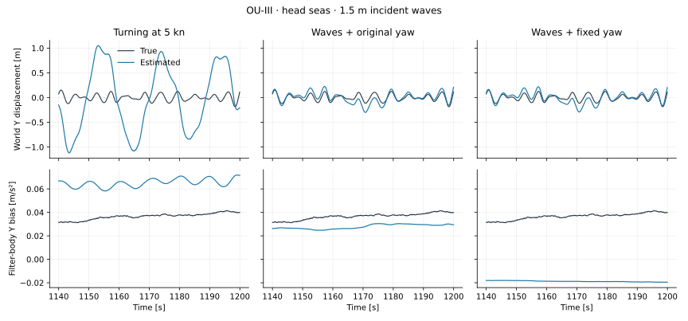

# Heading oscillations, horizontal wave motion and bias

The v1.4.0 replay exposes physical steering acceleration in every tested horizontal filter. The scoring target is wave displacement after removing the entire curved cruise track, while the filters receive the total specific force and have no separate cruise-motion state. The characteristic 20 s displacement error and 10 s body-bias ripple are predominantly responses to this unmodelled motion. They are not explained by rotating a displacement axis alone.

## What the generator and scorer mean

The released generator uses fixed geographic axes: north, west, up. At constant cruise speed U and heading ψ, the cruise velocity and acceleration are

```math
v_c = U(\cos\psi,\sin\psi,0),\qquad
a_c = U\dot\psi(-\sin\psi,\cos\psi,0).
```

For U = 5 kn and ψ = ±3° sin(2πt/20 s), the lateral acceleration peaks at **0.04231 m/s²**. The bounded lateral track has **0.42856 m amplitude** about its cycle mean (0.857 m peak to peak). Relative to the previous 120 s steering cycle, acceleration is six times larger and the forcing has moved from 0.00833 Hz to 0.05 Hz, where the filters reject much less of it. An estimator can also amplify it through its coupled attitude/motion updates; its erroneous displacement is not bounded by the physical track amplitude.

`MovingVesselRao` in oceanography-waves-lib correctly differentiates the total track and wave response, including rotating-response terms. In this repository, `W3dSimulationRunner` subtracts the declared track from displacement and velocity truth, but retains total acceleration and body IMU measurements. Thus the scored displacement/velocity and acceleration columns intentionally belong to different decompositions. A desired wave-only error is meaningful, but it is not an inertial-integration error against one p/v/a history.

The filter output and scored displacement are world vectors. A boat-frame sway product would project **wave-relative** displacement onto the current lateral axis. That projection can legitimately change with heading; it does not remove physical turning acceleration.

Bias columns are sensor-body quantities in the harness basis `(x,y,z) -> (y,x,-z)`. In particular, plotted bias Y corresponds to the generator body X, whereas displacement Y is geographic west. Bias Y and displacement Y are not the same axis. The TFG gallery also had an independent presentation bug: its plot titled estimated bias read the true-bias columns. It now plots true and estimated body bias separately.

## Paired controls

All eight horizontal Kalman families were rebuilt from `5426da8a394b33f5f473f70faa05247f832f85fa`, using GCC 14.2 and the existing per-target host flags. Each control keeps the same 1200 s wave response, roll/pitch history, sensor-noise seed and initialization protocol. Scores use all 180,000 samples of the final 900 s. Both directions use the pinned, checksummed v1.4.0 inputs.

| Control | Translation | Yaw | Meaning |
| --- | --- | --- | --- |
| Released | Total cruise + waves delivered; wave-only p/v scored | Original 20 s cycle | Current production replay |
| Waves + yaw | Complete cruise p/v/a chain removed; body force updated | Original cycle and instantaneous gyro preserved | Separates physical turning force from rotation |
| Waves + fixed yaw | Same wave p/v/a as the preceding control | Mean heading; analytic yaw-rate contribution removed from gyro | Isolates rotation itself |

The latter two controls are deliberately different physical histories. They are not a deployable truth-based correction, and they do not regenerate the hydrodynamic response for a different course. Their p/v/a, specific force, attitude and instantaneous angular rate are checked independently in regression tests. No acceptance limits or filter defaults are changed.

### Y displacement RMS, 0.27 m incident JONSWAP [m]

| Filter | Following: released | Following: waves + yaw | Head: released | Head: waves + yaw |
| --- | ---: | ---: | ---: | ---: |
| OU-II | 0.12804 | 0.01230 | 0.07241 | 0.00617 |
| OU-III | 0.12162 | 0.01265 | 0.08928 | 0.00813 |
| TFG | 0.24759 | 0.01645 | 0.11033 | 0.00784 |
| CARMA | 0.04560 | 0.00447 | 0.02387 | 0.00231 |
| Shared QMEKF | 0.04532 | 0.00416 | 0.02387 | 0.00226 |
| TFG-CARMA | 0.04560 | 0.00447 | 0.02387 | 0.00231 |
| Shared TFG | 0.04532 | 0.00417 | 0.02387 | 0.00226 |
| Shared tangent | 0.04532 | 0.00417 | 0.02387 | 0.00226 |

### Larger-wave check, 1.5 m incident JONSWAP [m]

| Direction / filter | Released | Waves + yaw | Waves + fixed yaw |
| --- | ---: | ---: | ---: |
| following / OU-III | 0.63684 | 0.07730 | 0.07607 |
| following / Shared QMEKF | 0.43217 | 0.03741 | 0.03623 |
| head / OU-III | 0.68343 | 0.05297 | 0.05161 |
| head / Shared QMEKF | 0.41747 | 0.02799 | 0.02763 |

Keeping versus removing yaw changes Y RMS by at most **0.00136 m** in these cells once the cruise acceleration is absent. The large shared degradation is therefore attributable primarily to the cruise-turn forcing, not to the mere presence of yaw rotation. This is a deterministic attribution study, not Monte Carlo evidence for a new estimator.

## The bias ripple

The 10 s sinusoidal component of body-Y bias error falls by **94.5–99.6%** across the measured cells when cruise acceleration is removed but yaw is retained. It is coherent with the steering forcing and its second harmonic. Products of yaw angle and yaw rate contain a 2× frequency component; the experiment identifies the forcing, but does not uniquely identify which internal attitude, magnetic-reference or covariance pathway produces that harmonic.

Eliminating this ripple is not equivalent to solving bias estimation. For example, low-wave northbound OU-III body-Y bias RMS changes from **0.01116 to 0.01444 m/s²** in the waves-plus-yaw control even though its 10 s amplitude falls from **0.002110 to 0.000107 m/s²**. Fixed yaw can further worsen the slowly varying bias error by removing useful excitation. These effects are retained in the raw metrics, not hidden by detrending.



## What a runtime correction requires

The shared measurement model needs separate wave and manoeuvre acceleration. With body-to-navigation attitude R, it should represent `f_b = Rᵀ(a_wave + a_manoeuvre − g) + b_a + noise`, while the OU/CARMA motion states and zero-mean constraints apply to wave-relative p/v/a. Bias updates must use the residual after manoeuvre prediction, with uncertainty propagated for the added prediction.

Independent speed/course or velocity aiding is the most direct source. For varying speed the manoeuvre model includes both `U_dot * forward` and `U * heading_rate * lateral`; yaw rate alone does not supply U. A gyro-driven model with unknown speed is another research option, but requires explicit motion assumptions and an observability assessment. An IMU and magnetometer do not generally identify an arbitrary split between wave and manoeuvre acceleration without additional information.

The correction belongs in a shared runtime component, including startup/reference learning, so all filters receive the same physical model. It must be tested with noisy/delayed speed, speed changes, sideslip/current, multiple steering periods, real low-frequency waves and zero-speed yaw. Subtracting the simulator’s exact track, changing Y into total motion, freezing all bias learning, or inserting a fixed 0.05 Hz notch would not establish the requested wave-only behaviour. **The runtime estimator correction remains open.**

## Reproduce

Build the eight executables listed by `tools/filter_sim_gates.py` and fetch both cases with `python3 tools/sim_dataset.py --case all`. Use a disk-backed working directory; dense traces are deliberately not committed.

```sh
python3 tools/heading_kinematics_diagnosis.py \
  --work-dir /workspace/heading-diagnosis-work \
  --output reports/results/heading_kinematics/measurements.json --jobs 2
python3 tools/heading_kinematics_diagnosis.py \
  --work-dir /workspace/heading-diagnosis-work \
  --families ou3 csm --records wave_data_jonswap_H1.500_L50.710_A-30.00_P120.00.csv \
  --output reports/results/heading_kinematics/medium.json --jobs 2
python3 -m unittest discover -s tests/validation -p test_heading_kinematics_diagnosis.py -v
```

JSON receipts record input, executable and trace hashes. CSV tables contain full-rate RMS and fitted 20 s / 10 s amplitudes. Figure tails are uniformly reduced from 200 Hz to 20 Hz for the final 60 s only. The numerical metrics do not use that plotting reduction.
