# Accelerometer-bias estimation: timing and live information

Source baseline: [`9018fa4b57d9bd10983ae4e77ff95ce509551e17`](https://github.com/bareboat-necessities/ocean-imu/commit/9018fa4b57d9bd10983ae4e77ff95ce509551e17).
This was main when the investigation began. The implementation also incorporates
main through `b915b0470911a49de6ddcf2ff6dad79cb966f295`, including its publication-only follow-up;
its production sources are identical to the scored baseline.
The comparative section retains the original controlled study and adds fresh production-default and broader rollout tables for this source revision. Both 27-state shared-mode geometries are evaluated.
The default rollout additionally covers live OU-II, OU-III, TFG and NLO;
its native integration tests and paired wave results are reported separately. Since the
cited `c2ae63b2` study, main optimized TFG propagation/reset kernels and shared
SO(3) coefficients; it did not replace the measurement model or startup
architecture. Those numerical paths are checked again against native Jacobian,
dense covariance and integration references.

## Decision

Live prediction defaults to instantaneous-sample integration in OU-II, OU-III,
TFG, CARMA/shared-mode and NLO. Native Kalman prediction uses the effective
interval rate consistently in its mean, gyro-bias sensitivity and process
covariance. Direct mathematical kernels retain their interval-rate API.

The measurement-only marine frontend retains its existing endpoint rule.
Its integration/feedback/reference path is a separate numerical change:
centering it worsens pinned-record yaw while adding no oracle recovery benefit.
The core-only correction meets the original replay bars in the localization;
final default-path gates and the required full build are recorded below.
`frontend_gyro_sample_mode` makes that distinction explicit. This is not a
blanket average of every gyro stream. The combined Mahony/PII feedback path also retains its qualified endpoint default: enabling centering makes the unchanged high-wave Kuchler heave sentinel fail (17.58% versus its 15.66% limit). Its centered path remains optional and independently tested; this is a failed rollout, not a lowered threshold.

Schmidt holding is available as an opt-in covariance correction with independent
dense-Joseph tests. It is not selected as the production default: although it
correctly treats a persistent uncertain bias under its declared model, it
worsens several existing attitude/bias replay metrics. Initial/reference
uncertainty and nonlinear acquisition remain unqualified. The original held-bias
policy and calibrated noise/prior values are retained by default.

Correct prediction removes a demonstrated integration-induced bias error when
independent acceleration information is available. It does not reliably remove
the latent-wave tilt/bias error. The NLO adapter also avoids predicting an
interval again after bootstrap has seeded the observer at its endpoint.

Retain the existing bias-learning schedule. Neither a magnetic packet count,
a new gate, an optimistic covariance nor this window fit demonstrates the
missing directional information. Controlled freezes and noise-model changes
do not justify a new adaptive estimator or a shipping tuning change. Window
calibration feedback is not qualified for deployment.

## Sensor and prediction contract

`CarmaBenchTruth::omega_b` is the analytic instantaneous body rate at `t_k`.
The replay constructs force and magnetic samples at that same time, calls the
IMU update, then magnetic correction on packet ticks. The legacy predictor
uses `Exp((gyro-b_g)*dt)` over the preceding interval. It is correct for its
constant-rate contract; giving it the endpoint of a changing rate is first
order. A noiseless rotation-equivalent signal is
`Log(R_(k-1)^T R_k)/dt`; it is generated as sensor truth only in diagnostics.
An angular-rate average and this rotation-equivalent rate differ under
noncommuting rotations. A hardware delta-angle packet additionally needs its
own frame, bias and noise convention, rather than another averaging operation.

The `GyroInterval` helper is shared by the native OU/CARMA/TFG cores, the optional
centered frontend path, and the NLO/PII live adapters. Its instantaneous mode uses
the two measured endpoints as a
second-order approximation over the preceding interval. The native gyro-bias
Jacobian and covariance kernels use that same effective rate. There is no
additional truth input and no extra Kalman state. The first native sample
primes the cache instead of inventing a preceding rotation. The bootstrap
primes the live core from actual samples, so handoff does not lose an interval.
A new acquisition clears the frontend cache; internal attitude/statistics resets
retain physical sample history. Lever-arm force compensation
continues to use the endpoint rate; it must not acquire the integrator's
half-step delay.

Corrected live prediction requires no enable flag in either shared-mode
wrapper or the OU/TFG live wrappers. For a deployment with independently known
exposure and calibrated residual bias uncertainty:

```cpp
Fusion::Config cfg;
// cfg.gyro_sample_mode already defaults to Instantaneous.
cfg.gyro_sample_period_sec = 1.0f / 200.0f; // fixed sensor ODR/exposure
// The frontend and held-bias policy retain their existing defaults.
cfg.initial_acc_bias_std = calibrated_residual_sd; // m/s^2; use qualified uncertainty
// cfg.sigma_g is a noise density [rad/sqrt(s)], not per-sample SD.
fusion.begin(cfg);
```

The pinned CSV replay also uses the supplied 200 Hz index interval, not
successive printed `time` differences. The eight scored records have 240000
rows each; their six-significant-digit time column develops duplicate times
and 10-ms jumps near the end. Its maximum deviation from the 5-ms index grid
is 5 ms. It is unsuitable as a high-resolution acquisition clock. Using the
index grid and the stored quaternion convention, centering measured rates
reduces disagreement with rotation increments by about 14–30×; remaining
error includes quaternion rounding. The reproducible CSV audit records these
values. Do not infer dropped records or a variable sensor interval from that
rounded column.

The existing QMEKF/TFG shared-mode replay uses production defaults on an
ordinary invocation. The same unchanged numeric bars apply. `--regression`
explicitly reproduces the locked historical interval-rate/legacy-hold baseline.
`W3D_CSM_GYRO_INPUT=instantaneous` centers both core and frontend with legacy holding;
it is a diagnostic, not needed to enable corrected live prediction. `core`
reproduces the selected production sampling path; `both_schmidt` and
`core_schmidt` isolate held-bias handling. Strict baseline regression
rejects contract overrides. Both profiles and input hashes are recorded.

The live configuration default is `Instantaneous`. Low-level mathematical
`time_update` kernels retain the interval-rate contract for compatibility; the
live wrappers configure them automatically. Direct native-core users have matching
`set_gyro_sample_mode`, `set_gyro_sample_period` and `prime_gyro_sample` APIs.
Do not pre-average upstream and also select instantaneous mode. Separate raw
wrapper selectors exist to isolate the core/frontend contribution in tests.

### Covariance and timing limits

Two adjacent averaged gyro intervals share one endpoint noise sample. At a
fixed rate, each interval's gyro-noise variance is half the raw endpoint
variance but its neighbor covariance is one quarter. Halving native process
noise while ignoring that covariance is inconsistent. This implementation
retains a conservative covariance envelope, rather than claiming independent
averaged noise or changing the state size to track a correlated nuisance.

For a linearized output, each raw noise sample has two propagated
contributions. Applying `(u+v)(u+v)^T <= 2(uu^T+vv^T)` before summing samples
bounds the whole correlated history. Jensen's inequality connects the
constant-rate sensitivity to the native integrated white-noise covariance.
For a fixed exposure `h0`, the gyro process-noise multiplier is
`max(1, dt/h0)`. With exposure unspecified, the declared model is
`Var(n_k)=Q_g/dt_k`, giving `max(1, (1+dt/dt_prev)/2)`. Gyro-bias driving noise
and its cross-covariance remain native. This is a local bound under the
configured noise model, not proof of nonlinear EKF consistency or compensation
for interpolation/model error. The exact independent colored-noise test with
measurement feedback verifies the bound and demonstrates the failure of the
naive half-noise alternative.

Variable-interval and missed-sample tests retain second-order behavior for the
smooth admitted test trajectory. Missing rotations cannot be reconstructed
from two endpoints in general. Callers must supply elapsed time from the last
accepted sample and qualify gaps/rate bandwidth. The shared startup wrapper
now rejects invalid gyro/force/temperature packets *before* advancing clocks,
last-sample state, frontend statistics or magnetic acquisition.

The firmware reads mapped BMI270 data in rad/s, timestamps the host poll, applies
spike and calibration processing, and calls `fusion.update(dt,w,a)` followed
by fresh magnetic updates. This supports a rate interface; the repository does
not establish an interval average, sensor conversion timestamp or effective
filter group delay. `SampleDtTracker` substitutes nominal dt on configured
long gaps; that is a fallback, not measured elapsed-time recovery. The marine firmware wrappers inherit the corrected live defaults. This is a
rate-sample model assumption, not a measured conversion-time or group-delay
qualification. Qualification needs
sensor/FIFO timing, ODR/filter settings, dropped-frame accounting, and relative
accel/gyro delay to verify or override this default on specific hardware.

Magnetic updates are asynchronous in cadence but apply to the current estimator
time. Synthetic default packets are time-aligned with that state. The dormant vibration guard is transparent below its detector threshold;
when engaged it adds a separate accelerometer delay (up to the configured
22.7 ms), which gyro centering does not compensate. The hardware
AUX metadata explicitly records host observation, not a BMM150 conversion
instant. Its cache/freshness policy does not establish zero latency. Runtime magnetic timing calibration is stored with its configuration and
explicitly logged as `applied=0`. There is no out-of-sequence
update/repropagation API here. Delay controls quantify this
separate mismatch; they do not infer a hardware delay or justify a guessed
compensation. Reference and hard-iron errors are persistent calibration
uncertainties, not additional independent white noise at every packet.

### Persistent uncertainty while bias is held

A separate native covariance audit found that legacy CARMA holding removes
bias terms from `P H^T` while retaining their contribution in innovation
covariance. It also clears cross-covariance on entering hold. This does not
implement a Schmidt update for an uncertain persistent bias. Repeated samples
can then treat that nuisance uncertainty as fresh measurement noise.

The optional CARMA `schmidt_acc_bias_hold=true` policy retains the complete `P H^T`, sets
only the bias rows of the **gain** to zero, and uses the existing full Joseph
and attitude/group reset kernels. Thus the bias mean is held, its uncertainty
remains persistent, and its cross-covariance evolves. Entering hold preserves
those correlations. This applies to accelerometer, magnetic and applicable
QMEKF pseudo-updates; active bias learning retains its existing equations.
Dense independent Joseph checks at nontrivial covariances agree below 2e-18
for both geometries and verify unchanged held means and preserved correlations.
The legacy CARMA policy remains the default pending broader acquisition and
calibration qualification. The native
OU/TFG held-bias policies have not been replaced by this CARMA-specific audit.

`initial_acc_bias_std` makes calibrated residual uncertainty available at the
common wrapper boundary. Leaving it NaN preserves the native prior. The
synthetic turn-on uniform bias has per-axis SD 45.3 mm/s², versus the native
initial 4 mm/s². Tests distinguish correcting this prior from correcting white
sensor noise, and from changing its covariance only at 600 s without resetting
the mean or other state. A justified uncertainty is required; larger covariance
is not independently measured acceleration or a bias-identifiability gate.

The gyro-noise envelope assumes valid starting uncertainty and fixed linearized
gains. It does not retroactively qualify proxy handoff covariance, reference
correlations, calibration errors, clipped samples or nonlinear model mismatch.

## Remaining tilt, bias and acceleration coupling

The actual force model is `f_b = R^T(a_w-g_w)+b_a`. Its local perturbation for
`R' = Exp(dphi)R` is

`df_b = R^T[da_w - dphi x (a_w-g_w)] + db_a`.

An uncertain acceleration history can therefore absorb a tilt/bias change.
The full magnetic vector constrains two attitude directions; a constant world
rotation about that vector leaves its ideal readings unchanged. Gyro rates
alone do not determine that global rotation. Whether force, changing roll/pitch
and physical motion constraints separate the remaining mode is a **joint**
history question. It is not determined by constant yaw, and rocking supplies a
counterexample to the claim that yaw changes are always necessary.

In the wave records, bias-induced changes can occupy the same oscillatory band
as genuine translation, while a compensating tilt/bias change suppresses their
DC component. The CARMA prior then supplies much of the separation. Its
translation covariance models acceleration correlations, not a separately
qualified attitude/translation vessel RAO. A plausible motion history can fit
force while retaining the wrong tilt/bias. The acceleration oracle removes
that nuisance; the rocking control's near-zero motion strongly constrains it.
These controls establish a poorly conditioned/model-dependent regime, not
structural non-observability for every admissible marine history.

The primary sea-state leveling observer uses measurements independently of the
live EKF. It cannot be described as directly feeding the EKF's estimated
acceleration back into its own period. In contrast, the shared-mode coupling
learner observes `R*(f-b_a)+g`; its statistics can depend on tentative attitude
and bias. New independent freeze APIs hold sea-state commits or coupling
learning/confidence without resetting state, covariance, history or learned
statistics. The small measured freeze effects do not support adaptation feedback as the
controlling cause of the tested late windows. Freezing at 600 s does not
exclude earlier acquisition feedback or invalidate the need for qualified
adaptation models.

The offline 60-s reference spans 600–660 s and uses known synthetic white-noise parameters and a
separately declared population bias prior; it is not the live filter's identical
likelihood. These fits use labelled exact-magnetic-reference diagnostic histories.
Their first linearized solution and iterated solution share exactly
the same objective, isolating further relinearization. A change from the live
initialization also includes windowing and different noise/prior weights.
The reference keeps uncertain motion and gyro bias, relinearizes
all poses, and eliminates those nuisances before evaluating scaled tilt/bias
information. Sensor-only, motion-prior and bias-prior contributions are reported
separately. Free acceleration makes sensor-only bias information vanish by
construction; that relaxation is not a theorem about bounded marine motion.
Adding CARMA dynamics supplies information but leaves a weak wave direction.
Changing prior strength changes recovery. All window solutions are diagnostic
and never feed back into the live covariance, avoiding double-counted samples.

A practical next source of independent information is time-aligned GNSS/Doppler
velocity (with its own uncertainty), independently qualified attitude, or
verified stationary/multi-pose calibration. A qualified hull-response model
would be a stronger physical assumption requiring separate validation. Tuning
or gating alone cannot manufacture that information.

## Comparative results

<!-- RESULTS_START -->

Six independent seeds; means [Student 95% intervals]. Bias units are mm/s².

| Condition | QMEKF | TFG |
| --- | ---: | ---: |
| Wave, latent acceleration, unchanged main | 59.82 [25.73, 93.90] | 43.69 [5.99, 81.39] |
| Wave, latent acceleration, centered prediction | 55.85 [23.54, 88.15] | 45.73 [3.67, 87.80] |
| Wave, acceleration oracle, unchanged main | 22.41 [21.37, 23.46] | 22.38 [21.34, 23.41] |
| Wave, acceleration oracle, centered prediction | 1.70 [1.49, 1.92] | 1.70 [1.48, 1.93] |
| Independent rocking, no oracle, centered prediction | 2.16 [1.69, 2.63] | 2.16 [1.69, 2.63] |

Wave windows are 5400–7200 s; rocking is 2400–3600 s. Exact magnetic reference and fixed correct calibration are diagnostic controls. The oracle is artificial.

The paired centered-minus-endpoint effect with acceleration latent is QMEKF: -3.97 [-14.14, 6.20]; TFG: 2.05 [-10.42, 14.51]. Both intervals include zero.

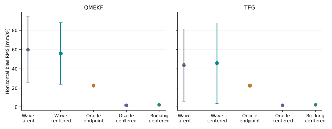

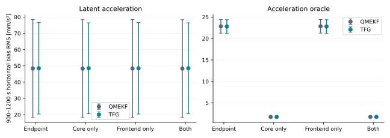
The core-only correction reproduces the oracle benefit; the frontend-only correction does not.

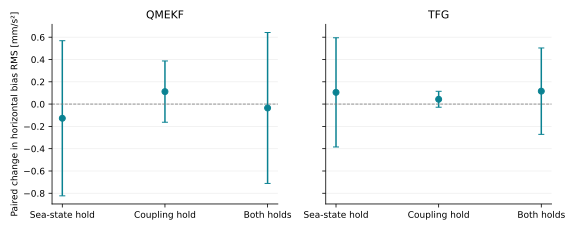

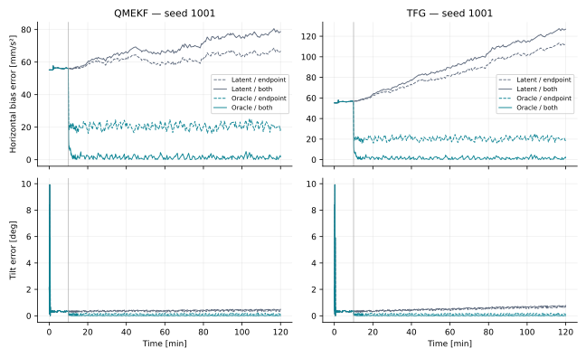

Covariance diagnostics remain conditional on the model. Late oracle coverage changes from 0% to 100% in these serial samples when timing is corrected; the latent-wave errors remain inconsistently covered. A 100% serial coverage fraction is not a calibration guarantee. Actual bias gates are open in scored live windows. Magnetic NIS is accumulated only at packets, and applied-correction counters are recorded separately.

| 60-s window, QMEKF initialization | Live initialization | First linearized solve | Relinearized |
| --- | ---: | ---: | ---: |
| wave; native_prior | 52.99 [26.85, 79.14] | 47.16 [17.74, 76.57] | 46.26 [15.09, 77.43] |
| wave; motion4 | 52.99 [26.85, 79.14] | 49.89 [22.94, 76.83] | 49.72 [22.26, 77.19] |
| wave; bias3 | 52.99 [26.85, 79.14] | 61.20 [4.92, 117.48] | 55.93 [22.36, 89.49] |
| rocking; native_prior | 5.98 [2.11, 9.85] | 15.44 [10.62, 20.25] | 15.45 [10.60, 20.31] |
| rocking; motion4 | 5.98 [2.11, 9.85] | 17.59 [11.87, 23.32] | 17.60 [11.82, 23.38] |
| rocking; bias3 | 5.98 [2.11, 9.85] | 14.66 [8.91, 20.41] | 14.70 [8.94, 20.45] |

TFG initializations give nearly identical window solutions. The window uses the known synthetic white-noise parameters and its declared population bias prior. A change from live initialization includes that changed window objective; only first-solve versus converged results isolate further relinearization. All 72 fits converge; PSD floors are unused. Weak information and its regularizer sensitivity are retained in JSON. The five-dimensional tilt/bias analysis eliminates world yaw as well as all other poses, gyro bias and motion. Prior sensitivity and degraded rocking recovery do not qualify window feedback.

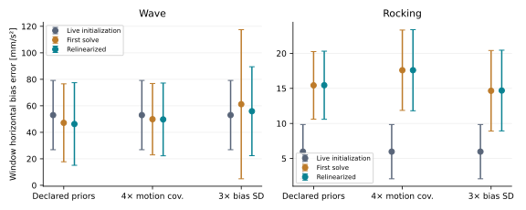

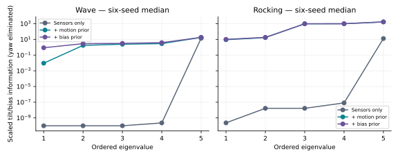
Eigenvalues at or below 1e-10 are plotted at that numerical floor. The sensor-only model in this plot deliberately frees the motion history.

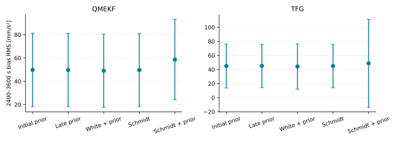

| Timing from startup; two-hour tail | QMEKF | TFG |
| --- | ---: | ---: |
| exact_fixed; native | 55.81 [23.50, 88.12] | 45.73 [3.65, 87.80] |
| exact_fixed; schmidt | 55.84 [23.57, 88.11] | 45.75 [3.63, 87.87] |
| exact_fixed; schmidt_prior | 60.51 [25.52, 95.50] | 48.08 [-16.05, 112.21] |
| learned_fixed; native | 68.51 [44.93, 92.09] | 56.88 [15.56, 98.20] |
| learned_fixed; schmidt | 68.51 [44.91, 92.10] | 56.88 [15.50, 98.27] |
| learned_fixed; schmidt_prior | 73.56 [51.13, 96.00] | 59.37 [-2.81, 121.56] |

These rows distinguish actual bias recovery from corrected covariance handling; the learned-reference rows use no truth for estimation.

| Actual default configuration | QMEKF | TFG |
| --- | ---: | ---: |
| wave; exact_fixed | 55.80 [23.50, 88.11] | 45.73 [3.66, 87.80] |
| wave; learned_fixed | 68.52 [44.95, 92.09] | 56.88 [15.55, 98.21] |
| wave; oracle | 1.70 [1.49, 1.92] | 1.70 [1.48, 1.93] |
| rocking; exact_fixed | 2.16 [1.69, 2.63] | 2.16 [1.69, 2.63] |

These runs leave sampling and held-bias Config defaults untouched under the common benchmark tuning: centered live prediction, the existing endpoint frontend, and legacy held-bias handling. The focused 180-s samplewise Config/setter control checks full state and covariance through startup and activation. Only the oracle arm supplies acceleration truth. The corrected implementation still has a large unknown-acceleration floor.

| Other live filters: acquired reference, unknown acceleration | Legacy RMS | Default RMS | Paired default minus legacy |
| --- | ---: | ---: | ---: |
| OU2 | 220.66 [106.46, 334.86] | 227.41 [112.47, 342.35] | 6.75 [5.28, 8.22] |
| OU3 | 373.06 [321.55, 424.57] | 377.89 [325.51, 430.27] | 4.83 [-0.94, 10.59] |
| TFG | 184.39 [118.10, 250.68] | 192.96 [125.89, 260.03] | 8.57 [6.22, 10.93] |

Six paired seeds, 7200 s each, scoring 5400–7200 s. Each legacy/default pair consumes identical sensors from one continuous physical history. Magnetic reference is acquired ordinarily; fixed hard iron is correct. These are within-family timing comparisons with existing family priors, not cross-family rankings or exact-reference CARMA controls. The timing correction slightly worsens this particular floor in all three families. Covariance remains overconfident (zero late 95% horizontal coverage here), and actual bias learning is enabled throughout. Correct integration does not create missing independent motion/reference information.

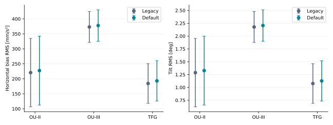

| Pinned replay profile | QMEKF records exceeding old bars | TFG records exceeding old bars |
| --- | ---: | ---: |
| interval | 0/8 | 0/8 |
| defaults | 0/8 | 0/8 |
| core | 0/8 | 0/8 |
| frontend | 1/8 | 1/8 |
| instantaneous | 2/8 | 2/8 |
| core_schmidt | 3/8 | 3/8 |
| both_schmidt | 3/8 | 3/8 |

Each profile uses the same eight pinned histories and default noise seeds. `interval` is the locked baseline; `defaults` retains the actual sampling and held-bias Config defaults; `core` selects that sampling path explicitly. `instantaneous` centers both paths, and the two Schmidt profiles add held-bias handling. Diagnostic profiles are compared offline to the original bars, without claiming their ungated exit status certifies those bars. Production and legacy profiles are gated natively. This evidence selects core-only prediction and retains the original frontend/holding defaults. It does not establish the exact mechanism of the frontend/reference regression.

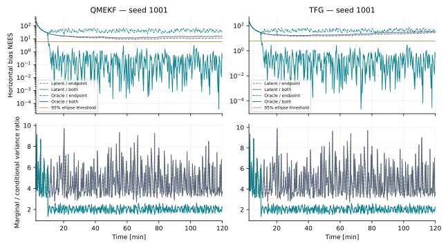
The variance ratio is a posterior-covariance diagnostic, not an observability Gramian.

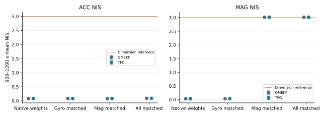
Matching magnetic white-noise SD can bring magnetic NIS near its dimension reference without resolving bias error. The prior/reference and motion assumptions remain separate.

**Recovery profile: late_recovery.**

| One-hour shock; 5400–7200 s bias RMS | QMEKF | TFG |
| --- | ---: | ---: |
| wave; exact_fixed | 55.84 [23.57, 88.11] | 45.75 [3.63, 87.87] |
| wave; bias | 52.97 [22.51, 83.43] | 48.90 [1.01, 96.78] |
| wave; tilt | 57.24 [27.84, 86.65] | 45.82 [3.41, 88.23] |
| rocking; bias | 2.32 [1.86, 2.78] | 2.31 [1.86, 2.77] |
| rocking; tilt | 2.32 [1.86, 2.78] | 2.31 [1.86, 2.77] |
| wave; learned_fixed | 68.51 [44.91, 92.10] | 56.88 [15.50, 98.27] |
| wave; correct_reference | 55.80 [23.44, 88.16] | 45.74 [3.76, 87.72] |

All these runs use centered core/frontend and Schmidt holding from startup with the common native prior. At 3600 s, bias/tilt shocks are additive estimated-state perturbations; the reference-repair arm instead changes only the magnetic reference. No live covariance reset accompanies an intervention.

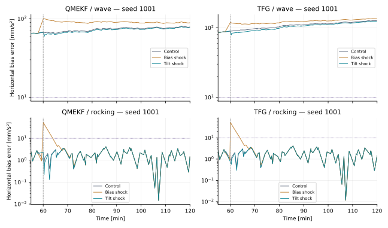
Recovery counts distinguish a first qualifying trailing 30-s window, sustained for another 30 s, from the independent late-window threshold. They are retained by seed in the summary.

**Recovery profile: production_recovery.**

| One-hour shock; 5400–7200 s bias RMS | QMEKF | TFG |
| --- | ---: | ---: |
| wave; exact_fixed | 55.80 [23.50, 88.11] | 45.73 [3.66, 87.80] |
| wave; bias | 52.94 [22.43, 83.45] | 48.91 [1.15, 96.66] |
| wave; tilt | 57.22 [27.79, 86.65] | 45.81 [3.46, 88.15] |
| rocking; bias | 2.32 [1.86, 2.78] | 2.31 [1.86, 2.77] |
| rocking; tilt | 2.32 [1.86, 2.78] | 2.31 [1.86, 2.77] |
| wave; learned_fixed | 68.52 [44.95, 92.09] | 56.88 [15.55, 98.21] |
| wave; correct_reference | 55.78 [23.40, 88.17] | 45.72 [3.80, 87.64] |

All these runs use the actual core-only production defaults from startup with the common native prior. At 3600 s, bias/tilt shocks are additive estimated-state perturbations; the reference-repair arm instead changes only the magnetic reference. No live covariance reset accompanies an intervention.

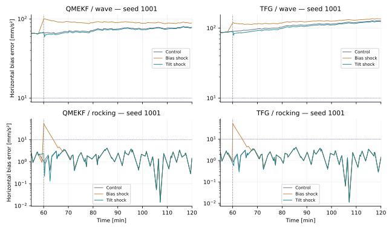
Recovery counts distinguish a first qualifying trailing 30-s window, sustained for another 30 s, from the independent late-window threshold. They are retained by seed in the summary.

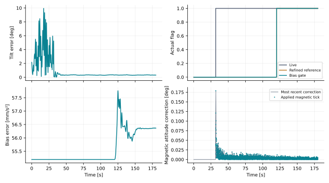

The untouched-main binary and the modified binary in compatibility mode match horizontal-bias RMS exactly on all 168 overlapping scored windows. The baseline was separately compiled against untouched production headers.

<!-- RESULTS_END -->

## Ordinary acquired-reference comparison

The additional untouched-main comparison uses an ordinarily acquired magnetic
reference, correct fixed hard iron and unknown acceleration. Neither estimator
receives truth as a measurement. Both binaries consume identical sensor histories
for seeds 1001–1006, run for 7200 s, and score 5400–7200 s. All late bias-learning
gates are open. Values are horizontal accelerometer-bias RMS in mm/s²; intervals
are 95% Student intervals across six seeds, including paired differences.

| Shared-mode filter | Untouched main | Corrected default | Paired change |
| --- | ---: | ---: | ---: |
| QMEKF | 72.80 [50.72, 94.88] | 68.52 [44.95, 92.09] | −4.28 [−13.68, 5.11] |
| TFG | 55.22 [18.21, 92.23] | 56.88 [15.55, 98.21] | 1.66 [−9.96, 13.27] |

Both paired intervals include zero. These results do not establish a reliable
live bias-RMS gain. The large demonstrated gain with an artificial acceleration
oracle diagnoses integration-induced error under independent motion information;
it is not a deployed-sensor result. Ordinary unknown-wave estimation retains a
substantial tilt/bias/motion floor.

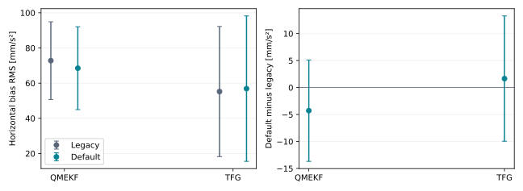

The 12 additional baseline runs bring the logical study cohort to 1212 runs.
`ordinary_reference_paired_scores.csv` retains all 60 matched scoring windows,
including sensor hashes, attitude errors, innovations, learning gates and
covariance diagnostics. `ordinary_reference_manifest.json` records the verified
untouched binary hash and seed-level confidence calculations. The corrected
counterpart is the existing `production_runs.csv` cohort, reused without
double-counting it as a new experiment.

After building the untouched baseline binary using the recipe in the test
README, reproduce the additional baseline cohort with:

```sh
mkdir -p /tmp/ordinary-reference-baseline
for seed in 1001 1002 1003 1004 1005 1006; do
  for geometry in qmekf tfg; do
    tests/live_bias_consistency/live-bias-baseline \
      --seed "$seed" --filter "$geometry" --motion wave \
      --arm learned_fixed --timing endpoint --noise native --change 0 \
      --duration 7200 \
      --output "/tmp/ordinary-reference-baseline/${seed}_${geometry}"
  done
done
```

Pair each `_scores.csv` row with `production_runs.csv` by seed, filter, motion,
arm, start and end; require equal sensor hashes from the native logs. For the
late window multiply `ba_h_rms` by 1000 and compute the mean and Student interval
with five degrees of freedom. Compute paired intervals from each seed's
default-minus-baseline difference, not from independent marginal intervals.

## Validation and scope

[Reproduction commands and experimental definitions](../tests/live_bias_consistency/README.md)
are part of the implementation. Seed tables, binary hashes and bounded plot
vertices are under `reports/results/live_bias_consistency/`. Existing baseline
thresholds are preserved. The report separates estimated errors, conditional
covariance, actual applied magnetic corrections and actual native bias gates.
The [study receipt](../reports/results/live_bias_consistency/validation.json)
records environment versions and experiment source bindings. The
[validation receipt](live-bias-validation-final.md) records the completed serial
`make all` and subsequent CI/publication checks.

The selected default code changes improve integration consistency and reject malformed
samples consistently across the shared startup/frontend boundary. Conservative
handling of reused gyro noise improves uncertainty honesty; it is not itself a
bias-recovery mechanism. The optional CARMA Schmidt policy corrects the treatment of a held, uncertain bias
under the stated model; it does not certify identifiability or improved RMS. No magnetic-uncertainty estimator, information
gate, window feedback, new sea-state rule or shipping noise tuning is promoted.
Hardware performance and delayed-measurement compensation remain unvalidated.
The finite simulations are neither a shipping OU-III stability proof nor a
shipping counterexample; the new sampling map is not certified by historical source-bound proof receipts.
The cache-augmented shipping audit is tracked in `ou3-proof-research-state.md`.

## Numerical replay contracts

The broader native replay exposes small yaw increases after correcting prediction.
These increases remain reported; they are not bias-estimation improvements.
`--regression` runs the historical endpoint integration against every original
threshold, unchanged. Ordinary invocations use the corrected live defaults and
a separately versioned numerical fixture. Current full-channel production
limits and their measurements are documented in
[Filter simulator regression gates](filter-simulator-gates.md). These are
regression references, not estimation quality targets. The independent rotation, bias-Jacobian, noise/covariance and
artificial-oracle tests establish the integration benefit.

The following table records the source-bound rollout study, rather than the
active production limits:

| Native replay | Legacy maximum yaw | Corrected maximum yaw | Original limit | Rollout fixture limit |
| --- | ---: | ---: | ---: | ---: |
| CARMA3 | 0.753640° | 0.760895° | 0.75750° | 0.76470° |
| OU3 | 0.814511° | 0.824166° | 0.81870° | 0.82829° |
| TFG | 0.933212° | 0.949967° | 0.94300° | 0.95472° |
| TFG-CARMA | 0.762213° | 0.769657° | 0.76620° | 0.77351° |

At the rollout revision, both profiles passed all eight pinned histories for
each of these four families (64 gated replays). OU-II and NLO also passed
their then-existing default replay limits. Shared-mode default and legacy
profiles passed the same original limits.
Corrected native profiles' common-old-limit violations remain in
`native_replay_scores.csv`; no score or covariance was changed to hide them.
The six-seed shared-mode and broader live comparisons remain the estimation
evidence, including the persistent unknown-acceleration floor.

Frontend centering is not promoted to repair individual fixtures: on the
independent CARMA H4 control it reduces yaw from 0.760882° to 0.731500°, but its
full eight-record run exceeds a gyro-bias limit (12.785% versus 12.78%). The
shared-mode ablation also exceeds existing yaw/bias bars. The core-only
correction remains the default; frontend and Schmidt changes remain explicit
diagnostics.

Detailed [validation results](live-bias-validation-final.md) record the complete
serial run, source-archive repair and final evidence publication.
