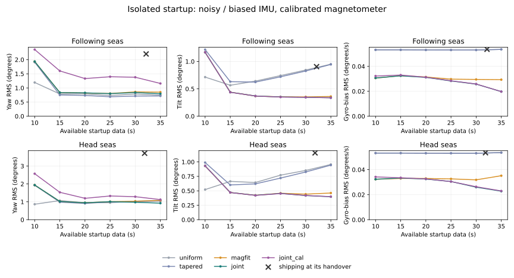

# Isolated gravity and magnetic-field startup in waves

The experiment in [`tests/startup_learning`](../tests/startup_learning/README.md)
compares the actual shared Mahony-proxy handover with five standalone
initializers. It changes **no file under `src/` and no live-filter behavior**.
The base is `8c9f535709fe7ff4d87d75dc5c98f4d0a48daa7b`; both cases use the pinned
`oceanography-waves-lib` v1.4.0 archives, at 5 kn with ±3° / 20 s heading motion.

## Results within 35 seconds

The validation set has five unused sensor-noise/calibration seeds, three later
power-on phases, eight wave records and both travel directions: 480 startups
across two sensor profiles. Every method receives identical noisy samples.
Only sensor synthesis and scoring can read truth. This is held-out replay on
the same wave files, not new independent ocean realizations.

| Equal physical handover epoch | Shipping yaw RMS | Candidate yaw RMS | Shipping tilt RMS | Candidate tilt RMS | Candidate |
|---|---:|---:|---:|---:|---|
| Following, calibrated magnetometer | 2.202° | 0.802° | 0.905° | 0.333° | joint |
| Head, calibrated magnetometer | 3.715° | 0.966° | 1.157° | 0.408° | joint |
| Following, residual magnetic calibration | 2.494° | 1.876° | 0.905° | 0.370° | joint_cal |
| Head, residual magnetic calibration | 4.680° | 1.640° | 1.157° | 0.437° | joint_cal |

Tilt is the angle between the estimated and true unit gravity directions in
the current body frame. It measures gravity orientation independently of yaw;
it is not a separate roll or pitch Euler-angle RMS.

All 240 calibrated-magnetometer trials meet yaw ≤2° and tilt ≤1° at 35 s.
The worst calibrated endpoint errors are 1.387° yaw / 0.574° tilt following
and 1.545° yaw / 0.610° tilt head. Independent fixed-deadline accuracy gates
include every trial, even when shipping never hands over; paired gates alone
would omit those deadline misses. The reports retain both RMS and worst errors.
The shipping wrapper reaches Live by 35 s in 458/480 trials. The 22 deadline
misses remain in the coverage file and the fixed-horizon results; they are
excluded only from the comparison requiring an actual shipping handover.
The baseline is stopped before any live magnetic correction, so these are
startup seed errors, **not subsequent live-navigation RMS**.

For calibrated magnetometers, matched-time tilt RMS falls from 0.905° to
0.333° following and from 1.157° to 0.408° head; gyro-bias vector RMS falls
from 0.0537 to 0.0244°/s and 0.0535 to 0.0251°/s respectively.

Full per-method tables, readiness failures, latency, field magnitude/direction
and replay provenance are in the
[validation report](../reports/results/startup_learning/validation/REPORT.md).
The [ideal/field-step controls](../reports/results/startup_learning/controls/REPORT.md)
keep adversarial failures visible, including numerically plausible fits that
must not be handed over as ready.

## Why the experiment helps

The existing provisional magnetic acquisition averages in a yaw-removed
Mahony tilt frame. Its stored absolute yaw is the acquisition-window gauge,
which is then written at the later handover epoch. With heading oscillations,
the window's mean heading need not equal the current heading. A provisional
tilt error also changes the learned magnetic reference; current shipping
defaults start another reference refinement at 90 s.

The isolated candidates instead keep one gyro-transported initial frame from
the first sample. They learn a constant, unrestricted three-component local
magnetic vector there, without a gravity/attitude guess. Gravity is represented
by a **unit direction**; its known magnitude is never fitted. The tapered force
statistic from `doc/kalman_ou_iii/ins-startup.tex` suppresses finite-window wave
contamination. Finally, the magnetic-NED basis is composed with the terminal
relative rotation, producing a current-epoch attitude.

The `joint` fit combines magnetic constancy, a gyro-calibration prior and a
wave-tolerant constraint on the long-window transported force slope. The
additional force constraint helps the gyro-bias direction that one magnetic
vector observes poorly. The `joint_cal` ablation also fits a regularized
constant hard-iron offset. Every candidate bias change repropagates all prior
gyro samples; terminal-only bias correction would be inconsistent.

Fitting hard iron helps the residual-calibration profile, but worsens the
already-calibrated profile. The code does not choose a method using truth or
the dataset label. Both are explicit experiment arms; a future device policy
would need externally justified calibration uncertainty/quality.

## Handover contract

| Field | Meaning |
|---|---|
| `time`, `attitude` | Acquisition epoch and body→magnetic-NED quaternion at that epoch |
| `down_body` | Unit gravity direction in current body axes; multiply by known gravity magnitude |
| `field` | Learned magnetic-NED vector in µT, retaining magnitude and inclination |
| `gyro_bias`, `accel_bias`, `mag_bias` | Body-frame residual calibration seeds; acceleration bias remains its prior |
| `angular_rate` | Latest instantaneous body rate minus fitted gyro bias, rad/s |
| `last_raw_gyro` | Endpoint sample to prime the next interval without replaying the last one |
| `gyro_bias_cov` | Conditional gyro-bias covariance; includes fitted hard-iron nuisance elimination when enabled |
| `valid`, `ready` | Numerically usable estimate versus a model-consistency readiness heuristic |

Gravity direction plus the learned magnetic vector defines magnetic north.
True north requires external declination. Position, velocity and wave states
need their own initialization and uncertainty; this attitude experiment does
not claim to recover them. A full live handover also needs attitude/reference/
bias/wave cross-covariances, calibration identity and scheduler/history state.
The current conditional covariance is explicitly insufficient for that step.

## Boundaries and reproducibility

Residual magnetic calibration is still a material limitation: good aggregate
RMS does not mean every handover meets the 2° / 1° target. A constant-field
optimizer can also explain a magnetic step using a large invented bias, so a
fit beyond four prior standard deviations cannot be marked ready. Low residual
alone is not a certificate. Neither the bounded-displacement statistic nor the
force-slope prior proves that physical acceleration has zero mean in 35 s.

The hardware-neutral learner validates sample epochs, gaps, finite values,
magnetic freshness and the 35 s maximum window. Actual magnetic acquisition
timestamps must be supplied; unknown delivery latency is not solved here.
Recorded host solve time does not qualify ESP32 memory or execution time.

Run the commands in the [test README](../tests/startup_learning/README.md).
The focused `isolated startup learning` workflow reproduces the complete
held-out paired matrix. Unit tests cover frames, sample timing, gravity/field
recovery, gyro-bias recovery, quiet water, wave contamination, invalid packets,
deadline enforcement, stale/vertical magnetic fields and field-step rejection.
The experiment is in both Make and CMake host builds. Production filter
integration remains deliberately outside this PR.
