# Coupled three-axis CARMA priors: generated results

Generated by tools/carma3_coupled_report.py; do not edit by hand.  Simulation only (no hardware).

## Screening (seeds 1001-1020; estimator hyper-parameters)

Criterion (fixed before the run): mean over the screening (scenario, seed) pairs of log(RMS_3d candidate / RMS_3d baseline); lower is better.  Scenarios: jonswap_fp0.29_hs0.8_g3.3, pm_fp0.25_hs1, mixed_swell_wind, dir_change, jonswap_fp0.29_hs0.8_g3.3+turns, calm.

| SHM:est configuration | mean log ratio | jonswap_fp0.29_hs0.8_g3.3 | pm_fp0.25_hs1 | mixed_swell_wind | dir_change | jonswap_fp0.29_hs0.8_g3.3+turns | calm |
|---|---|---|---|---|---|---|---|
| SHM:est/h240/b0.15 | -0.0396 | -0.0298 | -0.0568 | -0.0956 | -0.0236 | -0.0317 | -0.0002 |
| SHM:est/h480/b0.15 | -0.0393 | -0.0299 | -0.0575 | -0.0991 | -0.0176 | -0.0318 | +0.0001 |
| SHM:est/h240/b0.25 | -0.0392 | -0.0300 | -0.0566 | -0.0923 | -0.0241 | -0.0319 | -0.0002 |
| SHM:est/h120/b0.25 | -0.0391 | -0.0297 | -0.0556 | -0.0884 | -0.0289 | -0.0316 | -0.0002 |
| SHM:est/h120/b0.15 | -0.0390 | -0.0294 | -0.0553 | -0.0894 | -0.0283 | -0.0313 | -0.0002 |
| SHM:est/h480/b0.25 | -0.0387 | -0.0301 | -0.0571 | -0.0945 | -0.0183 | -0.0320 | +0.0001 |
| SHM:est/h120/b0.4 | -0.0382 | -0.0298 | -0.0547 | -0.0836 | -0.0293 | -0.0318 | -0.0001 |
| SHM:est/h240/b0.4 | -0.0381 | -0.0300 | -0.0555 | -0.0861 | -0.0246 | -0.0321 | -0.0000 |
| SHM:est/h480/b0.4 | -0.0375 | -0.0302 | -0.0558 | -0.0876 | -0.0191 | -0.0322 | +0.0001 |

Selected: **SHM:est/h240/b0.15** (used unchanged in every final and ablation run).

## Final comparison (complete INS, seeds 1-50)

RMS error of the wave displacement in % of incident H_s (mm for calm water and the still IMU), mean over seeds; in brackets the paired change against the baseline with its 95 % bootstrap interval (positive = better); better on every seed unless a win rate is given.

### Axis x (north)

| Scenario | n | B41 | MOD:off | MOD:est/nz | COR:est | COR:orc | SHM:est | SHM:orc | MCA:est |
|---|---|---|---|---|---|---|---|---|---|
| calm water (afloat, no waves) | 50 | 61.16 | 61.14 (+0.0 % [+0.0, +0.0]) | 61.11 (+0.1 % [+0.0, +0.1], win 96 %) | 61.16 (+0.0 % [-0.0, +0.0], win 88 %) | 61.16 (+0.0 % [+0.0, +0.0]) | 61.14 (+0.0 % [+0.0, +0.1], win 90 %) | 61.14 (+0.0 % [+0.0, +0.0], win 98 %) | 60.89 (+0.5 % [+0.3, +0.6], win 88 %) |
| still IMU | 50 | 59.10 | 59.07 (+0.0 % [+0.0, +0.1]) | 59.05 (+0.1 % [+0.0, +0.2], win 94 %) | 59.10 (+0.0 % [-0.0, +0.0], win 90 %) | 59.09 (+0.0 % [+0.0, +0.0]) | 59.07 (+0.1 % [+0.0, +0.1], win 94 %) | 59.07 (+0.1 % [+0.1, +0.1]) | 58.82 (+0.5 % [+0.4, +0.6], win 92 %) |
| regular monochromatic wave | 50 | 2.22 | 2.22 (+0.0 % [+0.0, +0.0], win 98 %) | 2.97 (-33.8 % [-37.5, -30.3]) | 2.21 (+0.5 % [+0.3, +0.7], win 76 %) | 2.21 (+0.5 % [+0.3, +0.8], win 76 %) | 1.96 (+11.7 % [+10.8, +12.4]) | 1.93 (+13.1 % [+12.0, +14.1]) | 1.90 (+14.5 % [+13.7, +15.2]) |
| unidirectional JONSWAP | 50 | 1.96 | 1.96 (+0.0 % [+0.0, +0.0], win 96 %) | 2.46 (-25.6 % [-26.8, -24.4]) | 1.93 (+1.4 % [+1.3, +1.6]) | 1.93 (+1.5 % [+1.4, +1.7]) | 1.87 (+4.2 % [+3.9, +4.5]) | 1.87 (+4.4 % [+4.1, +4.8]) | 1.73 (+11.4 % [+11.1, +11.7]) |
| directionally spread JONSWAP (cos^8) | 50 | 1.92 | 1.91 (+0.0 % [+0.0, +0.0], win 98 %) | 2.37 (-23.9 % [-25.5, -22.4]) | 1.89 (+1.4 % [+1.2, +1.5]) | 1.89 (+1.5 % [+1.3, +1.7]) | 1.84 (+3.7 % [+3.4, +4.0]) | 1.84 (+3.9 % [+3.6, +4.3]) | 1.73 (+9.9 % [+9.5, +10.2]) |
| Pierson-Moskowitz | 50 | 2.14 | 2.14 (+0.0 % [+0.0, +0.0], win 84 %) | 2.71 (-26.5 % [-27.9, -25.2]) | 2.12 (+0.8 % [+0.6, +0.9], win 90 %) | 2.12 (+0.8 % [+0.6, +1.0], win 90 %) | 2.01 (+6.3 % [+6.1, +6.5]) | 2.00 (+6.6 % [+6.4, +6.8]) | 1.88 (+11.9 % [+11.6, +12.2]) |
| long-period swell | 50 | 6.25 | 6.25 (-0.0 % [-0.0, -0.0]) | 7.25 (-16.1 % [-17.5, -14.8]) | 6.34 (-1.5 % [-1.6, -1.4]) | 6.34 (-1.5 % [-1.6, -1.5]) | 4.53 (+27.4 % [+27.1, +27.8]) | 4.20 (+32.7 % [+32.2, +33.2]) | 4.61 (+26.3 % [+25.9, +26.7]) |
| short-period wind waves | 50 | 1.41 | 1.41 (+0.0 % [+0.0, +0.0]) | 1.41 (-0.2 % [-0.5, +0.1], win 42 %) | 1.37 (+2.8 % [+2.6, +3.0]) | 1.36 (+3.0 % [+2.7, +3.2]) | 1.38 (+1.7 % [+1.5, +1.9]) | 1.38 (+1.8 % [+1.6, +2.1], win 98 %) | 1.32 (+6.2 % [+5.7, +6.7]) |
| mixed wind sea + swell | 50 | 14.48 | 14.48 (-0.0 % [-0.0, -0.0], win 4 %) | 12.65 (+12.6 % [+11.2, +14.0]) | 14.89 (-2.8 % [-3.1, -2.6], win 2 %) | 14.92 (-3.1 % [-3.3, -2.8]) | 13.36 (+7.7 % [+7.2, +8.2]) | 13.27 (+8.3 % [+7.8, +8.8]) | 12.74 (+12.0 % [+11.4, +12.6]) |
| two systems, different frequencies | 50 | 5.32 | 5.32 (-0.0 % [-0.0, -0.0], win 36 %) | 6.14 (-15.5 % [-17.2, -14.0]) | 5.43 (-2.2 % [-2.3, -2.1]) | 5.43 (-2.2 % [-2.3, -2.1]) | 4.45 (+16.2 % [+15.9, +16.5]) | 4.47 (+16.0 % [+15.6, +16.4]) | 4.21 (+20.9 % [+20.4, +21.3]) |
| two crossing systems (90 deg) | 50 | 2.02 | 2.02 (+0.0 % [+0.0, +0.0], win 94 %) | 3.20 (-58.6 % [-82.6, -37.4]) | 2.02 (+0.2 % [+0.1, +0.2], win 68 %) | 2.01 (+0.2 % [+0.1, +0.3], win 66 %) | 1.98 (+1.8 % [+1.6, +2.0], win 98 %) | 1.98 (+2.0 % [+1.8, +2.2]) | 1.95 (+3.2 % [+2.9, +3.4]) |
| changing wave direction (30 -> 120 deg) | 1 | 1.85 | 1.85 (--) | 2.17 (--) | 1.85 (--) | 1.85 (--) | 1.84 (--) | 1.86 (--) | 1.81 (--) |

### Axis y (east)

| Scenario | n | B41 | MOD:off | MOD:est/nz | COR:est | COR:orc | SHM:est | SHM:orc | MCA:est |
|---|---|---|---|---|---|---|---|---|---|
| calm water (afloat, no waves) | 50 | 60.81 | 60.78 (+0.0 % [+0.0, +0.0]) | 60.76 (+0.1 % [+0.0, +0.2], win 92 %) | 60.80 (+0.0 % [-0.0, +0.1], win 94 %) | 60.80 (+0.0 % [+0.0, +0.0]) | 60.76 (+0.1 % [+0.0, +0.1], win 94 %) | 60.78 (+0.0 % [+0.0, +0.0]) | 60.53 (+0.5 % [+0.4, +0.6], win 96 %) |
| still IMU | 50 | 58.26 | 58.23 (+0.0 % [+0.0, +0.0]) | 58.22 (+0.1 % [+0.0, +0.2], win 92 %) | 58.25 (+0.0 % [-0.0, +0.1], win 92 %) | 58.25 (+0.0 % [+0.0, +0.0]) | 58.22 (+0.1 % [+0.0, +0.1], win 92 %) | 58.23 (+0.1 % [+0.0, +0.1]) | 57.98 (+0.5 % [+0.4, +0.6], win 94 %) |
| regular monochromatic wave | 50 | 2.01 | 2.01 (+0.0 % [+0.0, +0.0], win 92 %) | 2.77 (-38.2 % [-41.2, -35.1]) | 1.99 (+0.7 % [+0.5, +0.9], win 76 %) | 1.99 (+0.6 % [+0.4, +0.8], win 76 %) | 1.96 (+2.4 % [+0.4, +4.4], win 68 %) | 1.94 (+3.1 % [+1.0, +5.2], win 68 %) | 1.93 (+3.7 % [+1.4, +5.7], win 70 %) |
| unidirectional JONSWAP | 50 | 1.83 | 1.83 (+0.0 % [+0.0, +0.0], win 96 %) | 2.40 (-30.8 % [-32.0, -29.6]) | 1.82 (+1.0 % [+0.8, +1.1], win 92 %) | 1.82 (+1.0 % [+0.7, +1.2], win 84 %) | 1.81 (+1.1 % [+0.5, +1.6], win 74 %) | 1.81 (+1.1 % [+0.5, +1.7], win 72 %) | 1.73 (+5.6 % [+5.0, +6.3], win 96 %) |
| directionally spread JONSWAP (cos^8) | 50 | 1.85 | 1.85 (+0.0 % [+0.0, +0.0]) | 2.40 (-29.4 % [-31.3, -27.4]) | 1.84 (+0.9 % [+0.7, +1.0], win 90 %) | 1.84 (+0.9 % [+0.7, +1.1], win 86 %) | 1.83 (+1.2 % [+0.7, +1.7], win 72 %) | 1.83 (+1.2 % [+0.7, +1.8], win 74 %) | 1.76 (+4.9 % [+4.3, +5.5], win 98 %) |
| Pierson-Moskowitz | 50 | 1.97 | 1.97 (+0.0 % [+0.0, +0.0], win 98 %) | 2.59 (-31.4 % [-33.4, -29.4]) | 1.96 (+0.4 % [+0.2, +0.6], win 60 %) | 1.96 (+0.4 % [+0.2, +0.7], win 70 %) | 1.92 (+2.7 % [+2.3, +3.1], win 96 %) | 1.92 (+2.8 % [+2.4, +3.2], win 94 %) | 1.85 (+6.3 % [+5.8, +6.8]) |
| long-period swell | 50 | 4.10 | 4.10 (-0.0 % [-0.0, +0.0], win 34 %) | 4.74 (-15.5 % [-17.3, -13.8]) | 4.15 (-1.1 % [-1.2, -1.0]) | 4.15 (-1.2 % [-1.3, -1.1]) | 3.24 (+21.0 % [+20.2, +21.8]) | 3.05 (+25.6 % [+24.2, +27.0]) | 3.27 (+20.3 % [+19.7, +20.9]) |
| short-period wind waves | 50 | 1.44 | 1.44 (+0.0 % [+0.0, +0.0]) | 1.47 (-2.5 % [-3.2, -1.8], win 16 %) | 1.41 (+2.3 % [+2.0, +2.5], win 98 %) | 1.40 (+2.4 % [+2.0, +2.7], win 98 %) | 1.42 (+1.3 % [+1.0, +1.6], win 88 %) | 1.42 (+1.3 % [+1.0, +1.7], win 86 %) | 1.37 (+4.9 % [+4.3, +5.5]) |
| mixed wind sea + swell | 50 | 3.94 | 3.94 (-0.0 % [-0.0, +0.0], win 48 %) | 4.60 (-16.7 % [-19.5, -14.0], win 2 %) | 4.75 (-20.4 % [-21.8, -19.0]) | 4.86 (-23.2 % [-24.6, -21.8]) | 3.92 (+0.5 % [-1.1, +2.0], win 66 %) | 4.01 (-1.7 % [-3.1, -0.3], win 40 %) | 3.21 (+18.6 % [+16.9, +20.2]) |
| two systems, different frequencies | 50 | 3.12 | 3.12 (+0.0 % [+0.0, +0.0], win 96 %) | 3.60 (-15.6 % [-25.2, -9.0]) | 3.12 (-0.1 % [-0.2, +0.0], win 42 %) | 3.11 (+0.1 % [-0.1, +0.3], win 60 %) | 3.12 (+0.1 % [-0.1, +0.3], win 46 %) | 3.12 (+0.0 % [-0.2, +0.2], win 54 %) | 3.12 (-0.1 % [-0.5, +0.3], win 44 %) |
| two crossing systems (90 deg) | 50 | 2.01 | 2.01 (+0.0 % [+0.0, +0.0], win 92 %) | 2.72 (-35.8 % [-38.1, -33.5]) | 1.97 (+1.6 % [+1.4, +1.9]) | 1.97 (+1.7 % [+1.5, +2.0]) | 1.99 (+0.9 % [+0.7, +1.1], win 88 %) | 1.99 (+0.9 % [+0.7, +1.1], win 84 %) | 1.93 (+4.0 % [+3.8, +4.2]) |
| changing wave direction (30 -> 120 deg) | 1 | 1.84 | 1.84 (--) | 2.53 (--) | 1.81 (--) | 1.81 (--) | 1.80 (--) | 1.80 (--) | 1.70 (--) |

### Axis z (heave)

| Scenario | n | B41 | MOD:off | MOD:est/nz | COR:est | COR:orc | SHM:est | SHM:orc | MCA:est |
|---|---|---|---|---|---|---|---|---|---|
| calm water (afloat, no waves) | 50 | 52.16 | 52.15 (+0.0 % [+0.0, +0.0]) | 52.16 (+0.0 % [-0.0, +0.0], win 94 %) | 52.16 (-0.0 % [-0.0, +0.0], win 58 %) | 52.16 (-0.0 % [-0.0, +0.0], win 42 %) | 52.17 (-0.0 % [-0.1, +0.0], win 18 %) | 52.17 (-0.0 % [-0.0, -0.0]) | 50.37 (+3.4 % [+3.3, +3.6]) |
| still IMU | 50 | 52.16 | 52.15 (+0.0 % [+0.0, +0.0]) | 52.16 (+0.0 % [-0.0, +0.0], win 88 %) | 52.17 (-0.0 % [-0.0, +0.0], win 44 %) | 52.16 (+0.0 % [-0.0, +0.0], win 50 %) | 52.18 (-0.0 % [-0.1, +0.0], win 18 %) | 52.16 (-0.0 % [-0.0, -0.0]) | 50.37 (+3.4 % [+3.3, +3.6]) |
| regular monochromatic wave | 50 | 1.69 | 1.69 (+0.0 % [-0.0, +0.0], win 40 %) | 1.44 (+14.4 % [+13.8, +15.0]) | 1.68 (+0.3 % [+0.2, +0.4], win 86 %) | 1.68 (+0.3 % [+0.2, +0.4], win 82 %) | 1.52 (+10.1 % [+9.8, +10.5]) | 1.51 (+10.3 % [+9.9, +10.7]) | 1.22 (+27.9 % [+27.3, +28.6]) |
| unidirectional JONSWAP | 50 | 1.83 | 1.83 (-0.0 % [-0.0, -0.0], win 20 %) | 1.70 (+7.0 % [+6.7, +7.3]) | 1.82 (+0.4 % [+0.3, +0.5], win 94 %) | 1.82 (+0.4 % [+0.3, +0.5], win 92 %) | 1.73 (+5.2 % [+5.0, +5.4]) | 1.73 (+5.1 % [+4.9, +5.4]) | 1.17 (+36.1 % [+35.5, +36.6]) |
| directionally spread JONSWAP (cos^8) | 50 | 1.83 | 1.83 (-0.0 % [-0.0, -0.0], win 30 %) | 1.72 (+5.9 % [+5.6, +6.2]) | 1.82 (+0.4 % [+0.3, +0.4], win 94 %) | 1.82 (+0.4 % [+0.3, +0.4], win 90 %) | 1.75 (+4.4 % [+4.2, +4.6]) | 1.75 (+4.3 % [+4.1, +4.5]) | 1.21 (+34.0 % [+33.5, +34.6]) |
| Pierson-Moskowitz | 50 | 2.10 | 2.10 (-0.0 % [-0.0, +0.0], win 32 %) | 1.95 (+7.3 % [+7.1, +7.6]) | 2.09 (+0.3 % [+0.3, +0.4], win 98 %) | 2.09 (+0.3 % [+0.3, +0.4], win 96 %) | 1.93 (+8.0 % [+7.8, +8.2]) | 1.93 (+8.0 % [+7.8, +8.2]) | 1.32 (+37.0 % [+36.4, +37.5]) |
| long-period swell | 50 | 5.96 | 5.96 (-0.0 % [-0.0, -0.0]) | 4.85 (+18.6 % [+18.3, +18.9]) | 5.94 (+0.4 % [+0.4, +0.4]) | 5.94 (+0.4 % [+0.4, +0.4]) | 4.55 (+23.7 % [+23.3, +24.2]) | 4.19 (+29.7 % [+29.2, +30.1]) | 4.56 (+23.4 % [+23.0, +23.9]) |
| short-period wind waves | 50 | 1.67 | 1.67 (-0.0 % [-0.0, +0.0], win 40 %) | 1.64 (+1.4 % [+1.2, +1.5]) | 1.66 (+0.4 % [+0.4, +0.5], win 96 %) | 1.66 (+0.4 % [+0.3, +0.5], win 96 %) | 1.69 (-1.2 % [-1.4, -1.0], win 2 %) | 1.69 (-1.3 % [-1.4, -1.1], win 2 %) | 1.07 (+35.8 % [+35.2, +36.3]) |
| mixed wind sea + swell | 50 | 11.54 | 11.54 (-0.0 % [-0.0, +0.0], win 44 %) | 11.40 (+1.2 % [+0.8, +1.5], win 88 %) | 11.43 (+1.0 % [+0.9, +1.0]) | 11.42 (+1.0 % [+0.9, +1.1]) | 10.16 (+11.9 % [+11.7, +12.2]) | 10.02 (+13.1 % [+12.8, +13.4]) | 8.97 (+22.2 % [+21.8, +22.7]) |
| two systems, different frequencies | 50 | 4.18 | 4.18 (+0.0 % [-0.0, +0.0], win 50 %) | 3.90 (+6.8 % [+6.4, +7.1]) | 4.16 (+0.6 % [+0.6, +0.6]) | 4.16 (+0.6 % [+0.6, +0.7]) | 3.51 (+16.1 % [+15.8, +16.3]) | 3.52 (+15.8 % [+15.5, +16.1]) | 3.10 (+25.7 % [+25.3, +26.1]) |
| two crossing systems (90 deg) | 50 | 1.99 | 1.99 (-0.0 % [-0.0, +0.0], win 30 %) | 1.95 (+2.3 % [+2.1, +2.5]) | 1.99 (+0.2 % [+0.1, +0.2], win 90 %) | 1.99 (+0.2 % [+0.1, +0.2], win 88 %) | 1.96 (+1.7 % [+1.5, +2.0], win 98 %) | 1.96 (+1.6 % [+1.3, +1.8], win 98 %) | 1.46 (+26.8 % [+26.3, +27.3]) |
| changing wave direction (30 -> 120 deg) | 1 | 1.73 | 1.73 (--) | 1.61 (--) | 1.72 (--) | 1.72 (--) | 1.65 (--) | 1.68 (--) | 1.18 (--) |

### Consistency, velocity, acceleration, attitude (means over seeds)

NEES of [p, v] (6 dof; 6 if consistent, larger = overconfident), accelerometer NIS (3 dof; 3 if consistent), 95 % coverage of the position intervals (x, z), whitened-innovation autocorrelation at 1 s (z), horizontal velocity RMS (mm/s), vertical acceleration RMS (mm/s^2), yaw RMS (deg).

| Scenario | filter | NEES6 | NIS | cov x | cov z | innov ac z | v_h | a_z | yaw |
|---|---|---|---|---|---|---|---|---|---|
| directionally spread JONSWAP (cos^8) | B41 | 5.70 | 0.088 | 0.990 | 0.979 | -0.29 | 16.7 | 14.6 | 1.76 |
| directionally spread JONSWAP (cos^8) | MOD:off | 5.70 | 0.088 | 0.990 | 0.979 | -0.29 | 16.7 | 14.6 | 1.76 |
| directionally spread JONSWAP (cos^8) | MOD:est/nz | 4.65 | 0.108 | 0.997 | 0.982 | -0.20 | 19.4 | 14.4 | 1.76 |
| directionally spread JONSWAP (cos^8) | COR:est | 5.71 | 0.089 | 0.991 | 0.979 | -0.24 | 16.6 | 14.5 | 1.76 |
| directionally spread JONSWAP (cos^8) | COR:orc | 5.70 | 0.089 | 0.991 | 0.979 | -0.24 | 16.6 | 14.5 | 1.75 |
| directionally spread JONSWAP (cos^8) | SHM:est | 5.59 | 0.089 | 0.992 | 0.981 | -0.29 | 16.4 | 14.5 | 1.76 |
| directionally spread JONSWAP (cos^8) | SHM:orc | 5.55 | 0.090 | 0.992 | 0.981 | -0.29 | 16.4 | 14.5 | 1.75 |
| directionally spread JONSWAP (cos^8) | MCA:est | 5.57 | 0.298 | 0.994 | 0.997 | -0.01 | 16.2 | 6.8 | 1.76 |
| unidirectional JONSWAP | B41 | 6.14 | 0.089 | 0.988 | 0.978 | -0.29 | 17.1 | 14.5 | 1.92 |
| unidirectional JONSWAP | MOD:off | 6.14 | 0.089 | 0.988 | 0.978 | -0.29 | 17.1 | 14.5 | 1.92 |
| unidirectional JONSWAP | MOD:est/nz | 4.91 | 0.111 | 0.997 | 0.982 | -0.18 | 19.9 | 14.3 | 1.93 |
| unidirectional JONSWAP | COR:est | 6.14 | 0.090 | 0.989 | 0.979 | -0.24 | 17.0 | 14.5 | 1.92 |
| unidirectional JONSWAP | COR:orc | 6.13 | 0.090 | 0.989 | 0.979 | -0.23 | 16.9 | 14.4 | 1.92 |
| unidirectional JONSWAP | SHM:est | 5.99 | 0.090 | 0.990 | 0.981 | -0.29 | 16.8 | 14.5 | 1.92 |
| unidirectional JONSWAP | SHM:orc | 5.94 | 0.091 | 0.990 | 0.981 | -0.29 | 16.8 | 14.5 | 1.91 |
| unidirectional JONSWAP | MCA:est | 5.91 | 0.298 | 0.993 | 0.997 | -0.01 | 16.5 | 6.7 | 1.92 |
| mixed wind sea + swell | B41 | 62.89 | 0.190 | 0.361 | 0.369 | 0.35 | 61.3 | 15.1 | 1.67 |
| mixed wind sea + swell | MOD:off | 62.89 | 0.190 | 0.361 | 0.369 | 0.35 | 61.3 | 15.1 | 1.67 |
| mixed wind sea + swell | MOD:est/nz | 51.04 | 0.225 | 0.504 | 0.347 | 0.34 | 54.6 | 15.7 | 2.69 |
| mixed wind sea + swell | COR:est | 66.76 | 0.195 | 0.352 | 0.370 | 0.35 | 63.8 | 15.1 | 1.75 |
| mixed wind sea + swell | COR:orc | 67.47 | 0.197 | 0.351 | 0.370 | 0.35 | 64.1 | 15.2 | 1.75 |
| mixed wind sea + swell | SHM:est | 60.09 | 0.181 | 0.389 | 0.400 | 0.18 | 58.8 | 16.1 | 2.87 |
| mixed wind sea + swell | SHM:orc | 59.98 | 0.181 | 0.391 | 0.403 | 0.16 | 58.6 | 16.1 | 2.87 |
| mixed wind sea + swell | MCA:est | 56.14 | 0.387 | 0.404 | 0.382 | 0.08 | 55.6 | 10.7 | 2.91 |
| two systems, different frequencies | B41 | 10.02 | 0.162 | 0.828 | 0.837 | -0.05 | 31.0 | 13.9 | 1.58 |
| two systems, different frequencies | MOD:off | 10.02 | 0.162 | 0.828 | 0.837 | -0.05 | 31.0 | 13.9 | 1.58 |
| two systems, different frequencies | MOD:est/nz | 8.07 | 0.261 | 0.970 | 0.823 | -0.07 | 38.0 | 13.8 | 1.85 |
| two systems, different frequencies | COR:est | 10.21 | 0.164 | 0.819 | 0.839 | -0.05 | 31.3 | 13.8 | 1.60 |
| two systems, different frequencies | COR:orc | 10.20 | 0.164 | 0.818 | 0.839 | -0.04 | 31.3 | 13.8 | 1.59 |
| two systems, different frequencies | SHM:est | 8.43 | 0.166 | 0.872 | 0.876 | -0.13 | 28.9 | 13.9 | 1.63 |
| two systems, different frequencies | SHM:orc | 8.38 | 0.166 | 0.872 | 0.876 | -0.12 | 28.9 | 13.9 | 1.60 |
| two systems, different frequencies | MCA:est | 8.47 | 0.360 | 0.888 | 0.869 | -0.00 | 28.8 | 7.4 | 1.70 |
| two crossing systems (90 deg) | B41 | 5.91 | 0.090 | 0.987 | 0.968 | -0.26 | 17.2 | 14.8 | 1.60 |
| two crossing systems (90 deg) | MOD:off | 5.91 | 0.090 | 0.987 | 0.968 | -0.26 | 17.2 | 14.8 | 1.60 |
| two crossing systems (90 deg) | MOD:est/nz | 8.10 | 0.108 | 0.969 | 0.967 | -0.20 | 24.1 | 14.7 | 1.60 |
| two crossing systems (90 deg) | COR:est | 5.86 | 0.091 | 0.987 | 0.968 | -0.23 | 17.1 | 14.7 | 1.59 |
| two crossing systems (90 deg) | COR:orc | 5.85 | 0.092 | 0.988 | 0.968 | -0.23 | 17.0 | 14.7 | 1.58 |
| two crossing systems (90 deg) | SHM:est | 5.73 | 0.092 | 0.989 | 0.968 | -0.27 | 17.1 | 14.7 | 1.57 |
| two crossing systems (90 deg) | SHM:orc | 5.70 | 0.092 | 0.989 | 0.967 | -0.27 | 17.0 | 14.7 | 1.56 |
| two crossing systems (90 deg) | MCA:est | 5.76 | 0.302 | 0.990 | 0.987 | -0.01 | 16.9 | 7.3 | 1.56 |
| changing wave direction (30 -> 120 deg) | B41 | 5.52 | 0.108 | 0.986 | 0.975 | -0.24 | 15.2 | 14.9 | 1.56 |
| changing wave direction (30 -> 120 deg) | MOD:off | 5.51 | 0.108 | 0.986 | 0.975 | -0.24 | 15.2 | 14.9 | 1.56 |
| changing wave direction (30 -> 120 deg) | MOD:est/nz | 5.06 | 0.132 | 0.993 | 0.978 | -0.17 | 18.3 | 14.7 | 1.66 |
| changing wave direction (30 -> 120 deg) | COR:est | 5.54 | 0.109 | 0.986 | 0.976 | -0.21 | 15.2 | 14.9 | 1.60 |
| changing wave direction (30 -> 120 deg) | COR:orc | 5.47 | 0.109 | 0.985 | 0.976 | -0.21 | 15.2 | 14.8 | 1.59 |
| changing wave direction (30 -> 120 deg) | SHM:est | 5.57 | 0.109 | 0.984 | 0.977 | -0.26 | 15.2 | 14.9 | 1.67 |
| changing wave direction (30 -> 120 deg) | SHM:orc | 5.68 | 0.110 | 0.983 | 0.973 | -0.26 | 15.2 | 14.8 | 1.71 |
| changing wave direction (30 -> 120 deg) | MCA:est | 5.90 | 0.313 | 0.984 | 0.994 | -0.02 | 15.1 | 7.7 | 1.77 |
| calm water (afloat, no waves) | B41 | 3.40 | 0.718 | 1.000 | 1.000 | 0.00 | 40.1 | 3.8 | 2.83 |
| calm water (afloat, no waves) | MOD:off | 3.39 | 0.718 | 1.000 | 1.000 | 0.00 | 40.1 | 3.8 | 2.83 |
| calm water (afloat, no waves) | MOD:est/nz | 3.39 | 0.718 | 1.000 | 1.000 | 0.00 | 40.1 | 3.8 | 2.83 |
| calm water (afloat, no waves) | COR:est | 3.40 | 0.718 | 1.000 | 1.000 | 0.00 | 40.1 | 3.8 | 2.83 |
| calm water (afloat, no waves) | COR:orc | 3.40 | 0.718 | 1.000 | 1.000 | 0.00 | 40.1 | 3.8 | 2.83 |
| calm water (afloat, no waves) | SHM:est | 3.39 | 0.718 | 1.000 | 1.000 | 0.00 | 40.1 | 3.8 | 2.83 |
| calm water (afloat, no waves) | SHM:orc | 3.39 | 0.718 | 1.000 | 1.000 | 0.00 | 40.1 | 3.8 | 2.83 |
| calm water (afloat, no waves) | MCA:est | 3.40 | 0.729 | 1.000 | 1.000 | 0.00 | 39.9 | 3.1 | 2.83 |

## Summary (section 12 of the study brief)

Pooled over the 10 wave scenarios (every final scenario except calm water and the still IMU): mean RMS in % of incident H_s, change against the baseline with a 95 % bootstrap interval (seeds resampled jointly across scenarios).  NEES/NIS: pooled means (6 / 3 if consistent).  Cross-spectral accuracy: energy-weighted relative error of the estimated displacement cross-spectral matrix against the truth's (spectra stage, 10 seeds x 5 seas; lower is better).  Runtime: host mean / 99th percentile per update (one job, x86-64), ESP32-S3 object code and filter sizeof (Xtensa GCC 14.2.0 -Os).  Completed experiments only.

| Model | States | X RMS | Y RMS | Z RMS | NEES / NIS | Cross-spectral accuracy | Runtime host (us) | ESP32-S3 code / filter (B) |
|---|---|---|---|---|---|---|---|---|
| Baseline CARMA3 (A41) | 21 | 4.18 | 2.47 | 3.64 | 15.42 / 0.183 | 0.226 | 3.6 / 7.9 | 141,209 / 6,136 |
| Complex-OU modal, exact equivalent | 21 | 4.18 (-0.0 % [-0.0, -0.0]) | 2.47 (+0.0 % [+0.0, +0.0]) | 3.64 (-0.0 % [-0.0, +0.0]) | 15.42 / 0.183 | -- | 4.2 / 11.6 | -- |
| Complex-OU modal, directional (numerator), estimated | 21 | 4.57 (-9.2 % [-10.7, -8.0]) | 3.03 (-22.6 % [-24.1, -21.3]) | 3.39 (+6.8 % [+6.6, +7.0]) | 12.35 / 0.220 | 0.160 | 4.3 / 12.0 | -- |
| Correlated, estimated | 21 | 4.24 (-1.3 % [-1.4, -1.2]) | 2.55 (-3.3 % [-3.6, -2.9]) | 3.62 (+0.6 % [+0.6, +0.6]) | 15.89 / 0.185 | 0.236 | 4.0 / 10.5 | 144,789 / 5,736 |
| Correlated, oracle | 21 | 4.24 (-1.4 % [-1.5, -1.3]) | 2.57 (-3.8 % [-4.1, -3.4]) | 3.62 (+0.6 % [+0.6, +0.7]) | 15.96 / 0.185 | -- | -- | 144,789 / 5,736 |
| Shared modes, estimated | 33 | 3.71 (+11.4 % [+11.2, +11.6]) | 2.36 (+4.8 % [+4.2, +5.4]) | 3.20 (+12.2 % [+12.0, +12.3]) | 13.91 / 0.181 | 0.182 | 7.0 / 34.9 | 153,210 / 15,288 |
| Shared modes, oracle | 33 | 3.66 (+12.6 % [+12.3, +12.9]) | 2.34 (+5.3 % [+4.6, +6.0]) | 3.14 (+13.6 % [+13.4, +13.8]) | 13.84 / 0.182 | -- | -- | 153,210 / 15,288 |
| MCARMA (RAO), estimated | 35 | 3.56 (+14.9 % [+14.7, +15.2]) | 2.24 (+9.5 % [+8.9, +10.0]) | 2.67 (+26.5 % [+26.3, +26.8]) | 13.57 / 0.366 | 0.143 | 26.4 / 824.0 | 160,062 / 19,352 |

## Ablations (seeds 1-30)

3-D RMS (x, y, z) change against the baseline (positive = better) with 95 % bootstrap intervals; NEES_pv6 in brackets.  Oracle rows use the true wave acceleration (labelled); flip / rot90 are deliberately wrong couplings; fz400 freezes the estimate at 400 s, in NED or in the keel frame; rao* are mismatched heave RAOs of the MCARMA (the truth's hull is 0.55 Hz, 0.35).

| filter | directionally spread JONSWAP (cos^8) | Pierson-Moskowitz | mixed wind sea + swell | two systems, different frequencies | two crossing systems (90 deg) | vessel heading changes (90 deg zigzag) | calm water (afloat, no waves) |
|---|---|---|---|---|---|---|---|
| Baseline CARMA3 (A41) | 26.2 mm (6.0) | 36.2 mm (6.5) | 244.7 mm (64.6) | 94.8 mm (10.1) | 29.8 mm (6.2) | 26.0 mm (5.1) | 101.9 mm (3.4) |
| Shared modes, no coupling | -0.3 % [-0.4, -0.3] (6.0) | +0.0 % [-0.1, +0.1], win 53 % (6.5) | -0.6 % [-0.7, -0.5], win 3 % (65.4) | -0.4 % [-0.5, -0.2], win 20 % (10.1) | -0.2 % [-0.2, -0.1], win 17 % (6.2) | -0.3 % [-0.4, -0.3], win 3 % (5.1) | +0.0 % [+0.0, +0.0] (3.4) |
| Correlated x-y only, estimated | +3.3 % [+2.7, +3.8] (7.8) | +2.8 % [+2.4, +3.3], win 97 % (8.4) | -8.7 % [-9.6, -7.7] (165.6) | +2.8 % [+2.1, +3.4], win 90 % (11.9) | +0.0 % [-0.1, +0.2], win 50 % (6.4) | +3.5 % [+2.9, +4.1], win 93 % (6.4) | -0.0 % [-0.1, +0.0], win 70 % (3.4) |
| Shared modes, measured horizontal anisotropy | +5.2 % [+4.7, +5.8] (7.8) | +6.9 % [+6.3, +7.4] (8.3) | -4.0 % [-5.4, -2.6], win 20 % (195.7) | +12.8 % [+11.9, +13.6] (10.9) | +1.8 % [+1.5, +2.0] (6.3) | +5.6 % [+5.0, +6.2] (6.3) | +0.0 % [-0.0, +0.1], win 77 % (3.4) |
| Shared modes, measured horizontal block (first mapping) | +0.7 % [+0.5, +0.9], win 93 % (5.7) | +3.5 % [+3.2, +3.8] (6.0) | +8.5 % [+8.1, +8.9] (59.2) | +10.4 % [+9.8, +11.0] (7.9) | +0.4 % [+0.1, +0.6], win 73 % (5.8) | +0.8 % [+0.6, +1.0], win 87 % (4.8) | -22.0 % [-34.2, -12.1] (3.4) |
| Shared modes, oracle reversed (180 deg) | -14.8 % [-15.3, -14.2] (7.2) | -19.1 % [-19.7, -18.3] (8.2) | -21.1 % [-21.8, -20.5] (129.4) | -38.5 % [-40.7, -36.3] (20.0) | -8.3 % [-8.6, -8.0] (7.2) | -15.1 % [-15.6, -14.6] (6.2) | +0.0 % [+0.0, +0.0] (3.4) |
| Shared modes, oracle turned 90 deg | -6.0 % [-6.8, -5.2] (7.1) | -6.6 % [-7.2, -6.0] (7.9) | -24.6 % [-25.3, -23.9] (141.4) | -8.8 % [-9.5, -8.0] (12.9) | -6.9 % [-7.4, -6.5] (6.6) | -5.8 % [-6.3, -5.3] (5.8) | +0.0 % [+0.0, +0.0] (3.4) |
| Shared modes, frozen at 400 s (NED) | +3.1 % [+2.9, +3.2] (5.9) | +5.7 % [+5.4, +5.9] (6.2) | +9.2 % [+8.6, +9.8] (61.4) | +12.9 % [+12.5, +13.4] (8.5) | +1.5 % [+1.3, +1.7] (6.0) | +3.2 % [+3.0, +3.3] (5.0) | +0.0 % [+0.0, +0.1], win 97 % (3.4) |
| Shared modes, frozen at 400 s (keel frame) | +3.0 % [+2.9, +3.2] (5.9) | +5.6 % [+5.4, +5.9] (6.3) | +9.0 % [+8.3, +9.7] (61.9) | +12.9 % [+12.5, +13.3] (8.5) | +1.5 % [+1.3, +1.7] (6.0) | -0.2 % [-0.5, +0.1], win 43 % (5.2) | +0.0 % [+0.0, +0.1], win 97 % (3.4) |
| Shared modes, oracle phase +45 deg | +2.4 % [+2.1, +2.8] (6.2) | +2.8 % [+2.5, +3.1] (6.8) | -3.2 % [-3.8, -2.5], win 3 % (91.4) | +3.3 % [+3.0, +3.6] (12.0) | +1.8 % [+1.5, +2.1] (6.2) | +2.6 % [+2.3, +2.9] (5.2) | +0.0 % [+0.0, +0.0] (3.4) |
| MCARMA RAO prior, no coupling | +6.4 % [+6.1, +6.7] (6.1) | +7.4 % [+7.1, +7.8] (6.5) | +3.8 % [+3.6, +4.0] (65.4) | +2.4 % [+2.2, +2.6] (10.3) | +6.8 % [+6.5, +7.1] (6.2) | +6.5 % [+6.2, +6.8] (5.1) | +1.6 % [+1.6, +1.7] (3.5) |
| MCARMA (RAO), oracle | +15.5 % [+14.9, +16.0] (5.8) | +18.0 % [+17.3, +18.6] (6.2) | +17.2 % [+16.8, +17.7] (57.0) | +17.7 % [+17.1, +18.3] (8.5) | +10.7 % [+10.3, +11.0] (6.0) | +15.6 % [+15.2, +16.0] (4.9) | +1.6 % [+1.6, +1.7] (3.5) |
| MCARMA, RAO f_n -27 % | -25.3 % [-27.9, -22.7] (13.2) | -12.8 % [-14.7, -10.9] (12.0) | +21.9 % [+21.3, +22.5] (53.7) | +15.0 % [+13.9, +15.9] (13.0) | +5.5 % [+2.5, +8.1], win 80 % (8.3) | -24.4 % [-26.6, -22.3] (9.9) | +1.6 % [+1.4, +1.8] (3.4) |
| MCARMA, RAO f_n +36 % | +10.2 % [+9.8, +10.7] (6.1) | +13.0 % [+12.4, +13.5] (6.5) | +12.6 % [+12.1, +13.0] (64.6) | +15.6 % [+15.1, +16.0] (8.9) | +7.8 % [+7.6, +8.1] (6.2) | +10.4 % [+10.1, +10.8] (5.0) | +0.9 % [+0.8, +1.1] (3.4) |
| MCARMA, RAO damping x2 | +12.4 % [+11.8, +12.9] (6.0) | +15.2 % [+14.5, +15.9] (6.4) | +23.1 % [+22.7, +23.5] (40.9) | +10.9 % [+9.7, +12.1] (16.1) | +8.8 % [+8.4, +9.1] (5.9) | +12.4 % [+12.0, +12.8] (5.0) | -0.1 % [-0.3, +0.0], win 43 % (3.4) |
| Complex-OU modal, real coupling, estimated | +0.9 % [+0.8, +1.0] (6.0) | +0.5 % [+0.4, +0.6] (6.5) | -2.3 % [-2.4, -2.1] (68.6) | -1.0 % [-1.0, -0.9] (10.3) | +0.7 % [+0.6, +0.8] (6.1) | +1.0 % [+0.9, +1.1] (5.1) | +0.1 % [+0.0, +0.1], win 97 % (3.4) |
| Complex-OU modal, directional, oracle | -18.4 % [-19.5, -17.4] (4.8) | -18.7 % [-19.8, -17.7] (5.1) | +8.1 % [+6.4, +9.5], win 97 % (50.1) | -6.9 % [-8.0, -5.9] (7.4) | -25.3 % [-33.8, -18.2] (7.0) | -17.7 % [-18.6, -16.7] (4.1) | +0.0 % [+0.0, +0.0] (3.4) |
| Complex-OU modal, directional, oracle reversed (180 deg) | -25.9 % [-27.1, -24.8] (5.7) | -27.9 % [-29.0, -26.9] (6.5) | -5.5 % [-7.5, -4.0] (83.6) | -21.7 % [-22.9, -20.5] (14.5) | -29.7 % [-38.0, -22.8] (7.9) | -25.3 % [-26.3, -24.3] (5.0) | +0.0 % [+0.0, +0.0] (3.4) |

## Analytic results (tools/carma3_coupled_analysis.py)

* Complexified C41J: real-part PSD equals C41J to 1.8e-14 (relative), [p, v, a] stationary covariance to 7.7e-15; mirror leakage |H(-iw)|^2/|H(iw)|^2 at kappa = 1: 0.1 Hz 0.170, 0.15 Hz 0.063, 0.2 Hz 0.020, 0.3 Hz 0.001, 0.45 Hz 0.006, 0.6 Hz 0.009, 1 Hz 0.021.
* Kronecker identity (Experiment A): F 0.0e+00, Q 1.6e-16; Hermitian Kronecker (Experiment B): Q 1.7e-16; SHM with a real excitation reproduces COR's cross-spectral matrix to 6.1e-15.

Steady-state (DARE, white accelerometer noise only, oracle parameters) horizontal / heave RMS (mm):

| sea | IND | COR | MODN | MODN_wrong180 | SHM | SHM_diag | MCA | MCA_diag | SHR | SHM_wrong180 | SHM_wrong90 | K2 | K2_diag |
|---|---|---|---|---|---|---|---|---|---|---|---|---|---|
| jonswap_fp0.29_hs0.8_g3.3 | 7.4 / 10.2 | 7.4 / 10.2 | 9.7 / 9.3 | 8.3 / 13.1 | 7.5 / 9.5 | 7.4 / 10.2 | 6.5 / 5.5 | 7.4 / 6.5 | 7.4 / 9.6 | 9.1 / 13.5 | 8.5 / 11.5 | -- | -- |
| pm_fp0.25_hs1 | 11.2 / 14.8 | 11.2 / 14.7 | 13.8 / 13.3 | 11.6 / 19.7 | 10.5 / 13.4 | 11.2 / 14.8 | 9.2 / 7.3 | 11.2 / 8.8 | 10.5 / 13.6 | 14.7 / 20.2 | 12.7 / 16.9 | -- | -- |
| jonswap_longcrested | 7.4 / 10.2 | 7.3 / 10.1 | 9.9 / 9.2 | 8.3 / 13.6 | 7.5 / 9.4 | 7.4 / 10.2 | 6.3 / 5.3 | 7.4 / 6.5 | 7.4 / 9.5 | 9.4 / 14.1 | 8.7 / 11.8 | -- | -- |
| jonswap_wide_spread | 7.5 / 10.2 | 7.4 / 10.2 | 9.4 / 9.6 | 8.4 / 12.2 | 7.5 / 9.7 | 7.5 / 10.2 | 6.8 / 5.7 | 7.5 / 6.5 | 7.5 / 9.7 | 8.6 / 12.7 | 8.2 / 11.2 | -- | -- |
| mixed_swell_wind | 89.7 / 93.6 | 90.9 / 93.2 | 68.6 / 92.5 | 65.6 / 130.9 | 77.2 / 83.4 | 89.7 / 93.6 | 74.8 / 59.2 | 89.7 / 65.8 | 77.2 / 87.1 | 117.2 / 125.7 | 113.3 / 121.2 | 28.2 / 23.4 | 32.5 / 36.2 |
| bimodal | 25.3 / 26.9 | 25.5 / 26.7 | 29.3 / 22.7 | 25.7 / 47.2 | 21.4 / 22.2 | 25.3 / 26.9 | 20.2 / 17.7 | 25.3 / 21.6 | 21.5 / 22.2 | 43.2 / 46.7 | 32.5 / 35.8 | 20.9 / 18.6 | 22.4 / 25.7 |
| crossing | 8.8 / 11.7 | 8.8 / 11.7 | 10.7 / 11.4 | 9.9 / 13.5 | 8.9 / 11.4 | 8.8 / 11.7 | 8.4 / 6.9 | 8.8 / 7.4 | 8.9 / 11.5 | 9.8 / 14.0 | 9.7 / 12.8 | 8.4 / 10.8 | 8.6 / 11.5 |

Representable share of the truth's cross-spectral energy (real-only = COR, constant phase = SHM) and phase at the energy peak:

| sea | x-z real / const-phase | y-z real / const-phase | x-z phase (deg) |
|---|---|---|---|
| jonswap_fp0.29_hs0.8_g3.3 | 0.35 / 0.94 | 0.40 / 0.90 | -62 |
| pm_fp0.25_hs1 | 0.41 / 0.92 | 0.47 / 0.89 | -59 |
| jonswap_longcrested | 0.35 / 0.94 | 0.40 / 0.90 | -62 |
| jonswap_wide_spread | 0.35 / 0.94 | 0.39 / 0.91 | -62 |
| mixed_swell_wind | 0.38 / 0.93 | 0.41 / 0.91 | -61 |
| bimodal | 0.41 / 0.84 | 0.71 / 0.94 | -37 |
| crossing | 0.28 / 0.94 | 0.42 / 0.91 | -67 |

Complex-OU modal form of C41J (kappa 0.2-2.5): worst transfer-function error 3.1e-14, stationary covariance 8.6e-15, F 2.4e-15, Q 7.5e-15, autocovariance 6.8e-15; cond(T) <= 196. Residue sums: sum Re r = 6.6e-17, sum Re(r p) = 6.0e-17, sum Im r = 0.0070. Independently driven modes: Q_pp slope 1.00 (exact: 4.98), displacement variance x1.387, acceleration PSD high-frequency log2 slope +1.97 per octave (exact: -2.04).

Identifiability (Whittle Fisher information, 1200 s of three-axis acceleration, JONSWAP):

| family | parameters | numerical rank | smallest / largest FIM eigenvalue |
|---|---|---|---|
| COR | 7 | 7 | 1.91e+03 / 9.44e+04 |
| SHM | 10 | 10 | 1.42e+03 / 9.34e+04 |
| MCA | 12 | 12 | 5.06e+02 / 2.34e+05 |
| MCARMA41_unrestricted | 54 | 51 | -1.78e-13 / 1.93e+03 |

## Figures

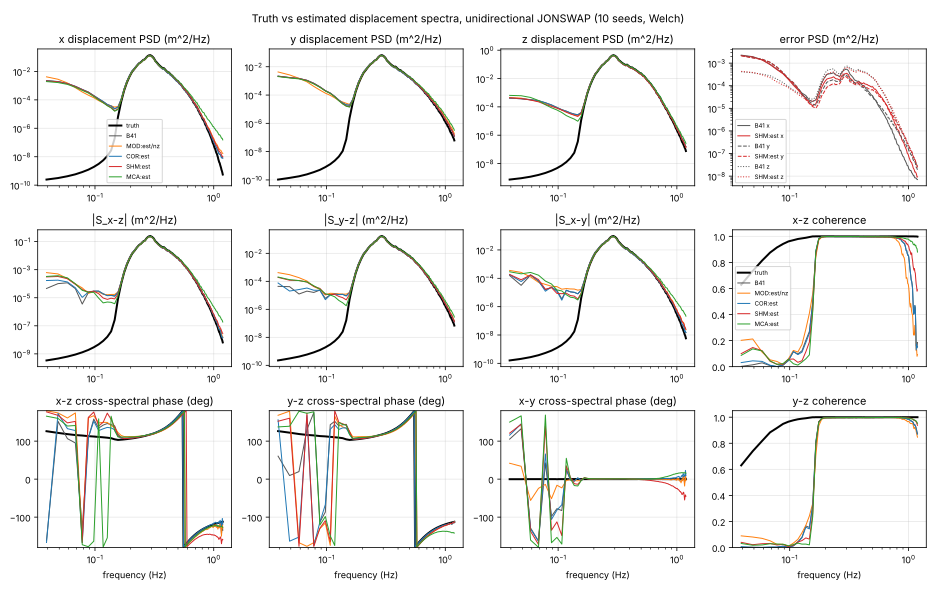
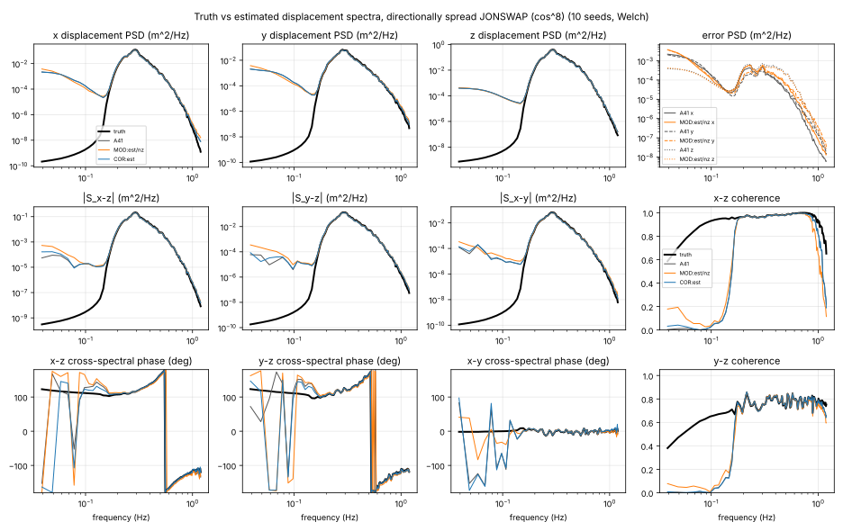
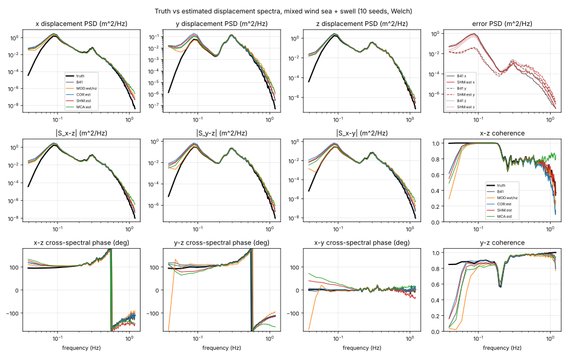
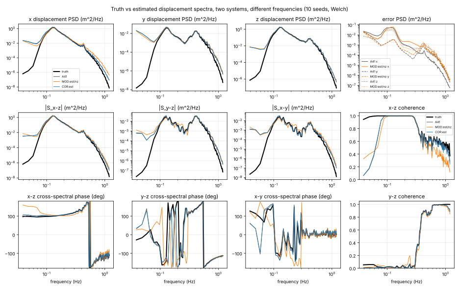
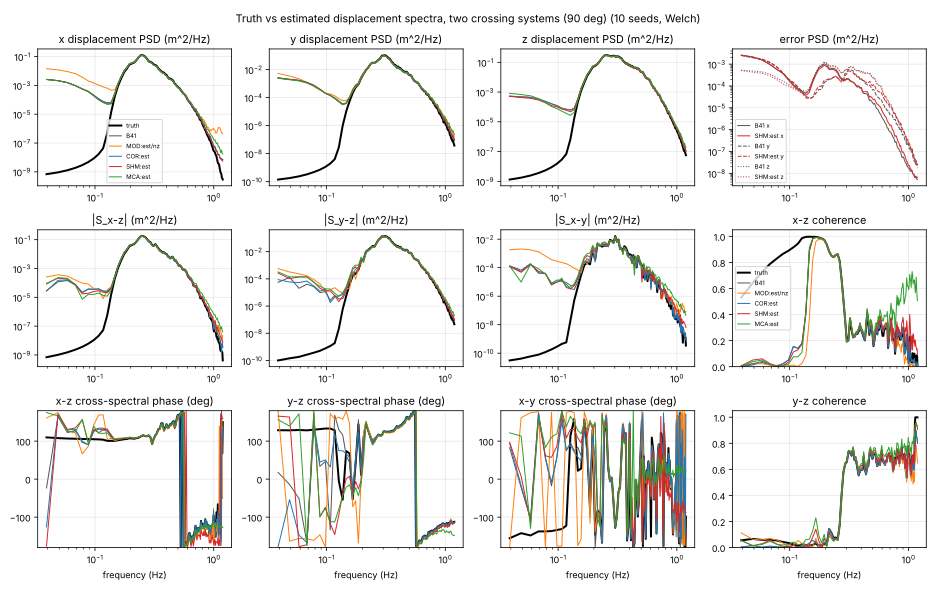
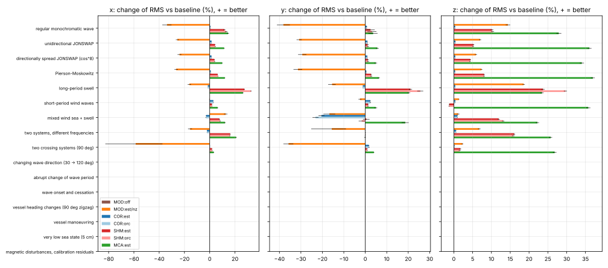
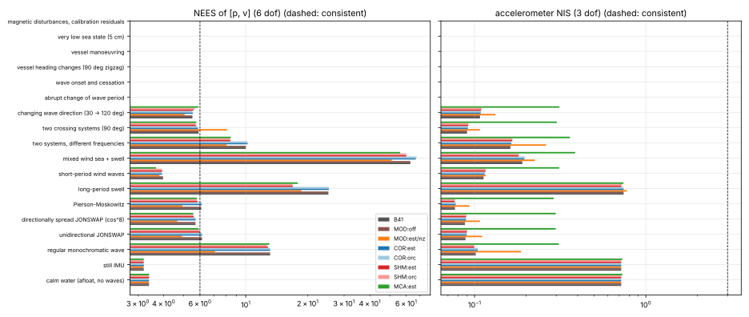
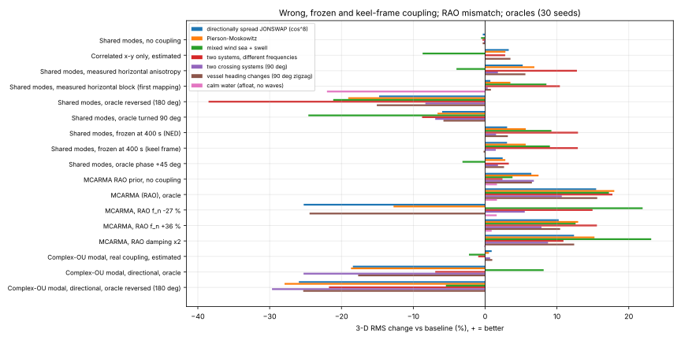
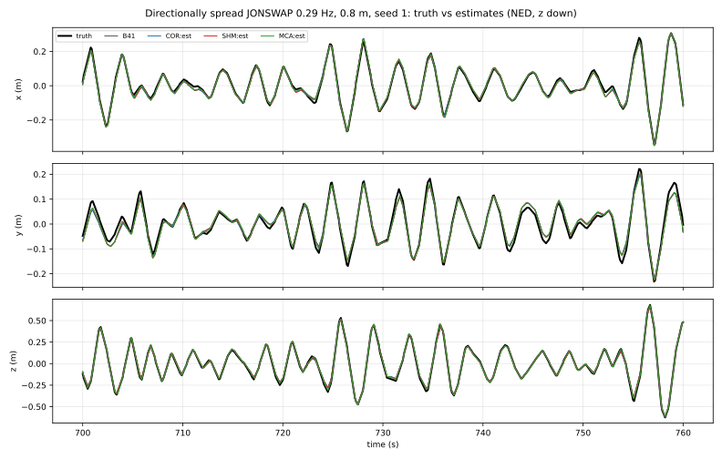
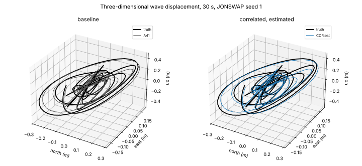
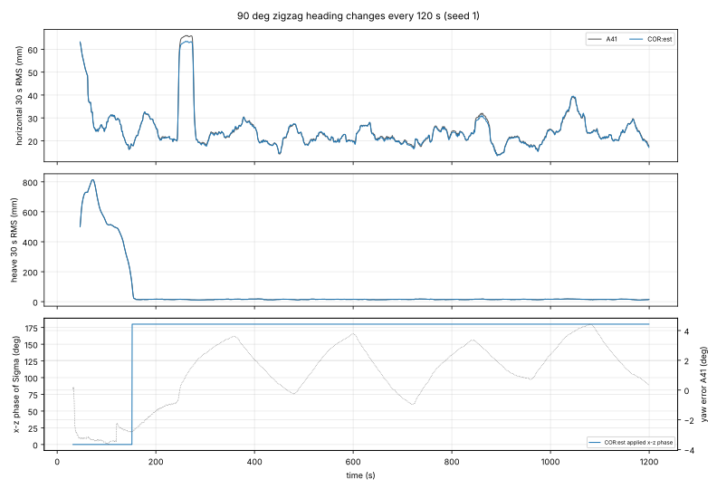
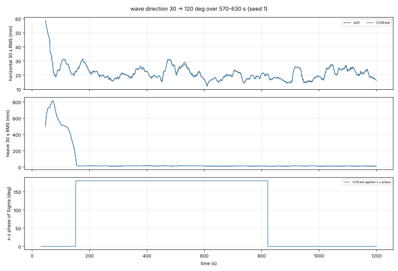
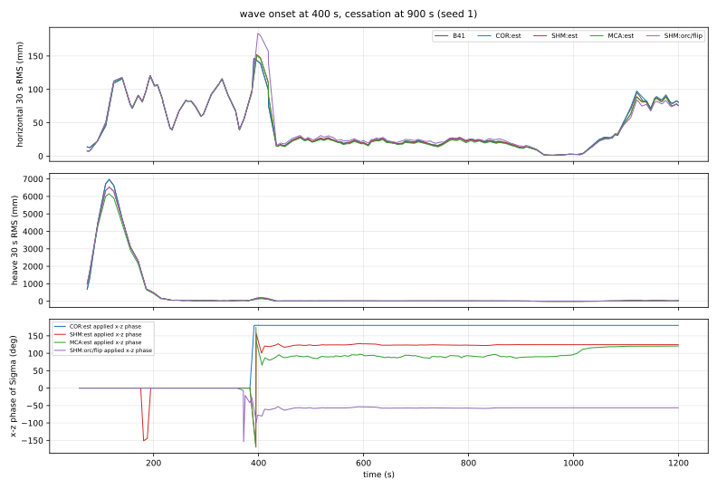
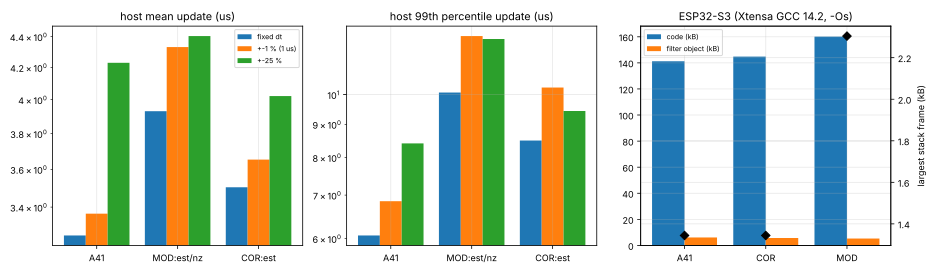
