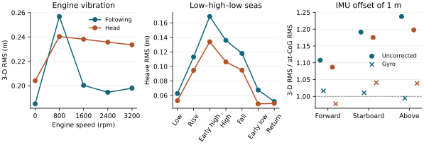

# Shared-mode TFG–CARMA degradation studies

These runs exercise the 27-state estimator on the pinned v1.4.0 28 ft vessel at 5 kn. Each direction includes eight 20-minute JONSWAP and PM–Stokes records at 200 Hz. The fixed-sea tests pair the same record, IMU noise (seed 101), initialization (seed 1009), magnetic service and adaptation. The common control has the engine off and the IMU at the centre of gravity (CoG). Each run scores its final 900 s. Pooled RMS is the square root of the mean of the eight squared record RMS values.

| Underway case | Per-record engine and mounting results | Transition windows | Inputs, executable and file hashes |
|---|---|---|---|
| Following seas | [184 runs](following/steady_seas.csv) | [Seven windows](following/roundtrip.csv) | [Manifest](following/manifest.json) |
| Head seas | [184 runs](head/steady_seas.csv) | [Seven windows](head/roundtrip.csv) | [Manifest](head/manifest.json) |



- **Engine noise.** The three-cylinder engine model adds vibration to the delivered accelerometer and gyro signals with the normal vibration guard enabled. At 800 rpm, pooled 3-D RMS rises from 0.185 to 0.257 m in following seas and from 0.204 to 0.240 m in head seas. Pooled yaw RMS reaches 10.96° and 2.22°, respectively. At 3200 rpm, heave RMS is largest in both directions.
- **Low–high–low seas.** The OU-III article's round-trip generator blends the 1.5 m sea into a nominal 4.0 m sea from 400 to 520 s and returns to the original low-sea realization from 800 to 920 s. One filter runs continuously in each direction. Initial low, early high and final low heave RMS are 0.063, 0.169 and 0.052 m following and 0.053, 0.134 and 0.049 m head. The CSVs include reference heave RMS in every window. The percentage of reference RMS accounts for the realized wave energy. The separate percentage of incident height uses the generator filename's fixed 4 m denominator throughout.
- **IMU off CoG.** Forward, starboard and upward mounting offsets of 0.30 and 1.00 m are evaluated separately. Each has an uncorrected arm, the measured-gyro correction in the actual wrapper (15 Hz derivative cutoff), and an oracle using the injected rotational acceleration. At 1 m above CoG, the uncorrected/at-CoG 3-D RMS ratios are 1.238 following and 1.198 head. With wrapper correction they are 0.995 and 1.039. The worst individual corrected ratio across all offsets and records is 1.079. The arm is known exactly in this study.

The [method article](../../../../doc/kalman_tfg_shared_modes/kalman_tfg_shared_modes-method.tex) gives the phase-by-phase and mounting-axis tables. The [companion study](../README.md) reports independent-seed engine and transition diagnostics under a different synthetic protocol.

## Reproduce

From the repository root, use the C++ replay toolchain, Python numerical and plotting dependencies, and TeX for PGF export.

```sh
python3 tools/sim_dataset.py --case all --dest .sim-data/cases
make -C tests/kalman_tfg_shared_modes installation-study
for direction in following head; do
  OCEAN_IMU_SIM_CASE="$direction" python3 tools/tfg_shared_modes_degradation.py --jobs 4
done
python3 tools/tfg_shared_modes_degradation_report.py
```

The runner verifies the record hashes, the estimator identity, the full scoring window and activation of the requested disturbance or correction. The renderer checks the paired design and CSV hashes before producing the article tables and plots. Each direction contains 184 fixed-sea runs (one control, four engine speeds and eighteen installation conditions per record) and one continuous transition run.
