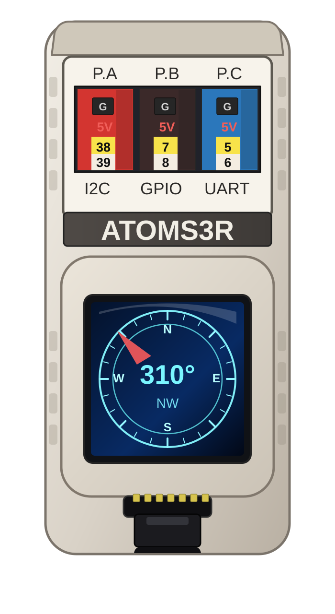

# Sensor and M5Stack examples

[ocean-imu](../README.md) / **sensors**

This directory contains the hardware-facing Arduino examples for `ocean-imu`. The current examples target the **M5Stack AtomS3R** and build upward from direct IMU access to tilt-compensated compass/AHRS applications and complete marine motion estimators.

  

The examples intentionally form a progression. Start with the basic IMU sketch to verify the board, coordinate mapping, serial connection, and saved calibration. Move to the compass/AHRS examples once raw sensing is healthy, then use a full marine INS example when you want attitude, heading, and wave-motion estimation together.

## Choose an example

| Area | What it demonstrates | Start here |
| --- | --- | --- |
| [IMU basics](imu_basic/README.md) | M5Unified IMU access, body-to-NED mapping, saved calibration, serial diagnostics | First hardware bring-up |
| [Compass / AHRS](compass_ahrs/README.md) | Tilt-compensated heading with Mahony or quaternion MEKF, display UI, NMEA output | Heading and attitude |
| [Full marine INS](full_marine_ins/README.md) | Adaptive marine motion estimation with OU-II, OU-III, TFG, PII observer, or NLO | Vessel motion / wave estimation |

## Checking the 200 Hz cycle on an AtomS3R

The speed-optimized marine sketches use GCC level-1 debug information to keep function names and source lines for device backtraces and bound assembler memory use.

Build the navigation or compass sketch with `-DOCEAN_IMU_PROFILE_LOOP=1` and capture
`[TIMING]` lines after startup, with the usual LCD and serial output enabled.
`sample_gap_mean_us` and `sample_gap_max_us` measure elapsed time between accepted
IMU frames. `accepted_work_mean_us` and `accepted_work_max_us` measure processing
from the end of the pacing wait through output publication. A steady 200 Hz window
has mean sample spacing near 5,000 µs. `accepted_over_4500us=0` means every accepted
update in the window had at least 0.5 ms of processing headroom. The profile prints
one summary per window to keep per-sample serial writes out of the measurement.
OU-II, OU-III, plain TFG and shared-mode TFG–CARMA timestamp the host poll that found a complete BMI270 frame.
Compare `sample_gap_min_us`, `sample_gap_max_us` and `jitter_mean_abs_us` to
see variation even when the mean is 5,000 µs. `gaps_over_7_5ms` counts host gaps
longer than 7.5 ms. An early poll can retry within 300 µs. A successful retry
anchors the next 5 ms wait to the observed ready poll.

On these four sketches, the startup message `[IMU] estimator clock: BMI270 200 Hz`
means the reader verified both inertial output rates and captures the sensor clock
in the same I²C burst as acceleration and angular rate. This works with both
M5 raw and Bosch-compensated magnetic calibrations. Consecutive frames pass
5 ms to the estimator, a two-frame advance passes 10 ms, and a repeated frame
is discarded. If the stock reader or matching rates are unavailable, startup
reports `host micros`. The profile line `[ESTIMATOR] dt_min_ms=5.000 dt_max_ms=5.000 host_steps=0`
identifies a window of 5 ms estimator steps. A nonzero `host_steps` counts
accepted intervals timed from the host, including recovery from a sensor-clock discontinuity.
Plain TFG and shared-mode TFG–CARMA also report `missed_sensor_frames`, the number
of unprocessed sensor frames confirmed by successive frame counts. A jump of four
frames adds three. Duplicate polls and host-timed intervals add zero.

OU-II, OU-III and plain TFG publish NMEA heading and tilt on the 80 ms output deadline.
Shared-mode TFG–CARMA publishes heading first and sends the pitch and roll sentences
in the next available slot. All four sketches take heave, wave, status, temperature
and rate-of-turn values from the same snapshot and send them over subsequent slots.

## Hardware

The sensor sketches are written for the M5Stack AtomS3R and use `M5Unified` for board and IMU access. Connect the AtomS3R over USB-C for power, programming, and serial output.

The reusable filtering code under [`../src/`](../src/) is separate from these hardware examples; the `sensors/` tree shows how that library code is integrated on a real embedded target.

## Arduino installation

1. Install Arduino IDE 2.x or another Arduino-compatible build environment.
2. Install the current Espressif **ESP32 Arduino core** and select the board profile you normally use for the AtomS3R.
3. Install `ocean-imu` as an Arduino library. You can clone/copy this repository into your Arduino libraries directory, or download the repository as a ZIP and use **Sketch → Include Library → Add .ZIP Library…**.
4. Install the library dependencies. [`library.properties`](../library.properties) declares `M5Unified` and `Eigen`; allow the Arduino IDE to install them when prompted, or install them manually with Library Manager.
5. Connect the AtomS3R, select its serial port, open one of the `.ino` sketches linked below, and upload it.

If you are bringing up a new board or a new installation, use [`imu_basic/atomS3R_imu_m5_basic`](imu_basic/atomS3R_imu_m5_basic/README.md) first. It is deliberately much simpler than the full estimators and makes wiring, board-package, sensor, mapping, and calibration problems easier to isolate.

## Suggested bring-up order

1. [Basic AtomS3R IMU](imu_basic/atomS3R_imu_m5_basic/README.md); if a compass later reads wrong headings, run [magnetometer diagnostics](imu_basic/atomS3R_mag_diagnostics/README.md)
2. [Mahony compass](compass_ahrs/atomS3R_compass_mahony/README.md) or [qMEKF compass](compass_ahrs/atomS3R_compass_qmekf/README.md)
3. For full marine navigation, start with [shared-mode TFG–CARMA marine INS](full_marine_ins/atomS3R_ins_tfg_carma_shared_modes/README.md). The [full marine INS guide](full_marine_ins/README.md) compares the alternative estimators.

## Coordinate convention

The AtomS3R helper layer converts device readings into the project body/NED-oriented convention used by the filters. Do not bypass that mapping in a full filter unless you also update the corresponding frame assumptions. The basic IMU example is the easiest place to inspect the mapped accelerometer, gyro, and magnetometer values before running an estimator.

## Calibration wizard

The compass and INS sketches share one on-device calibration wizard (single tap on the home screen, or automatically when nothing is saved). With a saved calibration that includes the gyro, the first screen offers **Tap: full calib / Tap x2: accel only / Tap x3: cancel**.

- **Accelerometer:** ten guided holds — the six faces, then four tilted "screen up, ~45 deg" corners described by the USB end and the left/right edge. Each hold shows its instructions first ("Tap then place"). The device is then placed on a table or held by hand; modest hand motion is fine. A hold completes after about 5 s of steady data. If the measured geometry leaves a term undetermined, or one hold disagrees with the others, at most two extra holds are requested.
- **Gyro and magnetometer:** unchanged (full wizard only).
- **Rechecks:** three short holds (screen up, USB up, left edge down) give temperature evidence and a held-out check.

**Gravity.** M5Unified reports acceleration in nominal g, converted to m/s² with the exact standard value 9.80665 (`ImuCalCfg::g_std`). That is only a unit. The physical gravity at the calibration site is `ImuCalCfg::g_cal_local`; the default is WGS84 normal gravity at Fair Lawn, NJ 07410 (40.935833° N, ellipsoidal height −9 m), 9.8025605 m/s². The accelerometer is calibrated to that static norm, and every sketch's estimator removes the same value, so a still device reads zero translational acceleration. Elsewhere, build with `-DATOMS3R_CALIBRATION_GRAVITY_MPS2=<your gravity>` and recalibrate. A saved accelerometer calibration fitted against a different gravity is reported at boot and not applied; gyro and magnetometer calibrations stay in use.

The accelerometer part takes about 2.5–3 minutes in simulation. Nothing is saved unless the whole result validates; otherwise, or after a cancel, the previous calibration stays. The method, pose design and validation are in [`doc/imu_calibrate/imu_calibrate-method.tex`](../doc/imu_calibrate/imu_calibrate-method.tex).

## Related repository areas

- [`../src/AtomS3R/`](../src/AtomS3R/) — shared AtomS3R calibration, display, and UI helpers
- [`../src/ahrs/`](../src/ahrs/) — attitude filters
- [`../src/kalman_ou_ii/`](../src/kalman_ou_ii/) — OU-II marine Kalman filter
- [`../src/kalman_ou_iii/`](../src/kalman_ou_iii/) — OU-III marine Kalman filter
- [`../src/kalman_tfg/`](../src/kalman_tfg/) — two-frame Lie-group marine filter
- [`../src/pii_observer/`](../src/pii_observer/) — lightweight PII observer
- [`../src/nlo/`](../src/nlo/) — time-varying-gain nonlinear observer
- [Project README](../README.md) — algorithms, publications, tests, and repository-wide build information
