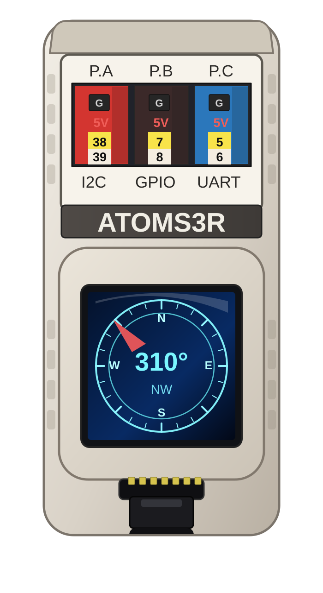

# Legacy full marine INS examples

[ocean-imu](../../README.md) / [sensors](../README.md) / **full_marine_ins-legacy**

These AtomS3R applications are alternatives and research comparisons to the primary marine INS estimator, [shared-mode TFG–CARMA(4,1)](../full_marine_ins/atomS3R_ins_tfg_carma_shared_modes/README.md), which lives in [`full_marine_ins/`](../full_marine_ins/). They are among the most complete AtomS3R applications in the repository. They combine calibrated IMU input, attitude/heading estimation, marine-motion processing, on-device UI, and serial/NMEA output.

  

They are intended for **marine motion estimation**, where accelerometer measurements contain both gravity and wave-induced translational acceleration and the system may need to initialize while already moving.

## Available estimators

| Example | Method | Main character |
| --- | --- | --- |
| [atomS3R_ins_tfg_carma_shared_modes](../full_marine_ins/atomS3R_ins_tfg_carma_shared_modes/README.md) | Shared-mode TFG–CARMA(4,1) INS | **Primary marine INS estimator.** 27 error states, shared directional modes and confidence-weighted coupling. Accuracy evaluated in simulation. |
| [atomS3R_ins_kalman_ou2](atomS3R_ins_kalman_ou2/README.md) | Adaptive OU-II Kalman INS | More direct integral-drift correction; responsive sea-state adaptation |
| [atomS3R_ins_kalman_ou3](atomS3R_ins_kalman_ou3/README.md) | Adaptive OU-III Kalman INS | Higher-order integral regularization; OU-family 3-D navigation implementation |
| [atomS3R_ins_carma3](atomS3R_ins_carma3/README.md) | Experimental three-axis CARMA Kalman INS | OU-III with CARMA(4,1) motion priors on X/Y/Z; research sketch, simulation evidence only |
| [atomS3R_ins_carma_shared_modes](atomS3R_ins_carma_shared_modes/README.md) | Experimental shared-modes QMEKF INS | CARMA3 with shared directional stochastic modes and coupling confidence; research sketch, simulation evidence only |
| [atomS3R_ins_tfg_carma3](atomS3R_ins_tfg_carma3/README.md) | Experimental TFG-CARMA3 Kalman INS | CARMA3's prior and wrapper on the two-frame Lie group; research sketch, simulation evidence only |
| [atomS3R_ins_tfg](atomS3R_ins_tfg/README.md) | Right-invariant two-frame Lie-group INS | Same state and wave model as OU-III on one group, so attitude corrections move the kinematic states with them |
| [atomS3R_ins_pii_observer](atomS3R_ins_pii_observer/README.md) | Adaptive PII observer + Mahony | Much lighter computation; primarily vertical/heave-oriented motion estimation |

The OU-II, OU-III, CARMA3, TFG-CARMA3 and TFG sketches learn tilt during startup, perform a one-shot magnetic north lock in the sea-state fusion filter, and then use filter yaw as the primary heading output. The PII application uses Mahony attitude with a lightweight adaptive vertical observer.

TFG differs from the OU sketches in how it is assembled rather than in what it publishes. `SeaStateFusionFilter_TFG` carries the core of the OU-III orchestrator but not its wave-direction estimator or its displacement detrender, which live in the OU wrapper class; the TFG sketch composes those from the same shared components, so its outputs mean what they mean elsewhere on this page. It also has no IMU lever-arm correction — see its [README](atomS3R_ins_tfg/README.md) for the full list of differences.

## Installation and bring-up

Follow the common [Arduino installation instructions](../README.md#arduino-installation). Before debugging one of these larger applications, first verify the same board with [Basic IMU](../imu_basic/README.md) and preferably one of the [Compass / AHRS](../compass_ahrs/README.md) examples. That separates sensor/calibration problems from full estimator behavior.

The full sketches enable the shared IMU calibration wizard by default through `SEA_STATE_ENABLE_WIZARD=1`. They also default to graphical UI and NMEA serial output; those behaviors can be changed with the compile-time switches near the top of each sketch.

## Which should I use?

Start with **shared-mode TFG–CARMA(4,1)** for the primary 3-D navigation method. Its quaternion counterpart uses the same wave model. **OU-III** and **OU-II** provide alternatives with integral drift regularization, and the two independent-axis CARMA sketches provide comparisons without directional coupling. Try **TFG** when you want the OU-III state and wave model with a geometrically consistent attitude correction, and can mount close to the centre of gravity. Use the **PII observer** when MCU cost and simplicity matter more than the full Kalman-state solution.

## Related material

The mathematical descriptions and validation links are collected in the [project README](../../README.md). Source implementations live under [`../../src/kalman_ou_ii/`](../../src/kalman_ou_ii/), [`../../src/kalman_ou_iii/`](../../src/kalman_ou_iii/), [`../../src/kalman_carma/`](../../src/kalman_carma/), [`../../src/kalman_tfg/`](../../src/kalman_tfg/), [`../../src/pii_observer/`](../../src/pii_observer/), and [`../../src/nlo/`](../../src/nlo/). The TFG convention contract is in [`../../docs/tfg-design.md`](../../docs/tfg-design.md).

[Back to all sensor examples](../README.md)
