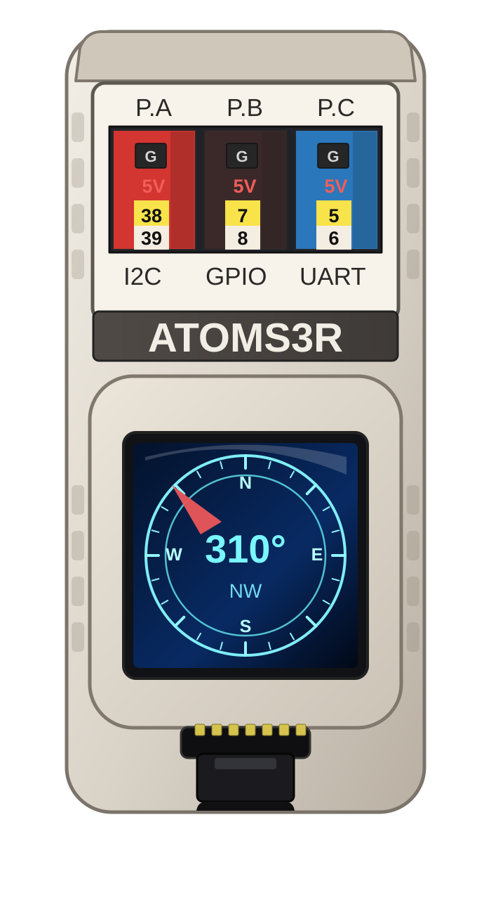

# AtomS3R marine INS — Kalman CARMA3 (experimental)

[ocean-imu](../../../README.md) / [sensors](../../README.md) / [full_marine_ins](../README.md) / **atomS3R_ins_carma3**

This sketch runs the **experimental** three-axis CARMA Kalman filter, **SeaStateFusion CARMA3**, on the M5Stack AtomS3R. It replaces OU-III's per-axis integrated-OU wave chains with CARMA(4,1) motion priors on X, Y and Z (no `S` states), the research candidate recommended in [`docs/carma-three-axis.md`](../../../docs/carma-three-axis.md). Attitude, bias, magnetometer handling, startup and adaptation are OU-III's.

  

Open the sketch: [`atomS3R_ins_carma3.ino`](atomS3R_ins_carma3.ino).

> **Research sketch, not the shipping estimator.** The CARMA3 results are simulation-only; there is no hardware or sea-trial evidence and no stability analysis. Compared with OU-III it shows larger phantom motion and a larger heave startup transient on a still IMU, and worse heave on mixed swell + wind seas. Use [OU-III](../atomS3R_ins_kalman_ou3/README.md) for deployment.

## What it does

- reads and calibrates the AtomS3R IMU using the shared device layer;
- runs the estimator at 200 Hz;
- rejects sporadic single-sample IMU spikes before calibration and fusion with the shared [`ImuSpikeFilter`](../../../src/AtomS3R/AtomS3R_ImuSpikeFilter.h) (disable with `-DATOMS3R_IMU_SPIKE_FILTER=0`);
- learns tilt during startup while the vessel may already be moving;
- performs a one-shot magnetic north lock inside the sea-state fusion filter;
- uses filter yaw as the primary heading after north lock while retaining tilt-compensated magnetic heading for diagnostics;
- keeps north on the startup/refined magnetic reference: continuous hard-iron learning is disabled;
- estimates 3-D marine motion with CARMA(4,1) priors whose frequency and amplitude follow the operating point measured by the shared OU-III tuner;
- optionally corrects an IMU mounted away from the centre of gravity (`IMU_LEVER_ARM_*_M` at the top of the sketch, zero by default);
- provides on-device graphics and serial/NMEA output (the same sentences as the OU-III sketch);
- enables the shared IMU calibration wizard by default.

Differences from the OU-III sketch:

- the IMU lever-arm correction is removed at the fusion wrapper's input, so the startup tilt, the magnetic reference, the tuner and the wave direction all see centre-of-gravity motion; OU-III removes it in its MEKF's accelerometer update only. The [off-CoG study](../../../docs/carma-imu-lever-arm.md) compares the two;
- no `S = 0` pseudo-measurement, so there is no pseudo-update cadence setting.

## Install and upload

Install a prebuilt release without compiling using the
[AtomS3R command-line flashing guide](../../../docs/atoms3r-release-flashing.md).
Select `atomS3R_ins_carma3`. For an Arduino IDE source build, follow the steps below.

1. Complete the common [`sensors/` Arduino setup](../../README.md#arduino-installation).
2. Verify [Basic IMU](../../imu_basic/atomS3R_imu_m5_basic/README.md) and a [Compass / AHRS](../../compass_ahrs/README.md) example first when commissioning new hardware.
3. Open `atomS3R_ins_carma3.ino`.
4. Select the AtomS3R-compatible board profile and USB port, compile, and upload.
5. Evaluate startup and magnetic north lock in the intended mounting orientation and away from strong transient magnetic disturbances.

The compile-time controls at the top of the sketch include calibration-wizard enable, graphics mode, NMEA mode, and NMEA talker ID.

## More about CARMA3

[`docs/carma-three-axis.md`](../../../docs/carma-three-axis.md) describes the model, the operating-point mapping, the benchmark against OU-III and the remaining obstacles before deployment. The paper is [`doc/kalman_carma/kalman_carma.tex`](../../../doc/kalman_carma/kalman_carma.tex). The implementation lives under [`../../../src/kalman_carma/`](../../../src/kalman_carma/).

## Compare

- [OU-III marine INS](../atomS3R_ins_kalman_ou3/README.md) — the shipping 3-D navigation estimator this filter is derived from
- [OU-II marine INS](../atomS3R_ins_kalman_ou2/README.md) — more direct integral drift correction
- [TFG marine INS](../atomS3R_ins_tfg/README.md) — OU-III's state and wave model on a two-frame Lie group

[Back to Full marine INS](../README.md) · [All sensor examples](../../README.md)
