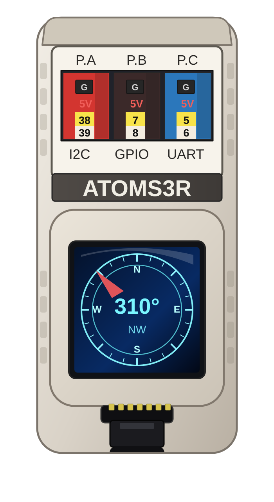

> [!WARNING]
> EXPERIMENTAL

# AtomS3R marine INS — Two-Frame Lie-Group (TFG)

[ocean-imu](../../../README.md) / [sensors](../../README.md) / [full_marine_ins](../README.md) / **atomS3R_ins_tfg**

This sketch runs the **right-invariant two-frame Lie-group** estimator, `SeaStateFusionFilter_TFG`, on the M5Stack AtomS3R. It carries the same 21-dimensional state and the same OU wave model as OU-III, but attitude, the world-frame kinematic states and the body-frame biases live on one group, so an attitude correction rotates velocity, position, integral displacement and wave acceleration coherently instead of leaving them behind.

<p align="center">
  
</p>

Open the sketch: [`atomS3R_ins_tfg.ino`](atomS3R_ins_tfg.ino).

## What it does

- reads and calibrates the AtomS3R IMU using the shared device layer, which samples the BMI270 accelerometer at the gyroscope's 200 Hz and stops before the estimator when the saved calibration cannot be applied in full ([calibration safety](../../../docs/calibration-safety.md));
- runs the estimator at 200 Hz;
- rejects sporadic single-sample IMU spikes before calibration and fusion with the shared [`ImuSpikeFilter`](../../../src/AtomS3R/AtomS3R_ImuSpikeFilter.h): detection runs on |a| plus the vertical (body z) accelerometer component, which also catches vertical sign flips, and a rejected read has its accelerometer and gyro replaced together from the same observed window sample (settings in `ImuSpikeCfg`; disable with `-DATOMS3R_IMU_SPIKE_FILTER=0`);
- learns tilt during startup through the filter's private Mahony proxy, so the boat may already be moving at power-on;
- performs a one-shot magnetic north lock inside the fusion filter;
- uses filter yaw as the primary heading after north lock while retaining tilt-compensated magnetic heading for diagnostics;
- keeps north on the startup/refined magnetic reference: continuous hard-iron learning is disabled, because heel motion makes it absorb calibration residuals as a heading offset;
- estimates 3-D marine motion on the two-frame group, with the OU integral chain and its spectral-MSE regularizer;
- adapts the sea-state-dependent estimator parameters from the canonical period statistics;
- arms the accelerometer vibration guard by default, so machinery noise does not rectify into a standing tilt error;
- provides on-device graphics and serial/NMEA output;
- enables the shared IMU calibration wizard by default.

## How it is assembled

`SeaStateFusionFilter_TFG` carries the core of the OU-III orchestrator, but **not** OU-III's wave-direction estimator, its displacement detrender or its alternative frequency trackers: those live in the `SeaStateFusion_OU_III` wrapper class, and TFG has no wrapper. This sketch therefore composes them itself, from the same shared components the OU wrapper uses and driven the same way:

| Output | How this sketch produces it |
| --- | --- |
| heading, roll, pitch | `fusion_.mekf().quaternion()`, the body→world rotation, world frame NED |
| heave, heave rate | `mekf().get_position()` / `get_velocity()`, Z flipped to "up" |
| detrended heave | [`AdaptiveWaveDetrender3D`](../../../src/detrend/AdaptiveWaveDetrender3D.h) on that displacement, given the filter's own period as external frequency guidance |
| wave axis and sign | `heading_frame_acceleration` → [`VesselRaoEqualizer`](../../../src/wave_dir/VesselRaoEqualizer.h) → [`KalmanWaveDirection`](../../../src/wave_dir/KalmanWaveDirection.h) → [`WaveDirectionDetector`](../../../src/wave_dir/WaveDirectionDetector.h) |
| wave envelope | `C_HS · σ_aw · τ² / 2`, the same scalar reduction OU-III publishes as `getDisplacementScale()` |

Every value the application publishes therefore means what it means in the OU-III sketch; the estimator underneath it is the only thing that changed.

## Differences from the OU sketches

- **No IMU lever-arm knob.** `Kalman3D_Wave_TFG` has no off-centre-of-gravity correction, so there is no `IMU_LEVER_ARM_*_M` block. Mount the device as close to the vessel centre of gravity as the installation allows, or use [OU-III](../atomS3R_ins_kalman_ou3/README.md) where the offset is large enough to matter.
- **Gyroscope noise is a density, not a per-axis sigma.** `Config::gyro_noise_density` replaces OU-III's `sigma_g` vector, and the sample-rate scaling the accelerometer and magnetometer get must not be applied to it a second time.
- **One frequency tracker.** TFG reports a wave period from the canonical estimator; there is no `TrackerType` choice and no `ZERO_CROSSINGS_*` tuning block.
- **Loop-task stack.** The sketch allocates 32 KiB for the estimator, wave direction, displacement filtering, output and calibration UI. The covariance workspaces are members of the filter. Peak stack usage for the current kernels still needs a measurement on the AtomS3R.
- **Vibration guard is exposed instead of the OU clamp knobs.** `ACC_VIBRATION_GUARD_HZ` near the top of the sketch sets the front-end corner; zero removes the guard and restores the unconditioned measurement path.

## Checking the 5 ms budget

Build with `-DOCEAN_IMU_PROFILE_LOOP=1` and keep the normal LCD and serial outputs enabled. In Live operation, `missed_sensor_frames` counts missing BMI270 frames and `host_steps` counts intervals measured from host time. The `[TIMING]` line reports processing time and the number of accepted updates that exceeded 4.5 ms or the 5 ms period.

The estimator propagates the full covariance using the sparse transition, applies the three-channel Joseph update at each accepted accelerometer correction, and transports covariance through the finite group reset. It reuses OU coefficients only when the interval, model parameters and linear-block state match. The optional host benchmark exercises the firmware fusion settings with a 200 Hz IMU and 25 Hz magnetic service. It checks that all scheduled corrections were accepted.

```sh
make -C tests/kalman_tfg tfg_update_bench
tests/kalman_tfg/tfg_update_bench
```

## Memory on the AtomS3R

The 21-state filter holds three 21 × 21 and two 21 × 3 single-precision workspaces in the filter object. Together they occupy 5,796 bytes and are reused by prediction and correction. The firmware build reports the complete sketch's flash and global RAM usage in the `build-MCU (full_marine_ins)` job.

## Install and upload

Install a prebuilt release without compiling using the
[AtomS3R command-line flashing guide](../../../docs/atoms3r-release-flashing.md).
Select `atomS3R_ins_tfg`. For an Arduino IDE source build, follow the steps below.

1. Complete the common [`sensors/` Arduino setup](../../README.md#arduino-installation).
2. Verify [Basic IMU](../../imu_basic/atomS3R_imu_m5_basic/README.md) and a [Compass / AHRS](../../compass_ahrs/README.md) example first when commissioning new hardware.
3. Open `atomS3R_ins_tfg.ino`.
4. Select the AtomS3R-compatible board profile and USB port, compile, and upload.
5. Evaluate startup and magnetic north lock in the intended mounting orientation and away from strong transient magnetic disturbances.

The compile-time controls at the top of the sketch include calibration-wizard enable, graphics mode, NMEA mode, and NMEA talker ID.

## More about TFG

The convention contract — rotation direction, error definition and correction side, stated together — is in [`docs/tfg-design.md`](../../../docs/tfg-design.md), and it is pinned by `tests/kalman_tfg/convention-test.cpp`. The root [project README](../../../README.md) links the TFG paper and the comparison studies against the OU families. The implementation used by this sketch lives under [`../../../src/kalman_tfg/`](../../../src/kalman_tfg/), on the Lie-group operations in [`../../../src/lie/`](../../../src/lie/).

## Compare

- [OU-III marine INS](../atomS3R_ins_kalman_ou3/README.md) — same state and wave model, quaternion-MEKF geometry, plus the lever-arm correction
- [OU-II marine INS](../atomS3R_ins_kalman_ou2/README.md) — more direct integral drift correction
- [PII observer](../atomS3R_ins_pii_observer/README.md) — much lighter observer-based alternative
- [Time-varying-gain NLO](../atomS3R_ins_nlo/README.md) — observer-based 3-D estimator with published gains, no covariance propagation

[Back to Full marine INS](../README.md) · [All sensor examples](../../README.md)
