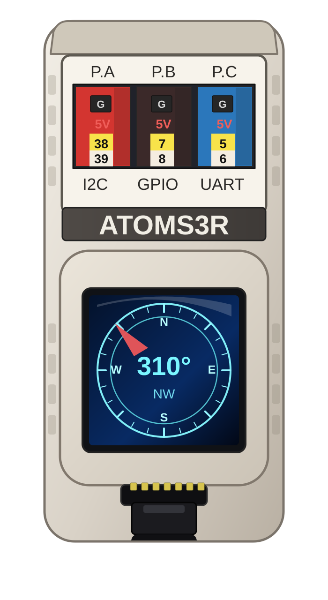

# AtomS3R marine INS — shared-mode TFG–CARMA(4,1)

[ocean-imu](../../../README.md) / [sensors](../../README.md) / full_marine_ins / **atomS3R_ins_tfg_carma_shared_modes**

This sketch runs the project’s primary marine INS estimator, the 27-state shared-mode TFG–CARMA(4,1) filter [`KalmanTfgCarmaSharedModes`](../../../src/kalman_carma_shared_modes/KalmanTfgCarmaSharedModes.h), on the M5Stack AtomS3R. It is [atomS3R_ins_tfg_carma3](../../full_marine_ins-legacy/atomS3R_ins_tfg_carma3/README.md) with the three independent CARMA(4,1) motion priors replaced by **shared directional stochastic modes**. Each axis carries one complexified CARMA(4,1) mode in its six-state minimal realization, the axes share its dynamics, and a Hermitian excitation is estimated from the filter's own world-frame acceleration. A **coupling confidence** withdraws the coupling and falls back toward the independent-axis prior when it cannot be trusted. The error state lives on the right-invariant two-frame Lie group of [`src/lie/TwoFrameGroup.h`](../../../src/lie/TwoFrameGroup.h) ([design](../../../docs/tfg-carma-shared-modes.md)).

  

Open the sketch: [`atomS3R_ins_tfg_carma_shared_modes.ino`](atomS3R_ins_tfg_carma_shared_modes.ino).

> The paired simulation measured 5.9% lower heave RMS and 2.8% lower horizontal RMS than independent-axis TFG–CARMA. The study found poorly calibrated covariance. The firmware has been compiled for the AtomS3R. Sea-trial accuracy, on-device update time and measured stack high-water remain unverified. [Study and limitations](../../../reports/results/tfg_shared_modes/README.md)

## Differences from atomS3R_ins_tfg_carma3

- The filter type is `SeaStateFusion_TfgCarmaSharedModes`, the CARMA3 wrapper with `KalmanTfgCarmaSharedModes<float>` as its inner filter (27 error states instead of 21). Startup, magnetic north lock, tuner, wave-excitation evidence, outputs, sentences, display and calibration paths are the TFG-CARMA3 sketch's.
- `begin(cfg)` selects the deployable configuration: the coupling is estimated from the filter's own acceleration, with the coupling confidence and the default excitation cap. No oracle, RAO or truth information is used.
- The sketch uses the saved magnetometer calibration by default. Build with `-DOCEAN_IMU_SCREEN_MAG_INSTALLATION=1` to enable gyro-aided residual calibration. When enabled, the learner checks for distortion every five seconds. Three consecutive detections allow the live filter to apply the correction gradually once magnetic refinement and excitation checks pass. [Screening and replay results](../../../doc/marine_mag/README.md#production-replay-results)
- The display shows `Fusion: TFG-SHARED`.

Its quaternion counterpart is [atomS3R_ins_carma_shared_modes](../../full_marine_ins-legacy/atomS3R_ins_carma_shared_modes/README.md), which runs the same shared modes on the CARMA3 quaternion MEKF error.

## Mounting away from the centre of gravity

Set `IMU_LEVER_ARM_X_M`, `IMU_LEVER_ARM_Y_M` and `IMU_LEVER_ARM_Z_M` to the sensor position relative to CoG in metres. Positive axes point forward, starboard and down. An IMU one metre above CoG uses `(0, 0, -1)`. The wrapper uses the measured gyro to correct specific force before startup and fusion. [Results for six mounting positions](../../../reports/results/tfg_shared_modes/degradation/)

## Memory and timing

The current 27-state filter occupies 16,088 bytes in its single heap allocation on ESP32-S3 (Arduino-ESP32 3.3.11, Xtensa GCC 14.2). Its fixed-size table holds the transition and process-noise coefficients for the tuned wave shape. The host polls on a 5,000 µs schedule. On each accepted sample after the first, the filter computes `Ts` from the elapsed microseconds between accepted poll starts. A late or missed poll therefore lengthens the interval used for propagation. At each 125 ms display refresh, the acquisition loop publishes a snapshot to a one-frame queue. A task on the other AtomS3R core renders the newest snapshot and transfers the entire frame over SPI. Text mode uses the same task. Opening the calibration menu waits for any active transfer to finish.

Navigation acquires accelerometer and gyro data on each accepted frame. With Bosch magnetic compensation active on the internal AtomS3R BMI270, the four CARMA sketches read the ready flags and a 12-byte accelerometer/gyro burst. When a magnetic poll is due (35 ms minimum spacing) or the source has expired, a single 20-byte burst covers the adjacent BMM150 AUX and inertial registers. Combining those transfers saves 27 I²C clocks per magnetic poll (67.5 µs at 400 kHz). Die temperature is read at 10 Hz. Calibration still reads both with every requested frame. The primary sketch computes compass angles and wave reports for the first sample and when a display or serial update needs them. Rate of turn continues to use every gyro sample.

Every accepted accelerometer/gyro sample advances the full 27-state covariance prediction and accelerometer correction. For a well-conditioned three-axis innovation, the filter whitens the residual and applies a symmetric rank-three covariance update. A projected accelerometer-bias gain adds a correction confined to its three bias rows and columns. The original LDLT/Joseph path handles poorly conditioned innovations.

The sketch's `build_opt.h` places recurring estimator and wave-tracking routines in ESP32-S3 instruction RAM. This reduces competition for the 16 KiB flash instruction cache and uses some internal SRAM that would otherwise be available to the heap. Keep this file alongside the sketch when building it.

Build with `-DOCEAN_IMU_PROFILE_LOOP=1` to emit a `[TIMING]` line every 1,000 accepted samples on the actual device. The `mekf_internal` field is 1 when the estimator occupies internal RAM. PSRAM-enabled ESP32-S3 builds request internal RAM for the covariance and its workspace, then use the normal allocator if internal storage is exhausted. The release board profile disables PSRAM.

When startup reports `[IMU] estimator clock: BMI270 200 Hz`, the estimator advances by 5 ms for each elapsed BMI270 frame. A repeated frame is discarded and a two-frame advance contributes 10 ms. The accompanying `[ESTIMATOR]` line reports the smallest and largest step in milliseconds, the number of host-timed intervals, and the number of skipped frames confirmed by sensor counts. An uninterrupted window reports `dt_min_ms=5.000 dt_max_ms=5.000 host_steps=0 missed_sensor_frames=0`.

| Field | Measurement |
|---|---|
| `fusion_cycles_mean`, `fusion_cycles_max` | CPU cycle counter around the fusion update and any magnetic update due on that sample |
| `loop_cycles_mean`, `work_us_mean` | Mean cycle-counter delta and elapsed microseconds across all loop passes before pacing |
| `read_us_mean`, `estimator_us_mean`, `output_us_mean` | Mean time per pass acquiring the sample, processing it (including calibration and rate of turn), and servicing serial and display |
| `loop_work_max_us`, `loops_over_5ms` | Maximum active loop active time after the pacing wait, and number of loops that exceeded the 200 Hz budget |
| `accepted_work_mean_us`, `accepted_work_max_us`, `accepted_over_4500us` | Full active sampling-loop time for the 1,000 accepted samples only, from before the sensor read through output publication. Includes time spent servicing serial. |
| `mag_samples`, `mag_work_max_us` | Number of accepted samples offering a fresh magnetic observation and maximum complete sampling-loop time among those samples |
| `lcd_frames_total`, `lcd_stack_free_min_bytes` | Cumulative number of completed compass draws and the worker's stack high-water mark in free bytes (zero before its first draw or in synchronous fallback) |
| `sample_gap_min_us`, `sample_gap_mean_us`, `sample_gap_max_us` | Shortest, mean (nearest µs), and longest interval between accepted IMU poll starts. The first window after reset has 999 intervals. Later windows also include the interval from the preceding window's last sample. |
| `jitter_mean_abs_us`, `gaps_over_7_5ms` | Mean absolute departure from 5,000 µs and count of intervals above 7.5 ms |

Use steady `live=1` windows to assess the operating workload. Compare `sample_gap_mean_us` with the 5,000 µs sample period and `accepted_work_mean_us` with the 4,500 µs processing budget. Keep the clock, graphics and serial settings the same when comparing firmware. At 240 MHz the 4.5 ms target corresponds to 1.08 million sampling-core cycles and leaves 0.5 ms before the next tick. The target is met for a window when `accepted_over_4500us=0`. Check sample gaps and completed draws alongside it. LCD transfer completes asynchronously on the display core.

### Earlier static size and stack measurements

| | TFG-CARMA3 | shared-modes TFG |
|---|---|---|
| filter object (heap, one allocation at `begin`) | 5.9 kB | 14.5 kB |
| wrapper object (heap) | 3.2 kB | 3.2 kB |
| largest single stack frame | 1.3 kB | 1.7 kB |
| worst static call chain of one update | 3.3 kB | 3.7 kB |

These figures come from `tests/kalman_carma_shared_modes/arduino/csm_size_probe/build.sh`, a static analysis recorded in [`esp32s3_size_stack.csv`](../../../reports/results/tfg_shared_modes/esp32s3_size_stack.csv). They were taken before the excitation-cap change, which adds a few scalars to the filter object. The call-chain figure excludes indirect calls and library frames. The complete sketch reserves 12 KiB for the Arduino loop task, which also runs the startup observer and, when enabled, screened magnetic calibration. The ESP32-S3 compiler reports a 1,872-byte frame for the gyro–mag calibration update with Arduino-ESP32 3.3.11. On-device peak use remains to be measured. The static stack figures predate the current kernel optimizations. Physical board timing and stack high-water must be measured with the running firmware.

## Install and upload

1. Complete the common [`sensors/` Arduino setup](../../README.md#arduino-installation).
2. Verify [Basic IMU](../../imu_basic/atomS3R_imu_m5_basic/README.md) and a [Compass / AHRS](../../compass_ahrs/README.md) example first when commissioning new hardware.
3. Open `atomS3R_ins_tfg_carma_shared_modes.ino`.
4. Install the Espressif Arduino-ESP32 3.3.11 core used by the release firmware. Select the AtomS3R board and USB port, compile, and upload. This core recovers the hardware CDC transmit interrupt when a host temporarily stops reading or reconnects. [Espressif USB serial fix](https://github.com/espressif/arduino-esp32/pull/12606)
5. Evaluate startup and magnetic north lock in the intended mounting orientation and away from strong transient magnetic disturbances.

Releases published after this sketch was added also carry a prebuilt ZIP; see the [AtomS3R command-line flashing guide](../../../docs/atoms3r-release-flashing.md) and select `atomS3R_ins_tfg_carma_shared_modes`.

The compile-time controls at the top of the sketch include calibration-wizard enable, graphics mode, NMEA mode, and NMEA talker ID.

## Compare

- [TFG-CARMA3 marine INS](../../full_marine_ins-legacy/atomS3R_ins_tfg_carma3/README.md) — the same geometry and wrapper with independent-axis priors
- [Shared-modes QMEKF marine INS](../../full_marine_ins-legacy/atomS3R_ins_carma_shared_modes/README.md) — the same shared modes with a quaternion MEKF error
- [OU-III marine INS](../../full_marine_ins-legacy/atomS3R_ins_kalman_ou3/README.md) — OU-family alternative with integral drift regularization

[Legacy marine INS estimators](../../full_marine_ins-legacy/README.md) · [All sensor examples](../../README.md)
