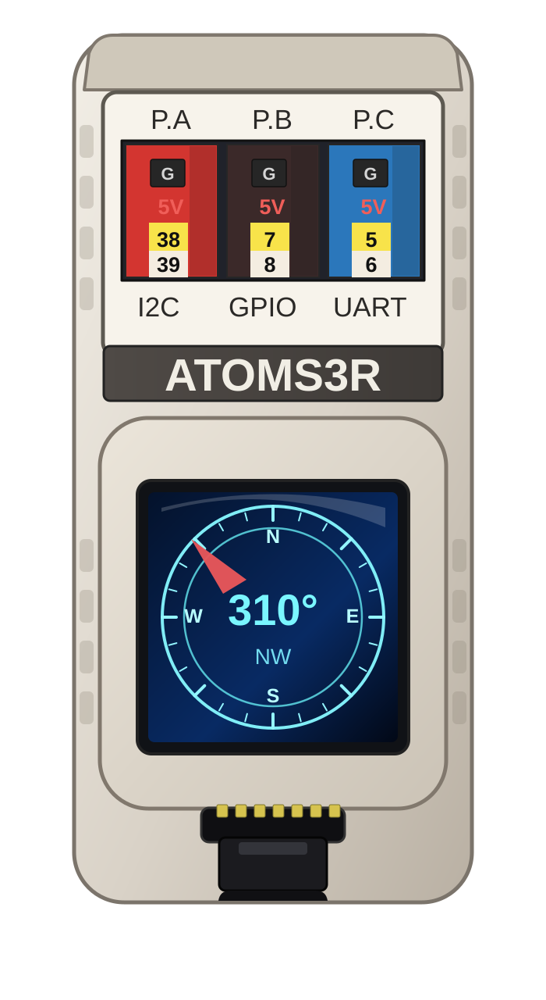

# AtomS3R marine INS — shared-modes TFG (experimental)

[ocean-imu](../../../README.md) / [sensors](../../README.md) / [full_marine_ins](../README.md) / **atomS3R_ins_tfg_carma_shared_modes**

This sketch runs the **experimental** 27-state shared-mode TFG filter, [`KalmanTfgCarmaSharedModes`](../../../src/kalman_carma_shared_modes/KalmanTfgCarmaSharedModes.h), on the M5Stack AtomS3R. It is [atomS3R_ins_tfg_carma3](../atomS3R_ins_tfg_carma3/README.md) with one change: the three independent CARMA(4,1) motion priors are replaced by **shared directional stochastic modes**. Each axis carries one complexified CARMA(4,1) mode in its six-state minimal realization, the axes share its dynamics, and a Hermitian excitation is estimated from the filter's own world-frame acceleration. A **coupling confidence** withdraws the coupling and falls back toward the independent-axis prior when it cannot be trusted. The error state lives on the right-invariant two-frame Lie group of [`src/lie/TwoFrameGroup.h`](../../../src/lie/TwoFrameGroup.h) ([design](../../../docs/tfg-carma-shared-modes.md)).

  

Open the sketch: [`atomS3R_ins_tfg_carma_shared_modes.ino`](atomS3R_ins_tfg_carma_shared_modes.ino).

> **Research sketch, not the shipping estimator, and not run on hardware yet.** The evidence is simulation-only ([results and limitations](../../../reports/results/tfg_shared_modes/README.md)). In that study it has the lowest condition-balanced position error of the four CARMA estimators: −5.9% heave and −2.8% horizontal RMS against TFG-CARMA3. There is no sea trial, no stability analysis of the adaptive filter, no on-target timing and no measured stack high-water mark, and its covariance is poorly calibrated. Use [OU-III](../atomS3R_ins_kalman_ou3/README.md) for deployment.

## Differences from atomS3R_ins_tfg_carma3

- One line: the filter type is `SeaStateFusion_TfgCarmaSharedModes`, the CARMA3 wrapper with `KalmanTfgCarmaSharedModes<float>` as its inner filter (27 error states instead of 21). Startup, magnetic north lock, tuner, wave-excitation evidence, outputs, sentences, display and calibration paths are the TFG-CARMA3 sketch's.
- `begin(cfg)` selects the deployable configuration: the coupling is estimated from the filter's own acceleration, with the coupling confidence and the default excitation cap. No oracle, RAO or truth information is used.
- The display shows `Fusion: TFG-SHARED`.

Its quaternion counterpart is [atomS3R_ins_carma_shared_modes](../atomS3R_ins_carma_shared_modes/README.md), which runs the same shared modes on the CARMA3 quaternion MEKF error.

## Memory and timing (ESP32-S3, Xtensa GCC 14.2.0, `-Os`)

| | TFG-CARMA3 | shared-modes TFG |
|---|---|---|
| filter object (heap, one allocation at `begin`) | 5.9 kB | 14.5 kB |
| wrapper object (heap) | 3.2 kB | 3.2 kB |
| largest single stack frame | 1.3 kB | 1.7 kB |
| worst static call chain of one update | 3.3 kB | 3.7 kB |

These figures come from `tests/kalman_carma_shared_modes/arduino/csm_size_probe/build.sh`, a static analysis recorded in [`esp32s3_size_stack.csv`](../../../reports/results/tfg_shared_modes/esp32s3_size_stack.csv). They were taken before the excitation-cap change, which adds a few scalars to the filter object. Calls through function pointers and library frames are not counted, so the call-chain figure is a lower bound; measure the loop task's stack high-water mark on the device before relying on the 8 KB default loop stack. Host update time of the filter core is about 1.75 times that of TFG-CARMA3; the embedded per-update time has not been measured.

## Install and upload

1. Complete the common [`sensors/` Arduino setup](../../README.md#arduino-installation).
2. Verify [Basic IMU](../../imu_basic/atomS3R_imu_m5_basic/README.md) and a [Compass / AHRS](../../compass_ahrs/README.md) example first when commissioning new hardware.
3. Open `atomS3R_ins_tfg_carma_shared_modes.ino`.
4. Select the AtomS3R-compatible board profile and USB port, compile, and upload.
5. Evaluate startup and magnetic north lock in the intended mounting orientation and away from strong transient magnetic disturbances.

Releases published after this sketch was added also carry a prebuilt ZIP; see the [AtomS3R command-line flashing guide](../../../docs/atoms3r-release-flashing.md) and select `atomS3R_ins_tfg_carma_shared_modes`.

The compile-time controls at the top of the sketch include calibration-wizard enable, graphics mode, NMEA mode, and NMEA talker ID.

## Compare

- [TFG-CARMA3 marine INS](../atomS3R_ins_tfg_carma3/README.md) — the same geometry and wrapper with independent-axis priors
- [Shared-modes QMEKF marine INS](../atomS3R_ins_carma_shared_modes/README.md) — the same shared modes with a quaternion MEKF error
- [OU-III marine INS](../atomS3R_ins_kalman_ou3/README.md) — the shipping 3-D navigation estimator

[Back to Full marine INS](../README.md) · [All sensor examples](../../README.md)
